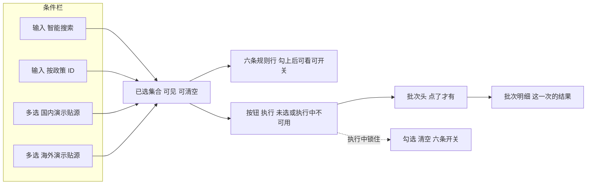

# 602 选择政策 · 清洗页签线框

口径只认说明书「#### 602」。页在「智能政策库构建」的清洗页签。控件按 Arco 同类写名：选择、输入、多选、开关、按钮。不写实现。页眉库级计数不随这一选改口径。候选来自演示贴源。表在、当前行一条都没有，才写「这一源还没有贴源数据」。表不存在是「读取失败」。不出现只在政策主表里有的政策。已选集合旁有按钮「执行」。一条都没选时不可用。执行中不可用。没点之前不跑。「执行」只是这一页上的按钮，不画成已定的接口或作业。

## 一页

```
┌ 智能政策库构建 / 清洗 ─────────────────────────────────────────────────────────┐
│ 页眉库级计数（本页选择不改它的口径）                                            │
├ 条件栏 · 选择（多选）「选择政策」──────────┬ 右侧 ──────────────────────────────┤
│ 输入「智能搜索」                           │ 规则行 ×6                          │
│   国内：标题、文号或发文部门               │   勾上后可看、可开关               │
│   海外：只按标题                           │   执行中：六条开关不可用           │
│   文号和发文部门不参与海外搜索             │   规则名、作用范围、启用或停用     │
│   也不把没搜到说成该 ID 不存在             │   没点「执行」前无本批判定或命中   │
│   从贴源里勾选                             │   不写成功，也不写成已经清洗过     │
│ 输入「按政策 ID 检索」                     │                                    │
│   贴源政策 ID，精确查                      │ 批次头                             │
│                                            │   没点「执行」前：空               │
│ 国内 · 多选 · 演示贴源                     │   不写成功，也不写成已经清洗过     │
│   每行：标题，辅文号、发文部门、发布日期   │   点了才有：批次名、这次条数       │
│   表在、当前行一条都没有，才写             │                                    │
│     「这一源还没有贴源数据」               │ 批次明细                           │
│   表不存在是「读取失败」                   │   没点「执行」前：空               │
│ 海外 · 多选 · 演示贴源                     │   点了才出现这一次的结果           │
│   每行：标题，辅发布机构、发布日期         │   批次、判定或命中、脱敏样例       │
│   表在、当前行一条都没有，才写             │   更新时间、状态                   │
│     「这一源还没有贴源数据」               │   成功：能判定的都过了、           │
│   表不存在是「读取失败」                   │     没有失败样例                   │
│                                            │   部分：既有过的也有失败样例，     │
│ 执行中：勾选不可用                         │     或者有的能判定、               │
│ 两条入口进同一个已选集合                   │     有的仍无加工事实               │
│ 已选可见（标题可辨国内 / 海外）            │   失败：能判定的都带失败样例       │
│ 按钮「执行」（旁靠已选集合）               │   读取失败和无加工事实不占用这三句 │
│   一条都没选时不可用                       │   改了勾选或开关：旧结果留着       │
│   执行中不能再点                           │   标明还不是最新一次               │
│   改勾选或开关不自动跑                     │                                    │
│ 按钮「清空」一次清掉，回到未选             │                                    │
│   执行中不可用                             │                                    │
└────────────────────────────────────────────┴────────────────────────────────────┘
```



「执行」是这一页上的按钮。点了才按当前勾选和当前启用的规则，让批次头和批次明细出现这一次。不把它画成已定的接口或作业。谁读贴源不画成接口，线框仍只画这一页上的块。改勾选或开关不自动再跑。执行中勾选、清空、六条开关都不可用，「执行」不能再点。跑完之后再改勾选或开关，旧结果留着，标明还不是最新一次。

智能搜索：国内按标题、文号或发文部门。海外只按标题。文号和发文部门不参与海外搜索，也不把没搜到说成该 ID 不存在。从贴源里勾选。

## 六条规则行

勾上至少一条、还没点「执行」时，六条都能看，每条都能启用或停用。重新打开这一页时，六条规则都是启用，开关不画成会记住上次。执行中六条开关不可用。本批判定或命中只在点过「执行」之后出现。没点之前不写这些条数，不写成功，也不写成已经清洗过。

停用的行仍留在列表里，标明「停用」。点「执行」时本批不计入它。

| 规则 | 作用范围 | 本批判定或命中 | 开关 |
|---|---|---|---|
| 去重合并 | 标题、文号、效力级别 | 「应合并」。不改贴源原文 | 启用 / 停用 |
| 格式标准化 | 发布日期、文号、PDF 转文本 | 「待标准化」。不改贴源原文 | 启用 / 停用 |
| 噪声过滤 | 扫描件乱码、重复附件 | 本批判定条数 | 启用 / 停用 |
| 完整性校验 | 缺发布日期、缺发文机关 | 本批命中，加一条脱敏失败样例 | 启用 / 停用 |
| 一致性校验 | 效力级别与发文主体对不上 | 本批命中，加一条脱敏失败样例 | 启用 / 停用 |
| 准确性校验 | 文号、日期、机关与原文对不上 | 对上演示行时，点过「执行」后给出看得出是演示的数，旁边标明「演示」。这一条没有演示行时写「这一条还没有演示数」，不出现 0，不写成已经按原文核过。不画表名 | 启用 / 停用 |

去重合并、格式标准化只是判定文案，贴源行保持原文。上表的结果文案只在点过「执行」之后出现。

## 批次明细

只表示点「执行」之后的这一次。没点之前，批次头和这里都是空的，不写成功，也不写成已经清洗过，也不写成无加工事实。

点「执行」才按当前勾选的政策和当前启用的规则跑这一批，然后这里出现这一次的结果。不画正式事实表，不画作业。列：批次、判定或命中、脱敏样例、更新时间、状态。批次头同时出现：批次名，条数等于点「执行」时勾上的条数。

有与六条规则对应的加工事实时，状态是「成功」「部分」「失败」里的一种。能判定的都过了、没有失败样例，是成功。既有过的也有失败样例，或者有的能判定、有的仍无加工事实，是部分。能判定的都带失败样例，是失败。读取失败和无加工事实不占用这三句。已经点过「执行」之后仍然没有这种事实时，命中处空白，状态不写成成功。`script_state` 对不上这六条，不当成清洗结果。

正在跑时，这里标明执行中。勾选、清空、六条开关都不可用。「执行」不能再点。先不写成成功，也不写成已经清洗完。

跑完后又改勾选或开关：批次头和这里的旧结果留着，标明还不是最新一次。不自动跑。要再点「执行」才按新的选择重跑。

清空选择后回到未选。

## 状态

每种只写哪一块变成什么。

| 状态 | 哪一块变成什么 |
|---|---|
| 未选 | 一条都没勾。「执行」不可用。规则区、批次头、批次明细都空，不出现 0，不出现「成功」 |
| 未执行 | 已经勾了至少一条，还没点「执行」。规则行可以看、可以开关。批次头和批次明细是空的，不写成功，也不写成已经清洗过，也不写成无加工事实。「执行」可以点 |
| 执行中 | 同一次选择正在跑。界面上标明还在执行。勾选、清空、六条开关都不可用。「执行」不能再点。先不写成成功，也不写成已经清洗完 |
| 贴源无数 | 表在、当前行一条都没有，才写「这一源还没有贴源数据」。不把刚输入的 ID 说成不存在。表不存在不写这一句 |
| ID 不在贴源 | 这一源有数据，按政策 ID 对不上。该输入下提示「该 ID 不在贴源」。不改去政策主表找 |
| ID 未命中 | 这一源有数据，智能搜索打了词但没有可勾的行。该输入下提示这次没搜到，不说成该 ID 不存在。已经勾上的政策保持不动 |
| 规则停用 | 该规则行仍在，标明停用。点「执行」时本批不计入它的命中 |
| 无加工事实 | 已经点过「执行」。启用的规则行还在。除准确性以外，没有对应加工事实时命中处空白，批次明细状态不写成成功，不出现 0。没点「执行」之前不会出现这一句。这和「未选」「未执行」「读取失败」不是同一句 |
| 没有演示行 | 点过「执行」之后，准确性这一条没有演示行，写「这一条还没有演示数」。不出现 0，不写成已经按原文核过，不画表名。对上演示行才给出看得出是演示的数，旁边标明「演示」。这和「无加工事实」「读取失败」不是同一句 |
| 读取失败 | 表不存在是「读取失败」。候选或本批结果读不出来的那一块标明「读取失败」。已经显示出来的区块保持原样，不改写成成功，也不改写成「没有加工事实」，也不写成「这一源还没有贴源数据」 |

## 已定

1. 候选来自演示贴源。表在、当前行一条都没有，才写「这一源还没有贴源数据」。表不存在是「读取失败」。
2. 谁读贴源不画成接口，线框仍只画这一页上的块。
3. 对上演示行时，点过「执行」后给出看得出是演示的数，旁边标明「演示」。这一条没有演示行时写「这一条还没有演示数」，不出现 0，不写成已经按原文核过。不画表名。
4. 重新打开这一页时，六条规则都是启用，开关不画成会记住上次。
