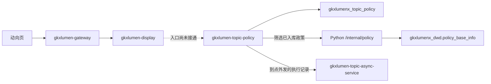
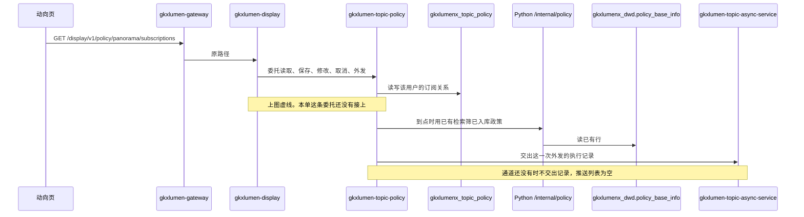

# E-E7-POLICY-M1-L11 · 专题政策门面内的政策订阅与外发

- 日期：2026-11-03
- 任务：`E-E7-POLICY-M1-L11`（定义）
- 监管：`human:淮政玮`
- claimed_by：`agent:arch-agent`（已认领，本单不重复认领）
- ponytail: off
- 用户故事：`US-DS-POL-02` · SRS 序号 204
- 上游：`POL-L2-DS10-TREND-ARCH` 第 7.1 节；说明书第 11 节
- 图：`E-E7-POLICY-M1-L11-SEQ`（本叶新图，无 frontmatter，会签态 `draft`）

本单只定 `gkxlumen-topic-policy` 内部的订阅与外发。不写代码，不写建表 SQL，不写 OpenAPI 字段表。不改 Java。入口尚未接通。

## 1. 读到的现状

只读了 `PolicyFacadeController`。门面上已有检索（`search`）、正文（`docs`）、指标（`metrics`）、分布（`indicators`）。全仓没有订阅映射，没有 `subscriptions` 字样。

工作区里若另有排序、收藏、导出，那是别的叶子的未提交改动。本单不把这些改动当成订阅入口，也不把它们写成已经接通。

`GET /display/v1/policy/panorama/subscriptions` 仍是动向页上序号 204 的浏览器资源。展示服务今天没有把保存、修改、取消、读取和外发委托到本门面。本单不补这条委托。

## 2. 序号 204 要保存的关系

需规要保存的是用户自己的订阅条件，对到已经入库的政策：

| 要保存的 | 取值 |
|---|---|
| 政策类别 | 用户填写的类别 |
| 行业领域 | 用户填写的领域 |
| 发布部门 | 用户填写的部门 |
| 地区 | 用户填写的地区 |
| 频率 | 日、周、月，一条只取一个 |
| 通道 | 系统通知、邮件、短信，一条可以选一个或多个 |

用户可以修改同一条上的条件、频率和通道，也可以取消。取消之后这条不再到点外发，也不再出现在该用户的有效列表里。一个用户可以有多条。一条都没有，列表就是空的。

这条服务对的是已经入库的政策。不新开抓取，不重建来源站点，不改序号 203 的入库链。

序号 201 的收藏是「用户 + 政策 id」，走收藏关系。序号 212 的企业匹配仍走 `jobs` 上已见的匹配模型，读 `ads.policy_match`。204 不占用这两条。

`FE-POL-01B` 的 localStorage 订阅和「立即推送」是页面演示。本单不把演示写成服务。

## 3. 调用链

浏览器只打这一条：

`GET /display/v1/policy/panorama/subscriptions`

接通之后的一次读取与到点外发：

`gkxlumen-display` 不保存订阅关系，不跑定时，不发系统通知，不发邮件，不发短信，不把订阅写进 `gkxlumen-element` 或 ADS。保存、修改、取消、读取和外发全部由它委托给 `gkxlumen-topic-policy`。浏览器不改打 `/topic/v1/policy`。

这不是把 `E-E7-POLICY-M1-L06` 改成展示联调单。`L06` 仍停在专题侧。

身份取已经鉴权的用户。门面不采用调用方在请求体里自填的 `user_id`。展示委托时只带它已经拿到的鉴权用户，关系仍写在门面库。

## 4. 关系落在哪里，存什么

关系落在门面自己的库 `gkxlumenx_topic_policy`。与检索历史、收藏、导出记录同库，但是另一份关系。

不进 ODS，不进 DWD，不进 ADS，不进 `gkxlumenx_gapfill`。不用态势模块已经落在 `gkxlumenx` 的用户行为表。`ARCH-DISPLAY-01` A15 仍只管其他展示页的订阅，序号 204 不改去那套表。

本单只定这份关系要存的内容，不写建表 SQL，不建表：

- 鉴权用户
- 四项条件：政策类别、行业领域、发布部门、地区。某一项空着，表示这一维不加限制
- 频率：日、周或月
- 用户选中的通道：系统通知、邮件、短信
- 这条是否仍有效。修改改的是条件、频率、通道；取消使它退出有效列表
- 上次已经外发对到的入库位置。下一次只推相对这个位置新入库、且仍符合条件的政策。这个位置是水位，不是文案，不是命中快照，不是推送记录

关系里不放政策正文，不放生成的推送文案，不放命中列表，不放收藏用的政策 id，不放匹配分。

说明书第 11 节：用户自己的订阅条件不灌假记录。没有记录就返回空。204 不建缺项表。

库地址还没指到这套关系，或入口还没接上时，不得造一条订阅来顶上。

## 5. 筛选已经入库的政策

到点筛选走门面已有的检索，再进 Python `/internal/policy`，读 `gkxlumenx_dwd.policy_base_info` 的当前行。不另写目录引擎，不写这张表，不新开抓取。

四项条件对到这张表上已经有的列，与检索叶已经签收的读法相同：

| 订阅条件 | 对到已入库行 |
|---|---|
| 政策类别 | `policy_type` |
| 行业领域 | 已有检索的行业条件。Java 不解释产业码 |
| 发布部门 | `publish_organization` |
| 地区 | `province`、`city` |

`theme` 仍不是已经闭合的主题分布。部门不新造指标。产业覆盖率不挂到这条订阅上。

这一次没有命中：不造政策，不删用户的订阅关系，这一拍没有要推的内容。

## 6. 到点外发

频率写在订阅关系上。展示服务不跑定时。本单不部署调度器，也不把日、周、月写成展示侧已有调度。到点判断属于门面，由 `E-E7-POLICY-M1-L12` 接到门面上。接到之前没有外发。

到点后，门面按第 5 节筛出新入库且符合条件的政策，把这一次外发的执行记录交给 `gkxlumen-topic-async-service`。执行记录不是订阅关系。关系仍留在 `gkxlumenx_topic_policy`。

执行记录只记这一拍：哪一条订阅、哪一个频率刻度、对到哪些已入库政策、走用户选中的哪条通道、这一拍的结果。不在这里保存第二份政策正文。

Java 不生成推送文案，不调用未注册模型，不把 204 送进 Python 去写一段通知。外发内容只取命中行上已经有的字段：标题、发布部门、地区、类别、发布时间，以及该行已经有的正文。不润色，不补写。

204 不进全景 `jobs`。`gkxlumen-topic-async-service` 现有的分析任务继续给序号 212 等已见模型用。订阅外发不登记新模型，不复用匹配模型的 URL，不因此去调未注册的 `/internal/*`。

系统通知、邮件、短信现在都没有可发送的通道。通道还没有时，门面不向异步服务交执行记录，读取到的推送记录是空列表。用户保存了订阅条件，也不制造推送历史。空的推送列表不把本叶改判成外发已上线，也不把 D4 改绿。

`E-E7-POLICY-M1-L10` 里检索分享的邮件空态是导出叶子，不是这三条通道。

没有选定任何通道的订阅不产生外发。

## 7. 空列表的两种情况

入口尚未接通。本单不把 `gkxlumen-display` 写成已经委托门面，也不允许展示或门面返回手写订阅、假推送来填这个口。

入口接上之后：

- 该用户没有仍有效的订阅：订阅列表为空。空列表是正常结果，不用 501 代替，也不在返回语句里写死一条订阅。
- 外发通道还没有：推送记录为空列表。订阅条件本身仍按库里的行返回。不把空的推送记录说成外发已上线。
- 读订阅失败：不清空动向页上已经返回的时序、地域分布和入库列表。

## 8. 后续单

| 任务 | 监管 | 本单与它的边界 |
|---|---|---|
| `E-E7-POLICY-M1-L12` | `human:淮政玮` | 在 `gkxlumen-topic-policy` 实现第 4–6 节。展示侧只加委托，不写订阅业务。本单不认领、不实现 |
| `E-E7-POLICY-M1-L13` | `human:淮政玮` | 测试这条委托和外发。页面 localStorage 与「立即推送」不算通过。本单不认领、不实现 |

## 9. 本单不做

- 不写代码，不改 `lumen-svc-platform`，不写建表 SQL，不写 OpenAPI 字段表。
- 不把订阅入口写成已经接通，不把外发写成已经上线。
- 不灌假订阅，不建 `gapfill_` 订阅表。
- 不新造 `metric_id`，不改 D4。
- 不把 `E-E7-POLICY-M1-L06` 改成展示联调单。
- 不认领 `L12`、`L13`。
- 不改 task-registry，不把本任务标成 done，不写会签通过。

2026-11-03 human:淮政玮 签收本架构。入口仍未接通，不灌假订阅。
