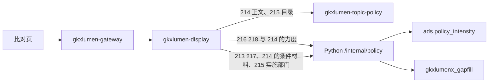

# POL-L2-DS10-CMP-ARCH · 科创政策全景 · 政策重点比对

- 任务：`POL-L2-DS10-CMP-ARCH`
- 日期：2026-11-03
- 监管：`human:淮政玮`
- 认领：`agent:arch-agent`
- 强度：ponytail off（定义任务，不缩文档）
- 图：`POL-L2-DS10-CMP-ARCH-SEQ`（本叶新图，源文件无 frontmatter，记 `draft`）

本叶只定科创政策全景二级「政策重点比对」的实现架构和整体流程。SRS 序号 **213–218**。用户故事 `US-DS-POL-04`。不写 OpenAPI 字段、请求体、响应体、枚举。那是 `POL-L2-DS10-CMP-API`。

上游只引用，不改写：`科创政策全景.md` 213–218、说明书第 2 节 DS-10 与第 11 节、`sdd/调用链与边界.md`、`sdd/契约输入清单.md` 的 `version-diff` / `benchmark-report`、`sdd/指标与501.md` 213–218。不新造 `metric_id`，不改 D4。

签收标准（`human:淮政玮`，2026-11-03）：可实现才签收。真算、真查或真模型做不到时，只接受新建表、把 mock 写入表、接口读表。不允许接口直接返回 mock。本叶按这个标准写迁移之后的架构。

## 1. 范围

六叶都在全景比对工作区里完成，不另开页，不另开路径。

| 序号 | 叶子 | 需规摘要 | 本叶流程 |
|---|---|---|---|
| 213 | 政策新旧对比 | 同一政策两个时点，高亮新增、修改、删除，并给出变化统计 | 没有版本对比模型。读缺项表 |
| 214 | 政策详情对比 | 多项政策在申报时间、部门、产业、条件、力度、材料上的差异 | 时间、部门、产业读已有正文。力度读已有力度表。条件与材料读缺项表 |
| 215 | 部门政策对比 | 按区域实施部门，从项目类别、技术类别看扶持件数和清单 | 区域和类别读已有目录。实施部门收集不到，读缺项表。不新造部门指标 |
| 216 | 标杆比对功能 | 选对标范围、对象和字段，看支持力度 | 读力度评估已经写入的支持力度。不新建表 |
| 217 | 对标报告生成与导出 | 差异、优劣、借鉴建议，在线查看并可导出 | 没有报告模型。正文读缺项表。不灌假文件 |
| 218 | 对标结果可视化展示 | 雷达、柱、热力看地区或政策的差异 | 读同一张力度表。不另建可视化缺项表 |

215、216 的 D4 仍是 `mock`。`GDF-POLICY-MOCK-GATE-L01` 仍是 blocked。闸门未解开时，正式值仍是 mock。本叶不把 mock 写成已上线。

## 2. 实现架构

浏览器只打 `/display/v1/policy/**`。不改打 `/topic/v1/policy`，不打开算法中台页面，不打 `/v1/policy/**`。

| 叶子 | 资源 | 迁移后的读法 |
|---|---|---|
| 213 | `GET /display/v1/policy/panorama/version-diff` | `gkxlumen-display` 不直连库。转发到 Python `/internal/policy` 只读查询 `gkxlumenx_gapfill.gapfill_policy_version_diff` |
| 214 时间、部门、产业 | `GET /display/v1/policy/panorama/search` 与 `{id}/detail` | 内部委托已有 `gkxlumen-topic-policy`。不另开对比查询 |
| 214 力度、216、218 | `POST /display/v1/policy/panorama/jobs` | 增加 `sub_type=policy_intensity`。Python 调用已有 `polan.eval.intensity.run`，再读 `ads.policy_intensity` |
| 214 条件、材料 | `GET /display/v1/policy/panorama/{id}/detail` | 同一次详情读。Python 只查 `gapfill_policy_detail_compare` 的申报条件、申报材料。不把这两列写进接口常量 |
| 215 区域、类别 | `GET /display/v1/policy/panorama/stats` 与 `search` | 区域走已有地区分布。项目类别、技术类别走已有选项。总件数仍用 `M_POLICY_TOTAL_COUNT` |
| 215 实施部门 | `GET /display/v1/policy/panorama/stats` | 同一次统计读。Python 只查 `gapfill_policy_impl_dept`。现网收集不到实施部门，不按发布机构去重，不另开路径 |
| 217 | `GET /display/v1/policy/panorama/benchmark-report` | 只查 `gapfill_policy_benchmark_report`。导出内容从读到的行生成 |

`gkxlumen-display` 不直连库，不写算法，不写 nGQL。`E-E7-POLICY-M1-L06` 不是本页路径。

## 3. 各对比的输入条件

条件只来自需规原文。下表是用户要提交的选择，不是参数名，也不是响应字段。参数名留给 `POL-L2-DS10-CMP-API`。未列出的条件不收。少了必选条件时，该对比空，不补一套默认对象。

| 序号 | 用户要选 | 必选 | 闭集 | 落到哪次读取 |
|---|---|---|---|---|
| 213 | 一条政策；两个时点 | 政策和两个时点都要有 | 时点就是该政策的发布时间，不另编版本号，不接受任意日期 | `version-diff` 按这条政策和两个发布时间查缺项表 |
| 214 | 至少两条政策；要对比的维度 | 至少两条政策。维度不选则六维都出 | 申报时间、受理部门、产业类别、申报条件、支持力度、申报材料 | 时间、部门、产业读已有正文。力度读 `ads.policy_intensity`。条件、材料读缺项表。未勾选的维不读 |
| 215 | 区域；至少两个实施部门；看项目类别还是技术类别 | 至少两个部门。区域可不选 | 方面只有项目类别、技术类别。项目类别用已有政策类型，技术类别用已有产业条件。部门只来自缺项表 | 区域和方面走已有目录。实施部门只读缺项表。不把部门件数登记成新指标 |
| 216 | 对标范围；至少两个对标对象；对标字段 | 范围、至少两个对象、至少一个字段 | 范围只有全球科创领先城市、国内先进地区。字段只有政策类型、支持力度、覆盖范围 | `policy_intensity` 按这些对象和已勾字段读 `ads.policy_intensity` |
| 217 | 沿用 216 的对象和字段；是否导出以及格式 | 没有 216 的选择则报告空。导出可不做 | 格式只有 PDF、Word | `benchmark-report` 用同一组对象和字段查缺项表。不选格式则只在线看行 |
| 218 | 沿用 216 的对象和字段；看地区还是看政策；图种 | 对象和字段沿用 216。图种不选则不出图 | 对象视角只有地区、政策。图种只有雷达、柱状、热力 | 同一张力度表。政策视角用 214 已选的政策，不另收一批政策 |

215 的区域对已有地区分布。项目类别、技术类别对已有政策类型和产业节点。实施部门对不上发布机构，不按发布机构筛目录。216 未勾选的字段不进 217 的报告，也不进 218 的图。

### 3.1 条件从哪来

对照了两处 demo 和现网 lumen。展示原型 `demo-ui-science` 的 `PolicyPanorama.jsx` 不调接口，选项都在 `policyData.js`。算法中台 `demo-ui-system-test` 的政策页调的是 `/v1/policy/**`，不是这六叶的对比窗。lumen 已接通的只有专题门面 `gkxlumen-topic-policy` 上的检索、选项、指标和正文，下游是 Python `/internal/policy/**`。浏览器仍只打 `/display/v1/policy/**`，由 display 内部委托这些门面。不把 `/v1/policy/**` 和 `policyData.js` 迁进来。

| 条件 | demo 里实际从哪取 | lumen 里哪条接口能提供 | 本叶怎么用 |
|---|---|---|---|
| 213、214 的政策 | `policyListData` 本地数组 | `GET /topic/v1/policy/search`，查询参数原样到 `/internal/policy/search`。条目里有政策 id 和标题 | 展示走已有 `panorama/search`。不另开候选接口 |
| 213 的两个时点 | `policyVersionHistory` 本地版本号和日期 | 检索和 `GET /topic/v1/policy/docs/{id}` 的发布时间。下游 `/internal/policy/search` 与 `/internal/policy/docs/{id}` | 时点就是发布时间。展示走已有 `panorama/search` 和 `{id}/detail`。不从缺项表反查可选时点，不迁本地版本号。同一政策只有一个发布时间时，凑不齐两个时点，对比空 |
| 214 的六维、216 的范围和字段、217 的格式、218 的视角和图种 | 页内常量。`DETAIL_COMPARE_DIMENSIONS`、`benchmarkDimensions` 另有需规没写的项 | 无接口 | 保持第 3 节闭集。不调接口，也不采纳 demo 多出来的维度 |
| 215 的区域 | `deptCompareRegions`：国家部委、广东省、深圳市 | `GET /topic/v1/policy/indicators?kind=national` 与 `kind=sz`，下游 `/internal/policy/indicators`。这是地区分布，不是部委名单 | 展示走已有 `panorama/stats`。桶空则区域下拉空。不迁那三条常量 |
| 215 的实施部门 | `departmentPolicyCompare` 本地部门 | 现网没有部门名单。`search/options` 不返回发布机构去重，底表也收集不到可对上的实施部门 | 做 mock。表 `gapfill_policy_impl_dept`，Python 灌区域、实施部门、方面、件数和清单标题。浏览器读 `GET /display/v1/policy/panorama/stats`。不扩 `search/options`，不另开路径，不迁本地部门表，不把件数写成新指标。表空则部门下拉空 |
| 215 的项目类别 | `deptPolicyByCategory` 的资金扶持、税收优惠等 | `search/options` 的 `policy_type`，来自 `dwd.policy_base_info` 去重 | 用这条。不用 demo 的五类扶持名 |
| 215 的技术类别 | `deptPolicyByTech` 的人工智能、生物医药等 | `search/options?industry_code=` 的 `nodes`，来自 `dwd.industry_chain_node`。不传产业码则 `nodes` 为空 | 用这条。没有节点则技术类别空 |
| 216、218 的对标对象 | `benchmarkRegions`：北京、上海、硅谷等，带写死分数 | 算法中台 `GET /v1/policy/analysis/intensity?scope_type=province` 读 `ads.policy_intensity`。lumen 同一函数在 vendor，但只挂了 `/v1`，专题门面没有转发 | 展示不打 `/v1`。对象从 `ads.policy_intensity` 已有的地区范围读出，走本叶 `policy_intensity` 同一次读取。没有海外城市。demo 的硅谷等不迁 |
| 214 的力度值、216 的支持力度 | 政策对象上的本地字段，或标杆数组里的 `score` | 同上，力度行在 `ads.policy_intensity`。`run()` 已在 `polan.eval.intensity` | 这是结果，不是选项接口。选项选定后才读 |

`search/options` 的下游是 `/internal/policy/search/options`，Python 读 `dwd.policy_base_info` 的去重，不写死词表。读失败时四个列表都空。

## 4. 整体流程

1. 用户做部门对比。区域来自已有 `stats`。项目类别、技术类别来自已有选项。实施部门只读缺项表。选定部门后的件数和清单标题也在这张表里。总件数指标仍是已有政策总数，不把缺项件数登记成新指标。表无行则部门对比空。
2. 用户做详情对比。时间、受理部门、产业类别从已有正文读出。受理部门不是 215 的实施部门，不读部门缺项表。支持力度从 `ads.policy_intensity` 按政策读出。申报条件、申报材料从缺项表读出。某一列无行则该列空。
3. 用户做新旧对比。两个时点用该政策的发布时间，从已有检索和正文带出。前端再调 `version-diff`，用这两个发布时间查缺项表里的增改删。无行则对比空。
4. 用户做标杆比对或看可视化。前端提交 `jobs`，`sub_type` 为 `policy_intensity`。Python 先跑已有 `run()`，再按地区或政策读 `ads.policy_intensity`。表无行则图空。
5. 用户看对标报告。前端调 `benchmark-report`，只读缺项表里的正文。无行则报告空。不返回一份写死的 PDF。

切筛选不自动起任务。某一块读失败，不清空已经返回的目录和正文。

## 5. 分叶

### 5.1 213 政策新旧对比 · 读缺项表

算法中台没有版本对比模块，lumen 也没有两个时点的差异表。真实识别做不到。

- 库 `gkxlumenx_gapfill`，表 `gapfill_policy_version_diff`。不写入 ODS、DWD、ADS。
- 一行是同一政策的一个变更：两个发布时间、变更类型（新增、修改、删除）、一句摘要。时点列填的就是发布时间，不另编版本号。
- 可选时点不从本表读。来源是已有检索和正文上的发布时间。同一政策只有一个发布时间时，对比空。
- 灌数是独立脚本，不是请求处理。执行单 `POL-L2-DS10-CMP-GAPFILL-L01`。
- 两个发布时间对不上行则对比空，不在接口里拼一段高亮。

### 5.2 214 政策详情对比 · 正文 + 力度表 + 缺项表

对照算法中台「力度评估」。计算已在 `lumen-algo-py/vendor/entan-py/polan/eval/intensity.py` 的 `run()`，写入 `ads.policy_intensity`。正式入口还没有把这次计算挂到展示。展示不打开 `demo-ui-system-test` 的力度页，也不打算法中台的 `/v1` 读面。

目标链路与舆情叶的效果、匹配同一条 Job 管道，`sub_type` 用 `policy_intensity`：

1. 浏览器提交 `POST /display/v1/policy/panorama/jobs`。
2. `gkxlumen-display` 走已有分析任务管道，调 `POST /internal/policy/jobs/execute`。
3. Python 调用已有 `polan.eval.intensity.run`，再按所选政策读 `ads.policy_intensity` 的力度分。Java 不打分，不抄公式。
4. 申报时间、受理部门、产业类别继续读专题门面已有正文。这三列不进缺项表。
5. 申报条件、申报材料没有字段、也没有模型。只建 `gapfill_policy_detail_compare`，按政策放这两列正文。浏览器读 `GET /display/v1/policy/panorama/{id}/detail`，同一次详情把这两列带出。

`M_POLICY_INTENSITY_SCORE` 仍是本行的指标。`M_POLICY_INTENSITY_INDEX` 不挂本页。QPOL-02 的权重保持待确认。D4 保持 mock。三维缺数据时，`run()` 写不出力度分就让该格空，不在接口里补一个分数。

`sub_type` 尚未放行时，这次 Job 的力度结果为空，不返回演示分。

### 5.3 215 部门政策对比 · 目录加部门缺项表

指标只用已有 `M_POLICY_TOTAL_COUNT`。不新造部门指标，不把门户扶持十条写成这页的任务。

区域走已有地区分布。项目类别、技术类别走已有政策类型和产业节点。

实施部门在现网收集不到，检索选项里也没有发布机构去重。建 `gapfill_policy_impl_dept`。一行有区域、实施部门、方面（项目类别或技术类别）、件数、清单标题。Python 灌这些行。浏览器读 `GET /display/v1/policy/panorama/stats`，同一次统计把这些行带出。不另开路径。不在接口里写部门名单，不把 demo 的部门常量迁进来，不把件数登记成新指标。方面的取值仍用已有词表里的政策类型或产业节点，不把 demo 的扶持类、技术类写进这张表。

目录按发布机构筛不到这些部门。清单标题只在缺项表里，不写入政策底表。标题对不上已有政策时只显示标题，不编详情。表无行则部门对比空。

### 5.4 216 标杆比对功能 · 读已有支持力度

指标 `M_POLICY_SUPPORT_STRENGTH`，COMPUTE，D4=mock。算法中台的 `intensity.run()` 已把支持力度和力度评分写在同一次计算里。本叶不另建支持力度表，也不把这一行放进 `POL-L2-DS10-CMP-GAPFILL-L01`。

对标范围、对标对象、勾选字段是这次查询的条件。读到的是 `ads.policy_intensity` 里已有的支持力度。金额档缺失时该维空，不在接口里补档位。对标报告正文不在本叶生成，见 217。

### 5.5 217 对标报告生成与导出 · 读缺项表

没有对标报告模型。核增研报 `report/jobs`（614–618）和检索分享 `share` 不是这条资源。

- 表 `gapfill_policy_benchmark_report`。
- 一行有对标对象、对照字段、差异、优劣、借鉴建议、报告正文。正文写在行里。
- `GET benchmark-report` 只查询。导出若要文件，从这次读到的行生成，响应里不内嵌一份写死的 PDF 或 Word。
- 不写对象存储。不建邮件。

### 5.6 218 对标结果可视化展示 · 读力度表

雷达、柱、热力的数来自 `ads.policy_intensity` 里 214、216 已经读到的力度与支持力度。不建 `gapfill_policy_benchmark_viz`。图上若只画件数，仍用 215 的目录命中，不改挂成力度分。

`M_POLICY_INTENSITY_INDEX` 不挂本页。无行则图空，不返回演示序列。

## 6. 点名排除

| 资源或序号 | 不纳入本二级的原因 |
|---|---|
| `rank`、`favorites`、`share` | 序号 199、201、202 |
| `ingest`、`subscriptions` | 序号 203、204 |
| `feedback`、`assessment-report` | 序号 210、211。211 不是 217 |
| 205、206 | 热点、主题分布。不是对标可视化 |
| `compare/jobs`、`report/jobs` | 核增对比与研报 |
| 门户扶持十条 | 不是部门件数 |

## 7. 明确不做

- 不写 OpenAPI 字段表。
- 不新造 `metric_id`。不改 D4。不把 `GDF-POLICY-MOCK-GATE-L01` 写成已解开。
- 浏览器不改打专题 URL。不把 `E-E7-POLICY-M1-L06` 写成展示路径。
- 不重开 GDF，不写 nGQL。不加 ODS、DWD 表。213、214 的条件与材料、215 的实施部门、217 只加第 9 节的 `gapfill_` 表。
- 不在本叶展开参数名。输入条件只到第 3 节的闭集。
- 不在本叶改 Python 或 Java。力度的预计实现是挂已有 `polan.eval.intensity.run`。
- 不允许接口函数直接返回 mock。
- 不会签。不把本单标 done。

## 8. 签收条件：可实现

六叶都有一条现在就能照着做的链路。写成「以后再选算法」，或者接口直接返回写死的差异、分数、报告，本单不可签收。

| 序号 | 可实现的做法 | 现在就能用的代码或表 |
|---|---|---|
| 213 | 时点用已有发布时间。差异建 `gapfill_policy_version_diff`，`version-diff` 只查这张表 | 检索和正文已有发布时间。算法中台没有版本对比 |
| 214 | 正文走已有门面；力度走 `policy_intensity` 读 `ads.policy_intensity`；条件与材料查 `gapfill_policy_detail_compare` | `polan.eval.intensity.run` 已在 vendor |
| 215 | 区域和类别走已有目录。实施部门建 `gapfill_policy_impl_dept`，只查这张表 | 实施部门收集不到。总件数仍是 `M_POLICY_TOTAL_COUNT` |
| 216 | 同一次 `policy_intensity` 读支持力度 | 同一份 `run()`，不另建表 |
| 217 | 建 `gapfill_policy_benchmark_report`，报告只查这张表 | 算法中台没有对标报告生成 |
| 218 | 图读 `ads.policy_intensity` | 不建可视化缺项表 |

迁移边界：算法中台页面留在 `demo-ui-system-test`。展示不嵌力度页。`/v1` 读面继续给算法中台自己用。展示走 `/internal/policy/jobs/execute` 的新 `sub_type`。不把 `intensity.py` 抄进 Java。门户十条不得改挂到力度指数、力度评分或产业覆盖率，vendor 里已有这段拒绝。

## 9. 表与要灌的 mock

界面上要出现、而真实版本差、申报条件、申报材料、实施部门、对标报告还没有的内容，先写入表。接口只查询。D4 保持 mock。字段级 DDL 由 `POL-L2-DS10-CMP-DATA` 定。灌数由 `POL-L2-DS10-CMP-GAPFILL-L01` 执行，本叶不执行。

| 序号 | 库表 | 新建 | 要灌的 mock | 不灌 |
|---|---|---|---|---|
| 213 | `gkxlumenx_gapfill.gapfill_policy_version_diff` | 是 | 政策、两个发布时间、变更类型、一句摘要 | 版本号、高亮 HTML、假 diff 文件。可选时点不灌在这张表 |
| 214 条件、材料 | `gkxlumenx_gapfill.gapfill_policy_detail_compare` | 是 | 政策、申报条件、申报材料 | 时间、受理部门、产业、力度分 |
| 214 力度、216、218 | `ads.policy_intensity` | 否 | 由已有 `run()` 写入。缺维则该格空 | 接口里的演示分。不建 `gapfill_policy_benchmark_viz` |
| 215 实施部门 | `gkxlumenx_gapfill.gapfill_policy_impl_dept` | 是 | 区域、实施部门、方面、件数、清单标题 | 发布机构去重、假政策正文、新的部门指标 |
| 215 区域、类别、总件数 | 已有地区分布、选项和 `M_POLICY_TOTAL_COUNT` | 否 | 不新灌 | 把缺项件数改挂成政策总数 |
| 217 | `gkxlumenx_gapfill.gapfill_policy_benchmark_report` | 是 | 对标对象、字段、差异、优劣、借鉴、正文 | PDF、Word、对象存储、核增研报 |

缺项表的行要能按第 3 节的条件拣出来：213 按政策和两个发布时间，214 按政策，215 按区域、实施部门和方面，217 按 216 的对标对象和已勾字段。条件对不上的行不返回。

灌数单执行人是 `data-agent`，监管 `human:淮政玮`，状态 backlog。它依赖本架构和 `POL-L2-DS10-CMP-DATA`。查询请求不灌数。
