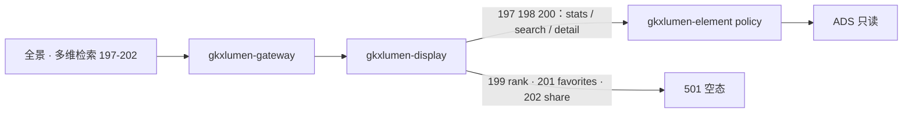

# POL-L2-DS10-QRY-ARCH · 科创政策全景 · 多维检索查询

- 任务：`POL-L2-DS10-QRY-ARCH`
- 日期：2026-11-03
- 监管：`human:淮政玮`
- 认领：`agent:arch-agent`
- 强度：ponytail off（定义任务，不缩文档）
- 图：`POL-L2-DS10-QRY-ARCH-SEQ`（本叶新图，源文件无 frontmatter，记 `draft`）

本叶只定科创政策全景二级「多维检索查询」的实现架构和整体流程。SRS 序号 **197–202**。用户故事 `US-DS-POL-01`。不写 OpenAPI 字段、请求体、响应体、枚举。那是 `POL-L2-DS10-QRY-API`。

上游只引用，不改写：`科创政策全景.md` 197–202、说明书第 2 节 DS-10 与第 3–6 节、`sdd/调用链与边界.md`、`sdd/契约输入清单.md` 全景五条、`survey/DS-10.md` 197–202、`POL-DISPLAY-长任务总控.md`。不新造 `metric_id`，不改 D4。

## 1. 范围

六叶都在检索工作区里完成，不另开页，不另开路径。

| 序号 | 叶子 | 需规摘要 | 本叶流程 |
|---|---|---|---|
| 197 | 多维度检索条件设置 | 多源政策按类别、行业领域、发布部门、地区做筛选，并给出全景统计 | 同步读 ADS |
| 198 | 高级检索功能 | 关键词、发布机构、效力级别、政策状态，以及 AND / OR / NOT 组合 | 同步读 ADS |
| 199 | 检索结果智能排序 | 需规要按相关性、时效性、重要性智能排；已有判定没有排序模型 | 501 空态 |
| 200 | 检索结果筛选与分类 | 在已有结果上再按类型、时间、地域筛选，并按类别分组 | 同步读 ADS |
| 201 | 检索历史与收藏 | 需规要记录检索历史并收藏政策；已有判定没有用户态服务 | 501 空态 |
| 202 | 检索结果导出与分享 | 需规要导出文件并以链接或邮件分享；已有判定没有导出或邮件服务 | 501 空态 |

197、198、200 的 D4 仍是 `mock`。`GDF-POLICY-MOCK-GATE-L01` 仍是 blocked。闸门未解开时，正式值仍是 mock。本叶不把 mock 写成已上线，也不把该闸门写成已解开。

## 2. 实现架构

本二级只用全景已有五条，不新开路径。前缀 `/display/v1/policy/`。

| 叶子 | 资源 | 流程 |
|---|---|---|
| 197、198、200 | `GET /display/v1/policy/panorama/stats`、`GET /display/v1/policy/panorama/search`、`GET /display/v1/policy/panorama/{id}/detail` | 同步。前端 → 网关 → `gkxlumen-display` → `gkxlumen-element` → ADS |
| 199 | `GET /display/v1/policy/panorama/rank` | 501。`gkxlumen-display` 直接返回，不进 element，不进 Python |
| 201 | `GET /display/v1/policy/panorama/favorites` | 501。同上 |
| 202 | `GET /display/v1/policy/panorama/share` | 501。同上 |

契约输入清单把 `rank`、`favorites`、`share` 写在「同步或 Job」列的「同步」下，意思是它们是 GET，不是 Job。成功时读为「未见」。按该清单的读法，以及 `sdd/指标与501.md`，这三条调用直接 501，不建任务。本叶据此写成 501 空态，不把「同步」理解成去读 ADS。

同步三条的物理跳与 `sdd/调用链与边界.md` 第 2 节一致。`gkxlumen-display` 不直连库，不直连 Python。Java 只读 ADS，不写算法，不写 nGQL。

199、201、202 不进 Python，不进 `gkxlumen-topic-async-service`，不复用 `/topic/v1/policy`。`E-E7-POLICY-M1-L06` 不是这五条的实现路径。

501 不清空同页已经返回的统计卡、目录和正文。普通列表排序留在 `search`，不因 `rank` 的 501 被拿掉。

trace 沿既有展示链走。同步三条在 display → element 上带 traceId。501 三条在 display 返回，不另起算法 span。本叶不新设计观测点。

## 3. 整体流程

一次检索按下面六步走。197、198、200 共用前三步，不拆成三套后端。

1. 打开检索。前端经网关调 `stats`。197 读总数和四条分布，198 读时序、三条分布和有效率，200 读类型分布与全国分布。无行则对应统计卡空，不造 0。对齐前数值仍是 mock。
2. 用户设置维度、高级条件或二次筛选。前端调 `search`，读政策目录。布尔组合和二次筛选没有独立 `metric_id`，只是目录查询条件。无命中则列表空，不造 0，也不改判 501。
3. 用户打开一条政策。前端调 `{id}/detail`，读正文。无正文则详情空。力度和匹配不在这条资源上。
4. 用户要求按相关性、时效性、重要性做智能排序。前端调 `rank`。display 返回 501，智能排序空。不返回演示权重 `smartScore`。若用户只按发布时间、效力级别、浏览量排，仍走第 2 步的目录查询，不调用 `rank`。这三列是查询顺序，不是新指标。
5. 用户要看检索历史或收藏。前端调 `favorites`。display 返回 501，历史与收藏空。页面 localStorage 不是这条资源。
6. 用户要导出或分享。前端调 `share`。display 返回 501，导出与分享空。前端表格导出和打印窗不是这条资源。

`stats` 这条资源上还挂着 `M_POLICY_INDUSTRY_COVERAGE`、`M_POLICY_SUPPORT_STRENGTH`。它们分别留给无序号的行业覆盖和序号 216。本二级不改这条资源的读面，也不把这两条写成 197–202 的挂接。

## 4. 六叶

### 4.1 197 多维度检索条件设置 · 同步

读已有资源：

- `stats`：`M_POLICY_TOTAL_COUNT`、`M_POLICY_TYPE_DIST`、`M_POLICY_LEVEL_DIST`、`M_POLICY_NATIONAL_DIST`、`M_POLICY_SZ_DIST`
- `search`：政策目录。类别、行业领域、发布部门、地区落在目录查询上
- `{id}/detail`：打开一条时读正文

链路：前端 → 网关 → `gkxlumen-display` → `gkxlumen-element` → ADS。不进 Python。

空态：不返回 501。无行则统计卡或列表空，不造 0。对齐前数值仍是 mock。D4 保持 mock。类型分布已有口径标记 QPOL-01，本叶不改口径。深圳分布已挂在本叶，页面是否已挂接不在本叶改 `FE-POL-01A`。

不做什么：不新造全景汇总指标替代这五条。不把 `M_POLICY_BASE_100_1` 挂进本叶。不把行业覆盖、支持力度算进本叶。不重开 GDF。

### 4.2 198 高级检索功能 · 同步

读已有资源：

- `stats`：`M_POLICY_TIMESERIES`、`M_POLICY_NATIONAL_DIST`、`M_POLICY_LEVEL_DIST`、`M_POLICY_TYPE_DIST`、`M_POLICY_VALIDITY_RATE`
- `search`：关键词、发布机构、效力级别、政策状态，以及 AND / OR / NOT。布尔组合没有独立 `metric_id`
- `{id}/detail`：打开一条时读正文

链路与 197 相同。布尔组合在 Java 读目录时完成，不进 Python，不单开算法。

空态：不返回 501。无行则对应统计卡或列表空，不造 0。对齐前数值仍是 mock。D4 保持 mock。有效率的 `srs_refs` 为空，本叶不因此新造 id，也不把它从已有挂接上拿掉。

不做什么：不把时序改挂焦点指数。时序、全国分布也出现在 205、206，本叶只用它们服务高级检索字段，不实现重点领域分析和动态可视化。不新造布尔指标。

### 4.3 199 检索结果智能排序 · 501

读已有资源：`GET /display/v1/policy/panorama/rank`。成功读面未见。没有排序模型。

流程：前端 → 网关 → `gkxlumen-display` 直接 501。不进 `gkxlumen-element`，不读 ADS，不进 Python，不建 Job。

空态：智能排序空。不返回 `smartScore`。前端演示权重不是排序服务。

列表仍可按发布时间、效力级别、浏览量排。这三列留在 `search` 的目录查询上，不进 `rank`，也不新造 `metric_id`。需规里的「政策级别」与已有判定里的效力级别是同一排序维。

不做什么：不在本叶注册排序模型。不把普通三列排序改判成智能排序。不因 501 清空已经返回的目录。

### 4.4 200 检索结果筛选与分类 · 同步

读已有资源：

- `stats`：`M_POLICY_TYPE_DIST`、`M_POLICY_NATIONAL_DIST`。类别分组挂类型分布，地域分组挂全国分布
- `search`：在已有命中上再按政策类型、发布时间、地域收窄。二次筛选没有独立 `metric_id`
- `{id}/detail`：打开一条时读正文

链路与 197 相同。二次筛选是目录查询，不进 Python。

空态：不返回 501。无行则分组或列表空，不造 0。对齐前数值仍是 mock。D4 保持 mock。

不做什么：不新造二次筛选指标。不改走 `compare/stats`。深度交叉对比是序号 207 及以后，不在本叶。

### 4.5 201 检索历史与收藏 · 501

读已有资源：`GET /display/v1/policy/panorama/favorites`。成功读面未见。没有用户态服务，收藏卡没有 `metric_id`。

流程：前端 → 网关 → `gkxlumen-display` 直接 501。不进 element，不读 ADS，不进 Python，不建 Job。

空态：检索历史与收藏空。localStorage 不是收藏服务，不把浏览器本地记录写成这条资源的实现。

不做什么：不在本叶建用户态、收藏表或写面。调用链与边界已写明，若以后要做，写面落展示侧、不落专题库；那不在本叶开单。不因 501 清空已经返回的目录和正文。

### 4.6 202 检索结果导出与分享 · 501

读已有资源：`GET /display/v1/policy/panorama/share`。成功读面未见。没有导出服务，也没有邮件或链接分享服务。

流程：前端 → 网关 → `gkxlumen-display` 直接 501。不进 element，不读 ADS，不进 Python，不建 Job。不写对象存储。

空态：导出与分享空。前端表格导出和打印窗不是分享服务。

不做什么：不把本叶写成 Excel、PDF、链接或邮件通道。不把序号 217 的对标报告、核增研报（614–618）或 `report/jobs` 当成全景分享。不因 501 清空已经返回的目录。

## 5. 点名排除

这些全景资源不属于 197–202。本叶不读、不改、不新开替代路径。

| 资源 | 不纳入本二级的原因 |
|---|---|
| `panorama/ingest` | 序号 203 的入库列表 |
| `POST panorama/jobs` | 实施效果、匹配、力度、热点与深度报告 |
| `panorama/subscriptions` | 序号 204 |
| `panorama/feedback` | 序号 210 |
| `panorama/assessment-report` | 序号 211 |
| `panorama/version-diff` | 序号 213 |
| `panorama/benchmark-report` | 序号 217 |

序号 203–218 的边界见下表。本叶不展开它们的流程。

| 序号 | 与本二级的边界 |
|---|---|
| 203 | 来源监控只读已有入库。资源是 `ingest`。不重开 GDF |
| 204 | 订阅与外发。资源是 `subscriptions`。不是收藏 |
| 205 | 趋势另叶复用时序。热点、影响、深度报告走 `jobs`，501。本叶不实现 |
| 206 | 时间轴、热力、趋势另叶。本叶不把高级检索字段写成动态可视化 |
| 207 | 页内并列查看另叶。深度对比不在检索五条里 |
| 208 | 区域差异只消费已有子图。本叶不读图，不走 `E-E7-POLICY-M1-L06` |
| 209 | 实施效果走 `jobs`，501。不是检索排序 |
| 210 | 受众反馈走 `feedback`，501 |
| 211 | 效果评估报告走 `assessment-report`，501。不是 202 的导出 |
| 212 | 匹配与推送走 `jobs`，501。不改展示 URL 去打专题 |
| 213 | 新旧对比走 `version-diff`，501 |
| 214 | 详情对比上的力度走 `jobs`，501。正文读面不带力度 |
| 215 | 部门件数另叶，复用政策总数。本叶不新造部门指标 |
| 216 | 标杆支持力度另叶。本叶不读 `M_POLICY_SUPPORT_STRENGTH` 作为检索结果 |
| 217 | 对标报告走 `benchmark-report`，501。与 `share` 不是同一资源 |
| 218 | 对标可视化走 `jobs`，501。件数若只画统计，仍不改判本叶 |

## 6. 明确不做

- 不写 OpenAPI 字段表、请求体、响应体、枚举。
- 不新造 `metric_id`。不改 D4。不把 mock 写成已上线。
- 不把 `GDF-POLICY-MOCK-GATE-L01` 写成已解开。
- 不消费 `/topic/v1/policy`。不把 `E-E7-POLICY-M1-L06` 写成展示路径。
- 不改 `FE-POL-01A`，不新建前端单。契约冻结前前端继续 mock，本叶不猜字段。
- 不重开 GDF，不加表，不加字段。
- 不改说明书、WBS、注册表、调研分册。
- 不把 199、201、202 送进 Python 或异步 Job。
- 不把 localStorage、`smartScore`、前端导出或打印窗写成服务。
- 不会签。不把本单标 done。
