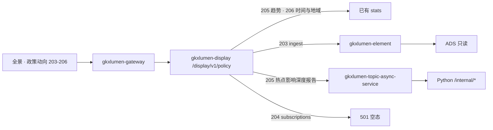

# POL-L2-DS10-TREND-ARCH · 科创政策全景 · 政策动向跟踪

- 任务：`POL-L2-DS10-TREND-ARCH`
- 日期：2026-11-03
- 监管：`human:淮政玮`
- 认领：`agent:arch-agent`
- 强度：ponytail off（定义任务，不缩文档）
- 图：`POL-L2-DS10-TREND-ARCH-SEQ`（本叶新图，源文件无 frontmatter，记 `draft`）

本叶只定科创政策全景二级「政策动向跟踪」的实现架构和整体流程。SRS 序号 **203–206**。用户故事 `US-DS-POL-02`。不写 OpenAPI 字段、请求体、响应体、枚举。那是 `POL-L2-DS10-TREND-API`。

上游只引用，不改写：`科创政策全景.md` 203–206、说明书第 2 节 DS-10 与第 3–6 节、`sdd/调用链与边界.md`、`sdd/契约输入清单.md` 全景里的 `stats` / `ingest` / `jobs` / `subscriptions`、`sdd/指标与501.md` 203–206、`survey/DS-10.md` 这四行、`sdd/l2/POL-L2-DS10-QRY-ARCH.md` 对同一条 `stats` 的内部委托。不新造 `metric_id`，不改 D4。

## 1. 范围

四叶都在全景动向工作区里完成，不另开页，不另开路径。

| 序号 | 叶子 | 需规摘要 | 本叶流程 |
|---|---|---|---|
| 203 | 政策来源监控与更新 | 监控权威站点并给出最新政策列表和详情 | 同步读已有入库。跨项索引第 6 项。不重开抓取 |
| 204 | 政策订阅服务 | 按类别、领域、部门、地区订阅，并按日/周/月经通知、邮件、短信推送 | 501 空态 |
| 205 | 重点领域政策分析 | 重点领域的趋势、热点、影响和深度报告 | 趋势走已有时序。热点、影响、深度报告 501 |
| 206 | 政策动态可视化展示 | 时间轴、热力、趋势，看时间、地域、主题分布 | 时间与趋势走时序。地域热力走全国分布。主题分布不新造指标 |

205 的趋势、206 的时间轴和地域热力，D4 仍是 `mock`。`GDF-POLICY-MOCK-GATE-L01` 仍是 blocked。闸门未解开时，正式值仍是 mock。本叶不把 mock 写成已上线。

## 2. 实现架构

本二级只用全景已有四条，不新开路径。前缀 `/display/v1/policy/`。浏览器只打这个前缀。

| 叶子 | 资源 | 流程 |
|---|---|---|
| 203 | `GET /display/v1/policy/panorama/ingest` | 同步。`gkxlumen-display` → `gkxlumen-element` → 已有 ADS。不委托专题政策门面 |
| 204 | `GET /display/v1/policy/panorama/subscriptions` | `gkxlumen-display` 直接 501。不是收藏，也不进 Job |
| 205 趋势 | `GET /display/v1/policy/panorama/stats` | 同步。读已有 `M_POLICY_TIMESERIES`。不另建查询 |
| 205 热点、影响、深度报告 | `POST /display/v1/policy/panorama/jobs` | Job。模型未见，501 |
| 206 | `GET /display/v1/policy/panorama/stats` | 同步。时间轴和趋势读 `M_POLICY_TIMESERIES`，地域热力读 `M_POLICY_NATIONAL_DIST`。不另建查询 |

`stats` 这一条资源的内部委托已经写在 `POL-L2-DS10-QRY-ARCH`：浏览器仍打 `/display/v1/policy/panorama/stats`，`gkxlumen-display` 内部委托 `gkxlumen-topic-policy`。本叶不新开第二条委托，不把浏览器改去打 `/topic/v1/policy`。203 的入库列表不走这条委托。

`gkxlumen-display` 不直连库，不直连 Python，不写算法，不写 nGQL。重点领域（科创发展、人才引进、资金扶持）是 `stats` 上的筛选条件，不是三条新指标。无行则对应统计卡或列表空，不造 0。注册表 D4 仍是 mock，本叶不改绿。

205 的 Job 未注册时，display 返回 501，不把已经返回的时序、地域分布和入库列表清空。切筛选不自动起任务。204 的 501 同样不清空这些同步区块。

trace 沿既有展示链走。`stats` 与 `ingest` 在 display 往下游带 traceId。501 的订阅在 display 返回，不另起算法 span。本叶不新设计观测点。

## 3. 整体流程

一次动向查看按下面四步走。205 的趋势和 206 共用第一步，不拆成两套统计。

1. 打开动向。前端经网关调 `stats`。205 的趋势读 `M_POLICY_TIMESERIES`。206 的时间轴和趋势读同一条时序，地域热力读 `M_POLICY_NATIONAL_DIST`。无行则对应图空，不造 0，也不改判 501。对齐前数值仍是 mock。
2. 用户看来源更新。前端调 `ingest`，读第 6 项已经落入 ADS 的入库列表和管线阶段。无入库行则列表空，不返回 501，也不在本页发起抓取。打开一条详情时仍走全景已有的 `{id}/detail`，本叶不新开详情资源。
3. 用户要看热点、影响或深度报告。前端提交 `jobs`。模型未见，display 返回 501，这三块空。不自动提交。统计卡和入库列表保持第 1、2 步的结果。
4. 用户要设订阅或看推送。前端调 `subscriptions`。display 返回 501，订阅与外发空。页面 localStorage 不是这条资源。

`stats` 上还挂着总数、类型、级别、深圳分布、有效率、行业覆盖、支持力度。它们分别留给检索、部门件数、标杆比对和没有序号的行业覆盖。本叶只读时序和全国分布，不改这条资源的其余挂接。

## 4. 四叶

### 4.1 203 政策来源监控与更新 · 跨项索引

读已有资源：`GET /display/v1/policy/panorama/ingest`。成功时读政策入库列表。来源监控没有 `metric_id`，本叶不新造。

链路：前端 → 网关 → `gkxlumen-display` → `gkxlumen-element` → ADS。加工在第 6 项。`GDF-POLICY-WORKPACK-V2-L01` 已完成，`GDF-POLICY-MDC-DOC-L01` 为 integration。本叶不重开这些包，不加表，不加字段。

空态：不返回 501。无入库行则列表空。详情正文走全景已有 detail，无正文则详情空。

不做什么：不在展示侧建抓取、定时任务或新的来源站点清单。不把 `ingest` 改成 Job。不把治理页的清洗质量写成这一叶。

### 4.2 204 政策订阅服务 · 501

读已有资源：`GET /display/v1/policy/panorama/subscriptions`。成功读面未见。邮件、短信、系统通知外发未见任务。

流程：前端 → 网关 → `gkxlumen-display` 直接 501。不建 Job，不委托专题政策门面。调用链已写明订阅外发不在检索那一跳。

空态：订阅与外发空。`FE-POL-01B` 的 localStorage 订阅和「立即推送」是演示，不是这条资源。收藏是序号 201 的 `favorites`，本叶不读。

不做什么：不在本叶建订阅表、发信或短信通道。不把日/周/月频率写成已有调度。不因 501 清空时序和入库列表。

### 4.3 205 重点领域政策分析 · 趋势可接，其余 501

趋势读已有资源：`stats` 上的 `M_POLICY_TIMESERIES`。类型 STAT，D1 aligned，D4 mock。需求来源含本序号。源表 `dwd_policy_base`。口径上历史段可以复算，2022-09 之后当前段库内没有记录，所以它不能单独承担「趋势监测」已完全支持。连续性仍是 QPOL-07，本叶不改口径。D2 为 provisional，架构上保留「待核验」，不在本叶改绿。

重点领域名称只作为 `stats` 的筛选条件。不新造「科创发展时序」「人才引进时序」「资金扶持时序」。

热点、影响、深度报告读 `POST /display/v1/policy/panorama/jobs`。这三项未见模型，未见 `metric_id`。不改挂 `M_POLICY_FOCUS_INDEX`。

流程：趋势与第 3 节第 1 步相同，内部委托沿用检索叶已经写明的 `stats`。三项报告是 Job：前端 → 网关 → `gkxlumen-display` → `gkxlumen-topic-async-service` → Python `/internal/*`。未注册则 501。这是基础设施复用，不是改打 `/topic/v1/policy`。

空态：趋势不返回 501，无点则图空，不造 0，数值仍是 mock。三项报告空，不用报告 fixture 填。同一条 `jobs` 上的实施效果、匹配、力度不属于本叶，见第 5 节。

不做什么：不新注册热点或报告模型。不把时序改挂焦点指数。不因 Job 失败清空趋势图。

### 4.4 206 政策动态可视化展示 · 同步

读已有资源，仍是 `stats`：

- 时间轴、趋势图：`M_POLICY_TIMESERIES`。需求来源含本序号
- 地域热力：`M_POLICY_NATIONAL_DIST`。类型 STAT，D1 aligned，D4 mock。不另开地域指标

主题分布没有已挂的 `metric_id`。本叶不新造。这一维空，不造 0，也不借用类型分布冒充主题。

链路与 205 的趋势相同：读同一条 `stats`，不另建 element 查询。D2 为 provisional 时保留「待核验」。对齐前数值仍是 mock。

空态：不返回 501。无点或无省行则对应图空，不造 0。

不做什么：不把检索叶的高级检索字段写成这张可视化。不把评价页序号 219 的效能趋势改挂到本时序。不读图，不走 `E-E7-POLICY-M1-L06`。

## 5. 点名排除

这些全景资源不属于 203–206 的本叶流程。本叶不新开替代路径。

| 资源 | 不纳入本二级流程的原因 |
|---|---|
| `panorama/search`、`{id}/detail`、`rank`、`favorites`、`share` | 序号 197–202。详情只被 203 打开一条时复用，不在本叶重写 |
| `panorama/feedback` | 序号 210 |
| `panorama/assessment-report` | 序号 211。不是 205 的深度报告 |
| `panorama/version-diff` | 序号 213 |
| `panorama/benchmark-report` | 序号 217。不是 205 的深度报告 |

`jobs` 是全景共用资源。本叶只用它承接 205 的热点、影响、深度报告。下面这些叶子不在本叶展开。

| 序号 | 与本二级的边界 |
|---|---|
| 197–202 | 检索叶。本叶不改 `stats` 的内部委托，也不实现排序、收藏、导出 |
| 207 | 页内并列查看另叶。深度对比不在动向四叶 |
| 208 | 区域差异只消费已有子图。本叶的地域热力是全国分布，不是读图 |
| 209 | 实施效果走同一条 `jobs`，501。不是来源监控 |
| 210 | 受众反馈另叶 |
| 211 | 效果评估报告另叶。不是深度报告 |
| 212 | 匹配与推送走同一条 `jobs`，501。动向页上的匹配弹窗不在本叶升成服务 |
| 213–214 | 新旧对比、详情对比另叶 |
| 215 | 部门件数另叶，复用政策总数 |
| 216 | 标杆力度另叶。本叶不读 `M_POLICY_SUPPORT_STRENGTH` |
| 217–218 | 对标报告和对标可视化另叶。不是本叶的深度报告 |

## 6. 明确不做

- 不写 OpenAPI 字段表、请求体、响应体、枚举。
- 不新造 `metric_id`。不改 D4。不把 mock 写成已上线。不把 QPOL-07 写成已闭合。
- 不把 `GDF-POLICY-MOCK-GATE-L01` 写成已解开。不重开 GDF。
- 浏览器不改打 `/topic/v1/policy`。本叶不新开专题政策查询。`stats` 的内部委托以检索叶为准。不把 `E-E7-POLICY-M1-L06` 写成展示前端联调单。
- 不改 `FE-POL-01B`，不新建前端单。契约冻结前前端继续 mock。
- 不把 localStorage 订阅、演示推送写成已经接通的服务。
- 不改说明书、WBS、调研分册。
- 不会签。不把本单标 done。
