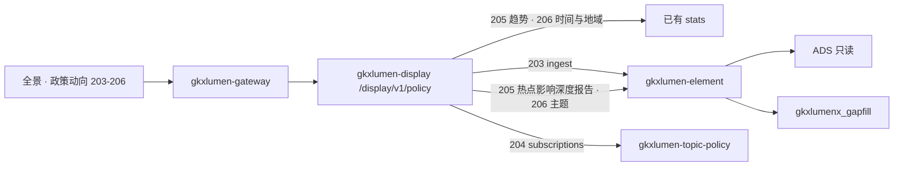
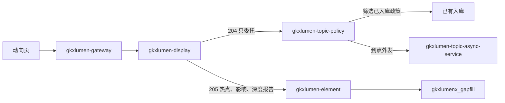

# POL-L2-DS10-TREND-ARCH · 科创政策全景 · 政策动向跟踪

- 任务：`POL-L2-DS10-TREND-ARCH`
- 日期：2026-11-03
- 监管：`human:淮政玮`
- 认领：`agent:arch-agent`
- 强度：ponytail off（定义任务，不缩文档）
- 图：`POL-L2-DS10-TREND-ARCH-SEQ`（本叶新图，源文件无 frontmatter，不另填绿）
- 签收：2026-11-03 `human:淮政玮`。按说明书第 11 节再次签收。做不到的只允许缺项表灌 mock 后由接口读表。订阅条件不灌假记录。不允许接口直接返回 mock
- **2026-11-12 增补 §7.2**：`POL-L2-DS10-TREND-KEYFIELD-FDE-L01` 中档——影响/深度弹窗进度 + situation/report 导出（仍同步读 gapfill，不进 Python）

本叶只定科创政策全景二级「政策动向跟踪」的实现架构和整体流程。SRS 序号 **203–206**。用户故事 `US-DS-POL-02`。不写 OpenAPI 字段、请求体、响应体、枚举。那是 `POL-L2-DS10-TREND-API`。

上游只引用，不改写：`科创政策全景.md` 203–206、说明书第 2 节 DS-10 与第 3–6 节、`sdd/调用链与边界.md`、`sdd/契约输入清单.md` 全景里的 `stats` / `ingest` / `jobs` / `subscriptions`、`sdd/指标与501.md` 203–206、`survey/DS-10.md` 这四行、`sdd/l2/POL-L2-DS10-QRY-ARCH.md` 对同一条 `stats` 的内部委托。不新造 `metric_id`，不改 D4。

## 1. 范围

四叶都在全景动向工作区里完成，不另开页，不另开路径。

| 序号 | 叶子 | 需规摘要 | 本叶流程 |
|---|---|---|---|
| 203 | 政策来源监控与更新 | 监控权威站点并给出最新政策列表和详情 | 同步读已有入库。跨项索引第 6 项。不重开抓取。「立即同步」= LLM 合成入库，见 4.1 的 2026-11-07 变更 |
| 204 | 政策订阅服务 | 按类别、领域、部门、地区订阅，并按日/周/月经通知、邮件、短信推送 | 可实现：展示只委托专题门面。见第 7.1 节 |
| 205 | 重点领域政策分析 | 重点领域的趋势、热点、影响和深度报告 | 趋势读已有时序表。热点、影响、深度报告没有模型，走缺项表。见第 7.2 节 |
| 206 | 政策动态可视化展示 | 时间轴、热力、趋势，看时间、地域、主题分布 | 时间与地域读已有表。主题分布没有指标，走缺项表 |

205 的趋势、206 的时间轴和地域热力，D4 仍是 `mock`。`GDF-POLICY-MOCK-GATE-L01` 仍是 blocked。闸门未解开时，正式值仍是 mock。本叶不把 mock 写成已上线。

## 2. 实现架构

本二级只用全景已有四条，不新开路径。前缀 `/display/v1/policy/`。浏览器只打这个前缀。

| 叶子 | 资源 | 流程 |
|---|---|---|
| 203 | `GET /display/v1/policy/panorama/ingest` | 同步。`gkxlumen-display` → `gkxlumen-element` → 已有 ADS。不委托专题政策门面 |
| 204 | `GET /display/v1/policy/panorama/subscriptions` | 可实现。展示只委托 `gkxlumen-topic-policy`。不是收藏，也不进 `jobs`。接口不手写订阅列表 |
| 205 趋势 | `GET /display/v1/policy/panorama/stats` | 同步。读已有 `M_POLICY_TIMESERIES` 所在表。不另建查询，不在接口里造点 |
| 205 热点、影响、深度报告 | `POST /display/v1/policy/panorama/jobs` | 没有模型。不进 Python。读三张缺项表。见第 7.2 节 |
| 206 | `GET /display/v1/policy/panorama/stats` | 同步。时间轴和趋势读 `M_POLICY_TIMESERIES`，地域热力读 `M_POLICY_NATIONAL_DIST`。主题分布读缺项表 |

`stats` 这一条资源的内部委托已经写在 `POL-L2-DS10-QRY-ARCH`：浏览器仍打 `/display/v1/policy/panorama/stats`，`gkxlumen-display` 内部委托 `gkxlumen-topic-policy`。本叶不另建一条统计查询。204 的订阅是另一条委托，接通后 `subscriptions` 也转到同一门面，业务不在展示服务，见第 7.1 节。浏览器都不改打 `/topic/v1/policy`。203 的入库列表不走专题门面。

`gkxlumen-display` 不直连库，不直连 Python，不写算法，不写 nGQL。重点领域（科创发展、人才引进、资金扶持）是 `stats` 上的筛选条件，不是三条新指标。无行则对应统计卡或列表空，不造 0。注册表 D4 仍是 mock，本叶不改绿。

热点、影响、深度报告和主题分布读缺项表失败时，只让这几块空，不清空已经返回的时序、地域分布和入库列表。切筛选不自动起任务。订阅读失败同样不清空这些同步区块。接口不在代码里返回 mock，也不用 501 代替这几块的实现。

trace 沿既有展示链走。`stats`、`ingest` 和缺项表读取在 display 往下游带 traceId。本叶不新设计观测点。

## 3. 整体流程

一次动向查看按下面四步走。205 的趋势和 206 共用第一步，不拆成两套统计。

1. 打开动向。前端经网关调 `stats`。205 的趋势读 `M_POLICY_TIMESERIES`。206 的时间轴和趋势读同一条时序，地域热力读 `M_POLICY_NATIONAL_DIST`。无行则对应图空，不造 0，也不改判 501。对齐前数值仍是 mock。
2. 用户看来源更新。前端调 `ingest`，读第 6 项已经落入 ADS 的入库列表和管线阶段。无入库行则列表空，不返回 501，也不在本页发起抓取。打开一条详情时仍走全景已有的 `{id}/detail`，本叶不新开详情资源。
3. 用户要看热点、影响或深度报告。前端提交 `jobs`。这三种没有模型，不进 Python。受委托的 Java 读对应缺项表。表里无行则该块空，不造 0，不在接口里写死报告。不自动提交。统计卡和入库列表保持第 1、2 步的结果。见第 7.2 节。
4. 用户要设订阅或看推送。前端调 `subscriptions`。display 只委托专题门面。页面 localStorage 不是这条资源。门面按第 7.1 节读写订阅。没有订阅则空列表。display 不返回手写订阅。

`stats` 上还挂着总数、类型、级别、深圳分布、有效率、行业覆盖、支持力度。它们分别留给检索、部门件数、标杆比对和没有序号的行业覆盖。本叶只读时序和全国分布，不改这条资源的其余挂接。

## 4. 四叶

### 4.1 203 政策来源监控与更新 · 跨项索引

读已有资源：`GET /display/v1/policy/panorama/ingest`。成功时读政策入库列表。来源监控没有 `metric_id`，本叶不新造。

链路：前端 → 网关 → `gkxlumen-display` → `gkxlumen-element` → ADS。加工在第 6 项。`GDF-POLICY-WORKPACK-V2-L01` 已完成，`GDF-POLICY-MDC-DOC-L01` 为 integration。本叶不重开这些包，不加表，不加字段。

空态：不返回 501。无入库行则列表空。详情正文走全景已有 detail，无正文则详情空。

不做什么：不在展示侧建抓取、定时任务或新的来源站点清单。不把 `ingest` 改成 Job。不把治理页的清洗质量写成这一叶。

**2026-11-07 变更（`POL-L2-DS10-SRCMON-SYNTH-L01`，`human:淮政玮` 口头批准）**：「立即同步」不再只写一条演示历史，改成 LLM 合成政策入库。仍不抓取外站。

- 链路：前端 `POST /display/v1/policy/panorama/sync-history` → `gkxlumen-display` Feign → `gkxlumen-platform-entan-py` `/internal/policy/sync-history`。Python 先写一条 `running` 同步历史，立即返回，后台合成。前端轮询同步历史，直到没有 `running` 行，再刷新 `ingest`。
- 后台一次 10 条（2026-11-07 由 50 改为 10，上限 100）。地区、层级、类型、主题由代码排配额：深圳约 60%（含区级），国家级约 15%，其余随机落到 24 个省市。类型在 通知/意见/办法/规划/若干措施/实施细则/行动方案/指南/目录/决定 中轮转。LLM 只写标题、文号、摘要、关键词、正文（按「第X条」分条）、要点和支持方式。
- 写入：ODS `dwd_policy_base` + DWD `policy_base_info`。`source_plane='domestic'`，检索和统计都计入。
- 入库后原样调用两种已有方法：产业补码 `polan.industry_enrich.enrich_one`，写 DWD 和 ADS 两层 `policy_industry_rel`；条款结构化 `polan.clause_job.structure_one`（按规则分条），写 ADS `policy_text_parse`。两种方法都从 demo-algo-ent-analysis 迁到 lumen-algo-py `vendor/entan-py`。
- 历史版本：每次合成后随机挑一半（10 条里 5 条）再调一次 LLM 写上一版。旧版是独立政策行，`policy_id` = 新版 id 加 `-H1`，`status=已废止`，发布日比新版早 1～3 年（由代码定），同样入 ODS/DWD 并跑补码与条款结构化。新旧之间 3～6 条增改删写 `gkxlumenx_gapfill.gapfill_policy_version_diff`（`policy_id` 用新版，`fill_method=llm-synth`，`is_mock=1`），供 213 新旧对比读取；时点经 `GET /display/v1/policy/panorama/versions` 读出，见 `POL-L2-DS10-CMP-DATA` 第 3 节。历史版写失败不影响新版计数。旧版 `expire_date` = 新版发布日前一天。
- 落地实效（用户 2026-11-07 追加，选「组合」且新旧版都给）：新旧版每条由 LLM 在同一次调用里顺带写 2～3 条受众反馈，入 `gkxlumenx_gapfill.gapfill_policy_audience_feedback`（210，`fill_method=llm-synth`）；全部写完后原样调用已有 `polan.eval.effect.run()` 重算各省落地实效（209，`ads.policy_effect` 与时序表）。删除合成行后同样重算。见 `POL-L2-DS10-SENT-DATA` 第 4、5 节变更段。
- 合成行有三个标记：`policy_id` 前缀 `SYN`，`source='llm-synth'`，`etl_batch_id` 前缀 `SYNTH-`（历史版同样带这三个标记，删除时一并删掉；变更行按合成 `policy_id` 加 `fill_method=llm-synth` 删）。`ingest` 读面对这类行返回 `is_mock=1`，评审态挂 MockBadge。中台政策 Mock 页的「删除所有 Mock 数据」只按这三个标记删，真实政策不受影响。
- D16 例外：合成行直接写 DWD，突破了「缺项数据不进 DWD」。这一条由 `human:淮政玮` 2026-11-07 批准，只限本叶，不推广。
- 诚实性：没有 LLM 密钥或生成失败时不造行，同步历史记为 `failed`。`running` 超过 30 分钟未回写的，标成 `failed`。同一进程内只允许一条合成在跑（ponytail：多副本时各副本各自限一条，以后要全局唯一再改用库锁）。

### 4.2 204 政策订阅服务 · 可实现

读已有资源：`GET /display/v1/policy/panorama/subscriptions`。保存、修改、取消、读取和外发都由 `gkxlumen-topic-policy` 实现。展示不手写订阅列表。

流程：前端 → 网关 → `gkxlumen-display` 只委托该门面。不占用收藏入口，也不把这条写成 `jobs`。见第 7.1 节。

空态：该用户没有订阅时返回空列表。`FE-POL-01B` 的 localStorage 订阅和「立即推送」是演示，不是这条资源。收藏是序号 201 的 `favorites`，本叶不读。

不做什么：不在展示服务建订阅表、发信或短信通道。不把日/周/月频率写成展示侧已有调度。不因读失败清空时序和入库列表。

### 4.3 205 重点领域政策分析 · 趋势读已有表，其余读缺项表

趋势读已有资源：`stats` 上的 `M_POLICY_TIMESERIES`。类型 STAT，D1 aligned，D4 mock。需求来源含本序号。源表 `dwd_policy_base`。口径上历史段可以复算，2022-09 之后当前段库内没有记录，所以它不能单独承担「趋势监测」已完全支持。连续性仍是 QPOL-07，本叶不改口径。D2 为 provisional，架构上保留「待核验」，不在本叶改绿。

重点领域名称只作为 `stats` 的筛选条件。不新造「科创发展时序」「人才引进时序」「资金扶持时序」。

热点、影响、深度报告读 `POST /display/v1/policy/panorama/jobs`。这三项未见模型，未见 `metric_id`。不改挂 `M_POLICY_FOCUS_INDEX`。

流程：趋势与第 3 节第 1 步相同，内部委托沿用检索叶已经写明的 `stats`，点从已有表读出。三项没有模型，不进 Python。`jobs` 接到这三种时，由 `gkxlumen-element` 读第 7.2 节的缺项表，原样返回行。display 不组装报告。

空态：趋势无点则图空，不造 0。三项缺项表无行则该块空，不在接口里填一份报告。同一条 `jobs` 上的实施效果、匹配、力度不属于本叶，见第 5 节。

不做什么：不新注册热点或报告模型。不把时序改挂焦点指数。不因缺项表为空清空趋势图。

### 4.4 206 政策动态可视化展示 · 同步

读已有资源，仍是 `stats`：

- 时间轴、趋势图：`M_POLICY_TIMESERIES`。需求来源含本序号
- 地域热力：`M_POLICY_NATIONAL_DIST`。类型 STAT，D1 aligned，D4 mock。不另开地域指标

主题分布没有已挂的 `metric_id`。本叶不新注册指标，也不借用类型分布冒充主题。这一维读 `gkxlumenx_gapfill.gapfill_policy_theme_dist`。Python 把 mock 行灌进这张表。`stats` 的这一维由 element 读表返回。display 不生成主题桶。

时间轴、趋势、地域热力与 205 的趋势相同：读已有表，不另建查询。D2 为 provisional 时保留「待核验」。表里的值在对齐前仍是 mock，但接口只读表。

空态：无点、无省行或主题表无行则对应图空，不造 0。

不做什么：不把检索叶的高级检索字段写成这张可视化。不把评价页序号 219 的效能趋势改挂到本时序。不读图，不走 `E-E7-POLICY-M1-L06`。

## 5. 点名排除

这些全景资源不属于 203–206 的本叶流程。本叶不新开替代路径。

| 资源 | 不纳入本二级流程的原因 |
|---|---|
| `panorama/search`、`{id}/detail`、`rank`、`favorites`、`share` | 序号 197–202。详情只被 203 打开一条时复用，不在本叶重写 |
| `panorama/feedback` | 序号 210 |
| `panorama/assessment-report` | 序号 211。不是 205 的深度报告 |
| `panorama/version-diff` | 序号 213 |
| `panorama/benchmark-report` | 序号 217。不是 205 的深度报告 |

`jobs` 是全景共用资源。本叶只用它承接 205 的热点、影响、深度报告。下面这些叶子不在本叶展开。

| 序号 | 与本二级的边界 |
|---|---|
| 197–202 | 检索叶。本叶不改 `stats` 的内部委托，也不实现排序、收藏、导出 |
| 207 | 页内并列查看另叶。深度对比不在动向四叶 |
| 208 | 区域差异只消费已有子图。本叶的地域热力是全国分布，不是读图 |
| 209 | 实施效果另叶，读 `ads.policy_effect`。不是来源监控 |
| 210 | 受众反馈另叶 |
| 211 | 效果评估报告另叶。不是深度报告 |
| 212 | 匹配与推送另叶，读 `ads.policy_match`。动向页上的匹配弹窗不在本叶升成服务 |
| 213–214 | 新旧对比、详情对比另叶 |
| 215 | 部门件数另叶，复用政策总数 |
| 216 | 标杆力度另叶。本叶不读 `M_POLICY_SUPPORT_STRENGTH` |
| 217–218 | 对标报告和对标可视化另叶。不是本叶的深度报告 |

## 6. 明确不做

- 不写 OpenAPI 字段表、请求体、响应体、枚举。
- 不新造 `metric_id`。不改 D4。不把 mock 写成已上线。不把 QPOL-07 写成已闭合。
- 不把 `GDF-POLICY-MOCK-GATE-L01` 写成已解开。不重开 GDF。
- 浏览器不改打 `/topic/v1/policy`。`stats` 的内部委托以检索叶为准。204 只在服务内部把 `subscriptions` 委托给 `gkxlumen-topic-policy`。不把 `E-E7-POLICY-M1-L06` 写成展示前端联调单。
- 不改 `FE-POL-01B`，不新建前端单。前端 mock 开关不是接口实现。
- 不把 localStorage 订阅、演示推送写成已经接通的服务。
- 不改说明书、WBS、调研分册。
- 2026-11-03 `human:淮政玮` 按说明书第 11 节再次签收。缺项表和要灌的 mock 见第 7.3 节，与第 11.1 节动向一行相同。灌数执行单是 `POL-L2-DS10-TREND-GAPFILL-L01`，本叶不执行。
- 不在本叶注册模型、不部署定时、不开发送。业务表不加。做不到的只建第 7.2 节和第 4.4 节的 `gapfill_` 表。
- 政策订阅与外发的实现单是 `E-E7-POLICY-M1-L11`、`L12`、`L13`，监管都是 `human:淮政玮`。本叶不认领、不实现。

## 7. 签收条件：可实现

能对上已有表或已有门面的，按那条实现。接口只读库里的行，或只委托门面。禁止在 `gkxlumen-display`、门面或 Python 的返回语句里直接写 mock JSON、写死数字，也禁止用 501 充当这块功能。

实在没有模型、没有指标、没有通道时，只接受一种退路，按 D16：

1. 表只建在 `gkxlumenx_gapfill`，表名以 `gapfill_` 开头。不建在 ODS、DWD、ADS，不写供应方库。
2. Python 把 mock 行灌进表。`fill_method` 用 `manual`。Java 和前端不建表、不灌数。
3. 接口经既有 Java 服务读这张表，原样返回行。无行则空列表或空图，不造 0。
4. 没有已挂 `metric_id` 的，不新注册指标。行上 `gap_item` 写序号和叶子名。D4 保持 mock，不把读到的行改判成已上线。生产配置不把这张表当正式源。

204 做得到，不走这条退路。205 的趋势、206 的时间与地域读已有统计表，也不走这条退路。

204 的实现不在展示系统。展示只委托 `gkxlumen-topic-policy`。独立任务是 `E-E7-POLICY-M1-L11`（架构）、`L12`（实现）、`L13`（测试）。本叶不认领这三张单，也不占用检索叶的收藏入口。热点、影响、深度报告不改挂 `E-E7-POLICY-M1-L03` 已点名的焦点、力度、效果模型。

浏览器在接通后仍只打 `/display/v1/policy/**`。

### 7.1 204 政策订阅服务

需规要保存的是订阅条件：政策类别、行业领域、发布部门、地区，加上日、周或月，以及系统通知、邮件、短信。用户可以修改或取消。这不是序号 201 的收藏，也不是序号 212 的企业匹配推送。212 仍走 `jobs` 上已见的匹配模型。204 对的是用户自己设的条件，对到已经入库的政策。

实现不在展示系统。`gkxlumen-display` 不保存订阅关系，不跑定时，不发系统通知、邮件或短信，不把订阅写进 `gkxlumen-element` 或 ADS。接通后浏览器仍只打 `GET /display/v1/policy/panorama/subscriptions`，display 把保存、修改、取消、读取和外发全部委托给 `gkxlumen-topic-policy`。这不是把浏览器改去打 `/topic/v1/policy`，也不是把 `E-E7-POLICY-M1-L06` 改成展示联调单。

门面内部要完成的事，由独立任务展开，不在本叶设计表结构和通道参数：

| 任务 | 监管 | 做什么 |
|---|---|---|
| `E-E7-POLICY-M1-L11` | `human:淮政玮` | 专题侧架构。订阅关系、对已入库政策的筛选、日/周/月、通知/邮件/短信落在 `gkxlumen-topic-policy` |
| `E-E7-POLICY-M1-L12` | `human:淮政玮` | 在该门面实现上述能力。展示侧只加委托，不写订阅业务 |
| `E-E7-POLICY-M1-L13` | `human:淮政玮` | 测试这条委托和外发。页面 localStorage 与「立即推送」不算通过 |

`ARCH-DISPLAY-01` A15 仍是其他展示页订阅模块的裁决。序号 204 按本次裁定改走专题政策门面，不把政策订阅关系落在展示侧库。态势模块的用户行为表不是这条服务。

本叶按做得到签收，不给 204 建缺项表。说明书第 11 节写明订阅条件不灌假记录，本叶也不把「做不成」改成缺项表。门面还没有入口时，display 不得返回手写订阅来顶上。入口接上且该用户没有订阅时，返回空列表。外发通道还没有时，推送记录为空列表，不把本叶改判成外发已上线。不因空列表清空时序和入库列表。本叶不开发送，不认领上面三张单。

### 7.2 205 热点、影响、深度报告

趋势不在本节。它继续读 `stats` 上的 `M_POLICY_TIMESERIES`。

三项都没有已挂模型和 `metric_id`。本叶不预占 `metric_id`，也不把下面已有模型改挂过来。模型没有，就走缺项表，不改去等一个未注册的 Python：

| 本叶要的结果 | 不改挂 |
|---|---|
| 热点识别 | `M_POLICY_FOCUS_INDEX`。那是评价页序号 223 |
| 政策影响评估 | `M_POLICY_IMPLEMENTATION_EFFECT`（序号 209）、`M_POLICY_SIMULATE`（推演页） |
| 深度分析报告 | `assessment-report`（序号 211）、`benchmark-report`（序号 217）、核增研报 `report/jobs`（614–618） |

重点领域名称仍是筛选条件，写在缺项表的行上。科创发展、人才引进、资金扶持不是三条新指标。Java 不识别热点，不写影响，不生成报告。

三张表，都在 `gkxlumenx_gapfill`：

| 结果 | 表 |
|---|---|
| 热点识别 | `gapfill_policy_trend_hotspot` |
| 政策影响评估 | `gapfill_policy_trend_impact` |
| 深度分析报告 | `gapfill_policy_trend_report` |

浏览器仍提交 `POST /display/v1/policy/panorama/jobs`。这三种不进 `gkxlumen-topic-async-service`，不进 Python。display 委托 `gkxlumen-element` 按种类读上表，把行返回。同一条 `jobs` 上的实施效果、匹配、力度仍由各自叶子使用各自已见模型。用户点了其中一种才查表。切领域不自动查另一域。表无行则该块空。读失败不清空已经返回的时序图和入库列表。

**界面与导出（2026-11-12，`POL-L2-DS10-TREND-KEYFIELD-FDE-L01`，中档）**

- 「政策影响评估」「深度分析报告」点击后统一打开弹窗：分阶段进度条（受理 → 读取分析材料 → 汇总 → 完成）→ 展示当次读到的行。进度为过程展示，底层仍是同步读表，不新建异步分析任务，不谎称模型推理。
- 完成后可导出 PDF / Word：FE 用当次行拼完整 HTML → `POST /display/v1/situation/report/generate` → topic-async OpenHTMLtoPDF（与 217 / 态势报告同构）。`reportType`=`policy-trend-impact` / `policy-trend-report`；Word=`format=html` 存 `.doc`。禁止 `trackingExport` 打印另存、禁止 `text/plain`。无行不产文件。
- 热点识别仍按原页内块，本增补不改热点主路径。

主题分布用 `gapfill_policy_theme_dist`，挂在 `stats` 上，不进这三张表。见第 4.4 节。这四张表要灌的 mock 见第 7.3 节。列由 `POL-L2-DS10-TREND-DATA` 定，灌数由 `POL-L2-DS10-TREND-GAPFILL-L01` 执行。本叶不写列，不灌数。

### 7.3 缺项表与要灌的 mock

只建下面四张，与说明书第 11.1 节动向一行相同。库只允许 `gkxlumenx_gapfill`。不进 ODS、DWD、ADS，不写供应方库。203 读已有入库，不建表。204 由专题门面实现，不建缺项表，也不灌假订阅。205 的趋势、206 的时间轴和地域热力读已有统计表，不建缺项表，也不把这些点改灌进检索的 `gapfill_policy_qry_stat`。已有表没有行则对应图空，不往 ADS 写 mock 点数。

每行都带 D16 要求的 `metric_id`、`gap_item`、`fill_method`、`gapfill_batch_id`、`generated_at`。这四张没有已挂指标，`metric_id` 留空，不新注册。`fill_method` 用 `manual`，不调用模型，不填 `fill_model`。`gap_item` 写序号和叶子名。D4 保持 mock。

| 表 | 叶子 | 要灌的 mock | 不灌 |
|---|---|---|---|
| `gapfill_policy_trend_hotspot` | 205 热点识别 | 科创发展、人才引进、资金扶持各若干条。每条有领域名、热点名称、一句说明 | 焦点指数、热度分。不挂 `M_POLICY_FOCUS_INDEX` |
| `gapfill_policy_trend_impact` | 205 政策影响评估 | 上述三个领域各一条。每条有领域名、影响对象、影响方向、一句结论 | 实施效果分、推演情景。不挂 `M_POLICY_IMPLEMENTATION_EFFECT`、`M_POLICY_SIMULATE` |
| `gapfill_policy_trend_report` | 205 深度分析报告 | 上述三个领域各一份。每份有标题、领域名、正文。正文写在行里 | 不把文件字节灌进本表；导出文件走 situation/report 存储指针（KEYFIELD-FDE）。不挂序号 211、217 |
| `gapfill_policy_theme_dist` | 206 主题分布 | 若干主题名和件数，可带年份 | 政策类型分布的桶。不新造主题指标 |

灌数执行单是 `POL-L2-DS10-TREND-GAPFILL-L01`。执行 `data-agent`，监管 `human:淮政玮`。它依赖 `POL-L2-DS10-TREND-DATA` 把列定下来之后再建表、写脚本、灌入上表这些行。本叶不认领、不执行。接口仍只读这些行，不在返回语句里写 mock。
