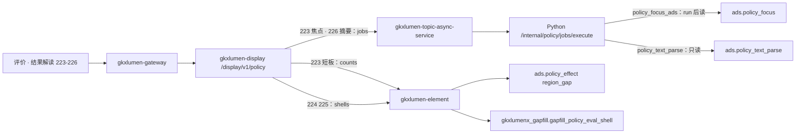

# POL-L2-DS11-READ-ARCH · 政策分析评价 · 结果解读报告多维展示

- 任务：`POL-L2-DS11-READ-ARCH`
- 日期：2026-11-03
- 监管：`human:淮政玮`
- 认领：`agent:arch-agent`
- 强度：ponytail off（定义任务，不缩文档）
- 图：`POL-L2-DS11-READ-ARCH-SEQ`（本叶新图，源文件无 frontmatter，记 `draft`）
- 会签：2026-11-03 架构、算法、数据、产品四页均同意
- 签收：2026-11-03 `human:淮政玮`。下游分册以本叶为准

本叶只定政策分析评价二级「结果解读报告多维展示」的实现架构和整体流程。SRS 序号 **223–226**。用户故事 `US-DS-POL-05`。不写 OpenAPI 字段、请求体、响应体、枚举。那是 `POL-L2-DS11-READ-API`。

上游只引用，不改写：`政策分析评价.md` 223–226、说明书第 2 节 DS-11、第 3–6 节与第 11.2 节、`sdd/调用链与边界.md`、`sdd/契约输入清单.md` 评价三条、`sdd/指标与501.md` 223–226、`survey/DS-11.md` 这四行。不新造 `metric_id`，不改 D4。

签收条件沿说明书第 11 节：架构必须能实现。已经有 ADS 表、也有可调用计算的，不新建表，接口读那张表。没有表、也没有算法的，只允许在 `gkxlumenx_gapfill` 建 `gapfill_` 表，把 mock 写入表，接口再读。不允许接口直接返回 mock，也不用 501 充当功能。

算法中台对照（`demo-ui-system-test` 政策菜单，计算在 `lumen-algo-py/vendor/entan-py`）：

| 中台页 | 已有计算 | 落表 | 本叶怎么用 |
|---|---|---|---|
| `/policy/focus` | `polan.eval.focus.run` | `ads.policy_focus`（`policy_id` 非空） | 223 焦点走这条，不走中台页 |
| `/policy/gap` | `polan.eval.gap.run` | `ads.policy_effect`（`scope_type=region_gap`） | 223 短板计数读这张表。页上提示写的 `ads.policy_gap` 与代码不符，不建那张表 |
| `/policy/parse` | `polan.text.parse.run` | `ads.policy_text_parse.summary` | 226 只读这列。中台把 `M_POLICY_DS_11_POLICY_EVAL_012` 定义成这列的展示读面 |
| 无多媒体、无分主题解读页 | 无 | 无 | 224、225 走缺项表 |

`GET /v1/policy/analysis/{modelId}` 与 `POST /v1/policy/analysis/focus-one` 留给算法中台。`focus-one` 不写 ADS。展示不打这两条，也不嵌中台页。

## 1. 范围

四叶都在政策分析评价里完成，不另开页。前缀 `/display/v1/policy/`。

| 序号 | 叶子 | 需规摘要 | 本叶流程 |
|---|---|---|---|
| 223 | 热点问题分析看板 | 识别高频、异常或重点问题，聚合成诊断看板 | 短板条数同步读已有表。焦点指数走 Job，读已有 `ads.policy_focus` |
| 224 | 分主题分指标互动解读 | 按专题、指标点选，看分项、结论与应用建议 | 读缺项表里的解读条目。点选只筛选已返回的行 |
| 225 | 多媒体辅助解读 | 嵌入视频、动画和图形 | 读缺项表里的条目标题和一句说明。不灌视频文件 |
| 226 | 智能摘要与结论推送 | NLP 生成可编辑摘要与结论，并推送 | 读已有 `ads.policy_text_parse.summary`。不另建摘要模型。不灌假推送 |

223 短板与 226 摘要的 D4 仍是 `mock`。`QPOL-02` 未闭合。`GDF-POLICY-MOCK-GATE-L01` 仍是 blocked。本叶不把 mock 写成已上线，也不把该闸门写成已解开。

机遇条数 `M_POLICY_OPPORTUNITY_COUNT` 没有 223–226 的序号，不挂进本二级。`evaluation/counts` 上留给它的读面本叶不改。

## 2. 实现架构

本二级只用契约输入清单里评价页已经点名的三条。前缀 `/display/v1/policy/`。

| 叶子 | 资源 | 流程 |
|---|---|---|
| 223 短板条数 | `GET /display/v1/policy/evaluation/counts` | 同步。`gkxlumen-element` 只读 `ads.policy_effect` 里 `scope_type=region_gap` 的 `shortboard_cnt`。GET 不调用 `gap.run` |
| 223 焦点指数 | `POST /display/v1/policy/evaluation/jobs` | Job。新例外键 `policy_focus_ads`：调用 `polan.eval.focus.run`，再读 `ads.policy_focus` 里 `policy_id` 非空的行 |
| 224、225 | `GET /display/v1/policy/evaluation/shells` | 同步。`gkxlumen-element` 只读 `gkxlumenx_gapfill.gapfill_policy_eval_shell` |
| 226 | `POST /display/v1/policy/evaluation/jobs` | Job。新例外键 `policy_text_parse`：只读 `ads.policy_text_parse`。请求里不调用 `parse.run` |

浏览器只打 `/display/v1/policy/**`。不改去打 `/topic/v1/policy`，也不打 `/v1/policy/**`。`E-E7-POLICY-M1-L06` 不是本二级的实现路径。`E-E7-POLICY-M1-L03` 只索引专题侧的焦点、力度、效果，展示不改打专题政策 URL，也不等它来实现本四叶。

223 的焦点和 226 的摘要不进专题政策查询门面。任务表、SSE、并发锁复用 `gkxlumen-topic-async-service`。展示调用已有 `POST /topic/v1/analysis/tasks`，`PolicyAnalysisAdapterImpl` 再调 `POST /internal/policy/jobs/execute`。切条件不自动起任务。Job 失败不清空已经返回的短板计数和解读条目。

`gkxlumen-display` 不直连库，不直连 Python，不写算法，不写 nGQL。

现有 `policy_focus` 要求 items、产业或正文，并走 `harness.dispatch`。展示看板不提交政策条目，也不把 harness 的返回当成热点看板。带 items 的既有焦点作业保持原样。`policy_focus_ads` 与已签收的 `policy_effect` 相同：不走产业 VID 校验，不收 items。

`polan.text.parse.run` 会清空整张 `ads.policy_text_parse`。条款结构化写在同一张表上。226 的请求路径只查询，避免一次展示请求把条款行清掉。摘要行仍由已有解析批次写入。

trace 沿既有展示链走。本叶不新设计观测点。

## 3. 整体流程

1. 打开解读看板。前端调 `counts`。223 只读区域短板条数。有 `region_gap` 行则返回 `shortboard_cnt`。没有行则该计数空，不造 0。数值在对齐前仍是 mock。这次读取不调用 `gap.run`，也不把 `GDF-POLICY-MDC-STAT-L01` 写成已覆盖本指标。
2. 用户要看焦点指数。前端向 `jobs` 提交，`sub_type=policy_focus_ads`。Python 调用已有 `polan.eval.focus.run`，再读 `policy_id` 非空的行：`focus_score`，以及 `ext` 里已有的标题和一句说明。表里没有行则看板空。不返回 `focus-one` 的当场计算结果。
3. 用户点选专题或指标。前端调 `shells`，只取解读条目。点选在已返回的行里筛选，不另起计算，不新开路径。表里没有行则解读块空。
4. 用户要看多媒体辅助。同一次 `shells` 取多媒体条目：标题和一句说明。不返回视频或动画文件。表里没有行则该块空。
5. 用户要看摘要。前端向 `jobs` 提交，`sub_type=policy_text_parse`。Python 只读 `ads.policy_text_parse.summary`。没有行则摘要空。不在这次请求里调用 `parse.run`，不调用大模型。没有推送通道时不另造通知。

`counts` 上的机遇条数、`jobs` 上的效能得分、实施路径、趋势、分区、方案和参数模拟，都不是这四步。本叶不改它们的资源，也不把它们算进 223–226。

## 4. 四叶

### 4.1 223 热点问题分析看板

两条挂接，两条链路。

短板条数，同步：

- 指标 `M_POLICY_SHORTBOARD_COUNT`，类型 STAT，D4=mock
- 资源 `counts`
- 链路：前端 → 网关 → `gkxlumen-display` → `gkxlumen-element` → `ads.policy_effect`
- 读 `scope_type=region_gap` 的 `shortboard_cnt`。这与 `GET /v1/policy/analysis/gap` 读的是同一张表、同一个范围。展示不打那条中台 URL
- 源模型 `M_POLICY_DEEP_169_1` 仍是 MODEL，不在这条同步链上计算
- 已有 `polan.eval.gap.run` 按区域写入覆盖盲区、失效占比、平均力度不足。`ext` 里已有 `is_mock` 和 `QPOL-02`。本叶不改公式，不改权重
- 空态：无行则计数空，不造 0，不返回 501

焦点指数，Job：

- 指标 `M_POLICY_FOCUS_INDEX`，类型 MODEL，D4=mock
- 资源 `jobs`，`sub_type=policy_focus_ads`
- 链路：前端 → 网关 → `gkxlumen-display` → `gkxlumen-topic-async-service` → `POST /internal/policy/jobs/execute`
- Python 调用 `polan.eval.focus.run`，再读 `ads.policy_focus`。`run()` 只删除 `policy_id` 非空的行再写入，不删除 `policy_id` 为空的机遇行。本叶不改这个删除范围
- 看板上的一句说明用 `ext` 里已有的 `explanation`，名称用 `ext` 里已有的 `title`。这就是说明书第 11.2 节写的「焦点问题名称和一句说明」，落在已有表上，不另建 `gapfill_policy_eval_focus`
- 权重仍是 `QPOL-02` 待甲方确认的规则基线。本叶不改权重，不把 `is_mock` 改成已上线
- 空态：无行则焦点块空，不返回 501，不返回写死的指数

`M_POLICY_RELATION_DEGREE` 写在同一行的 `relation_degree` 上。本叶不把它改挂到 223，也不为此读图。Java 不写 nGQL。

不做什么：不把算法中台的 Top15 图和区间图当成展示接口。不把演示页上的主题卡片写成新指标。不建 `ads.policy_gap`。

### 4.2 224 分主题分指标互动解读 · 读缺项表

没有专属 `metric_id`，也没有已注册的解读模型。真实生成做不到。

- 库 `gkxlumenx_gapfill`，表 `gapfill_policy_eval_shell`
- 本序号只读解读条目：专题或指标名、一句结论、一句应用建议。条目可以指向已经存在的 `metric_id`，不新注册
- `gkxlumen-display` 不直连库。`gkxlumen-element` 只读这张表
- 点选是对已返回条目的筛选，不新开模型，不新开路径
- 表里没有行则解读块空。不在接口里写死结论

不做什么：不把 226 的摘要行复制成解读条目。不把 223 的焦点说明改挂到本序号。

### 4.3 225 多媒体辅助解读 · 读缺项表

调研记交互壳，无指标，无视频通道。真实嵌入做不到。

- 同一张 `gapfill_policy_eval_shell`，只读多媒体条目：标题、一句说明
- 不灌视频、动画或图形文件，不写对象存储，前端不直连 RustFS
- 页上已有的短板计数和焦点结果可以留在原资源上。本序号不新做一套图
- 表里没有行则该块空

不做什么：不把序号 219–221 的趋势图、分区图、结构关联收进本叶。不把前端占位动画写成多媒体服务。

### 4.4 226 智能摘要与结论推送 · 读已有 ADS

指标 `M_POLICY_DS_11_POLICY_EVAL_012`，类型 MODEL，D4=mock。需求来源即序号 226。

算法中台「文本解析 · 智能摘要」已经把这条展示身份定义成读 `ads.policy_text_parse.summary`，不另写模型。写入该列的 `polan.text.parse.run` 是规则截取，行上的 `metric_id` 仍是 `M_POLICY_TEXT_PARSE`。本叶不改这个 `metric_id`，也不把截取改成大模型。

- 资源 `jobs`，`sub_type=policy_text_parse`
- 白名单增加这个键，并且与 `policy_effect` 一样不走产业 VID 校验
- Python 只查询 `ads.policy_text_parse`。不在请求里调用 `parse.run`
- 展示挂接用 `M_POLICY_DS_11_POLICY_EVAL_012`。这是读面身份，不是第二套摘要
- 空态：无行则摘要空，不返回 501，不返回写死的段落

可编辑和推送没有登记的用户表，也没有发信通道。本叶不建编辑表，不把改过的句子写回 ADS，不灌假通知。用户当时在页面上改字，不构成本条资源。

不做什么：不建 `gapfill_policy_eval_summary`。不把序号 242 的推演解读报告、核增研报 `report/jobs` 当成这条摘要。不把 `focus-one` 当成摘要。

## 5. 点名排除

| 资源或序号 | 不纳入本二级的原因 |
|---|---|
| `M_POLICY_OPPORTUNITY_COUNT` | 无 223–226 的序号。`counts` 上的机遇读面留给页 KPI，本叶不改 |
| 219–221 | 趋势、分区、结构关联。结构关联只消费已有子图，不在本叶 |
| 222 | 报告模板与批量导出。交互壳。模板选用不写入本叶的解读条目 |
| 227–231 | 方案、参数模拟、实施路径、意见与归档。`M_POLICY_DS_11_POLICY_EVAL_015` 不挂本叶 |
| `M_POLICY_EFFECT_SCORE` | 在 `jobs` 上，不是 223–226 |
| `policy_focus` 的 harness 路径 | 带 items 的既有焦点作业。展示看板走 `policy_focus_ads` |
| `compare/jobs`、`report/jobs`、`simulation/jobs` | 核增对比、研报、推演。不是本四叶 |

## 6. 明确不做

- 不写 OpenAPI 字段表、请求体、响应体、枚举。
- 不新造 `metric_id`。不改 D4。不把 mock 写成已上线。
- 不改 `指标与501.md`、说明书、调研分册、WBS。那些文件里 223 焦点、224、225、226 仍写着 501。本叶的可实现链路是读表。会签前不以本叶改写它们。
- 浏览器不改打 `/topic/v1/policy` 或 `/v1/policy/**`。不把 `E-E7-POLICY-M1-L06` 写成展示路径。
- 不改 `FE-POL-02A`，不新建前端单。契约冻结前前端继续 mock。
- 不重开 GDF，不写 nGQL。不加 ODS、DWD、ADS 表。224、225 只加 `gkxlumenx_gapfill` 里的 `gapfill_policy_eval_shell`。
- 不在本叶改 Python 或 Java。预计实现是：短板和 shell 由 element 查询；焦点和摘要走已有 Job 管道。焦点调用已有 `polan.eval.focus.run` 再查询。摘要只查询。
- 不把算法库页面、写死指数、写死摘要、前端 HTML 写成展示服务。
- 不允许接口函数直接返回 mock。mock 只能先落进表，再被查询读出来。
- 四角色会签页已落盘。2026-11-03 `human:淮政玮` 已签收。

## 7. 签收条件：可实现

四叶各自有一条现在就能照着做的链路。有一条写成「以后再选算法」，或者接口直接返回写死的数据，或者用 501 充当功能，本单不可签收。

能接到已有表的，接口必须查那张表。223 的短板查 `ads.policy_effect`，223 的焦点查 `ads.policy_focus`，226 查 `ads.policy_text_parse`。查询函数自己不拼指数、不拼短板数、不拼摘要。表里没有行就返回空。

实在没有算法、也没有表的，只允许这一条退路：在 `gkxlumenx_gapfill` 新建 `gapfill_` 前缀表，由 Python 把 mock 行写入表，接口只做查询。224、225 走这条。不接受第二种退路。

| 序号 | 可实现的做法 | 现在就能用的代码 |
|---|---|---|
| 223 短板 | `counts` 由 element 读 `ads.policy_effect` 的 `region_gap` | `polan.eval.gap.run` 与 `GET /v1/policy/analysis/gap` 已在 `lumen-algo-py/vendor/entan-py`。展示不打这条 GET |
| 223 焦点 | 在已有 `jobs/execute` 上增加 `policy_focus_ads`，调用 `polan.eval.focus.run`，读 `ads.policy_focus` | 计算与 `GET /v1/policy/analysis/focus` 已在同一份 vendor。任务管道是 `PolicyAnalysisAdapterImpl`。既有 `policy_focus` 仍走 harness |
| 224、225 | 建 `gapfill_policy_eval_shell`，Python 灌入 mock 行，`shells` 只查这张表 | 算法中台没有分主题解读模块，也没有多媒体模块 |
| 226 | 在已有 `jobs/execute` 上增加 `policy_text_parse`，只读 `ads.policy_text_parse.summary` | `polan.text.parse.run` 已会写这列。请求不调用它，避免清空整表 |

迁移边界：

- 算法中台页面留在 `demo-ui-system-test` 与 `lumen-ui-algo-apiview` 的 `/policy/focus`、`/policy/gap`、`/policy/parse`。展示不嵌这些页。
- `/v1/policy/analysis/focus`、`/v1/policy/analysis/gap`、`/v1/policy/text/parse` 继续给算法中台自己用。
- 不把 `polan.eval.focus`、`polan.eval.gap`、`polan.text.parse` 抄进 Java，不抄进 `gkxlumen-display`，不送进专题政策查询门面。
- 不新造 `metric_id`，不改 D4。223、226 不另建表。`QPOL-02` 的权重和阈值仍由已有 `run()` 使用，采购或甲方确认后再换输入，不在本叶换公式。
- 说明书第 11.2 节把 `gapfill_policy_eval_focus`、`gapfill_policy_eval_summary` 和 shell 写在同一行。本叶按第 11 节的总规则收窄：焦点和摘要已有 ADS 和计算，不建那两张缺项表。shell 保留，并且只服务 224、225。序号 222 的模板选用不在本叶灌入。

## 8. 表与合规 mock

界面上要出现、而真实采集或真实模型还没有的数，先写入表，并标成 mock。接口只查询。D4 保持 mock。不新造 `metric_id`。字段级 DDL 由 data-agent 在下游单里定。本叶只定粒度和必须落表的内容。本叶不执行灌数。

| 序号 | 库表 | 新建 | 要落表的内容 | 下游 |
|---|---|---|---|---|
| 223 短板 | `ads.policy_effect`（`scope_type=region_gap`） | 否 | 区域、`shortboard_cnt`、分项原因。行上已有 `is_mock` 与 `QPOL-02`。不另建 `ads.policy_gap` | 不新开灌数单。要补批次时只跑已有 `polan.eval.gap.run`，由 `POL-L2-DS11-READ-DATA` 排 |
| 223 焦点 | `ads.policy_focus`（`policy_id` 非空） | 否 | `focus_score`、标题、一句说明。`metric_id` 仍是已有的 `M_POLICY_FOCUS_INDEX/M_POLICY_RELATION_DEGREE`。不另建 `gapfill_policy_eval_focus` | Job 调用已有 `polan.eval.focus.run`。不改公式 |
| 224、225 | `gkxlumenx_gapfill.gapfill_policy_eval_shell` | 是 | 解读条目：专题或指标名、一句结论、一句应用建议。多媒体条目：标题、一句说明。不灌视频、不灌 PDF、不灌模板 | `POL-L2-DS11-READ-GAPFILL-L01` 只灌这两类行 |
| 226 | `ads.policy_text_parse` | 否 | 已有 `summary`。不另建 `gapfill_policy_eval_summary`。不把用户改稿和推送记录灌进去 | 展示 Job 只查询。解析批次仍是已有 `polan.text.parse.run`，不在请求里调用 |

`POL-L2-DS11-READ-GAPFILL-L01` 的执行人是 `data-agent`，监管 `human:淮政玮`。它依赖本架构和 `POL-L2-DS11-READ-DATA`。本叶不认领、不执行。shell 的每一行带 `metric_id`、`gap_item`、`fill_method`、`gapfill_batch_id`、`generated_at`。没有已挂指标的，`metric_id` 留空。`fill_method` 用 `manual`。`gap_item` 写序号和叶子名。列的其余字段由 `POL-L2-DS11-READ-DATA` 定。查询请求不灌数。
