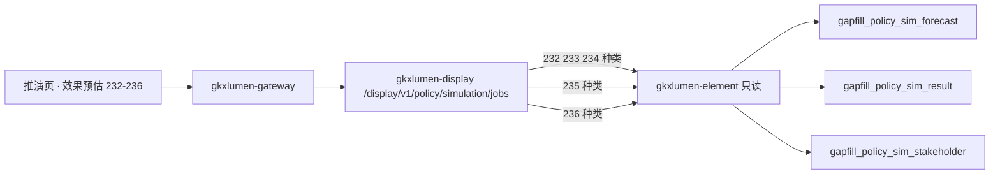

# POL-L2-DS12-EST-ARCH · 政策效果推演 · 效果预估 · 后台实现架构设计

- 任务：`POL-L2-DS12-EST-ARCH`
- 日期：2026-11-04
- 状态：架构稿已落盘，待架构、算法、数据、产品四角色会签。不标 done。2026-11-05 只改第 5.4、5.5 节的库.表写法，读法未改
- 监管：`human:淮政玮`
- 认领：`agent:arch-agent`
- 强度：ponytail off（定义任务，不缩文档）
- 图：`POL-L2-DS12-EST-ARCH-SEQ`（本叶新图，源文件无 frontmatter，记 `draft`）

本叶只定政策效果推演二级「效果预估」的实现架构和整体流程。SRS 序号 **232–236**（level5 路径 `政策效果推演/效果预估`）。用户故事 `US-DS-POL-06`。不写 OpenAPI 字段、请求体、响应体、枚举。那是 `POL-L2-DS12-EST-API`。

上游只引用，不改写：`政策效果推演.md` 232–236、说明书第 2 节 DS-12 与第 11.2 节、`sdd/调用链与边界.md`、`sdd/契约输入清单.md` 的 `simulation/jobs`、`sdd/指标与501.md` §3、`survey/DS-12.md`。不新造 `metric_id`，不改 D4。

签收标准（`human:淮政玮`，说明书第 11 节）：可实现才签收。真算、真查或真模型做不到时，只接受新建表、把 mock 写入表、接口读表。不允许接口直接返回 mock。本叶按第 11.2 节「推演 · 预估」写迁移之后的架构。

## 0. 范围裁定：五叶一稿，表分两组

SRS 路径把 **232–236 五叶都标在 level5「效果预估」**；说明书第 11.2 节按灌数分组把 232–234 归「推演 · 预估」、235/236 归「推演 · 仿真」。两个口径并存，本叶裁定：

- **业务归属以 SRS 为准**：本叶覆盖 232–236 五叶的架构与流程。
- **表归属以说明书 11.2 为准**：232–234 读 `gapfill_policy_sim_forecast`（EST 组）；235 读 `gapfill_policy_sim_result` 多维评估行、236 读 `gapfill_policy_sim_stakeholder` 参与意见行（SIM 组）。两张表的 DDL 字段分别由 `POL-L2-DS12-EST-DATA`、`POL-L2-DS12-SIM-DATA` 定，灌数单分别为 `POL-L2-DS12-EST-GAPFILL-L01`、`POL-L2-DS12-SIM-GAPFILL-L01`，均已按此分组建单。本叶不搬表、不改灌数单、不改说明书。

这样 `POL-L2-DS12-EST-ARCH`（本叶，232–236）与 `POL-L2-DS12-SIM-ARCH`（237–242）拼起来是完整的推演页，不产生第二套表，也不产生重叠叶。

## 1. 迁移调查：算法中台对应实现的分析与裁定

任务执行说明要求：参考算法中台里与本二级对应的政策实现；lumen 链路已有对应设计的沿用，没有的分析算法中台、把合理部分迁到 lumen 链路。调查结论如下。

### 1.1 算法中台现状（demo-ui-system-test + lumen-algo-py）

| 件 | 位置 | 实际内容 |
|---|---|---|
| 「效果推演」签 | `demo-ui-system-test/src/views/policy/components/TextAnalysis.vue` | 表格 + 曲线，读 `fetchSimulate` → `GET /policy/simulate` |
| 中台读面 | `lumen-algo-py` `policy_routes.py` `GET /v1/policy/simulate` | 按 `scope_code` / `scenario_id` 拣行读 `ads.policy_simulate` |
| 批产函数 | `polan/text/simulate.py` `run()` | 取 `ads.policy_intensity` 省级力度前 12 省 × 3 条固定情景（扶持+20%/+40%/覆盖扩展），按弹性系数推演 baseline→simulated、delta、逐年曲线、一句解释；truncate 后写回 `ads.policy_simulate` |
| 指标 | `metric_id` 固定 `M_POLICY_SIMULATE`；模型注册表把 `M_POLICY_DS_11_POLICY_EVAL_015` 列在 POLICY_SIMULATE 名下，函数本身不产出该条 | 情景参数待甲方（QPOL-02），现为规则基线 Mock |

### 1.2 与需规的差距

需规 232 要求用户输入**政策类型、覆盖范围、支持力度、实施时间**四类参数做未出台政策仿真，产出经济效益、社会影响、创新促进；233 基于政策文本解析与相似政策给短长期效果；234 按区域给 GDP、产业结构、就业率的空间分布。中台读面是**已出台政策的省级力度基线情景**：不收四类参数，没有区域空间维度，没有相似政策依据。整签迁过来填不出这三叶，且中台读面 `/v1/policy/simulate` 是算法中台自己的对外入口（`demo-ui-system-test` 在用），lumen 展示不直连、不把 demo 路径写成对外入口。

### 1.3 lumen 链路已有设计（沿用）

- 契约：推演整页只有一条资源 `POST /display/v1/policy/simulation/jobs`，只认 `M_POLICY_SIMULATE`（`sdd/契约输入清单.md`）。
- 链路：浏览器只打 `/display/v1/policy/**`；真算走 `gkxlumen-display` → `gkxlumen-topic-async-service` → Python `/internal/*`；展示不直连 Python、不直连库。
- 分键：`M_POLICY_SIMULATE` 是推演键；`M_POLICY_DEEP_171_1` / `M_POLICY_LAYOUT_REC_COUNT` 是布局推荐键，两键不合并、不互相填数。
- 白名单事实：Java `PolicyAnalysisTypes` 与 Python `JOB_SUB_TYPES` 均无 `policy_simulate` 子类型——`M_POLICY_SIMULATE` 未以可调用 Job 服务注册，真推演 Job 现状 501。

### 1.4 迁移裁定：不迁代码，迁职责

| 对象 | 裁定 |
|---|---|
| 中台读面 `/v1/policy/simulate`、`demo-ui-system-test` 效果推演签 | 留在原地服务算法中台，不迁、不改、不删。展示不直连、不嵌入 |
| `polan.text.simulate.run()` 与 `ads.policy_simulate` | 留作中台批产与读面。展示预估三叶**不改读这张表**（其 schema 与情景维度服务中台口径，动它会改已有闭包）；展示读 `gapfill_policy_sim_forecast`（说明书 11.2 的退路） |
| 行结构形态（baseline/simulated/delta/curve/explanation + 一句可解释说明） | **合理部分，采纳为缺项行的内容范式**：预估行的预测值、变化率、逐年趋势、一句解释照此形态写进行里，供前端直接呈现（字段名归 `POL-L2-DS12-EST-DATA`） |
| 弹性系数与固定三条情景 | **不迁**。情景参数 QPOL-02 待甲方，且中台情景不覆盖需规四类参数。缺项行的参数档由 DATA 单按需规四类参数设计 |
| 真模型演进 | `M_POLICY_SIMULATE` 注册为可调用服务后，三类预估切换到 async-service → Python `/internal/*` 真算；对外仍是 `simulation/jobs` 一条资源，URL 不变，Job 键不复用 `/topic/v1/policy`。注册动作不在本叶，本叶不进白名单 |

迁移之后的最终架构一句话：**浏览器只打 `/display/v1/policy/simulation/jobs`；效果预估三叶（232–234）由 `gkxlumen-display` 委托 `gkxlumen-element` 只读 `gapfill_policy_sim_forecast`，235/236 同一资源按种类读 SIM 组两张缺项表；真模型未注册的其余种类保持 501 空态；算法中台读面留原地，无任何 demo 依赖。**

## 2. 实现架构

推演页契约只有一条资源 `POST /display/v1/policy/simulation/jobs`。推演页可接统计读面为 0（`sdd/指标与501.md` §3），所以本二级没有 element 直读 ADS 统计的同步区块，全部区块走这一条资源按种类分发。

| 叶子 | 种类 | 迁移后的读法 |
|---|---|---|
| 232 | 预估 · 未出台仿真 | element 只读 `gapfill_policy_sim_forecast` 的未出台仿真行 |
| 233 | 预估 · 新出台预测 | 同表的新出台预测行 |
| 234 | 预估 · 区域空间 | 同表的区域空间行 |
| 235 | 多维评估 | element 只读 `gapfill_policy_sim_result` 的多维评估行（表归 SIM 组） |
| 236 | 利益攸关方 | element 按 `policy_id` 读 `gapfill_policy_sim_stakeholder` 的参与意见行与评估识别行（表归 SIM 组） |
| （真模型，未注册） | 真推演 | async-service → Python `/internal/*`。模型未注册 → 该种类 501，页面空态，不填曲线 |

| 生产者 | 消费者 | 触发 | 失败语义 | 禁止事项 |
|---|---|---|---|---|
| `data-agent` 按 `POL-L2-DS12-EST-GAPFILL-L01` / `POL-L2-DS12-SIM-GAPFILL-L01` 灌 mock 行 | `gkxlumen-element` 只读，经 `gkxlumen-display` 原样返回 | 用户打开预估三区、改参数查看、看多维评估、看参与意见 | 无行则该区空。一次种类查询失败不清其他种类已返回区块 | POST 不创建持久任务记录，不进 `gkxlumen-topic-async-service`，无 SSE、无进度条。不调用 `polan.text.simulate`。不写 ODS、DWD、ADS、供应方库。不把 demo 本地数组或 `/v1/policy/simulate` 当接口 |

`gkxlumen-display` 不直连库、不直连 Python，不写算法，不写 nGQL。`E-E7-POLICY-M1-L06` 不是本页路径。trace 沿既有展示链走，display 往 element 带 traceId，本叶不新设计观测点。

同一条 `simulation/jobs` 一次只带一种类。237–242 的种类（文本解析、重点可视、影响范围、路径预测、解读报告）由 `POL-L2-DS12-SIM-ARCH` 在同一条资源上分发，本叶不实现、不改挂。真推演种类 501 时，缺项表种类照常可读——「未注册则 501」约束的是真模型调用，缺项行是说明书第 11 节签收标准允许的退路，两者并存不冲突。

## 3. 各叶的输入条件

条件只来自需规原文。下表是用户要提交的选择，不是参数名，也不是响应字段。参数名与档位枚举留给 `POL-L2-DS12-EST-API`。未列出的条件不收。少了必选条件时该区空，不补默认值。

| 序号 | 用户要选 | 必选 | 落到哪次读取 |
|---|---|---|---|
| 232 | 政策类型、覆盖范围、支持力度、实施时间 | 四类至少一类；参数档对不上行则该次模拟空 | `jobs` 的未出台仿真 |
| 233 | 一条已出台政策（政策标识或文本） | 必选。无预测行则该区空 | `jobs` 的新出台预测 |
| 234 | 一个区域、一个政策类型 | 区域必选；类型对不上行则空间结果空 | `jobs` 的区域空间 |
| 235 | （推演上下文内查看，或跟随 232–234 的当次结果） | 无行则雷达/柱状空 | `jobs` 的多维评估 |
| 236 | 查看参与意见；页面提交渠道不落库 | 无行则意见列表空 | `jobs` 的利益攸关方 |

### 3.1 条件从哪来

对照了展示原型与算法中台。展示原型 `demo-ui-science` 推演页为复刻壳（`FE-POL-03A`），页头「布局建议」卡槽是布局推荐键的复刻位，不是预估数据源。算法中台效果推演签不收需规四类参数（见 §1.2）。lumen 已接通的政策计算只有 `polan.text.simulate.run` 写 `ads.policy_simulate`（省级力度情景，`metric_id` 固定 `M_POLICY_SIMULATE`），与本页三类预估维度不合。本叶不迁 `policyData.js` 常量，不迁 `/v1/policy/simulate`。

## 4. 整体流程

1. 用户打开效果预估。前端按默认档提交 `jobs`（种类=未出台仿真）。element 读缺项表未出台行。有行则呈现经济效益、社会影响、创新促进的预测值与说明；无行则该区空。
2. 用户调整政策类型、覆盖范围、支持力度或实施时间。前端再次提交 `jobs`，按新参数档拣行。对得上则返回该档结果；对不上则该次模拟空。切条件不自动起任务，也不现算。
3. 用户做多方案比较。多次查询的结果由前端并排呈现，或一次提交多参数档读多行。服务端不建对比槽，不存用户模拟历史（用户自己的模拟历史不灌假记录）。
4. 用户选一条已出台政策看新出台预测。前端提交 `jobs`（种类=新出台预测）。element 按政策拣行：短长期效果、经济/产业/科创影响、时间变化、空间分布说明与相似政策依据都写在行上。不调 `parse/jobs`，不另开解析通道。
5. 用户选区域与政策类型看空间模拟。前端提交 `jobs`（种类=区域空间）。element 按区域拣行：GDP、产业结构、就业率变化与空间分布数据在行上。热力图、地图渲染在前端，服务端只返回行。
6. 用户查看多维评估。前端提交 `jobs`（种类=多维评估）。element 读 `gapfill_policy_sim_result` 多维评估行。雷达图、柱状图为前端渲染。
7. 用户查看利益攸关方。前端先选政策，再提交 `jobs`（种类=利益攸关方，必带 `policy_id`）。element 读 `gapfill_policy_sim_stakeholder` 该政策下的参与意见行与评估识别行。无政策不查表。页面上新提交的问卷、意见不进入这次请求的写库；「汇总各方意见纳入效果评估模型」的需规在模型接通前不实现（有意不做），汇总只呈现该政策已灌参与意见行的计数。

某一次 `jobs` 失败，不清其他种类已经返回的区块。本页没有可接统计读面，也就没有会被异步失败清掉的同步统计卡；空态与失败态都按区块独立呈现。

## 5. 分叶

### 5.1 232 未出台政策仿真模拟 · 读未出台仿真行

没有未出台政策仿真模型。中台弹性情景不收四类参数（§1.2）。

- 表 `gkxlumenx_gapfill.gapfill_policy_sim_forecast`，种类为未出台仿真。
- 一行是一组参数档：政策类型、覆盖范围、支持力度、实施时间 + 经济效益、社会影响、创新促进的预测值 + 一句可解释说明。行内形态参照中台的 baseline/simulated/delta/curve 范式（§1.4）。
- 灌数是独立脚本 `POL-L2-DS12-EST-GAPFILL-L01`，不是请求处理。
- 行上 `metric_id` 用推演键 `M_POLICY_SIMULATE`（`sdd/指标与501.md` §3.2 已挂 232）。不新注册。
- Java 不生成方案，不按弹性公式现算。参数档对不上行则空。

### 5.2 233 新出台政策效果预测 · 读新出台预测行

没有新出台政策预测模型。需规说「基于政策文本解析和历史相似政策效果数据」，但调用链写明推演不为 `M_POLICY_TEXT_PARSE` 单开通道。

- 同一张表，种类为新出台预测。
- 一行挂在一条已出台政策上：短期与长期效果说明、**短中长期三维 KPI（`term_kpi_text`）**、经济增长/科技创新说明、产业发展柱图分（`industry_text`）、时间变化趋势（可带置信度）、空间分布特征、**相似政策列表（`similar_items`）**；`similar_basis_text` 可作一句总述。字段名归 `POL-L2-DS12-EST-DATA`。2026-11-12 COVER-FDE 按原型补齐列表与 KPI、趋势置信度。
- 不调 `parse/jobs`，不调 `policy_text_parse` 通道，不现做文本解析。
- 候选政策列表复用全景检索目录同一真源（`panorama/search` → `gkxlumen-topic-policy` 的 search/docs → Python `/internal/policy` → ODS 政策库），不新建政策列表读面。「新出台」的判定口径需规未定义，待甲方确认前，候选范围与灌数行挂哪些政策由 `POL-L2-DS12-EST-DATA` / `POL-L2-DS12-EST-GAPFILL-L01` 按临时默认定。
- 行上 `metric_id` 用 `M_POLICY_SIMULATE`。无行则该区空，不返回解析结果顶替。

### 5.3 234 区域经济发展空间模拟 · 读区域空间行

没有区域经济空间模拟模型。空间分布的渲染在前端，服务端只回行。

- 同一张表，种类为区域空间。
- 一行挂在一个区域 × 政策类型上：GDP 增长、产业结构变化、就业率变化 + 空间分布数据行（区域粒度由 DATA 单定）。
- 行上 `metric_id` 用 `M_POLICY_SIMULATE`。热力图、三维地图是前端渲染职责，不进服务端。
- 区域或类型对不上行则空间结果空，不造全国通用行。

### 5.4 235 多维度效果评估 · 读多维评估行（SIM 组表）

指标分册记 `metric_id` 未见，判定 501。按签收标准退路，读缺项表，不用 501 充当这块功能。

- 表 `gkxlumenx_gapfill.gapfill_policy_sim_result`（SIM 组，11.2 定名），种类为多维评估。
- 一行是一个维度（经济、社会、环境、创新）的得分与说明；雷达图、柱状图数据即这些行。
- 表与字段由 `POL-L2-DS12-SIM-DATA` 定，灌数由 `POL-L2-DS12-SIM-GAPFILL-L01` 执行，本叶只定读法。
- 行上 `metric_id` 留空（分册未见），不新造，不借用 `M_POLICY_DEEP_168_1`、不借用 `M_POLICY_SIMULATE` 填评估分——推演键只挂 232–234 的预测行。

### 5.5 236 利益攸关方参与评估 · 读参与意见行 + 评估识别行（SIM 组表）

指标未见，调研记关键词「利益」0 条。同款退路。2026-11-12 COVER-FDE：补政策选择与识别四卡真轨。

- 表 `gkxlumenx_gapfill.gapfill_policy_sim_stakeholder`（SIM 组）。`row_kind` 为 `参与意见` 或 `评估识别`。两种行都带 `policy_id`。
- 参与意见行：主体（决策者、评估者、利益攸关方）、渠道（在线问卷、意见征集、专家评审）、意见正文、时间。
- 评估识别行：`audit_item` / `audit_result` / `audit_text`（四项检查闭集见 SIM-DATA）。
- 请求种类仍是利益攸关方，**必须**带 `policy_id`。一次返回该政策下两种行。无政策或无行则空。
- 请求处理不插入、不更新、不删除。用户在页面新提交的意见留在浏览器，直到另有采集单。本叶不建那张单。
- 「纳入效果评估模型」有意不做；呈现侧汇总只对该政策已灌参与意见行计数。行上 `metric_id` 留空，不新造。

## 6. 点名排除

| 资源或对象 | 不纳入本二级的原因 |
|---|---|
| 237 政策文本智能解析、238 重点可视、239 影响范围、241 路径预测、242 解读报告 | SIM-ARCH 五叶（239 影响范围在 11.2 归 SIM 组灌数；契约注明「影响范围只跟该次结果」） |
| 240 政策关联分析 | 跨项索引。消费第 7 项子图，`M_POLICY_RELATION_DEGREE`，不设资源 |
| `M_POLICY_DEEP_171_1`、`M_POLICY_LAYOUT_REC_COUNT` | 布局推荐键。不进推演页任何区；`FE-POL-03A` 页头「布局建议」卡槽是复刻壳 |
| `ads.policy_simulate`、`polan.text.simulate`、`/v1/policy/simulate`、demo 效果推演签 | 算法中台读面与批产闭包。留原地，展示不直连不迁移（§1.4） |
| `M_POLICY_TEXT_PARSE`、`parse/jobs`、`parse/clauses` | 233 不调；拆解页资源不在本页 |
| 评价页 `evaluation/jobs` 序号 228 参数模拟 | 评价键。不共用推演资源，不把本页参数档写成评价方案 |
| `report/jobs` | 核增研报五叶。242 不是本单 |
| 异步白名单 `PolicyAnalysisTypes` / `JOB_SUB_TYPES` | 本叶不加 `policy_simulate` 子类型。缺项读面不进异步管道；模型注册后由后续单改 |
| `M_POLICY_EFFECT_SCORE`、`M_POLICY_INTENSITY_SCORE` | 效能得分留评价页，力度分留全景。不挂预估行 |

## 7. 明确不做

- 不写 OpenAPI 字段表、请求体、响应体、枚举、参数档名。
- 不新造 `metric_id`。不改 D4。不改模型注册表。不把 `GDF-POLICY-MOCK-GATE-L01` 写成已解开。
- 浏览器不改打专题 URL。不把 `E-E7-POLICY-M1-L06` 写成展示路径。
- 不重开 GDF，不写 nGQL。不加 ODS、DWD、ADS 表。预估三叶只加第 9 节这一张 `gapfill_` 表；235/236 行在已有定名的 SIM 组表里，本叶不建第二套。
- 不在本叶改 Python 或 Java。不进 `PolicyAnalysisTypes`，不进 async-service。
- 不直连、不迁移算法中台读面与 `demo-ui-system-test` 页面。lumen 链无任何 demo 运行时依赖（D12）。
- 不改 `FE-POL-03A`，不新建前端单。前端 mock 开关不是接口实现。
- 不改说明书、调研分册、契约输入清单，不改 WBS 里的 EST/SIM 两单拆分与灌数单依赖。
- 不允许接口函数直接返回 mock。
- 不会签。不把本单标 done。

## 8. 签收条件：可实现

五叶都有一条现在就能照着做的链路。写成「以后再选推演模型」，或者接口直接返回写死的预测、得分、意见、曲线，本单不可签收。

| 序号 | 可实现的做法 | 现在就能用的依据 |
|---|---|---|
| 232 | 建 `gapfill_policy_sim_forecast` 未出台仿真行，`jobs` 只查这些行 | 仓库无未出台政策仿真函数；中台情景不收需规四类参数 |
| 233 | 同表新出台预测行，依据写在行内，不另开解析通道 | 无预测模型；`policy_text_parse` 通道不进推演 |
| 234 | 同表区域空间行，服务端回行、前端渲染 | 无空间模拟模型；Java 不写渲染 |
| 235 | 读 SIM 组 `gapfill_policy_sim_result` 多维评估行 | 分册判定 metric 未见；11.2 已把该行归 SIM 表与 SIM 灌数单 |
| 236 | 读 SIM 组 `gapfill_policy_sim_stakeholder` 参与意见行，请求不插入 | 无采集服务；11.2 同上 |

迁移边界重申：算法中台页面留在 `demo-ui-system-test`；`/v1` 读面继续给算法中台自己用；展示不打 `/v1/policy/simulate`，不迁 `run()`；`ads.policy_simulate` 继续只服务中台读面。真模型注册后预估三类切 async 真算，对外 URL 不变。

## 9. 表与要灌的 mock（本叶组）

本叶组的表只有说明书 11.2 点名的一张。库只允许 `gkxlumenx_gapfill`。表名 `gapfill_policy_sim_forecast`。不进 ODS、DWD、ADS，不写供应方库。不拆成三张表。

种类只有三种：未出台仿真、新出台预测、区域空间。字段级 DDL 由 `POL-L2-DS12-EST-DATA` 定。灌数由 `POL-L2-DS12-EST-GAPFILL-L01` 执行，本叶不执行。

每行都带 `metric_id`（三种均用推演键 `M_POLICY_SIMULATE`）、`gap_item`、`fill_method`、`gapfill_batch_id`、`generated_at`。`fill_method` 用 `manual`。`gap_item` 写序号和叶子名。D4 保持 mock。

| 种类 | 叶子 | 要灌的 mock | 不灌 |
|---|---|---|---|
| 未出台仿真 | 232，可并排供多方案比较 | 若干参数档行。每行含政策类型、覆盖范围、支持力度、实施时间、目标产业，以及经济效益、社会影响、创新促进预测值、逐年趋势、一句解释。2026-11-07 起目标产业列是 `target_industry`，参与等值过滤 | 中台三条情景原文、弹性现算、用户模拟历史 |
| 新出台预测 | 233 | 挂在已出台政策上的预测行。含短长期效果、三类影响、时间趋势、空间特征、相似政策依据说明 | 独立文本解析行（归 SIM 组）、顶替用的解析结果 |
| 区域空间 | 234 | 挂在区域 × 政策类型上的行。含 GDP、产业结构、就业率变化、空间分布数据 | 全国通用兜底行、地图渲染数据之外的空间文件 |

235 多维评估行、236 参与意见行不在本表：归 `gapfill_policy_sim_result` / `gapfill_policy_sim_stakeholder`，灌数与字段由 SIM 组两单负责（§0 裁定）。

行要能按第 3 节的条件拣出来：232 按政策类型、覆盖范围、支持力度、实施时间、目标产业，提交了的项等值；233 按政策；234 按区域与类型，不加目标产业。条件对不上的行不返回。2026-11-07 `human:淮政玮` 修订 232，字段以 `POL-L2-DS12-EST-DATA` 同日修订为准。修复单 `POL-L2-DS12-INDUSTRY-EQ-FIX-L01`。

灌数单执行人是 `data-agent`，监管 `human:淮政玮`，状态 backlog。它们依赖本架构和 `POL-L2-DS12-EST-DATA` / `POL-L2-DS12-SIM-DATA`。查询请求不灌数。
