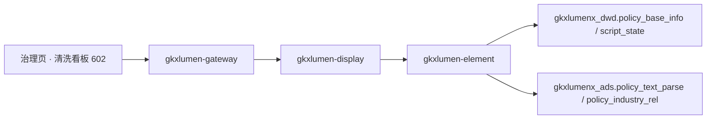

# POL-L2-PC1-CLEAN-ARCH · 政策数据治理 · 系统引用政策源数据清洗

- 任务：`POL-L2-PC1-CLEAN-ARCH`
- 日期：2026-11-04
- 状态：起草完成，待四角色会签。会签未完成不挡签收
- 监管：`human:淮政玮`
- 认领：`agent:arch-agent`
- 强度：ponytail off（定义任务，不缩文档）
- 图：`POL-L2-PC1-CLEAN-ARCH-SEQ`（本叶新图，源文件无 frontmatter，记 `draft`）

本叶只定政策数据治理二级「系统引用政策源数据清洗」的实现架构和整体流程。SRS 序号 **602**。用户故事 `US-DS-POL-07`。不写 OpenAPI 字段、请求体、响应体、枚举。那是 `POL-L2-PC1-CLEAN-API`。

上游只引用，不改写：`政策数据治理.md` 602、说明书第 2 节 PC-1 与第 11.2 节、`sdd/调用链与边界.md`、`sdd/契约输入清单.md` 的 `governance/results`、`sdd/指标与501.md` 治理节、`survey/PC.md` PC-1。不新造 `metric_id`，不改 D4。

签收标准（`human:淮政玮`，说明书第 11 节）：可实现才签收。真算、真查或真模型做不到时，只接受新建表、把 mock 写入表、接口读表。不允许接口直接返回 mock。本叶按第 11.2 节写迁移之后的架构：**602 全程不建缺项表**，读的就是第 6 项已有的加工结果。

## 1. 范围

602 是治理页的清洗看板。清洗、贴源、Mapping 全部在第 6 项数据工厂里已经发生或按既有计划发生，本二级不再实现一遍。前缀 `/display/v1/policy/`，资源只有一条：`GET /display/v1/policy/governance/results`。

| 需规要点 | 本叶流程 |
|---|---|
| 采集接入、去重合并、格式标准化、噪声过滤 | 发生在第 6 项：贴源（ODS→DWD）与主表清洗。展示只呈现其结果 |
| 数据质量校验规则 | 第 6 项 `script_state` 的状态枚举 `done/empty/no_match/degraded/failed/llm_unavailable` 就是已落库的校验结果。看板按状态聚合计数 |
| 准确性、完整性、一致性 | 看板上的计数口径。不新造清洗质量 `metric_id`（调研已判未见，指标单不改挂） |

## 2. 实现架构

浏览器只打 `/display/v1/policy/**`。不改打 `/topic/v1/policy`，不打开算法中台页面，不打 `/v1/policy/**`。

治理页契约只有三条资源。本二级只用 `governance/results` 这一条。`lineage-index`、`indicator-library` 分别由 604、605 两稿定，本叶不实现、不改挂。

| 需规要点 | 资源 | 迁移后的读法 |
|---|---|---|
| 清洗看板 | `GET /display/v1/policy/governance/results` | `gkxlumen-display` 不直连库。`gkxlumen-element` 只读 `gkxlumenx_dwd` / `gkxlumenx_ads` 已有加工结果 |

| 生产者 | 消费者 | 触发 | 失败语义 | 禁止事项 |
|---|---|---|---|---|
| 第 6 项 GDF 作业（贴源、Mapping、C1/C2）按既有单继续加工 | `gkxlumen-element` 只读，经 `gkxlumen-display` 原样返回 | 用户打开治理页清洗看板 | 无行则看板空；`script_state` 无行则质量计数空，不造 0 | 不重开 GDF 包。不加表不加字段。不调用 `polan` 函数。不把 demo 本地数组当接口 |

`gkxlumen-display` 不直连库，不直连 Python，不写算法，不写 nGQL。`E-E7-POLICY-M1-L06` 不是本页路径。

这条资源不进异步任务管道，不进 `gkxlumen-topic-async-service`。602 是同步读面。同一条资源上的页眉件数（挂 `M_POLICY_TOTAL_COUNT`，D4=mock）与 603 的结构化结果由同一资源返回，实现时按区块分发，本叶不改它们的读法。

trace 沿既有展示链走。display 往 element 带 traceId。本叶不新设计观测点。

## 3. 输入条件

条件只来自需规原文。下表是用户会做的操作，不是参数名，也不是响应字段。参数名留给 `POL-L2-PC1-CLEAN-API`。

| 用户操作 | 必选 | 落到哪次读取 |
|---|---|---|
| 打开治理页 | 无 | `governance/results` 一次读出：清洗质量计数、结构化结果、页眉「库内政策数」 |
| 按处理状态筛选质量明细（如只看 `failed`） | 否，不选则读全部 | 同一条资源的质量明细区块。枚举就是 `script_state.status` 已有六值，接口单不得另造状态名 |
| 选择政策查看该政策清洗/校验明细（总控 §1.2） | 否，不选则读全部 | 同一条资源的质量明细按 `policyId` 拣行。规则总表与批次总览仍全库；页眉 KPI 不变。参数名留给 API 单 |

### 3.1 条件从哪来

对照了展示原型和算法中台。展示原型 `demo-ui-science` 的政策治理演示（`PolicyGovernance.jsx` 一类）数据来自本地数组；算法中台 `demo-ui-system-test` 的「条款结构化」联调台（`POL-CLAUSE-BATCH-L01`）是加工操作台，不是看板。两者都不迁成本叶读面。

| 展示要素 | 现有实现里实际有什么 | 本叶怎么用 |
|---|---|---|
| 清洗质量 KPI | 演示页把 `M_POLICY_VALIDITY_RATE` 挂在清洗 KPI 上 | 不沿用。该指标口径是有效率、`srs_refs` 为空、挂点在全景筛选，调研已判本叶不挂。质量计数直接从 `script_state` 按状态聚合，无指标号 |
| 处理状态 | `script_state.status` 六值：`done/empty/no_match/degraded/failed/llm_unavailable` | 就是看板的质量枚举。`degraded`（LLM 降级）与 `failed` 是「噪声过滤/校验未过」的可观测事实 |
| 页眉件数 | `M_POLICY_TOTAL_COUNT`（STAT，D4=mock） | 保留。由本资源附带返回，不替代清洗质量 |

## 4. 整体流程

1. 用户打开治理页。前端调 `governance/results`。display 委托 element 读 DWD 主表与 `script_state`。
2. element 按 `script_state` 的 `job` 与 `status` 聚合：每作业总数、各状态行数。无行则质量区块空。
3. element 读 `policy_text_parse`（ADS，条款已合并）与 `policy_industry_rel` 的行数与最新批次，作为「已有加工结果」的结构化概览。无行则该块空。
4. 页眉件数按 `M_POLICY_TOTAL_COUNT` 的读法返回。对齐前数值仍是 mock。
5. 任何区块失败，不清空其他区块已经返回的内容。

## 5. 数据来源（只读，不建表）

| 库 | 表 | 用途 | 加工者 |
|---|---|---|---|
| `gkxlumenx_dwd` | `policy_base_info` | 政策主数据。行数即页眉件数的数据基础 | 第 6 项贴源 |
| `gkxlumenx_dwd` | `script_state` | 清洗/加工校验状态（C1/C2 每政策一行）。质量计数的唯一真源 | 第 6 项 C1/C2 |
| `gkxlumenx_ads` | `policy_text_parse` | 结构化条款（C2 合并）。603 的结果，本叶只取行数概览 | 第 6 项 C2 |
| `gkxlumenx_ads` | `policy_industry_rel` | 产业关联（C1）。概览行数 | 第 6 项 C1 |

602 **不新建任何表**。`gkxlumenx_gapfill` 不加表。清洗事实全部已在第 6 项的表里。

### 5.1 迁移边界

任务 note 要求：算法中台已有对应实现的沿用 lumen 设计；没有的，把合理部分迁到 lumen 链路。

| 算法中台/原型已有 | 本叶迁移后的架构 |
|---|---|
| `demo-ui-system-test` 条款结构化联调台（`/policy/clauses`，`polan/clause_job.py`，limit 100） | 留在算法中台，是加工操作台。展示侧不迁它的页面与操作，只读它写出的 `ads.policy_text_parse` 结果 |
| `GDF-POLICY-WORKPACK-v2` 的 `scripts/policy_c1_industry.py`、`policy_c2_clauses.py` | 留在第 6 项，是数据工厂作业。展示不重跑、不重开包 |
| demo 演示页本地数组（清洗 KPI、质量条目） | 不迁数据，只迁「看板区块」的信息结构：总数、按状态计数、最新批次时间。数值一律来自上面的表 |
| 旧 v1 37 列目标表、`polan/ods_sync.py` | 已废弃，不迁 |

lumen 不直连 demo 服务，不把 demo 路径写成对外入口。浏览器仍只打 `/display/v1/policy/**`。

## 6. 点名排除

| 资源或序号 | 不纳入本二级的原因 |
|---|---|
| `governance/lineage-index` | 604 的资源，由 `POL-L2-PC1-LINEAGE-ARCH` 定 |
| `governance/indicator-library` | 605 的资源，由 `POL-L2-PC1-INDLIB-ARCH` 定 |
| `M_POLICY_VALIDITY_RATE` | 口径是有效率，`srs_refs` 为空，挂点在全景。不把它改挂成清洗质量 |
| 重开 GDF / 新建清洗 Job | 第 6 项边界：展示不重做清洗、贴源、Mapping |
| 第 7 项读图 | 602 不涉及图 |
| 算法中台联调台操作 | 加工在算法中台，展示页只有看板，无操作按钮 |

## 7. 明确不做

- 不写 OpenAPI 字段表、请求体、响应体、枚举。
- 不新造 `metric_id`。不改 D4。清洗质量计数没有指标号，以行聚合呈现。
- 浏览器不改打专题 URL。不把 `E-E7-POLICY-M1-L06` 写成展示路径。
- 不重开 GDF，不写 nGQL，不加 ODS、DWD、ADS、gapfill 表。本叶零建表。
- 不在本叶改 Python 或 Java。
- 不改 `FE-POL-04A`，不新建前端单。
- 不改说明书、调研分册，不改 WBS 里的四单拆分。
- 不允许接口函数直接返回 mock。质量计数对不上真实行时显示空，不造 0。
- 不会签。不把本单标 done。

## 8. 签收条件：可实现

602 的链路现在就能照着做：element 三条只读 SQL（主表计数、`script_state` 聚合、ADS 概览），display 委托返回。写成「以后再建清洗管道」，或者接口返回写死的质量分数，本单不可签收。

| 需规要点 | 可实现的做法 | 现在就能用的依据 |
|---|---|---|
| 采集接入、去重、格式标准化、噪声过滤 | 呈现第 6 项已落库的结果，不自建管道 | `GDF-POLICY-WORKPACK-V1-L01` integration、`GDF-POLICY-WORKPACK-V2-L01` done，贴源与 C1/C2 已在跑 |
| 数据质量校验规则 | 按 `script_state.status` 六值聚合计数 | 表结构与枚举已在 `GDF-POLICY-WORKPACK-v2` `sql/script_state.sql` 定稿 |
| 准确性、完整性、一致性 | 看板计数 = 各状态行数占比；无行显示空 | 同上，真实行存在即可出数，无需新算法 |

迁移边界：算法中台联调台留在 `demo-ui-system-test`，继续服务加工。展示不打 `/internal/*`，不消费 `/v1/policy/**`。

## 9. 表与灌数

**本叶零建表、零灌数。** 说明书第 11.2 节对 602 的裁定就是「只读第 6 项已有结果」，不列灌数单。604、605 各有一张 gapfill 表与灌数单，分别归它们自己的架构稿。
