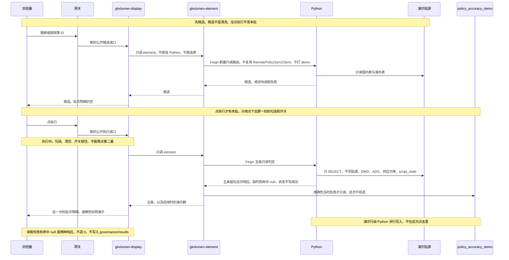

# POL-L2-PC1-CLEAN-ARCH · 政策数据治理 · 系统引用政策源数据清洗

- 任务：`POL-L2-PC1-CLEAN-ARCH`
- 日期：2026-11-04
- 重写：2026-11-10
- 状态：已按当日裁定重写。本稿不写会签结论，不把本单标 done
- 监管：`human:淮政玮`
- 认领：`agent:arch-agent`
- 强度：ponytail off（定义任务，不缩文档）
- 图：`POL-L2-PC1-CLEAN-ARCH-SEQ`（一张时序图，替换原来那张读主表和 `script_state` 的流图）
- **本稿已按 2026-11-10 裁定重写**

本叶只定政策数据治理二级「系统引用政策源数据清洗」的实现架构。SRS 序号 **602**。用户故事 `US-DS-POL-07`。口径是说明书「#### 602」与文末「已定」，以及 `会签/POL-L2-PC1-CLEAN-FDE-B2-读法方案.md` 的裁定清单和第 4.1 节。

中档。先出候选，点「执行」才有本批。没点不发本批。不写 OpenAPI 字段表，不写 SQL。那是后续 API 稿、数据稿的事。不新造 `metric_id`，不改 D4。准确性演示表用 `policy_accuracy_demo`，本稿不另起名。

签收标准仍是可实现。五条规则在一次请求里只读贴源做判定，结果留在响应里。准确性按 D18：Python 另行把演示行写入 `policy_accuracy_demo`，点「执行」时 element 只读这张表。display 不直连 Python，不直连库。不允许接口直接返回写死的演示数。

## 1. 范围

页在「智能政策库构建」的清洗页签。本叶只落实 602，不扩到 603、604、605。

候选来自演示贴源两表，库名用 `{ods}`，不写死成正式库。没有行的那一源，界面写「这一源还没有贴源数据」。

点「执行」之后才跑这一批。不建六条正式事实表。除准确性以外的五条（去重合并、格式标准化、噪声过滤、完整性校验、一致性校验）在这一次请求里判定，结果留在响应里。准确性单独走第 5 节的演示表，不和这五条混在一张表里。

`script_state` 和 `policy_base_info` 移出 602 的清洗结果。页眉库级计数口径不动，见第 7 节。

规则启停只在本页，不落库。见第 6 节。

## 2. 调用链

浏览器只打 `/display/v1/policy/**`。前端只到 Java。浏览器不直连 Python，也不直连贴源。

`gkxlumen-display` 只调 `gkxlumen-element`。display 不直连 Python，不直连库。候选和五条由 element 再 Feign 新建的只读内部路由，转到 Python。Python 只 SELECT 演示贴源。Java 不写贴源 SQL，不读供应方库 `gkx`。

候选和「执行」都是新的公开读口，具体路径由 API 稿定。两者都不复用 `GET /display/v1/policy/governance/results`，避免 603 被一起改掉。内部都不复用 `GET /internal/policy/search`，也不复用 `RemotePolicySyncClient`。不打 demo 服务。候选检索和本批五条判定在 Python 里分成两条只读入口。

准确性这条：点「执行」且当时这条规则启用时，`gkxlumen-element` 只读 `policy_accuracy_demo`。display 不读这张表，只把 element 读到的数放进同一次响应。Python 写入演示行发生在点击之外。

trace 沿既有展示链走。display 往下游带 traceId。本叶不新设计观测点。

| 动作 | 谁读 | 读哪里 |
|---|---|---|
| 候选 | display 只调 element；element Feign Python 只读 | `{ods}.dwd_policy_base`、`{ods}.dwd_global_policy_base` |
| 执行 · 五条 | 同上，新建只读内部路由 | 同上两表，只 SELECT，结果留在这次响应 |
| 执行 · 准确性 | element 只读。display 不直连库 | `policy_accuracy_demo` |
| 页眉库级计数 | 原读法，本叶不改 | 原资源里的库内政策数，不走候选读口 |

## 3. 候选

候选可以发生在点「执行」之前。候选不是清洗，不发本批请求。

`{ods}` 指向演示贴源，不写成正式库名。两表分源读，不合成一把。

| 源 | 表 | 界面上看见 |
|---|---|---|
| 国内 | `{ods}.dwd_policy_base` | 标题，辅以文号、发文部门、发布日期。业务键是政策 ID |
| 海外 | `{ods}.dwd_global_policy_base` | 标题，辅以发布机构、发布日期。业务键是政策 ID |

两条入口进同一个多选集合，国内、海外分块：按标题、文号或发文部门做智能搜索；按政策 ID 精确查。只出现贴源里的政策。

这一源一条行都没有，写「这一源还没有贴源数据」。这一源有数据但 ID 对不上，是另一句，不改去政策主表找。候选这一块读不出来，标明「读取失败」。已经显示出来的区块保持原样。

一条都没选时，「执行」不可用，规则区和批次明细都空，不造 0。已经勾上、还没点「执行」：规则行可以看、可以开关，批次明细仍空，不写成功，也不写成已经清洗过。

## 4. 点执行之后

没点「执行」不发本批。点下去之后按第 4.1 节：一次同步请求里算完再返回。不进 `gkxlumen-topic-async-service`，不新建清洗 Job。

请求只用点下去那一刻的勾选（来源 + 政策 ID）和当时启用的规则。停用的规则仍留在页上，标明停用，这一次不计入。返回前界面是执行中，同一选择不再发第二次。

五条只允许 SELECT 第 3 节那两张贴源表，国内和海外分源。禁止对 `{ods}`、DWD、ADS、供应方库 `gkx`、`script_state` 做写入。不改贴源里的原文。不读政策主表。去重合并在界面上是「应合并」，格式标准化是「待标准化」。

缺列的那一条作用范围不参与命中：该规则命中 null，状态不写成功，不造 0，走「无加工事实」。缺列不走「读取失败」。更新时间留空。有可判定的结果时，状态按下面三句，不展开成算法。判定结果只留在这次响应里，不落成六条正式事实表。

能判定的都过了、没有失败样例，是成功。既有过的也有失败样例，或者有的能判定、有的仍无加工事实，是部分。能判定的都带失败样例，是失败。读取失败和无加工事实不占用这三句。

两种响应分开：

| 情况 | 响应 |
|---|---|
| 这一次请求完成，该规则仍然没有可判定的结果 | 命中 null。状态不写成功。不造 0 |
| 转发失败或超时 | 该块标明「读取失败」。不用命中 null 代替。不返回 0。不写入 `governance/results` |

已经显示出来的区块保持原样，不改写成成功，也不改写成「没有加工事实」。

跑完之后再改勾选或开关：不自动再跑。旧结果留着，标明还不是最新一次。再点「执行」才按新的那一刻重跑。清空选择后回到未选。

刷新之后，执行中只在这次请求还没结束时成立。五条结果不在库里，刷新后不能从库里把这一批再读出来。

风险：去重要拿已选行对贴源比对，同步可能超时，超时按读取失败返回。多实例若只在单个进程里挡住第二次，另一实例仍可能再收一次。本叶不另做分布式锁。

## 5. 准确性演示表

准确性不参加第 4 节的现算，也不和五条结果放进同一张表。

单独一张 D18 的 ADS 演示表，表名 `policy_accuracy_demo`。本稿不另起名。这张表不进 ODS、DWD、供应方库，也不是 `gapfill_` 表，也不是那六条正式事实表。

Python 另行写入演示行，不在点击这次里现造。点「执行」且当时准确性启用时，element 只读 `policy_accuracy_demo`。display 不直连库，也不直连 Python，只把读到的数放进这一次的批次响应。没点「执行」之前不出现命中。

界面标明演示。不得写成已经按原文核过。读这张表失败时，准确性这一块标明「读取失败」，不改用写死的数顶上。

## 6. 规则启停

六条一次列全：去重合并、格式标准化、噪声过滤、完整性校验、一致性校验、准确性校验。

启停只在本页，不落库，不用 `script_state` 存开关。重新打开时六条都启用。勾上之后、没点「执行」之前可以开关。

正在跑时，页面锁住勾选、清空和规则开关。「执行」不能再点出第二遍。请求仍只用点下去那一刻的勾选和开关。

## 7. 页眉与相邻资源

页眉库内政策数的 `metric_id` 仍是 `M_POLICY_TOTAL_COUNT`，D4 保持 mock。它不走第 2 节的候选读口，也不随这一选改口径。本叶不重写它的读法。`results` 里的计数不得写成已经接入，也不得替代本批条数。

`GET /display/v1/policy/governance/results` 继续给 603。清洗页从这条只取页眉这个数。`qualityAgg` 不进 602 的批次明细，不再挂 `M_POLICY_VALIDITY_RATE`。602 的候选和执行不走这条资源。

`governance/lineage-index`、`governance/indicator-library` 仍分别由 604、605 两稿定。本叶不实现、不改挂。

不重开 GDF。第 6 项里 C1、C2 的既有作业留在第 6 项。`script_state` 记的是那两个作业的留痕，对不上这六条规则，602 不读它，也不写它。

## 8. 明确不做

- 不写 OpenAPI 字段表，不写 SQL。演示表不另起名，用 `policy_accuracy_demo`。
- 不新造 `metric_id`。不改 D4。
- 不把演示数写成已经按原文核过。
- 不建六条正式事实表。点「执行」这次不写 `{ods}`、DWD、ADS、`gkx`、`script_state`。
- 不复用 `governance/results`，不复用 `/internal/policy/search`，不复用 `RemotePolicySyncClient`。
- display 不直连 Python，不直连库。不打 demo 服务。
- 不把 `results` 里的计数写成已经接入，不拿它替代本批条数。`qualityAgg` 不进 602 的批次明细，不挂 `M_POLICY_VALIDITY_RATE`。
- 不让 Java 读贴源，不让 Java 读供应方库。
- 不重开 GDF，不改 603、604、605 的资源。
- 不把本单标 done，不在本稿写会签结论。
- 浏览器不改打专题 URL，不直连 Python。

## 9. 可实现

照着做就能落地，不依赖再选一档跑法。

| 需规要点 | 可实现的做法 |
|---|---|
| 多源候选 | display 只调 element。element Feign Python 只读演示贴源两表。没有行的源按「这一源还没有贴源数据」 |
| 采集接入、去重合并、格式标准化、噪声过滤、完整性、一致性 | 点「执行」后，同一条链只读判定，结果留在响应里。缺列则命中 null，状态不写成功，不造 0。成功、部分、失败按第 4 节三句 |
| 准确性 | Python 另行写入 `policy_accuracy_demo`。点「执行」时 element 只读。display 不直连这张表。界面标明演示 |
| 规则启停 | 只在本页。正在跑时锁住勾选、清空、开关 |

接口直接返回写死的质量分数，或把准确性演示数和五条现算写进同一张未命名的正式事实表，本单不可签收。

## 变更记录

2026-11-10：按当天裁定重写。贴源改由 Python 只读、Java 只转发。候选和执行改为新的公开读口，与 `governance/results` 拆开。不建六条正式事实表；除准确性外，点执行后在这一次请求里判定，结果留在响应里。准确性单独用一张演示表，表名由 DATA 稿定，本稿不起名。`script_state` 和政策主表移出本叶的清洗结果。页眉库级计数口径不动。

2026-11-10：波次 C。调用链改为浏览器只打 display，display 只调 element。候选和五条由 element Feign 新建只读内部路由，不复用 `RemotePolicySyncClient`，不打 demo 服务。准确性仍由 element 只读 `policy_accuracy_demo`。页眉 `metric_id` 仍是 `M_POLICY_TOTAL_COUNT`，D4 保持 mock。清洗页从 `results` 只取这个数，`qualityAgg` 不进批次明细。成功、部分、失败按选定三句写入第 4 节。
