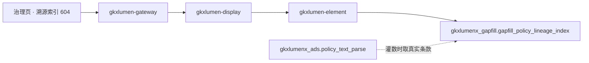

# POL-L2-PC1-LINEAGE-ARCH · 政策数据治理 · 溯源索引构建

- 任务：`POL-L2-PC1-LINEAGE-ARCH`
- 日期：2026-11-04
- 状态：起草完成，待四角色会签。会签未完成不挡签收
- 监管：`human:淮政玮`
- 认领：`agent:arch-agent`
- 强度：ponytail off（定义任务，不缩文档）
- 图：`POL-L2-PC1-LINEAGE-ARCH-SEQ`（本叶新图，源文件无 frontmatter，记 `draft`）

本叶只定政策数据治理二级「溯源索引构建」的实现架构和整体流程。SRS 序号 **604**。用户故事 `US-DS-POL-07`。不写 OpenAPI 字段、请求体、响应体、枚举。那是 `POL-L2-PC1-LINEAGE-API`。

上游只引用，不改写：`政策数据治理.md` 604、说明书第 2 节 PC-1 与第 11.2 节、`sdd/调用链与边界.md`、`sdd/契约输入清单.md` 的 `governance/lineage-index`、`sdd/指标与501.md` 治理节、`survey/PC.md` PC-1。不新造 `metric_id`，不改 D4。

签收标准（`human:淮政玮`，说明书第 11 节）：可实现才签收。真算、真查或真模型做不到时，只接受新建表、把 mock 写入表、接口读表。不允许接口直接返回 mock。本叶按第 11.2 节「治理 · 溯源 604」写迁移之后的架构：**建 `gapfill_policy_lineage_index`，行写入表，接口只读表**。

## 1. 范围

604 是治理页的溯源索引区块。需规要的是「政策原文、条款内容、分析结论之间的关联索引」。三个锚点里：原文与条款是真实数据（第 6 项已有）；**分析结论没有生产系统**（研报 Job 未注册、评价页分析结论未落库），所以结论端由灌数行提供。前缀 `/display/v1/policy/`，资源只有一条：`GET /display/v1/policy/governance/lineage-index`。

| 需规要点 | 本叶流程 |
|---|---|
| 原文 ↔ 条款关联 | 从已有 ADS 条款行生成真实关联行（不灌假数据，见 §5） |
| 条款 ↔ 分析结论关联 | 结论锚点无生产系统。灌 mock 行，接口读表 |
| 支撑研报结论的精准溯源、查证与复核 | 本叶只建治理页的索引读面。「研报溯源展示」是序号 617（PC-4），资源在 `report/jobs`，本叶不实现、不共用其表 |

## 2. 客观事实与迁移分析

任务 note 要求：算法中台已有的沿用，没有的把合理部分迁到 lumen 链路。

| 现有实现 | 与 604 的关系 | 本叶裁定 |
|---|---|---|
| `GDF-POLICY-LINEAGE-L01`（backlog，工位导入后的血缘说明） | DoD 是字段级数据血缘说明文档，不是原文—条款—结论索引 | 对不上。不改判成跨项索引，不为 604 等它 |
| 算法中台 `milvus_search` / 条款向量检索 | 相似度查询，不是溯源索引 | 不迁。604 的索引是关联行读面，不是相似检索 |
| 研报溯源（序号 617） | 五叶研报 Job 未注册，双向索引 501 | 不共用。617 灌 `gapfill_policy_report_trace`，与本表分开 |
| 专题 `gkx_search_service` | 专题政策检索门面 | 不迁。展示不打专题 URL |

分析结论锚点现状：政策域 35 条指标 D4 全 mock；研报五叶 501；评价页结论（摘要、解读）也无落库表。**没有可消费的结论真源**——这正是说明书第 11.2 节把 604 列入「未开工二级」、建 `gapfill_policy_lineage_index` 灌 mock 行的原因。604 不是「缺一项输入就建不了」的功能，是「结论端本来就没系统」的功能，灌数方案成立。

## 3. 实现架构

浏览器只打 `/display/v1/policy/**`。不改打 `/topic/v1/policy`，不打开算法中台页面，不打 `/v1/policy/**`。

治理页契约只有三条资源。本二级只用 `governance/lineage-index` 这一条。`results`（602/603）、`indicator-library`（605）由各自稿件定，本叶不实现、不改挂。

| 需规要点 | 资源 | 迁移后的读法 |
|---|---|---|
| 溯源索引读面 | `GET /display/v1/policy/governance/lineage-index` | `gkxlumen-element` 只读 `gkxlumenx_gapfill.gapfill_policy_lineage_index` |

| 生产者 | 消费者 | 触发 | 失败语义 | 禁止事项 |
|---|---|---|---|---|
| `data-agent` 按 `POL-L2-PC1-LINEAGE-GAPFILL-L01` 灌行 | `gkxlumen-element` 只读，经 `gkxlumen-display` 原样返回 | 用户打开治理页溯源区块，或按政策/条款/结论检索索引行 | 无行则区块空，不造 0；失败不清空治理页其他区块（602/603 的看板、页眉件数） | 不进 `gkxlumen-topic-async-service`。不调用任何 `polan` 函数。不写 ODS、DWD、ADS。不把 demo 本地数组当接口 |

`gkxlumen-display` 不直连库，不直连 Python，不写算法，不写 nGQL。`E-E7-POLICY-M1-L06` 不是本页路径。

这条资源不进异步任务管道。治理页三条资源各自独立，本叶不改另两条的读法。

trace 沿既有展示链走。display 往 element 带 traceId。本叶不新设计观测点。

## 4. 整体流程

1. `data-agent` 灌数：对每条已有条款行生成原文↔条款关联行；对假想的结论行生成条款↔结论行；写入 gapfill 表。
2. 用户打开治理页溯源区块。前端调 `lineage-index`。display 委托 element 只读 gapfill 表。
3. 用户按政策、条款或结论检索索引行。仍走同一条资源，按条件拣行。条件对不上则空。
4. 任何失败不清空治理页其他区块。

## 5. 数据来源：一张 gapfill 表，两种行

表只建在 `gkxlumenx_gapfill`，表名 `gapfill_policy_lineage_index`。不进 ODS、DWD、ADS，不写供应方库。字段级 DDL 由 `POL-L2-PC1-LINEAGE-DATA` 定；灌数由 `POL-L2-PC1-LINEAGE-GAPFILL-L01` 执行，本叶不执行。

**两种行，真实与 mock 各标各的性质：**

| 行类型 | 锚点 | 来源 | mock 标记 |
|---|---|---|---|
| 真实关联行 | 原文 ↔ 条款 | 灌数脚本从 `ads.policy_text_parse` 已有条款行生成；`policy_id`、条款号、原文摘录都取真实值 | 不标 mock，如实反映已有结构化结果 |
| mock 关联行 | 条款 ↔ 分析结论 | 灌数脚本写入假想的结论行（结论标题、一句内容）。政策域结论无生产系统 | 标 mock（`fill_method=manual`、`gap_item` 写序号与叶子名），UI 带 🧪 MockBadge，诚实呈现 |

每行都带 `metric_id`（留空，不新注册）、`gap_item`、`fill_method`、`gapfill_batch_id`、`generated_at`。D4 保持 mock。

**为什么原文—条款行取真实、结论行是 mock：** 说明书第 11 节的原则是「不灌假记录顶替已有真实数据」。原文与条款已在 ADS，编造假条款违反不伪闭合原则。结论端无真源，按签收标准只能灌 mock 行进表。灌数单 DoD 已写明「灌入原文、条款、结论之间的关联行」，两种行都在其范围内。

### 5.1 输入条件

条件只来自需规原文。下表是用户会做的操作，不是参数名，也不是响应字段。参数名留给 `POL-L2-PC1-LINEAGE-API`。

| 用户操作 | 必选 | 落到哪次读取 |
|---|---|---|
| 打开治理页溯源区块 | 无 | 读索引概览（行数、锚点类型分布）。无行则空 |
| 按政策查索引 | 否，不选则读全部 | 按政策拣行。该政策无行则空 |
| 按条款查关联 | 是 | 按条款拣关联行。条款号不在表里则空 |
| 按结论查原文依据 | 否 | 按结论行拣其条款行与原文行。无行则空 |

### 5.2 与 617 研报溯源的区别

| | 604 治理溯源索引 | 617 研报溯源展示 |
|---|---|---|
| 资源 | `governance/lineage-index` | `report/jobs` |
| 表 | `gapfill_policy_lineage_index` | `gapfill_policy_report_trace` |
| 方向 | 原文↔条款↔结论三锚点 | 研报结论↔政策原文/数据源双向 |
| 状态 | 本叶建表读面 | 五叶研报 Job 未注册，501 |

两表不合并。604 的表不给 617 顶数，617 的表也不给 604 顶数。

## 6. 点名排除

| 资源或序号 | 不纳入本二级的原因 |
|---|---|
| `GDF-POLICY-LINEAGE-L01` | 工位导入后的字段级血缘说明，不是原文—条款—结论索引。对不上不改判 |
| `governance/results` | 602/603 的资源 |
| `governance/indicator-library` | 605 的资源 |
| 第 7 项读图 / 政策子图 | 604 的索引是行表，不是图。不写 nGQL，不消费子图 |
| `milvus_search` 条款向量检索 | 相似度检索不是溯源索引。不迁 |
| `report/jobs`（617）与 `gapfill_policy_report_trace` | 研报溯源是另一条链路，表分开，不互顶 |

## 7. 明确不做

- 不写 OpenAPI 字段表、请求体、响应体、枚举。
- 不新造 `metric_id`。不改 D4。不改模型注册表。
- 浏览器不改打专题 URL。不把 `E-E7-POLICY-M1-L06` 写成展示路径。
- 不重开 GDF，不写 nGQL，不加 ODS、DWD、ADS 表。本叶只加第 9 节这一张 `gapfill_` 表。
- 不在本叶改 Python 或 Java。
- 不改 `FE-POL-04A`，不新建前端单。
- 不改说明书、调研分册，不改 WBS 里的四单拆分。
- 不允许接口函数直接返回 mock。行都在表里，接口只读表。
- 不会签。不把本单标 done。

## 8. 签收条件：可实现

604 的链路现在就能照着做：建表 → 灌两种行 → element 只读 → display 委托。写成「等研报系统上线后再建索引」，或者接口直接返回写死的索引行，本单不可签收。

| 需规要点 | 可实现的做法 | 现在就能用的依据 |
|---|---|---|
| 原文↔条款关联 | 从 ADS 条款行生成真实关联行 | 条款已在 `ads.policy_text_parse`（C2 done + 跑批 integration） |
| 条款↔结论关联 | 灌 mock 结论行进表 | 结论无生产系统，符合签收标准（表+mock+读表） |
| 支撑溯源查证 | 索引读面按政策/条款/结论拣行 | 同一条资源三种拣行方式，无需新模型 |

迁移边界：算法中台向量检索留在原处服务相似查询；`GDF-POLICY-LINEAGE-L01` 继续做它的工位血缘说明。展示不打 `/internal/*`。

## 9. 表与要灌的 mock

| 表 | 行类型 | 要灌的内容 | 不灌 |
|---|---|---|---|
| `gapfill_policy_lineage_index` | 真实关联行 | 从 `ads.policy_text_parse` 条款行生成的原文↔条款行（真实 policy_id、条款号、摘录） | 编造的条款、不存在的政策 |
| `gapfill_policy_lineage_index` | mock 关联行 | 挂在真实条款上的假想结论行（结论标题、一句内容） | 真实研报结论（研报 Job 未注册，无真源可取）；`gapfill_policy_report_trace` 的内容 |

行要能按 §5.1 的条件拣出来。灌数单执行人是 `data-agent`，监管 `human:淮政玮`，状态 backlog，依赖本架构和 `POL-L2-PC1-LINEAGE-DATA`。查询请求不灌数。
