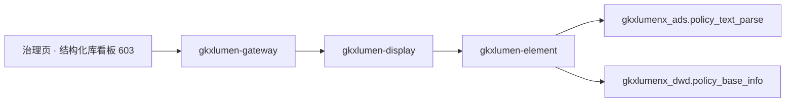

# POL-L2-PC1-STRUCT-ARCH · 政策数据治理 · 政策库结构化

- 任务：`POL-L2-PC1-STRUCT-ARCH`
- 日期：2026-11-04
- 状态：起草完成，待四角色会签。会签未完成不挡签收
- 监管：`human:淮政玮`
- 认领：`agent:arch-agent`
- 强度：ponytail off（定义任务，不缩文档）
- 图：`POL-L2-PC1-STRUCT-ARCH-SEQ`（本叶新图，源文件无 frontmatter，记 `draft`）

本叶只定政策数据治理二级「政策库结构化」的实现架构和整体流程。SRS 序号 **603**。用户故事 `US-DS-POL-07`。不写 OpenAPI 字段、请求体、响应体、枚举。那是 `POL-L2-PC1-STRUCT-API`。

上游只引用，不改写：`政策数据治理.md` 603、说明书第 2 节 PC-1 与第 11.2 节、`sdd/调用链与边界.md`、`sdd/契约输入清单.md` 的 `governance/results`、`sdd/指标与501.md` 治理节、`survey/PC.md` PC-1。不新造 `metric_id`，不改 D4。

签收标准（`human:淮政玮`，说明书第 11 节）：可实现才签收。真算、真查或真模型做不到时，只接受新建表、把 mock 写入表、接口读表。不允许接口直接返回 mock。本叶按第 11.2 节写迁移之后的架构：**603 全程不建缺项表**，结构化结果就是第 6 项 C2 已经合并进 `ads.policy_text_parse` 的条款与标签。

## 1. 范围

603 是治理页的结构化库看板。非结构化文本 → 结构化数据的转化发生在第 6 项（GDF C2 条款结构化）与算法中台联调台（`POL-CLAUSE-BATCH-L01`），~~本二级只呈现结果~~（**已被说明书 2026-11-10「#### 603」取代**，见下段）。前缀 `/display/v1/policy/`，与 602 共用同一条资源 `GET /display/v1/policy/governance/results`。

**FDE 补段（轻档，2026-11-10）**：治理页可触发**单条**结构化抽取，以说明书「#### 603」为准。触发复用已有 `POST /display/v1/policy/parse/clauses`（display → Feign `clauseEnrich` → Python `/internal/policy/clauses/enrich`，写回 ADS `policy_text_parse`）；摘要与看板主读仍走 `GET …/governance/results`（带 `policyId` 刷新 `hasClauses`）。仍不重开 GDF、不迁中台操作台、不新开第三条公开资源。旧「只读呈现、不重跑 / 点名排除本叶触发 `parse/clauses`」口径已被该说明书取代。

| 需规要点 | 本叶流程 |
|---|---|
| 非结构化文本转标准化结构化数据 | 已发生：C2 把正文切成条款合并进 ADS。展示呈现结构化覆盖率与条款概览 |
| 政策分类标签体系 | 已有列：`ads.policy_text_parse.auto_tags`、`structured_elements`。展示按标签聚合呈现分布，不新建标签字典 |
| 元数据规范与字段映射规则 | 第 6 项 Wave B Mapping 已定（`policy_base_info` 字段矩阵）。展示呈现结构化库的元数据概览，不重写映射文档 |
| 统一管理、快速检索与高效调用 | 「调用」由全景检索承担（序号 197/198/200，内部委托 `gkxlumen-topic-policy`）。本叶只做治理视角的库概览，不新建第二条检索 |

## 2. 实现架构

浏览器只打 `/display/v1/policy/**`。不改打 `/topic/v1/policy`，不打开算法中台页面，不打 `/v1/policy/**`。

| 需规要点 | 资源 | 迁移后的读法 |
|---|---|---|
| 结构化库看板 | `GET /display/v1/policy/governance/results`（与 602 同一条） | `gkxlumen-element` 只读 `gkxlumenx_ads.policy_text_parse` 与 `gkxlumenx_dwd.policy_base_info` |

| 生产者 | 消费者 | 触发 | 失败语义 | 禁止事项 |
|---|---|---|---|---|
| 第 6 项 C2（`policy_c2_clauses.py`）与算法中台条款跑批写 ADS | `gkxlumen-element` 只读，经 `gkxlumen-display` 原样返回 | 用户打开治理页结构化区块 | 无行则结构化区块空，覆盖率不造 100% 也不造 0% | 不重跑 C2。不写 ES。不回写 DWD。不重开 GDF 包 |

`gkxlumen-display` 不直连库，不直连 Python，不写算法，不写 nGQL。`E-E7-POLICY-M1-L06` 不是本页路径。

这条资源不进异步任务管道。603 的结构化区块与 602 的质量区块、页眉件数在同一条 `governance/results` 上，实现时按区块分发；契约单不得把三个区块拆成三条资源，也不得把本区块变成单独的条款树接口——条款树浏览仍是拆解页 `parse/clauses` 的事（序号 607/608），本叶看板仍是治理视角的统计概览。~~「本叶不得触发 `parse/clauses`」~~（**已被说明书 2026-11-10「#### 603」取代**：治理页可复用该 POST 作单条抽取，见 §1 FDE 补段）。

trace 沿既有展示链走。display 往 element 带 traceId。本叶不新设计观测点。

## 3. 输入条件

条件只来自需规原文。下表是用户会做的操作，不是参数名，也不是响应字段。参数名留给 `POL-L2-PC1-STRUCT-API`。

| 用户操作 | 必选 | 落到哪次读取 |
|---|---|---|
| 打开治理页 | 无 | `governance/results` 一次读出结构化区块：结构化政策数、标签分布、最新结构化批次 |
| 按标签筛选结构化概览（如只看某类标签） | 否，不选则读全部 | 同一条资源的结构化区块。标签枚举来自 `auto_tags` 实际值，接口单不得另造闭集 |
| 选择政策查看该政策结构化摘要（总控 §1.2） | 否；演示主路径建议默认一条可演政策 | 同一资源附加「单政策结构化摘要」：是否有条款行、`auto_tags`、更新时间。不是拆解页条款树。不选则提示选择或空，禁止用全局表冒充 |

### 3.1 条件从哪来

对照了展示原型和算法中台。展示原型的结构化演示数据在本地数组；算法中台的条款结构化是操作台（按 `policy_id` 抽单条/增量/全量，limit 100），它的产出就是本叶读的表。

| 展示要素 | 现有实现里实际有什么 | 本叶怎么用 |
|---|---|---|
| 分类标签体系 | `ads.policy_text_parse.auto_tags`（已有列）、`structured_elements.clauses` 内归类（补贴标准/准入条件/扶持措施） | 分布从实际行聚合。没有注册的结构化覆盖率指标，不挂 `metric_id` |
| 元数据规范 | `dwd.policy_base_info` 字段矩阵（Wave B Mapping 定稿） | 元数据概览（字段数、来源面）从表结构呈现，不把映射文档搬进接口 |
| 结构化覆盖率 | 无注册指标。`POLICY-DDL-GAP-L10` 只建了空表，覆盖率 = `policy_text_parse` 有条款行数 ÷ 主表政策数 | 展示按此口径出数。分子分母都是真实行数，缺行显示真实比例；全空则区块空，不造 0 |

## 4. 整体流程

1. 用户打开治理页。前端调 `governance/results`。display 委托 element 读 ADS 与 DWD。
2. element 计算：主表政策总数（分母）、`policy_text_parse` 有条款的政策数（分子），覆盖率照实返回。
3. element 按 `auto_tags` 与条款归类聚合作标签分布。无行则分布空。
4. element 取 `script_state` 中 `job=c2` 的最新批次时间，作为「结构化更新时间」呈现。
5. 页眉件数与 602 质量计数由同一次读取的其余区块返回。任何区块失败不清空其他区块。

## 5. 数据来源（只读，不建表）

| 库 | 表 | 用途 | 加工者 |
|---|---|---|---|
| `gkxlumenx_ads` | `policy_text_parse` | 结构化条款、自动标签。覆盖率分子、标签分布真源 | 第 6 项 C2 / 算法中台跑批 |
| `gkxlumenx_dwd` | `policy_base_info` | 覆盖率分母；元数据字段矩阵 | 第 6 项贴源 |
| `gkxlumenx_dwd` | `script_state`（`job=c2`） | 结构化批次时间与处理状态 | 第 6 项 C2 |

603 **不新建任何表**。`gkxlumenx_gapfill` 不加表。结构化事实已在 ADS。

### 5.1 迁移边界

| 算法中台/原型已有 | 本叶迁移后的架构 |
|---|---|
| 条款结构化联调台（`POL-CLAUSE-BATCH-L01`，写 `ads.policy_text_parse.structured_elements.clauses`） | 留在算法中台作加工通道。~~展示只读其产出~~（**「只读呈现、不触发抽取」已被说明书 2026-11-10「#### 603」取代**；治理页可触发单条 `parse/clauses`，见 §1）。不迁操作台、不新开展示侧跑批、不重开 GDF |
| GDF C2 合并逻辑 | 留在第 6 项。展示不合并、不去重、不回写 |
| demo 结构化演示本地数组 | 不迁数据。区块信息结构（覆盖率、标签分布、更新时间）保留，数值一律来自 ADS/DWD |
| 专题侧 `gkx_search_service` 的政策检索 | 「快速检索与高效调用」由全景检索（委托 `gkxlumen-topic-policy`）承担。本叶不建第二条检索，不迁专题门面 |

lumen 不直连 demo 服务，不把 demo 路径写成对外入口。浏览器仍只打 `/display/v1/policy/**`。

## 6. 点名排除

| 资源或序号 | 不纳入本二级的原因 |
|---|---|
| `parse/clauses`（条款树浏览） | 拆解页序号 607/608 的条款树浏览仍不纳入本二级。~~点名排除本叶触发该资源~~（**已被说明书 2026-11-10「#### 603」取代**）：治理页可复用 `POST …/parse/clauses` 作单条抽取，见 §1；不新开第三条资源 |
| `governance/lineage-index` | 604 的资源 |
| `governance/indicator-library` | 605 的资源 |
| `M_POLICY_TEXT_PARSE` | MODEL、口径是闭集词表、`ui_mount` 在详情与筛选。不是结构化覆盖率，不改挂 |
| 全景检索 `search`/`stats` | 「统一检索」由全景承担（委托 `gkxlumen-topic-policy`）。本叶不新建检索读面 |
| 重开 GDF / 新建结构化 Job | 第 6 项边界。C2 已在跑 |
| 第 7 项读图 | 603 不涉及图 |

## 7. 明确不做

- 不写 OpenAPI 字段表、请求体、响应体、枚举。
- 不新造 `metric_id`（含结构化覆盖率）。不改 D4。
- 浏览器不改打专题 URL。不把 `E-E7-POLICY-M1-L06` 写成展示路径。
- 不重开 GDF，不写 nGQL，不加 ODS、DWD、ADS、gapfill 表。本叶零建表。
- 不在本叶改 Python 或 Java。
- 不改 `FE-POL-04A`，不新建前端单。
- 不改说明书、调研分册，不改 WBS 里的四单拆分。
- 不允许接口函数直接返回 mock。覆盖率照真实行数计算，无行则空。
- 不会签。不把本单标 done。

## 8. 签收条件：可实现

603 的链路现在就能照着做：element 两条只读 SQL（覆盖率分子分母 + 标签聚合 + 批次时间），display 委托返回。写成「以后再建结构化管道」，或者接口返回写死的覆盖率与标签分布，本单不可签收。

| 需规要点 | 可实现的做法 | 现在就能用的依据 |
|---|---|---|
| 文本转结构化 | 呈现 C2 已合并的条款结果 | `GDF-POLICY-WORKPACK-V2-L01` done，`POL-CLAUSE-BATCH-L01` integration，ADS 有真实条款行 |
| 分类标签体系 | 从 `auto_tags` 与条款归类聚合 | 列已在 DDL 定稿（`14-ADS-MySQL-DDL/ads-creates.md`） |
| 元数据规范 | 从 `policy_base_info` 字段矩阵呈现 | Wave B Mapping 定稿在派单包 `09` |

迁移边界：操作台留在算法中台；`/v1` 读面继续给算法中台自己用；展示不打 `/internal/*`。

## 9. 表与灌数

**本叶零建表、零灌数。** 说明书第 11.2 节对 603 的裁定就是「只读第 6 项已有结果」，不列灌数单。`gapfill_policy_lineage_index`（604）与 `gapfill_policy_indicator_lib`（605）归它们自己的架构稿。
