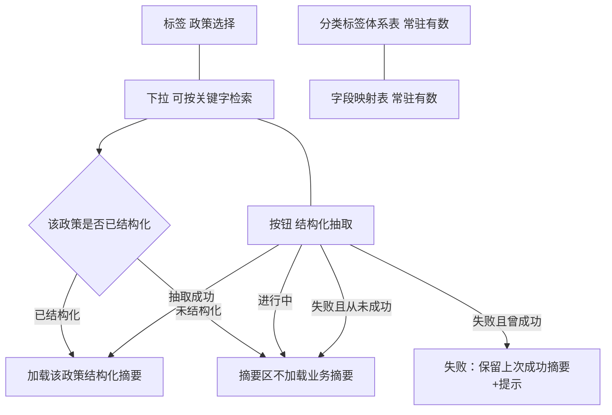

# 603-STRUCT-FDE · 政策库结构化页签线框

版本：`vFDE-603-2026-11-10`（中档；异议闭合 1A）  
口径只认说明书「#### 603」。页在「智能政策库构建」的**结构化**页签。只画：政策选择行（标签 + 可搜下拉 + 结构化抽取按钮）、下方摘要门控、两表常驻。不画架构时序、不写接口字段、不写建表。  
**本波不验收**：页内「结构化政策快速检索」区块（`603-qry-1`；异议闭合 **3A**；后波）。线框仍可占位画出，但不作本波截图/DoD 验收项。

## 一页

```
┌ 智能政策库构建 / 结构化 ──────────────────────────────────────────────────────┐
│                                                                              │
│  条件栏同一行                                                                │
│    标签「政策选择」（不再写「演示政策」）                                     │
│    下拉（可按关键字检索）                                                    │
│    按钮「结构化抽取」                                                        │
│      未选 → 不可用                                                           │
│      已选且未结构化 → 可点                                                   │
│      已选且已结构化 → 可再抽（2A）                                           │
│      抽取进行中 → 不可再点；标明进行中                                       │
│                                                                              │
│  ── 该政策结构化摘要（门控）────────────────────────────────────────────── │
│    未选：不出现某一政策的业务摘要                                            │
│    已选且未结构化：不加载业务摘要；引导先点「结构化抽取」                    │
│    已选且已结构化 / 抽取成功：加载摘要                                       │
│      （标题、效力级别、地区、机关、日期、结构化状态、分类标签、主题…）       │
│    抽取失败：保留上次成功摘要（若有）+ 失败提示；从未成功过则不加载摘要      │
│                                                                              │
│  ── 两表常驻（与是否选政策、是否抽取无关；不得空表）────────────────────── │
│    ┌ 政策分类标签体系（树表）─┐  ┌ 元数据规范 · 字段映射规则 ────────────┐ │
│    │ 有行有数（Wave0）         │  │ 有行有数（Wave0）                       │ │
│    └──────────────────────────┘  └────────────────────────────────────────┘ │
│                                                                              │
│  ── 结构化政策快速检索（治理视角；本波不验收 603-qry-1）────────────────── │
└──────────────────────────────────────────────────────────────────────────────┘
```



## 相对位置（必须能截图核验）

1. 「政策选择」标签、可搜下拉、「结构化抽取」在**同一行**；抽取按钮不挪到摘要卡标题栏或两表里。
2. 摘要区在条件栏之下、两表之上；未结构化时这里**没有**业务摘要卡。
3. 两表并排（或同区）常驻；打开页签即可看见有行，不依赖先选政策。
4. 「结构化抽取」只出现在结构化页签；溯源 / 指标库若共用选择器，可共用「政策选择」标签，但不出现本按钮。
5. 「结构化政策快速检索」若画出，仅占位；**本波不验收**（不进截图 DoD）。

## 状态（线框侧对照）

| 状态 | 哪一块变成什么 |
|---|---|
| 未选政策 | 下拉未选。「结构化抽取」不可用。摘要区无业务摘要。两表有数 |
| 已选且已结构化 | 摘要区加载该政策结构化摘要。「结构化抽取」仍在同一行且**可再抽** |
| 已选且未结构化 | 摘要区不加载业务摘要。「结构化抽取」可点。两表有数 |
| 抽取进行中 | 标明进行中。「结构化抽取」不能再点。摘要仍不假装成功 |
| 抽取失败 | 失败提示；**保留上次成功摘要**（若有）。「结构化抽取」可再点 |
| 抽取成功后摘要出现 | 摘要区出现已结构化摘要 |
| 两表常驻有数 | 标签体系表、字段映射表均有行；与选择 / 抽取无关 |
| 603-qry-1 | **本波不验收**（后波） |

## 不做

- 不画中台「抽取条款」页，不画 Python / enrich 时序。
- 不画 `parse/clauses` 请求体字段名表。
- 不画新建库表或 GDF 重跑。
- 不把拆解页条款树画进本页摘要。
- 本波不把页内快速检索当作验收项。
