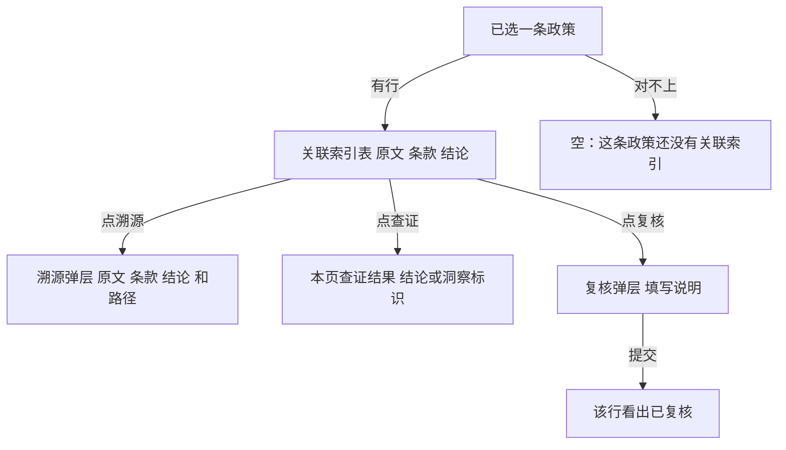

# 604-LINEAGE-FDE · 溯源索引页签线框

版本：`vFDE-604-2026-11-16`（选项 B 已定）  
口径只认说明书「#### 604」。页在「智能政策库构建」的**溯源**页签。只画：按政策拣出的关联索引表，以及行上「溯源」「查证」「复核」。不画研报页 617，不写接口字段，不写建表。

## 一页

```
┌ 智能政策库构建 / 溯源 ────────────────────────────────────────────────────────┐
│                                                                              │
│  已选一条政策（未选时提示「请先选择政策」，下面不列出某一政策的行）            │
│                                                                              │
│  ── 关联索引（原文 / 条款 / 结论）──────────────────────────────────────── │
│    ┌ 政策原文 │ 条款内容 │ 分析结论 │ 操作 ─────────────────────────────┐  │
│    │ （这一行的原文）│（这一行的条款）│（这一行的结论）│ 溯源 查证 复核 │  │
│    │ …            │ …            │ …            │                    │  │
│    └──────────────────────────────────────────────────────────────────┘  │
│    该政策对不上：整表空，写「这条政策还没有关联索引」，不出现数字 0          │
│                                                                              │
│  ── 查证结果（点了某一行「查证」之后才出现，停在本页）──────────────────── │
│    这一行的分析结论                                                          │
│    这一行的洞察标识（没有则写「这条还没有洞察标识」，不写 0）                │
│                                                                              │
└──────────────────────────────────────────────────────────────────────────────┘

┌ 弹层 · 溯源（点该行「溯源」）────────────────────────────────────────────────┐
│  政策原文：这一行的原文                                                      │
│  条款内容：这一行的条款                                                      │
│  分析结论：这一行的结论                                                      │
│  路径：原文 → 条款 → 结论                                                    │
│  [关闭] 回到索引表。不打开研报页。                                           │
└──────────────────────────────────────────────────────────────────────────────┘

┌ 弹层 · 复核（点该行「复核」）────────────────────────────────────────────────┐
│  说明：（可填写，提交前为空）                                                │
│  [取消]  [提交]                                                              │
│  提交后：关掉弹层，该行能看出「已复核」（只在这一次打开里）                  │
│  重新打开页面：已复核和说明都没有了                                          │
└──────────────────────────────────────────────────────────────────────────────┘
```



## 相对位置（必须能截图核验）

1. 关联索引表在溯源页签里。三列是政策原文、条款内容、分析结论。三个按钮在**同一行**上，不挪到页眉或别的页签。
2. 「溯源」打开的是本页弹层，里面有这一行的三块内容和路径「原文 → 条款 → 结论」。
3. 「查证」的结果出现在本页索引表附近，能读到结论或洞察标识。不靠离开本页来表示查完了。
4. 「复核」的说明框在弹层里。提交之后，标记打在**被点的那一行**上。
5. 未选、对不上，都不要造出一行来放按钮。

## 状态（线框侧对照）

| 状态 | 哪一块变成什么 |
|---|---|
| 未选政策 | 提示先选择政策。表不列出某一政策的行。没有三个按钮 |
| 有行 | 表有行。每行有原文、条款、结论，以及「溯源」「查证」「复核」 |
| 该政策无行 | 表空。写「这条政策还没有关联索引」。不出现数字 0 |
| 溯源弹层打开 | 弹层列出该行原文、条款、结论，以及「原文 → 条款 → 结论」 |
| 查证结果可见 | 本页出现该行的结论或洞察标识 |
| 复核未填 | 说明为空。该行还没有「已复核」 |
| 复核已提交 | 该行能看出「已复核」 |
| 重开丢失 | 重新打开后，没有「已复核」，说明也不在 |

## 不做

- 不画研报页 617，不画双向溯源。
- 不写接口字段，不写建表。
- 不画清洗页签，不改 602 的文案。
- 不把跳转到别的页面画成查证结果。
