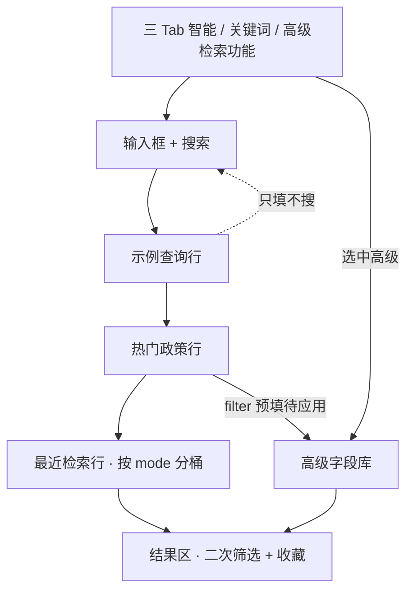

# DS10-QRY-FDE · 蓝色检索中枢线框

口径只认说明书「#### 197」。页在展示系统「科创政策全景」检索 Tab。只画蓝色区相对位置：三 Tab、输入、示例行、热门行、最近检索行；结果区只标边界。不画架构时序、不写接口字段、不写建表。

## 一页（智能 / 关键词）

```
┌ 科创政策全景 / 检索 ──────────────────────────────────────────────────────────┐
│ ░░░░░░░░░░░░░░░░░░░░░░ 蓝色检索中枢 ░░░░░░░░░░░░░░░░░░░░░░░░░░░░░░░░░░░░░░░ │
│                                                                              │
│  Tab：〔智能检索〕 〔关键词搜索〕 〔高级检索功能〕     ← 文案跟招标，不改专题名 │
│                                                                              │
│  输入框 + 按钮「搜索」                                                       │
│    智能：一句话；可出匹配 chips / 未命中说明                                 │
│    关键词：标题、发布机构、地区或关键词                                      │
│                                                                              │
│  示例查询                                                                    │
│    智能四条 = 专题 POLICY_QUERY_EXAMPLES                                     │
│    关键词四条 = 专题 POLICY_KEYWORD_EXAMPLES                                 │
│    点一条 → 只填入输入框，不自动搜索                                         │
│                                                                              │
│  热门政策                                                                    │
│    点 filter 类 → 切到「高级检索功能」+ 字段库预填 + 待应用                   │
│    不偷偷改成关键词并立刻出结果                                              │
│                                                                              │
│  最近检索（按当前 Tab / mode 分桶）                                          │
│    空：暂无最近检索                                                          │
│    有：只显示本 mode 桶；可点恢复、可清空                                    │
│    收藏不出现在这一行                                                        │
│ ░░░░░░░░░░░░░░░░░░░░░░░░░░░░░░░░░░░░░░░░░░░░░░░░░░░░░░░░░░░░░░░░░░░░░░░░░░ │
│                                                                              │
│  ── 结果区（本叶只标边界）──────────────────────────────────────────────── │
│  二次筛选 / 分类（200）· 列表 · 收藏仍在这里（201）                          │
│  最近检索不再与收藏并排塞回这里                                              │
└──────────────────────────────────────────────────────────────────────────────┘
```

## 一页（高级检索功能）

```
┌ 科创政策全景 / 检索 ──────────────────────────────────────────────────────────┐
│ ░░░░░░░░░░░░░░░░░░░░░░ 蓝色检索中枢（让位） ░░░░░░░░░░░░░░░░░░░░░░░░░░░░░░░ │
│  Tab： 智能检索   关键词搜索  〔高级检索功能〕                               │
│  提示：当前为高级检索字段库；可点回智能 / 关键词                             │
│  （示例查询行、热门政策行：收起，不可见）                                    │
│  最近检索：仍可按 advanced 桶展示在蓝色区下；或随字段库页约定，不得塞回结果区 │
│ ░░░░░░░░░░░░░░░░░░░░░░░░░░░░░░░░░░░░░░░░░░░░░░░░░░░░░░░░░░░░░░░░░░░░░░░░░░ │
│                                                                              │
│  字段库（198）                                                               │
│    条件可预填（来自热门）· 状态「待应用」直到用户点应用检索                   │
│    不挂第三套文案示例                                                        │
│                                                                              │
│  ── 结果区 ── 收藏仍在这里；未点应用前不因预填假装已检索成功 ────────────── │
└──────────────────────────────────────────────────────────────────────────────┘
```



## 相对位置（必须能截图核验）

上 → 下：Tab → 输入/搜索 → 示例查询（非高级）→ 热门政策（非高级）→ 最近检索 → 结果区（二次筛选 + 收藏）。

## 状态（与说明书状态清单同句）

| 状态 | 蓝色区看见什么 |
|---|---|
| 未输入 | 输入空；示例/热门（非高级）在；最近按桶或空态 |
| 点示例后未点搜索 | 输入已填示例；未因点击自动出新结果 |
| 智能解析未命中 | 未命中说明可见；可提示改用高级 |
| 最近检索空 | 本 mode 空态；不混其他 mode |
| 高级模式 | 示例/热门收起；字段库让位 |
| 热门进高级未点应用 | 字段库有预填；结果区未因预填自动刷新命中 |

## 已定（与说明书一致）

Tab 跟招标；示例搬专题两套；点示例只填；最近上移分桶；收藏留结果区；热门进高级预填待应用。
