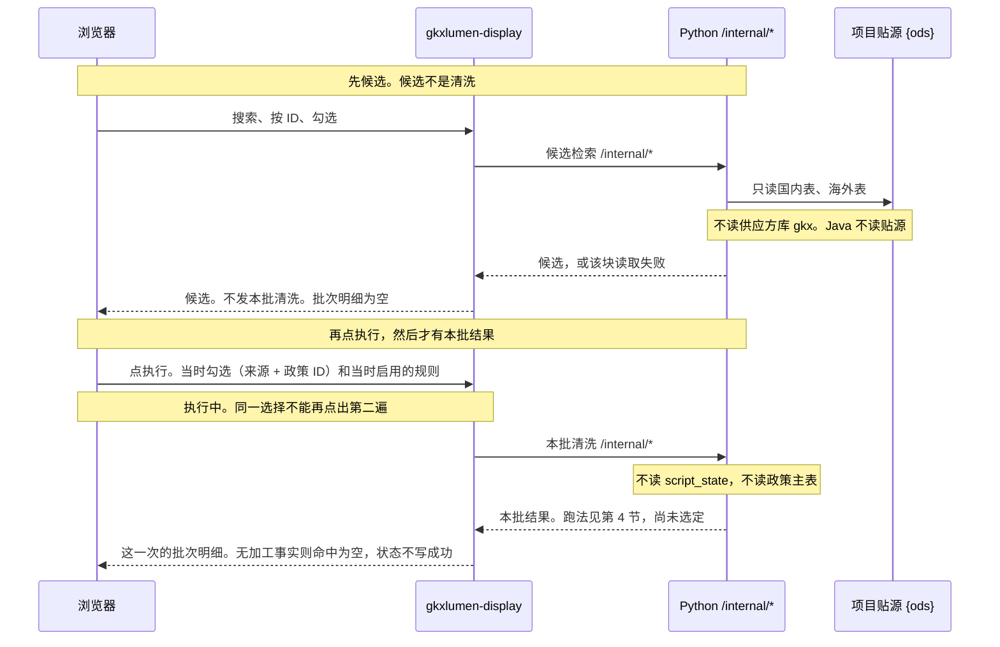

# POL-L2-PC1-CLEAN-FDE-B2 · 602 定档与读法方案

- 起草：`agent:arch-agent`
- 日期：2026-11-10
- 任务：602 重新试跑波次 B
- 口径：说明书「#### 602」（2026-11-10，含「点执行才跑」）、`sdd/602-选择政策-线框.md`
- 状态：方案稿。推荐放在每节第一项，供人裁定。本稿不代选。
- 本稿不改说明书、线框、四单、Storage、代码，不 commit。

触发方式以 2026-11-10 说明书「点执行才跑」为准，旧的「选定即读空」不再推荐。

第一轮 `POL-L2-PC1-CLEAN-FDE-B-读法方案.md` 与审稿记录文首已作废。下面事实于 2026-11-10 重新核对。那一版的推荐和它的 §3、§4 不作为本稿结论。

## 1. 档位：中档

对照《产品实现规程》§4.2.1，就高不就低。

| 判据 | 602 现在 | 落在哪一档 |
|---|---|---|
| 同一区块文案或控件替换，主路径、数据源、读口不变 | 条件栏改成可多选的「选择政策」，并增加规则启停 | 超过轻档 |
| 新增选择方式，或数据源、读口条件变化 | 候选改为 `{ods}` 贴源两表；本批改为点「执行」才按当时勾选和当时启用的规则跑 | 中档 |
| IA 或主路径大改，或增删需规叶子 | 仍在「智能政策库构建」的清洗页签；需规 602 这一叶还在 | 不到重档 |

**中档。** 选择方式和读口都变了，需规叶子没有增删。中档后续要高保真升版、体验 Owner 书面复核，以及数据、架构确认读法和四角色会签。本波只交读法。

读法若让 Java 去读贴源，或要新建正式库表，分别落到 §4.2.5「触碰团队铁律」「新建正式库表、新同步」。那两处由对应的人裁，见第 5 节。

## 2. 调用链

浏览器只打 `/display/v1/policy/**`。前端只到 Java。算法只在 Python `/internal/*`。Java 不读贴源，不读供应方库 `gkx`。`gkxlumen-element` 现有占位只有 `{dwd}`、`{ads}`、`{gapfill}`，没有贴源库。

没点「执行」：不发本批清洗请求，批次明细为空。点「执行」：按当时的勾选（来源 + 政策 ID）和当时启用的规则跑这一批；界面进入执行中，同一选择不能再点出第二遍。跑完之后改勾选或开关：不自动再跑，旧结果留着，标明还不是最新一次。候选检索（搜索、按 ID、勾选）可以发生在点「执行」之前。候选不是清洗。`script_state` 不能当成这六条规则的清洗结果。

页眉库级计数不走上面这条候选读口，也不随这一选改口径。点下去之后是一次请求里算完再返回，还是走作业、界面先看执行中，见第 4 节，尚未由人选定。

## 3. 候选怎么读，六条规则的结果怎么读

候选检索可以在点「执行」之前发生。候选不是清洗，不发本批清洗请求。

### 3.1 候选

候选只来自贴源两表，库名用 `{ods}`：

| 源 | 表 | 业务键 | 列表上用的列 |
|---|---|---|---|
| 国内 | `{ods}.dwd_policy_base` | `id` | `title`，辅 `publish_code`、`ministry`、`publish_date` |
| 海外 | `{ods}.dwd_global_policy_base` | `id` | `title`，辅 `organ`、`publish_date` |

两表结构以 `agent-delivery/data/data-design/storage/POLICY/sources/ods-ddl.md` 为准。国内有文号 `publish_code`、发文部门 `ministry`、效力级别 `rank`。海外有发布机构 `organ`、发布日期、报告编号 `report_number`，没有 `publish_code`，也没有 `rank`。两表的 `id` 各自主键，检索要带上来源，避免同号串源。

智能搜索按标题、文号或发文部门，在贴源里勾选。按政策 ID 检索是贴源 `id` 的精确查。对不上时按线框分成「这一源还没有贴源数据」「该 ID 不在贴源」「这次没搜到」。已经勾上的政策保持不动。清空后回到未选。

现有读口对不上这一选：

- `GET /internal/policy/search` 读的是 DWD `policy_base_info`（`polan/search.py`），会带上只在政策主表里的政策。602 候选不走它。
- `GET /internal/policy/status` 只对贴源国内表做了计数，不出候选行，也不计海外表。
- `PolicyGovernanceController` 的 `results` 读 `{dwd}.policy_base_info` 和 `{dwd}.script_state`。那是政策主表一侧的旧看板，不作为本页候选。

贴源行本身带 `is_deleted`、`is_history`。候选沿用这两列的当前行：未删除、非历史。历史行不进勾选列表。

### 3.2 本批六条规则

全仓没有与这六条规则对应的已落库事实。2026-11-10 复核：`lumen-algo-py` 没有去重合并、格式标准化、噪声过滤、完整性校验、一致性校验、准确性校验的政策实现；`agent-delivery/data` 没有这六条的事实表。

`script_state` 不能当清洗结果。建表说明写明它是 C1 抽取产业、C2 条款结构化两个作业的留痕，主键是 `(job, policy_id)`，`policy_id` 对应 DWD `policy_base_info.policy_id`，状态是 `done|empty|no_match|degraded|failed|llm_unavailable`。这六值和六条规则对不上，键也不是贴源 `id`。

因此现在的读法是：勾上之后可以看规则、可以开关。本批清洗请求只在点「执行」时发出。

| 界面上的块 | 从哪读 |
|---|---|
| 规则名、作用范围、开关 | 勾上至少一条之后，页上的六条固定说明。去重合并的判定文案是「应合并」，格式标准化是「待标准化」。两句都表示不改贴源行。没点「执行」不出现本批判定或命中 |
| 本批判定条数、命中、脱敏失败样例、更新时间 | 没点「执行」：不出现，不造 0。点过之后仍没有加工事实：空白，不造 0 |
| 批次明细的状态 | 没点「执行」：空，不发本批请求，不写成无加工事实，不写成功。点过之后仍没有加工事实：不写成功。和「未选」「未执行」「读取失败」分开 |
| 停用的规则 | 行还在，标明停用。点「执行」时本批不计入它 |
| 跑完后又改勾选或开关 | 不自动再跑。旧结果留着，标明还不是最新一次 |

有与六条规则对应的加工事实、并且已经点过「执行」之后，状态才是成功、部分、失败中的一种。点下去之后怎么跑，见第 4 节。事实表建不建，见第 5 节，本稿不先定。正在跑的时候就改勾选或开关，见第 5.6 节，本稿不规定一种行为。

准确性这一行保持在列表里。算不出时是空白还是演示数，见第 5 节。两种都不得写成已经按原文核过。

## 4. 点执行之后怎么跑

触发已经按说明书定死：没点「执行」不发本批清洗请求。本节只写点下去之后怎么跑。三项都守第 2 节的调用链。推荐放第一，尚未由人选定。旧的「不建作业、选定即返回空事实」不再作为推荐。

候选仍是点「执行」之前的另一条检索：Python 只读 `{ods}` 两表，分源返回；不走 `GET /internal/policy/search`，不读政策主表。602 的公开路径与 `results` 拆开，`results` 继续给 603 和页眉。

`审稿-data.md`、`审稿-api.md` 里仍然有效的四条：搜索列按那两份审稿分源写，本稿不另定一版；空态用空数组或 null，不造 0；不复用政策主表检索；公开路径与 `results` 拆开。

### 4.1 这一次请求里算完再返回（推荐）

点「执行」才发本批。Python 在这一次请求里按当时的勾选和当时启用的规则做判定，算完再返回。六条判定只允许 SELECT `{ods}.dwd_policy_base` 与 `{ods}.dwd_global_policy_base`，国内和海外分源，不去重合成一把。禁止对 `{ods}`、DWD、ADS、供应库 `gkx` 做 INSERT / UPDATE / DELETE。不写 `script_state`。不改贴源行。批次结果只留在这次响应里。不读政策主表。Java 只转发，不读贴源。

现算只用贴源已有列（结构以 `agent-delivery/data/data-design/storage/POLICY/sources/ods-ddl.md` 为准）：

| 规则 | 能 SELECT 的列 | 没有对应列时 |
|---|---|---|
| 去重合并 | 国内 `{ods}.dwd_policy_base.title`、`publish_code`、`rank`；海外只有 `{ods}.dwd_global_policy_base.title` | 海外文号、效力级别不参与命中 |
| 格式标准化 | 两表 `publish_date`；文号只有国内 `publish_code` | 「PDF 转文本」两表都没有列，该作用范围不参与命中 |
| 噪声过滤 | 无。两表都没有乱码标记、附件重复标记；`appendix_name`、`appendix_link` 只是附件名和链接 | 该规则命中为 null |
| 完整性校验 | 「缺发布日期」看两表 `publish_date` 是否空；「缺发文机关」只看国内 `ministry` | 海外 `organ` 是发布机构，不是发文机关列，这一作用范围不参与命中 |
| 一致性校验 | 无。没有效力级别与发文主体的对照表；海外没有 `rank` | 该规则命中为 null |
| 准确性校验 | 无。两表都没有原文核对结论列；`content` 是正文 | 该规则命中为 null。空白还是演示数仍见第 5.3 节，本稿不代选 |

没有对应列的那一条作用范围不参与命中：该规则命中为 null，状态不写成功，不造 0，走「无加工事实」。缺列不走「读取失败」。

两种响应分开。本批转发失败或超时：响应标明读取失败，不得只用命中 null 表示失败，不得返回 0，不写入 `results`。只有这一次请求完成、并且仍无六条加工事实时，命中才是 null，状态不写成功，不造 0。无事实时批次「更新时间」留空，不用贴源 `updated_time`，也不用 `script_state.tried_at`。当前没有六条实现、也没有事实行，所以现在整批仍是这个空。去重合并、格式标准化仍是「应合并」「待标准化」。

| 项 | 内容 |
|---|---|
| 做法 | display 把当时的勾选（来源 + 贴源 `id`）和当时启用的规则转给 Python `/internal/*`。返回前界面是执行中，同一选择不再发第二次。Python 只 SELECT 上表已有列。有与六条对应的加工事实时，状态是成功、部分、失败之一。缺列的规则命中为 null，走无加工事实。转发失败或超时走读取失败 |
| 动到哪几层 | `lumen-algo-py` 一条本批判定路由，与候选检索分开；`gkxlumen-display` 一只只读 Feign，公开路径与 `results` 并列；前端在这次请求未返回前锁住同一选择。不新建正式事实表 |
| 代价 | 用户要等这一次请求结束才离开执行中。候选是更早的另一条请求。噪声过滤、一致性、准确性以及海外缺列的作用范围，现在给不出命中 |
| 风险 | 去重要拿已选行对贴源全表比对，同步容易超时；超时按读取失败返回，不按命中 null，也不返回 0。刷新之后，执行中只在这次请求还没结束时成立。多实例若只在单个进程里挡住第二次，另一实例仍可能再收一次 |

### 4.2 点执行后走作业，界面看执行中

点「执行」后先进入执行中，判定放到一次运行里做完再回写这一次的批次明细。

| 项 | 内容 |
|---|---|
| 做法 | display 先把界面置于执行中，并记下这一次选择正在跑。Python 异步按当时的勾选和当时启用的规则做判定。同一选择已有在途的一次时，不再收下一次。跑完才写出这一次的批次明细。跑完后又改勾选或开关，旧结果留着，标明还不是最新一次。运行留痕不用 `script_state`。留痕要不要落成正式库表，见第 5.5 节，本稿不代选。无加工事实时命中为 null，状态不写成功，不造 0 |
| 动到哪几层 | display 的接单与在途；`lumen-algo-py` 的判定；前端看到执行中。公开路径仍与 `results` 拆开。人若在第 5.5 节选定建命中事实表，再由这次运行写入那张 ADS 表，Java 只读该表 |
| 代价 | 多一条在途和一次回写。人未裁第 5.5 节之前不落表名 |
| 风险 | 在途若写入 `script_state`，会和 C1/C2 作业留痕混表。运行失败要写成读取失败或失败，不能写成成功。正式表未裁定时，这一款还不能落地成库。海外没有 `rank` 和 `publish_code`，去重键不能和国内合成一把 |

### 4.3 点执行后只读已有加工事实，这次不现算

人若在第 5.5 节同意新建正式库表，点「执行」才去读那张表。现在全仓没有这张事实，点了也只得到空命中。

| 项 | 内容 |
|---|---|
| 做法 | 点「执行」才按当时的勾选（来源 + 贴源 `id`）和当时启用的规则去读已落库事实。没有行则命中为 null，状态不写成功，不造 0。不在这次请求里现算。没点「执行」不去读。准确性若要演示数，另按 D18 单独一张 ADS 表，由 Python 写入，Java 只读，界面带 MockBadge |
| 动到哪几层 | 人选定建表之后：element 只读该 ADS 表；display 转发；Python 另有写入，不在点击这次请求里算。未建表时这一款没有读口 |
| 代价 | 点击本身不现算。事实从哪来要等第 5.5 节。表名、主键在人选定后由波次 C 的数据稿写 |
| 风险 | 未建表时，点了之后界面停在无加工事实。作业还没覆盖的新进行，要和「读取失败」分成两句。准确性的演示行若写进同一张事实表，会和「已经按原文核过」混在一起，所以演示数单独成表 |

## 5. 待人裁定

每点推荐放第一。本稿不代选。

### 5.1 库连演示还是正式

谁裁：数据平台 Owner，监管人确认。

| 选项 | 做法 | 动到哪几层 | 代价 | 风险 |
|---|---|---|---|---|
| 先连演示库（推荐） | `{ods}` 指向演示贴源。正式库没有行时，该源写「这一源还没有贴源数据」。两句提示分开 | 配置里的库名；前端空态文案 | 页可以先按演示库走通。element 现默认就是 `demo_gkxlumenx_dwd` / `demo_gkxlumenx_ads` | 演示海外行可能很少。本稿没有重查线上行数，空多少以连上之后的读数为准 |
| 直接连正式库 | `{ods}` 指向正式贴源。没有行就按「贴源无数」 | 正式库只读账号；配置 | 和正式贴源一致 | 正式贴源若还没有行，候选整源为空 |

### 5.2 谁读贴源

谁裁：人类架构师（D3：Java 业务 API 只读 ADS），监管人确认。

| 选项 | 做法 | 动到哪几层 | 代价 | 风险 |
|---|---|---|---|---|
| Python 读贴源，Java 只转发（推荐） | 见第 2 节的候选检索。Java 不出现贴源 SQL，也不读供应方库 | Python、display | 一条新的只读路由 | 检索条件要在 Python 里按国内、海外分表写 |
| 先同步到 ADS 目录，Java 只读目录 | Python 或数据工厂把两表的展示列同步进 ADS。候选查询在 element，只读这张目录 | 数据一张目录表和一条同步；element；display | 多一条同步。命中 §4.2.5 新表、新同步 | 候选变成贴源某个时刻的副本。目录和政策主表容易被当成第二张主表 |
| element 直接读贴源 | 给 element 增加贴源库配置，候选 SQL 打在两张贴源表上 | element、库账号、Nacos | 少一次 Feign | 打破 D3。贴源字段一变就打到 Java。须人类架构师书面豁免后才能写进 ARCH |

### 5.3 准确性是空白还是演示数

谁裁：产品定空白还是演示数。选演示数时，人类架构师按 D18 裁定表、灌数方和读取接口。监管人确认。

| 选项 | 做法 | 动到哪几层 | 代价 | 风险 |
|---|---|---|---|---|
| 空白（推荐） | 准确性这一行在。点过「执行」之后命中处空白，状态不写成功。没点之前不出现命中 | 前端这一行的空态；接口返回空 | 不加表 | 这一行在有原文核对能力之前一直是空的 |
| 看得出是演示的数 | 新建一张 D18 的 ADS 表，Python 写入演示行，Java 只读该表，界面带 MockBadge。文案写明是演示 | 数据、Python、element、前端角标 | 一张演示表。表名在选定后写入波次 C 的 ARCH | 若把演示数写成已按原文核过，或和真算行放在同一张表里不标明，就和 D18 冲突 |

### 5.4 启停只在本页，还是长期保存

谁裁：产品。要落库时，数据平台 Owner 确认存处。监管人确认。

| 选项 | 做法 | 动到哪几层 | 代价 | 风险 |
|---|---|---|---|---|
| 只在本页（推荐） | 重新打开时六条都启用。停用只影响当前这次计不计。不写库 | 前端状态 | 无保存位 | 离开页面后开关恢复 |
| 长期保存 | 再次打开仍按上次的开关计本批。存处单独做，不用 `script_state` | 若落库：一张保存位，外加读写接口；若只存浏览器：仅前端 | 落库则再碰 §4.2.5 | 用 `script_state` 存开关会把 C1/C2 作业留痕和本页开关混在一张表里 |

### 5.5 要不要新建正式库表

谁裁：数据平台 Owner / 架构，监管人确认（§4.2.5）。

| 选项 | 做法 | 动到哪几层 | 代价 | 风险 |
|---|---|---|---|---|
| 先不建（推荐） | 不建六条事实表。点「执行」之后按 4.1，在这一次请求里判定。当前没有实现时命中为 null，不写成功，不造 0。候选仍直接查贴源 | Python、display、前端 | 六条的条数仍然没有 | 质量保障在点过之后仍是无加工事实，直到另一次裁定 |
| 只建命中事实表 | 一张 ADS 表。Python 只读贴源、只写该表。点「执行」后的跑法可改用 4.2，跑完由 Java 只读该表；或改用 4.3，点执行只读该表、不在请求里现算 | 数据、Python、element、display、前端 | 一张正式表和一条校验作业 | 见 4.2、4.3。海外去重键不能和国内合成一把 |
| 目录表和命中表都建 | 候选走 5.2 的目录同步，本批结果走命中表 | 两张 ADS 表、一条同步、一条校验作业 | 最大 | 同步链和事实链各有一份一致性责任 |

### 5.6 正在跑的时候改勾选或开关

已闭合。监管人选定：正在跑时锁住勾选和开关，改不了。跑完之后再改勾选或开关的旧句不变：旧结果留着，标明还不是最新一次，再点「执行」才按新选择重跑。

## 6. 需同步清单（波次 C 改四单）

本波不改这四份。波次 C 先改 ARCH，再改 API、指标、数据，改到与说明书「#### 602」和本稿裁定结果一致。

| 四单 | 现在仍写着 | 波次 C 要改成 |
|---|---|---|
| `sdd/l2/POL-L2-PC1-CLEAN-ARCH.md` | 文首注记只提到选择政策和贴源。正文仍把 `script_state` 六值写成已落库的校验结果，读口仍在政策主表一侧 | 调用链改成第 2 节：先候选，点「执行」才有本批。候选读贴源两表。点过之后仍无事实时命中为 null、状态不写成功，不造 0。`script_state` 移出 602 |
| `sdd/l2/POL-L2-PC1-CLEAN-API.md` | 文首注记提到多值和启停。正文仍写政策选择非强制、按单条 `policyId` 过滤，并用 `script_state.status` 筛明细 | 没点「执行」不发本批清洗请求。本批请求带当时的勾选（来源 + 贴源 `id` 多值）和当时启用的规则。启停只在本页，不长期保存。正在跑时页面锁住勾选和开关。空态分成未选、未执行、执行中、贴源无数、ID 不在贴源、无加工事实、读取失败。无加工事实只在点过之后。空数组或 null，不造 0。602 公开路径与 `results` 拆开，避免 603 被一起改掉。不复用 `/internal/policy/search` |
| `sdd/l2/POL-L2-PC1-CLEAN-DATA.md` | 全文没有取代注记。候选仍写 `policy_base_info`，质量真源仍写 `script_state` | 读面改为演示库的 `{ods}` 两表。贴源由 Python 只读。搜索列按 `审稿-data.md`、`审稿-api.md` 分源写，本稿不另定一版。`script_state` 移出。不建六条正式事实表。准确性另有一张 D18 演示表，表名由 DATA 稿定 |
| `sdd/l2/POL-L2-PC1-CLEAN-METRIC.md` | 全文没有取代注记。质量计数仍按 `script_state.status` 聚合 | 六条规则的条数不再按 `script_state` 聚合，也不新造清洗 `metric_id`。没点「执行」不出现本批条数，不造 0。页眉库级计数保持原口径，不随这一选改变 |

## 变更记录

2026-11-10，任务「602 重新试跑波次 B」：新建本读法方案，按说明书「#### 602」和线框写明中档、合规调用链，以及贴源候选与六条规则无落库事实时的读法；旧稿推荐不再沿用。影响到波次 C 的四份二级稿，本波未改它们。

2026-11-10，任务「602 · 读法方案修订 · 点执行才跑」：触发改为说明书「点执行才跑」，作废「选定即读空」。时序改为先候选、再点执行、然后才有本批结果。第 4 节改为点执行之后怎么跑，推荐 4.1 这一次请求里算完再返回，尚未由人选定。正在跑时改勾选或开关列为未闭合（第 5.6 节）。四单、说明书、线框、Storage、代码未改。

2026-11-10，任务「602 · 波次 B · 回应再审」：采纳 R2-D1、R2-D2、API-R2-1，写入第 4.1 节（现算落到哪几列、缺列命中为 null、只读不改源行、读取失败与命中 null 分成两种响应）。文末加再审回应和裁定清单。第 5 节未代选。四单、说明书、线框、Storage、代码未改。

2026-11-10，监管人在决策卡选定六条。裁定清单改为已选。准确性演示表与六条正式事实表分开记，不合并。说明书、线框、四单、Storage、代码仍未改。

## 再审回应

| 编号 | 结论 | 理由 |
|---|---|---|
| R2-D1 | 采纳 | 第 4.1 节已写明分源只 SELECT 的列；没有对应列的规则命中为 null，走无加工事实，不走读取失败 |
| R2-D2 | 采纳 | 第 4.1 节已把六条现算锁成只 SELECT 两张贴源表，禁止写 `{ods}`、DWD、ADS、`gkx` 和 `script_state`，更新时间不用贴源 `updated_time` |
| API-R2-1 | 采纳 | 第 4.1 节已把转发失败或超时写成读取失败，与请求完成但仍无加工事实时的命中 null 分成两种响应，失败不返回 0，不写入 `results` |

## 裁定清单

2026-11-10 监管人已选。下面是选定，不再是待选。说明书已经定死的「点执行才跑」，以及第 4.1 节的现算列、缺列命中 null、只读不改源行、读取失败与命中 null 两种响应，不在此列。

1. 库连演示库。没有行的那一源写「这一源还没有贴源数据」。不连正式贴源。
2. 谁读贴源：Python 只读，Java 只转发。不给 Java 直接读贴源。
3. 准确性用看得出是演示的数。单独一张 D18 演示表，由 Python 写入，Java 只读，界面标明演示。不得写成已经按原文核过。表名本波不取。
4. 规则启停只在本页。重新打开时六条都启用。不长期保存。
5. 不建六条正式事实表。点「执行」后按 4.1，除准确性以外的结果留在这次响应里。第 3 条的演示表不是这张事实表，两表不合并。
6. 正在跑的时候锁住勾选和开关，改不了。跑完之后再改勾选或开关的旧句不变：旧结果留着，标明还不是最新一次，再点「执行」才重跑。

第 3 条和第 5 条不打架：第 5 条不建的是六条正式事实表；第 3 条要的只是准确性这一行的演示表。

## 监管人裁定

日期：2026-11-10。来源：决策卡六题。本稿只记账，不改说明书、线框、四单、Storage、代码。

| 节 | 选定 | 没选的 |
|---|---|---|
| 5.1 | 先连演示库 | 直接连正式库 |
| 5.2 | Python 只读贴源，Java 只转发 | ADS 目录同步；Java 直接读贴源 |
| 5.3 | 看得出是演示的数 | 空白 |
| 5.4 | 只在本页 | 长期保存 |
| 5.5 | 先不建正式事实表，走 4.1 | 只建命中事实表；目录表和命中表都建 |
| 5.6 | 正在跑时锁住勾选和开关 | 先不规定；可以改但不影响这一次 |

数据平台负责人对「先连演示库」、人类架构师对 D18 演示表的表名和灌数，在波次 C 写入 ARCH / DATA。不挡把上面六条写进说明书。D3 不需要豁免，因为 Java 不读贴源。
