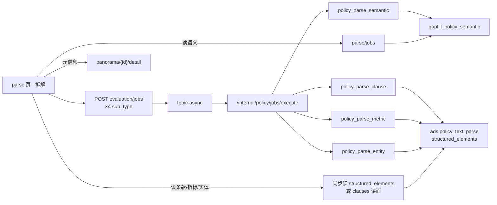

# POL-L2-PC2-PARSE-4JOB-FDE · B 波 · arch

- 总单：`POL-L2-PC2-PARSE-4JOB-FDE-L01`
- 日期：2026-11-13
- 身份：arch
- 输入：A 波 `2026-11-13-PARSE-4JOB-FDE-A-product.md`；决策卡 **C**（四点并行独立计算 Job）
- **2026-11-13 监管人裁定停机卡：卡1=A / 卡2=A / 卡3=A**
- 对照：237 `policy_text_parse_run` / 242 `policy_sim_interpret`；现行 `parse/jobs`（读语义缺项）+ `parse/clauses`（同步 enrich）；`PolicyEvaluationService` 白名单

## 1. 定档

**重**（四新 `sub_type` + algo 写回 + Java 白名单 + FE 并行进度）。栈与 237/242 同构，**不整页退定义规程**；须 C 波会签改说明书 PC-2 / 契约。D4 仍 mock。

## 2. 一句话结论

一点「拆解」→ FE **并行**提交四个 `evaluation/jobs`（四 `sub_type`）→ topic-async → Python 各算各写 → FE 轮询/等终态后分别读回四 Tab；页头 KPI 从指标/实体结果派生；**级别/地区/部门**同步打 `panorama/{id}/detail`（不算第五 Job）。

现行 `parse/clauses` **保留**给治理 603「结构化抽取」；拆解页一点拆解**不再直调**它（改由条款 Job 内部复用同算法）。

## 3. 调用链

**铁律**：浏览器不直连 Python；禁接口写死 mock KPI；禁整表 TRUNCATE；关评审零泄漏 Job/gapfill 黑话。

## 4. 四 Job 键（建议默认）

挂既有 **`POST /display/v1/policy/evaluation/jobs`**（与 237/242 同构），**不**新开四条顶层 URL。

| 叶 | `sub_type` | Python | 写回 | 读面 |
|---|---|---|---|---|
| 606 语义 | `policy_parse_semantic` | 新/扩语义算子 | `gapfill_policy_semantic`（按 policy_id upsert 四侧面） | 既有 `POST parse/jobs`（`policy_id`） |
| 607 条款 | `policy_parse_clause` | **复用** `run_clause_button` / `structure_one` | `ads.policy_text_parse.structured_elements.clauses` | 同步读条款（见 §5） |
| 608 指标 | `policy_parse_metric` | 新：从正文/条款抽 metrics[] | `structured_elements.metrics`（同 blob） | 同读口取 `metrics` |
| 609 实体 | `policy_parse_entity` | 新：实体+边（可降级规则/LLM；KG 开关只控展示） | `structured_elements.entities` + `links` | 同读口取实体网 |

请求体最小集（每 Job 一条）：

| 字段 | 说明 |
|---|---|
| `sub_type` | 上表四值之一 |
| `policy_id` | 必填 |
| `force` | 可选；「重新拆解」整页重跑时四条均带 `true` |

白名单：`PolicyEvaluationService` + Python `JOB_SUB_TYPES`；`skipsIndustryVidXor=true`（同 237/242）。

**不**占用已有 `policy_text_parse_run`（237 推演文本解析专用）。

## 5. 与现行 `parse/clauses` / `parse/jobs`

| 资源 | 裁定 |
|---|---|
| `POST parse/clauses` | **保留**；治理 603 继续直调。拆解页一点拆解改走 `policy_parse_clause` Job（worker 内调同一 enrich） |
| `POST parse/jobs` | **保留为语义读面**；写改由 `policy_parse_semantic` 灌 `gapfill_policy_semantic`，读仍走本口 |
| 条款/指标/实体读 | **建议新增**同步 `POST parse/result`（或扩 `parse/jobs` kind=拆解结果）一次返回 `clauses/metrics/entities/links/intensity/relation` 投影，避免 FE 三次拼；C 波可先钉「读 `structured_elements` 投影」，D 波最小实现 |

## 6. KPI / 元信息挂接

| UI | 来源 | 备注 |
|---|---|---|
| 力度指数 | 指标 Job 写回的 `intensity`，或 `metrics[]` → 既有 `intensityFromMetrics` | 未完成 Job 保持「—」 |
| 关联度 | 实体 Job 写回的 `relation` | 同上 |
| 拆解完整度 | 实体四类齐备度（既有 `entityCompleteness`） | 「未抽取实体」仅实体 Job 未成功/空时 |
| 文本类型 | `resolveTextType(level/…)` | 随元信息 |
| 级别 / 地区 / 部门 | **`panorama/{id}/detail` 同步**（一点拆解时与四 Job 并行） | **不算**第五计算 Job |

## 7. 进度 / 失败 / 重跑（建议默认）

| 项 | 裁定 |
|---|---|
| 进度 | **轮询** `GET …/evaluation/jobs/{taskId}`（或既有 analysis tasks 查口）；四 taskId 并行；不对齐完整 I2-12 工作区浮层 |
| 部分成功 | Tab/KPI **各自**亮；失败块业务空态 |
| 重跑 | 再点「拆解」= 四 Job 均 `force=true` **整页重跑**（不做「只重跑失败项」UI，降复杂度） |
| 当天已成功 | 进入已选政策可先读回展示；再点拆解才 force（对齐 242 精神） |
| 单飞 | 同用户同 `policy_id` 同 `sub_type` 仅一条 queued/running |

## 8. 要改的层（D 波）

| 层 | 动作 |
|---|---|
| algo | 注册四 `sub_type`；clause 调现成 enrich；semantic/metric/entity 写回规则 |
| Java display | 白名单四键；读口投影（若新 `parse/result`） |
| FE | 一点拆解 `Promise.all` 起四 Job + detail；分 Tab/KPI 回填；进度态 |
| 说明书 / 契约 | C 会签改 PC-2：606 不再「仅 501」；607–609 改为 Job 真算+读回 |
| 合规用例 | E 波 |

## 9. 停机决策卡（请监管人选）

### 卡1 · 四 Job 挂哪条资源

| 选项 | 做法 |
|---|---|
| **A（推荐）** | `evaluation/jobs` × 四 `sub_type`（上表） |
| B | 新开 `parse/async` 专资源四键 |
| C | 扩现有 `parse/jobs`：带 `sub_type` 写、带 `kind` 读（易与现行只读语义混淆） |

### 卡2 · 条款要不要异步

| 选项 | 做法 |
|---|---|
| **A（推荐）** | 条款也走 async Job（与另外三路真正并行；worker 内调 enrich） |
| B | 条款保持同步 `parse/clauses`，与另外三 async「伪并行」（一点同时触发，但条款阻塞按钮） |

### 卡3 · 指标/实体落库

| 选项 | 做法 |
|---|---|
| **A（推荐）** | 写入既有 `policy_text_parse.structured_elements`（metrics/entities/links）；不新表 |
| B | 各建 gapfill 表（多表、多灌数单） |

## 10. B 波收口

- 本简报即 B 产物；**卡 1/2/3 未裁定前不改代码、不改四单正文**
- 下一跳：监管人回「卡1=A 卡2=A 卡3=A」（或改选）→ **C 会签**回写说明书/契约 → D 实现
