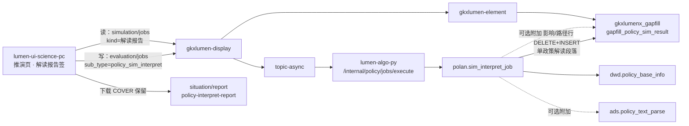

# 242 政策解读报告生成 · LLM 真算 ARCH 方案

| 项 | 值 |
|---|---|
| 日期 | 2026-11-13 |
| 角色 | arch-agent |
| 监管人 | human:淮政玮 |
| 叶 | SRS **242** 政策解读报告生成 |
| 产品草案 | `sdd/简报/2026-11-13-SIM-242-LLM-ASYNC-方案计划.md`（三卡推荐 A；**2026-11-13 监管人「按方案开工」已锁 A/A/A**） |
| 同构真源 | ARCH §5.1/5.2；API 真算节；`polan.sim_focus_job` / `text_parse_run_job` / `job.py` |
| 本稿性质 | **实现方案供审**；不改四单正文、不改业务代码、不 task-create |
| 建议默认 | 产品三卡均按 **A**；与产品草案不一致处标「建议默认=A」 |

---

## 1. 一句话结论 + 档位

**结论**：242 在保留现行「`simulation/jobs·解读报告` 同步读 gapfill 解读段落 + `situation/report` 下载」的前提下，**核增**一条与 237/238 同构的异步真算键 `policy_sim_interpret`：Python LLM 生成四段正文 → 单政策 upsert `gapfill_policy_sim_result`（`row_kind=解读段落`）→ 前端再读表展示；无行则点按钮起算，有行直接看，结果页 `force` 重算。

**建议档位**：**重**（新 Job 键 + algo LLM upsert + Java 白名单 + FE 进度/重算），栈已熟（237/238），不退整页定义、不开完整 I2-12 工作区。若监管人锁卡后砍掉「解析/推演附加上下文」可降半档至 **中偏重**，但仍须新键。

---

## 2. 目标态用户路径

前置：推演页「政策解读报告」签；政策检索必选 `policy_id`；未选政策禁用主按钮。

| 场景 | 用户动作 | 系统行为 | 看见什么 |
|---|---|---|---|
| **无行** | 点「生成解读报告」（文案可并列「深度解读」） | `POST evaluation/jobs` `sub_type=policy_sim_interpret`（`force` 可省略）→ topic-async → `/internal/policy/jobs/execute` → `polan.sim_interpret_job` LLM → upsert 四段 → 前端再 `POST simulation/jobs` kind=`解读报告` | 进度壳（进行中）→ 四段正文；可勾选章节 + Word/PDF 下载 |
| **有行** | 进签 / 换回该政策 | **不**自动起算；直接 `simulation/jobs·解读报告` 读表 | 四段正文；主按钮可变为「重新生成」或并存「重新生成」 |
| **重算** | 点「重新生成」 | 同上 Job，**必带** `force=true`；单飞：同用户同 `policy_id` 仅一条 queued/running | 覆盖旧四段后刷新读面 |
| **失败** | Job 失败 / `generated=0` / 无密钥降级 | **不**写假四段；读面仍空或保留旧行（见 §5.4）；诚实空态 + 可重试 | 「暂无解读报告」/「生成失败，请重试」类文案 |
| **换政策** | 改 `policy_id` | 清空本签结果态；**不**自动 create | 回到「尚未生成」或该政策已有行则直接展示 |
| **下载** | 有 ≥1 段且勾选章节 | **不变**：`POST situation/report/generate` `reportType=policy-interpret-report`（COVER 已闭合） | Word/PDF；无行或不勾选不发 generate |

对齐 I2-12 **精神**（显式按钮起算、切条件不自动 create、单飞、有结果可「重新生成」），**不是**完整分析工作区（无独立任务列表/浮层、不强制 Q-ANALYSIS-01 自然日配额 UI）。过程壳复用评价 jobs 进度模式（同 238）。

---

## 3. 调用链与组件图



**铁律**：浏览器不直连 Python；算法只在 Python；禁核增 `report/jobs` / `gapfill_policy_report_body` 顶替；禁整表 TRUNCATE；禁接口写死 mock 全文。

---

## 4. Job 键、读面、表与 upsert 规则

### 4.1 键与资源（建议默认=产品卡1 A）

| 面 | 资源 | 键 / 种类 | 语义 |
|---|---|---|---|
| **读（不变）** | `POST /display/v1/policy/simulation/jobs` | 种类=`解读报告` | 同步；element 拣 `row_kind=解读段落` + `policy_id`；不建任务、不调 Python |
| **写（核增）** | `POST /display/v1/policy/evaluation/jobs` | `sub_type=policy_sim_interpret` | async；白名单进 `PolicyAnalysisTypes` + Python `JOB_SUB_TYPES`；`skipsIndustryVidXor=true`（同 238） |
| **下载（不变）** | `POST /display/v1/situation/report/generate` | `reportType=policy-interpret-report` | COVER；jobs 响应不内嵌文件 |

请求体最小集（对齐 238）：

| 字段 | 说明 |
|---|---|
| `sub_type` | 固定 `policy_sim_interpret` |
| `policy_id` | 必填 |
| `force` | 可选；「重新生成」必须 `true`。服务端：无行可跑；有行且 `force≠true` 可短路返回已有（与 238 实测对齐——**待钉**：create 同步等终态 vs 轮询，见开放问题） |

### 4.2 表（建议默认=产品卡2 A）

- 库表：`gkxlumenx_gapfill.gapfill_policy_sim_result`
- `row_kind`：`解读段落`（闭集五值之一，不新造）
- 粒度：一政策 × 一段一行；同一 `policy_id` + `section_name` 唯一
- **不**新建 ADS 正式表（卡2 B 触 D18/存储会签，本稿不取）

### 4.3 四段枚举（闭集）

`section_name` ∈ {`政策背景`, `主要内容`, `预期效果`, `实施建议`}（需规原文；与 DATA / mockgen 一致）。

正文列：`body_text`（唯一内容列；不写文件路径/对象键）。

### 4.4 Upsert 规则（同构 238 重点行）

1. 仅当本轮校验通过的段集合非空时写库。
2. `DELETE FROM … WHERE policy_id=? AND row_kind='解读段落'`（**单政策**；禁整表、禁误删重点/影响/路径）。
3. `INSERT` 本轮段行（建议一次写满四段；部分段失败策略见 §5.4）。
4. 行元数据建议：

| 列 | 真算成功路径建议值 |
|---|---|
| `is_mock` | `1`（与 238 现状一致；D4 升格由 B 波/data 另钉，本方案不伪改绿） |
| `fill_method` | `llm` |
| `gap_item` | `242 政策解读报告生成` |
| `gapfill_batch_id` | `POL-L2-DS12-SIM-242-ASYNC`（或实现单 ID） |
| `metric_id` | `NULL`（不新造） |
| `generated_at` | 写库时刻 |

`force`：重算走同一 DELETE+INSERT；不保留历史版本表。

---

## 5. LLM 生成逻辑（实现钉）

模块建议：`polan/sim_interpret_job.py`，入口 `run_sim_interpret(payload)`；在 `polan/job.py` 增加 `elif sub_type == "policy_sim_interpret"` 分支（镜像 `policy_sim_focus`）。

### 5.1 输入字段从哪取（建议默认=产品卡3 A）

| 优先级 | 来源 | 列 / 行 | 用途 |
|---|---|---|---|
| **主输入（必有）** | `dwd.policy_base_info` | `policy_id, title, abstract, content`（可加 `keywords`） | 标题 + 摘要/正文；截断策略对齐 238（title≤120，正文建议 ≤3000～4000 字） |
| **附加 A** | `ads.policy_text_parse`（若该 `policy_id` 有行） | `summary`；`structured_elements` 四中文键（核心内容/支持对象/申报条件/支持力度）；`auto_tags` | 「基于政策解析」上下文；**无行不挡生成** |
| **附加 B** | 同表 gapfill | 同 `policy_id` 的 `row_kind∈{影响范围,路径环节}` 各取摘要句（影响：`category_name`+`impact_text` 限条；路径：`stage_name`+`schedule_text`/`stage_text` 五环节各一句） | 「基于效果推演」弱上下文；**无行不挡生成** |
| **不读** | `polan.text.parse.run` / 整表批产；核增 `gapfill_policy_report_body`；评价页 224 解读条目 | — | 防越界 |

无 DWD 行或 title+abstract+content 皆空 → **不起 LLM**，`generated=0`，不写库。

> **与现行 FE mock 门控差异**：`InterpretWorkbench` mock 路径有「未具备政策解析 / 效果推演结果则不可生成」。卡3=A 要求 live **取消硬门控**，改为「有则拼入 prompt、无则仅正文仍可算」。建议默认=A；若监管人改锁卡3=B，则 create 前 FE+服务端双检 237 行 + 至少一类推演行（影响或路径）齐备。

### 5.2 Prompt 结构

**System（约束）**

- 身份：科技政策解读助手。
- 只依据「给定材料」撰写；**禁止编造**材料未出现的数据、机构名、金额、日期、法规条文。
- 材料不足的段落：用「依据不足，暂无法从原文归纳…」类诚实句，**禁止**用通用套话充数冒充实算。
- 输出：**严格 JSON**（可容忍一层 markdown code fence，解析后剥除）。

**User（结构）**

1. 任务说明：生成政策解读报告四段，JSON 对象，键固定为四段中文名，值为字符串正文。
2. JSON schema 示例：

```json
{
  "政策背景": "…",
  "主要内容": "…",
  "预期效果": "…",
  "实施建议": "…"
}
```

3. 材料块（按序拼接，缺块省略标题）：
   - `【政策标题】` …
   - `【政策摘要】` …（abstract）
   - `【政策正文】` …（content 截断）
   - `【已有解析】` summary + 四要素（若有）
   - `【推演摘要·影响】` …（若有）
   - `【推演摘要·路径】` …（若有）
4. 篇幅：每段建议 120～400 汉字（上限校验见下）；口语书面均可，但须分段清晰、可直接上报告页。

**采样**：`temperature` 建议 0.2～0.3；`timeout_sec` 建议 ≥180（四段长文，高于或等于 238）；`max_tokens` 建议 1500～2000；`max_retries=0`（失败走降级，不空转重试风暴）。

复用：`entan.common.llm_client.OpenAICompatibleClient` / `has_llm_key` / `llm_model`（同 `sim_focus_job`）。

### 5.3 输出校验与落库映射

| 检查 | 规则 |
|---|---|
| 解析 | `json.loads`；若根为单 list 或包在 `报告`/`sections`/`data` 下，写 `_coerce_sections` helper（镜像 `_coerce_focus_list`）收成 dict |
| 键闭集 | 只接受四段中文键；未知键丢弃；同键后者不覆盖先者（或先者优先，实现钉一种） |
| `body_text` | `strip`；单段上限建议 **2000** 字符（超出截断）；空串丢弃该段 |
| 最少成功 | 建议 ≥1 段非空才写库；理想 4 段。若监管人要求「必须四段齐」再抬门（开放问题） |
| 落库列 | `row_kind=解读段落`，`section_name`=键，`body_text`=值；元数据见 §4.4 |
| 返回体 | `{policy_id, generated, degraded, sections:[...]}`；`degraded=true` 表示无密钥（`has_llm_key` 假） |

### 5.4 失败 / 降级

| 情况 | 行为 |
|---|---|
| 无 `policy_id` / DWD 无行 / 正文标题皆空 | `generated=0`；不 DELETE |
| 无 LLM 密钥 | `degraded=true`，`generated=0`；**不造假行**（同 238） |
| LLM 超时 / 非 JSON / 四段全空 | `generated=0`；不 DELETE（保留旧 mock/旧真算行，便于重试） |
| 部分段有效 | **建议**：只 upsert 有效段——实现上仍可「先 DELETE 解读段落再 INSERT 有效段」，页面出现少于 4 段；或要求模型重写（不推荐二次调用）。默认：**DELETE 后只插有效段**，FE 对缺段显示空块，不补套话 |
| Job 层异常 | async 任务 failed；FE 诚实失败态 + 重试；读面不 501 |

### 5.5 与 238 `sim_focus_job` 异同

| | 238 `sim_focus_job` | 242 `sim_interpret_job`（本方案） |
|---|---|---|
| 通道 | `evaluation/jobs` → execute | **同** |
| 主输入 | DWD title+content | **同**，并建议带 abstract |
| 附加上下文 | 无 | **有**（解析表 + 影响/路径摘要，可空） |
| LLM 产出 | 四组 focus + score | 四段长正文 |
| 落表 | 同 gapfill，`row_kind=重点` | 同表，`row_kind=解读段落` |
| upsert | 单政策 DELETE+INSERT | **同模式** |
| 禁项 | 整表清空、假行 | **同** |
| 可复用 helper | `_load_policy` 模式、`OpenAICompatibleClient`、JSON coerce、upsert 骨架、self-check 注入 `load_fn/llm_fn/write_fn` | **直接复用模式**；**不要** import 并改 238 的 GROUPS 逻辑 |
| 读面 | `simulation/jobs·重点可视化` | `simulation/jobs·解读报告` |
| 下载 | 无 | **另轨** situation/report（242 独有，保留） |

237 `text_parse_run_job` 差异更大（写 ADS、规则优先）；242 **更近 238**，仅 prompt/列映射与附加读不同。

---

## 6. FE 交互最小集

页面：`InterpretWorkbench` 解读报告签（live 分支）。

| 项 | 建议 |
|---|---|
| 主按钮 | 无行/未生成过：「生成解读报告」（副文案可「深度解读」）；有行：「重新生成」 |
| 未选政策 | 按钮 disabled；空态说明选政策 |
| 进度 | 复用评价/238 的 jobs 进度壳（queued/running/succeeded/failed）；**单飞**禁重复点 |
| 成功 | 自动或手动再打 `simulation/jobs·解读报告` 刷新四段；保留章节勾选 + 下载 |
| 失败 | 空态 + 重试；不灌前端假四段（`USE_MOCK=false` 禁 fixture） |
| 换政策 | 清本签请求态与结果；不自动 create |
| 门控 | live：**建议默认=A** 去掉「必须先有解析+推演」硬门；mock 演示门可另议 |
| I2-12 | 精神对齐；**完整工作区 = 不做**（卡1 不取 B） |

下载：不改 COVER 轨；生成中禁用下载或沿用「无段落不发 generate」。

---

## 7. 明确不做清单

1. 不改 237–241 四单正文落地（本稿只方案）；邻叶 ASYNC 不扩进本叶实现范围。
2. 不核增 `report/jobs`、不建 `gapfill_policy_report_body`、不把 `FE-POL-07A` 研报顶替 242。
3. 不新建 ADS 解读表（除非监管人改锁卡2=B）。
4. 不整表 TRUNCATE；不调用 `polan.text.parse.run()`。
5. 浏览器不直连 Python；Java 不写算法、不直连 LLM。
6. 接口不返回写死 mock 全文；jobs 读面不内嵌 PDF/Word。
7. 不开完整 I2-12 任务浮层/自然日配额工作区（卡1≠B）。
8. 不另造导出栈；下载只保留 `situation/report`。
9. 不把 226 `summary` 或评价 224 条目复制成四段。
10. 不擅自 task-create 总单（等监管人锁卡并说开工）。

---

## 8. 工作量切片与风险 / 待拍板

### 8.1 切片

| 切片 | 内容 | 估 |
|---|---|---|
| **algo** | `sim_interpret_job.py` + `job.py` 注册 + self-check；可选只读拼装解析/影响/路径 | 重 |
| **Java 白名单** | `PolicyAnalysisTypes` + 单测 + display/async 透传（与 238 同路径） | 中 |
| **FE** | live：evaluation create/进度/force；去硬门控（若锁 A）；重算按钮；读面刷新 | 中 |
| **用例 / E** | 样例 `policy_id` 真算或 force 冻期望；空态/失败/下载仍绿；附录 E 精神扫描（非完整工作区可注 N/A 理由） | 中 |
| **B 波 ARCH 钉** | 锁卡后回写 SIM-ARCH §5.5 / SIM-API §8 真算节（**开工后**，非本稿） | 轻 |

### 8.2 风险

- 四段长文超时 / token 截断 → 部分段空；需 FE 容忍 <4 段。
- 附加上下文过大撑爆 prompt → 影响/路径必须限条限长。
- 与 mock 灌数行并存：真算 DELETE 会清掉该政策 mock 解读段（预期）；样例政策需可演或 force 冻期望。
- 现行 FE 硬门控与卡3=A 冲突 → 不锁卡就改 FE 易返工。

### 8.3 待监管人拍板（建议默认=A）

| # | 题 | 建议默认 |
|---|---|---|
| 卡1 | 同构 237/238 过程壳（A）vs 完整 I2-12（B）vs 研报（C） | **A** |
| 卡2 | 继续 gapfill（A）vs 新 ADS（B） | **A** |
| 卡3 | 正文+可选解析/推演（A）vs 强制齐备（B）vs 仅正文（C） | **A** |
| 附加 | create 同步等终态 vs 轮询（跟 238 实测） | 跟 238 |
| 附加 | 部分段是否允许落库 | 允许（≥1） |

---

## 9. 开放问题（≤5，供批注）

1. **三卡是否按推荐全锁 A？**（尤其卡3：现行 FE 硬门控要否在 live 拆除）
2. **`force` 缺省语义**：有行且未带 force 时，服务端短路「已有」还是一律拒绝重跑？（建议：短路已有，重算必须 force）
3. **部分段落库**：允许 <4 段上屏，还是必须四段齐才 DELETE+INSERT？
4. **D4 / `is_mock`**：真算成功后是否本波就把行标到可宣称非 mock 的口径，还是维持 `is_mock=1` + 另开 data 波？
5. **文案**：主按钮定稿用「生成解读报告」还是「深度解读」/二者并存？

---

## 10. 回写与开工门槛（备忘，本稿不执行）

锁卡 + 监管人「按此计划开始」后：

1. 回写 `POL-L2-DS12-SIM-ARCH` §5.5、`POL-L2-DS12-SIM-API` §8（真算节同构 §3.2/§4.2）。
2. 再建实现总单 / 切片单（勿在锁卡前 task-create）。
3. 波次：A 界面必见 → B arch 钉键 → C 轻会签 → D algo→api→FE → E 用例。

---

*本稿仅方案；git 可只提交本 md。*
