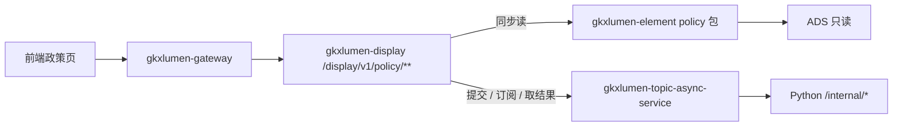

# 科技政策跟踪 · 调用链与边界

- 任务：`POL-DISPLAY-SDD-CHAIN-L01`
- 日期：2026-11-03
- 监管：`human:淮政玮`
- 图：`POL-DISPLAY-SDD-CHAIN-L01-SEQ`（本叶新图，会签态未见源 frontmatter，记 `draft`）

上游只引用，不改写：详设第 5 卷 `05-功能-科技政策跟踪.md`、`ARCH-DISPLAY-01.md` 里与展示自建 L3 和 `/display/v1` 有关的裁决、调研定稿 `对照-科技政策跟踪-存量任务与依赖.md` 第 7 节及四册 `survey/`。指标与 501 明细归 `POL-DISPLAY-SDD-METRIC-L01`。资源路径清单归 `POL-DISPLAY-SDD-INPUT-L01`。本叶不写 OpenAPI 字段表、DTO、枚举。

## 1. 对外链

展示政策页的浏览器只打 `gkxlumen-display` 的 `/display/v1/policy/**`。网关把 `/display/**` 转到该服务。前端不直连 Python、库、Nebula。`gkxlumen-display` 也不直连 Python、也不直连库。

政策要素归展示自建 L3 `gkxlumen-element`（要素域 `policy` 包，路由仅内网，不配网关）。智树自建政策读 ADS。A1 已裁定展示不复用专题业务查询链路。`gkxlumen-topic-*` 的政策服务不进入本链。

算法出口只有 Python `/internal/*`。已注册、可调用的共用算法走 `lumen-algo-py` 的 `/internal/*`。展示侧门面 `gkx_show_service` 的 `/internal/gkx-show/**` 仍是骨架，当前不可当政策算法通道。专题门面 `gkx_search_service`、`gkx_ai_service`、`gkx_svc_service` 不进入本链。

同一算法可以复用计算，URL 不复用 `/topic/v1/policy`。禁止第二套算法调用闭包。`E-E7-POLICY-M1-L03` 若以后注册焦点、力度、效果模型，展示只引用注册结果，调用仍从 `/display/v1/policy/**` 进入，经 `/internal/*`，不改去打专题路由。

Job 不自造任务体系。`gkxlumen-display` 只做提交、订阅、取结果。任务表、SSE、并发锁、大结果外置复用 `gkxlumen-topic-async-service`。这是基础设施复用，不是复用专题政策查询。异步失败不挡住同页已经返回的同步区块。切条件不自动起任务。模型未注册时，该 Job 保持 501，页面空态，不得用 fixture 填结果。

政策域 35 条 D4 全是 mock。可接统计读面在真路径接上之前，数值仍是 mock，角标保持测试态。`GDF-POLICY-MOCK-GATE-L01` 为 blocked。闸门未解开时，正式值仍是 mock。展示仓不算数。D4 要离开 mock，走已有 `GDF-POLICY-MDC-STAT-L01`，再由已有 `BE-POL-DATA-01` 对到已有 ADS。

契约冻结前，前端继续 mock，不猜具体资源路径。实现仍是已有 `BE-POL-IMPL-01`，本叶不新开实现单。

## 2. 同步读 ADS

同步区块的物理跳是：前端 → 网关 → `gkxlumen-display` → `gkxlumen-element` → ADS。Java 只读。纯查询、聚合、分页在门面实装前后都直读 ADS。这些区块不进 Job，也不进 Python。

| 页 | 同步区块 | 读什么 | 备注 |
|---|---|---|---|
| DS-10 全景 | 检索条件、筛选分类、动态可视化、页内并列查看、部门件数上的统计 | 政策总数、类型分布、级别分布、全国分布、深圳分布、时序、产业链覆盖率、有效率 | 调研可接统计读面 9 行里的 STAT。数值是 mock |
| DS-10 全景 | 标杆比对上的支持力度 | `M_POLICY_SUPPORT_STRENGTH`（COMPUTE） | 调研判可接统计读面。走 `BE-POL-DATA-01` 对已有 ADS，不进 Job。三维缺金额档，数值是 mock |
| DS-10 全景 | 筛选、列表、详情正文 | 政策目录与正文 | 详设第 5 卷：全景读面是目录加 ADS。挂接子图可空，见第 7 项，不在本跳算图 |
| DS-11 评价 | 短板清单条数、机遇清单条数 | `M_POLICY_SHORTBOARD_COUNT`、`M_POLICY_OPPORTUNITY_COUNT` | 只同步读计数。源模型仍是 MODEL，不在这条同步链上计算。第一批 STAT 脚本不含这两条，对不上 ADS 前没有真批次，数值是 mock |
| PC-1 治理 | 库内已有结果的看板，含页眉「库内政策数」 | 第 6 项已经落入 ADS / DWD 的结果；件数可挂 `M_POLICY_TOTAL_COUNT` | 治理质量指标未见。展示不重做清洗、贴源、Mapping |
| PC-2 拆解 | 条款树呈现 | 已写入 ADS `policy_text_parse` 的条款 | 加工在已有 `POL-CLAUSE-BATCH-L01` 与政策 GDF。展示只读结果 |
| PC-3 对比 | 表内并列全景已有分布 | 仍读 DS-10 那几条统计 | 对比页自身可接统计读面为 0。不新算一套对比统计。差异、冲突、摘要不在本行 |

来源监控与更新只读最新入库列表和管线阶段，加工在第 6 项，本页不重开抓取。

## 3. 走 Job

Job 的物理跳是：前端 → 网关 → `gkxlumen-display` 的 `/display/v1/policy/**` → `gkxlumen-topic-async-service` → Python `/internal/*`。未注册则 501 / 空态。下列区块没有可替代的统计读面。

| 页 | Job 区块 | 注册情况 |
|---|---|---|
| DS-10 全景 | 热点、影响、深度报告；实施效果跟踪；政策匹配与推送；详情对比与对标可视化上的力度结果 | 已见 MODEL 的是实施效果、匹配、产业适配、力度评分，D4 均 mock，未以可调用服务接通，501。热点 / 影响 / 深度报告未见模型，501 |
| DS-11 评价 | 焦点指数、效果评分、智能摘要、分区效果对比、方案对比、参数模拟、实施路径与风险 | 模型未注册则 501。参数模拟不挂推演指标。实施路径口径是生成，不是第 7 项在线读图。短板 / 机遇的源模型不随计数同步链返回 |
| DS-12 推演 | 效果预估与科技政策推演（仿真、预测、区域空间、多维评估、利益攸关方、文本解析、重点可视、影响范围、路径预测、解读报告） | 只认 `M_POLICY_SIMULATE`。该模型未以可调用服务注册，整页推演 501。无统计读面可替代。关联网络不在本行，见第 7 项 |
| PC-2 拆解 | 政策语义理解 | 语义理解 Job 未见，501。不把条款批处理写成展示新 Job |
| PC-3 对比 | 跨政策差异 / 冲突、由该结果驱动的可视化与权重、对比摘要 | 对比摘要 Job 未见，501。专题对比篮不在本页新建 |
| PC-4 研报 | 深度分析、洞察提炼、模块化撰写、结论与原文双向索引、服务端导出 | 研报 Job 未注册，真路径 501 / 空态 |

全景上的智能排序、检索历史与收藏、导出与分享、订阅外发、受众反馈、版本 diff、对标报告，调研记 501 或未见通道。它们不是已注册 Job。契约冻结前不得把页面演示当成这些服务。本叶不为此新开任务。

评价页多维趋势若没有本叶专指标，不改挂全景时序，未注册则 501。

## 4. 推演与布局推荐分键

两键不合并，不互相填数。

| 键 | 认什么 | 不认什么 |
|---|---|---|
| 展示推演键 | `M_POLICY_SIMULATE`（政策效果推演）。走上一节 Job。未注册则 501，空态，并标明假设与模型版本这一非功能要求在模型接通后才有结果可标 | 不用布局推荐的模型或条数填推演页。`FE-POL-03A` 页头「布局建议」卡槽是复刻壳，不升成推演结果 |
| 布局推荐键 | `M_POLICY_DEEP_171_1`（布局推荐模型）与 `M_POLICY_LAYOUT_REC_COUNT`（该模型对冲链路的建议条数） | 不进入展示推演键。计数类型是 STAT，只说明它在数建议条数，不把它变成推演页的可接统计读面，也不进 `BE-POL-DATA-01` 的推演计算 |

布局推荐留在算法库 171 与专题侧。`E-E7-POLICY-M1-L03` 不含布局推荐。展示不为其新开实现任务。Job 键与专题政策分析分键：专题分析走专题自己的 URL，展示推演不复用那条 URL。

评价页序号 228 的参数模拟、研报页「建议条数」演示挂载，都不改挂到推演键或布局推荐键。

## 5. L06 裁定

`E-E7-POLICY-M1-L06` 不是科技信息展示系统的实现路径。

该单 DoD 写展示层消费专题 `/topic/v1/policy`。这与 A1（展示不复用专题业务查询链路）和详设第 5 卷（`/display/v1/policy/**`，不复用 `/topic/v1/policy/**`）冲突。调研定稿第 7 节已写明它不是展示实现路径。本叶书面确认：展示集成不把 `L06` 列入关键路径，不把它改造成展示联调单，不让全景、评价、推演、治理、拆解、对比、研报去调 `/topic/v1/policy`。

专题签收单 `E-E7-POLICY-M1-L07` 硬依赖 `L06`，停在专题侧，不是展示模块的签收门。

## 6. 边界：这些范围不新开实现任务

### 6.1 专题政策

`E-E7-POLICY-M1-L01` 至 `L05`、`L07` 只索引。基础指标 ETL、政策子图、焦点 / 力度 / 效果模型、`/topic/v1/policy`、专题政策页、专题签收，都留在专题 / demo 算法仓。展示页面不等这条链。`L04` 的专题 URL 不转调进 `gkxlumen-display`。

### 6.2 门户政策扶持

`ALGO-LIB-POL-PORTAL-*` 是门户「政策扶持」。计算侧多条已完成，`ALGO-LIB-POL-PORTAL-LUMEN-L01` 为 integration。它不是 DS-10～12，也不是核增四页。同一 `metric_id` 可以复用已有计算，不把十条写成展示页任务。全景部门件数仍用已有政策总数，不新造部门指标，也不改走门户十条。

### 6.3 第 6 项 GDF

第 6 项是三方源进 ADS 的数据工厂。政策派单包 `GDF-POLICY-WORKPACK-V2-L01` 已完成。贴源、Mapping、统计离线加工、灌数闸门、血缘说明沿用已有单：`GDF-POLICY-WORKPACK-V1-L01`、`GDF-POLICY-MDC-DOC-L01`、`GDF-POLICY-MDC-STAT-L01`、`GDF-POLICY-MOCK-GATE-L01`、`GDF-POLICY-LINEAGE-L01`。展示不重开政策 GDF 包，不加表，不加字段。治理页只读第 6 项已有结果。`GDF-POLICY-LINEAGE-L01` 是工位导入后的血缘说明，对不上治理溯源索引和研报双向索引，不据此把这两处改判成已可查询。

### 6.4 第 7 项读图

读图、查图、图指标归第 7 项图数据库集成。政策页只消费子图，不重做抽取，不新建查图任务，不重画查图时序。已有索引：专题子图 `E-E7-POLICY-M1-L02`（done）、抽取脚本 `GDF-POLICY-GRAPH-EXT-L01`（backlog）。独立读图任务号未见。Java 不写 nGQL。全景挂接可空。区域差异、政策关联、拆解实体关联遇到图时走这条消费关系，不走 `L06`，也不在政策组新开图接口。评价页关系网（序号 221）同样只索引，不设展示新查图任务。

## 7. 本叶不做

- 不写 OpenAPI 字段、请求体、响应体、DTO、枚举。路径表由契约输入清单叶列出。
- 不新建第二套 `FE-POL-*`。
- 不把 `BE-POL-CONTRACT-01` 写成系统详细设计。它只出 API-POL。
- 不改 WBS、注册表、调研分册、详设第 5 卷、lumen / demo。
- 不把收藏、订阅关系、用户态写成已有服务。调研未见对应任务。若以后要做，写面落展示侧，不落专题库，仍不在本叶开单。
