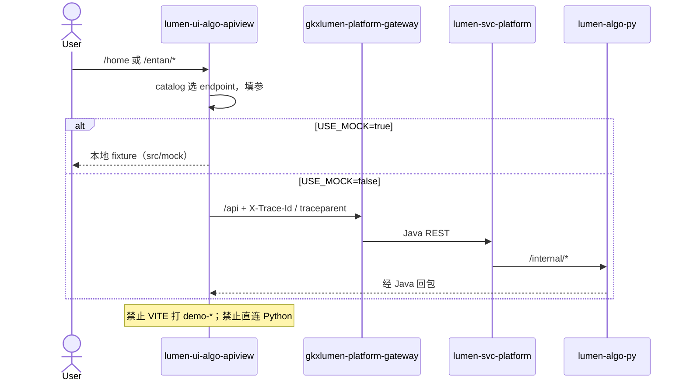

# LUMEN-ALGO-PLATFORM-UI-L01 · 算法前端正式交付 — 总览首页 + 企业分析算法库联调台首期

> 日期：2026-08-21  
> Task：`LUMEN-ALGO-PLATFORM-UI-L01`  
> 仓：`lumen-ui-algo-apiview` · `origin/dev`  
> 对照（只读）：`demo-ui-system-test` 企业分析页契约；未 merge demo  
> 计划：`gkx-orchestration/docs/superpowers/plans/2026-08-21-lumen-ui-algo-apiview-ui.md`

## 任务认领（必填）

| 字段 | 值 |
|------|-----|
| claimed_by | `agent:frontend-agent` |
| supervised_by | `human:孔东` |
| claim_type | `pull` |
| 说明 | 目标仓由实施中途的 `lumen-algo-platform` 更正为 `lumen-ui-algo-apiview`；本叶不标 `done` |

## Ponytail（coding 任务必填）

| 字段 | 值 |
|------|-----|
| ponytail | `full` |
| 说明 | catalog 驱动三区，未另起一套交互。未用 YAGNI 跳过 D8 token、D9 ⓘ、D10 评审自闸、可观测 `X-Trace-Id`/`traceparent`、D12 网关、handoff。 |

## Headroom（可选）

| 字段 | 值 |
|------|-----|
| headroom | `skip` |
| 说明 | 本机会话未挂载 Headroom MCP。 |

## 图即契约

本叶为联调台前端壳 + 企业 catalog，不改存储流图 / nGQL。调用链如下（会签态 `draft`，禁止自填绿）。

| 字段 | 值 |
|------|-----|
| diagram_id | `LUMEN-ALGO-PLATFORM-UI-L01-SEQ` |
| 图 diff | 新增 FE→网关→Java→Python 联调台边；无 ODS/ADS 改边。禁止事项未变。 |
| 会签态 | `draft` |

## 范围与实现

空仓 Python README 骨架替换为 Vue SPA。登录后 `/` → `/home`。企业 13 页由 `src/catalog/entan.json` 驱动同一套 `AlgoWorkspaceView`（接口信息 / 算法测试；可视化挂在测试区，随当前 endpoint 的 spec+result 渲染）。

### 已交付区块

1. **登录**：最小登录；成功 redirect `/home`（`ENABLE_MOCK_AUTH` 本机可跳过真实 token）
2. **总览 `/home`**：Hero + 四张 catalog 汇总卡（已开通/规划模块、企业算法页、接口数、图谱页）+ 企业算法卡片网格 + 二期五库灰显标签
3. **壳**：左菜单（总览 + 企业 13 子项 + 五库 `disabled`）+ 顶栏标题/Mock 标签/回总览；`RouterView :key="route.path"` 切菜单重建页
4. **企业 13 页**（slug 与 demo `ENTAN_SUB_MENU` 同名）：basic / competitiveness / history / pain-points / supply-chain / tech / biz / attract / cultivate / graph / risk / news / eval-async
5. **三区**：接口信息（方法/路径/参数/示例 JSON）；算法测试（ParamForm + 执行 + 原始 JSON）；可视化（KPI / 表 / ECharts / G6，按 catalog `viz`）
6. **验收向可视化调整**（只改 catalog `vizLayout` + 当前 endpoint 渲染，未另写表格组件）：
   - 基础指标 / 重点资讯：去掉会双接口自跑的复合面板，只渲染当前 endpoint
   - 竞争力评分/等级、供应链明细/Top15、风险明细/Top15、多维排名：`stack` 上下全宽
   - 痛难点：`table-then-charts`（表明细全宽，下方面包+雷达并排）
   - 资讯列表列：标题、企业名称、类型、时间
   - G6 节点可点，选中同步表格行
7. **Mock 门控**：仅 `USE_MOCK=true` 时 `main.ts` 动态 `import('./mock')`；`http.js` `mockEnabled=false` 走真实 `real()`
8. **可观测**：`request.ts` 每请求写 `X-Trace-Id` + `traceparent`
9. **D9**：`src/review/` 镜像 + `MetricMarker` 自闸（关评审不渲染 metric_id）

### 非范围

- 产业链 / 政策 / 产业服务 / 产业综合 / 创新监测 catalog 与可视化
- `.gitlab-ci.yml` 静态前端流水线（仓内仍无 CI 文件）
- Java path 与网关最终前缀会签（catalog 暂用 demo 对照 `/entan/v1/...`）
- 人审截图（本机未落盘到 handoff）

## 偏离说明

1. **模板站三顶栏 Tab** 在 as-built 收成两个：`接口信息` / `算法测试`；可视化在测试区按当前接口渲染，避免第三套 Tab 与双接口自跑。
2. **总览四卡 ⓘ** 使用无 `metricId` 的 `MetricMarker`（缺登记走红问号），未给汇总卡伪造 8 件套。
3. **`package.json` name** 曾误留 `lumen-algo-platform`，交仓前改为 `lumen-ui-algo-apiview`。
4. **`.env.development`** 含本机网关地址，已加入 `.gitignore`，只交 `.env.example`。
5. **计划中的 Leaflet / dayjs / UnoCSS** 首期未装：无地图页，样式走 `src/assets/main.css` token。
6. **异步评估** `runtime: local_mock`：`USE_MOCK=false` 时禁止伪请求 Java REST，只展示 catalog 契约。

## 复刻五维（R1–R5）

| # | 项 | 结果 |
|---|---|---|
| R1 布局 | 总览 Hero+四卡+网格；算法页左菜单+顶栏+接口信息/测试/可视化 | ✅ |
| R2 交互 | 切菜单重建；执行有加载/失败/JSON；未执行可视化为空；local_mock 禁用执行钮 | ✅ |
| R3 样式 | `--sci-bg-page` / `#D8E7FC`、主色 `#165DFF`、正文 14px；Arco Vue，无 Element/AntD | ✅ |
| R4 评审 | 只从 `@/review` 挂点；关评审不渲染 metric_id / GAP / 就绪度字样 | ✅ |
| R5 Mock | 开：`src/mock/register.ts`；关：不 `setupMocks`，不 fixture 填数 | ✅ |

### 检索皮肤（V1–V7）

本叶无检索 Hub。V2–V7 N/A。

| # | 结果 |
|---|---|
| V1 页底 `--sci-bg-page` / `#D8E7FC` | ✅ |
| V2–V7 | N/A |

工作区 W1–W4：N/A（本叶是 API 联调台，不是专题分析工作区；无 I2-12 异步任务闸）。

## Design.md §14

- 主色 `#165DFF`、页底 `#D8E7FC`、正文 14px、控件走 Arco 默认 32px 高
- 图表：ECharts + AntV G6（图谱页）；无新 vendor token、无 `.ant-`
- 无地图页，未引入 Leaflet

## 测试结果

- `node --test scripts/*.test.mjs`：33 pass / 0 fail
- `pnpm type-check`（`vue-tsc --build`）：通过
- `pnpm build-only`（`vite build`）：通过，3169 modules，约 27s
- 本叶 Java 联调：catalog 多数 endpoint `status: unavailable`；真实调用依赖网关已发布 `/entan/v1/*`

## 遗留风险

- 无 `.gitlab-ci.yml`，push 后无前端 type-check/build 门禁，需 devops 补静态站流水线
- Java `/entan/v1` 与正式网关 path 未会签；未发布接口在 `USE_MOCK=false` 下会失败，属诚实空/错误态
- 总览 Hero 在 `USE_MOCK=false` 时文案写「真实调用网关」，与顶栏 Tag 一致；若本机未配 `VITE_APP_API_URL` 则代理未启用
- 同名仓 `lumen-algo-platform` 若仍有本地实验代码，**不是**本任务交付仓，勿 push 混淆

## CI/CD（必填）

- 分支：`lumen-ui-algo-apiview` `origin/dev`
- commit：`f2a3dc9`
- pipeline URL / ID：仓内无 `.gitlab-ci.yml`，push 后可能无业务 pipeline
- 部署 namespace / 镜像 tag：未交 Helm/Dockerfile
- K8s rollout：本叶未等
- 本地：`pnpm dev` → `http://127.0.0.1:3100/`（hash 路由 `#/home`）

## 可观测性

- `src/utils/request.ts`：`X-Trace-Id` + `traceparent`（`createTraceId` / `createTraceparent`）
- OTEL_SERVICE_NAME：N/A（纯前端）
- Tempo / Loki：平台已有；本叶无新 Java span

## 架构合规自检

| 铁律 | 结果 |
|------|------|
| 1 算法只在 Python | ✅ 前端无 NLP/图谱算法，G6 只可视化回包 |
| 2 调用链 FE→Java→Python `/internal` | ✅ axios `baseURL=/api`，Vite proxy 到网关；不直连 Python |
| 3 Nebula 非 Neo4j | ✅ 未碰图数据库 |
| 4 可观测 | ✅ 请求头 trace |
| 5 CI | ❌ 无 `.gitlab-ci.yml`（遗留） |
| 6 demo2 不 merge 进 lumen | ✅ 只读对照 demo-ui-system-test |
| 7 共享聚合 / 只调 Java | ✅ 无 Feign/VITE 打 demo-* |
| 8 数据 ADS / Mock 开关 | ✅ `USE_MOCK=false` 不 fixture |
| 9 D8 Design token | ✅ |
| 10 D9 八件套 / 不自造改绿 | ✅ 镜像 `readiness.generated.ts`；总览卡无 metricId 走红问号 |
| 11 D10 `@/review` | ✅ |
| 12 D12 不打 demo-* | ✅ `.env.example` 注明只允许 gateway |

## Cost

| 字段 | 值 |
|------|-----|
| `actual_tokens` | 350000 |
| `model_used` | `claude-sonnet-4.5`（registry 合法枚举；本会话为 Cursor Grok 4.6，按 Sonnet 价表回填） |
| `actual_cost` | 1.89 |
| `cost_warn` | green |
| 口径 | frontend-agent 80/20；`350000×0.8×3/1e6 + 350000×0.2×15/1e6 = 1.89`；`source: session_estimate` |

## 涉及文件

- `lumen-ui-algo-apiview` 前端工程（`src/**`、`scripts/*.test.mjs`、`package.json`、`.env.example`）
- `gkx-orchestration/docs/superpowers/plans/2026-08-21-lumen-ui-algo-apiview-ui.md`
- 本 handoff

## 产物清单

- 可运行 SPA：登录 → `/home` → `/entan/*` 13 页联调
- catalog 契约 + Node 单测
- 本 handoff + cost 四字段
