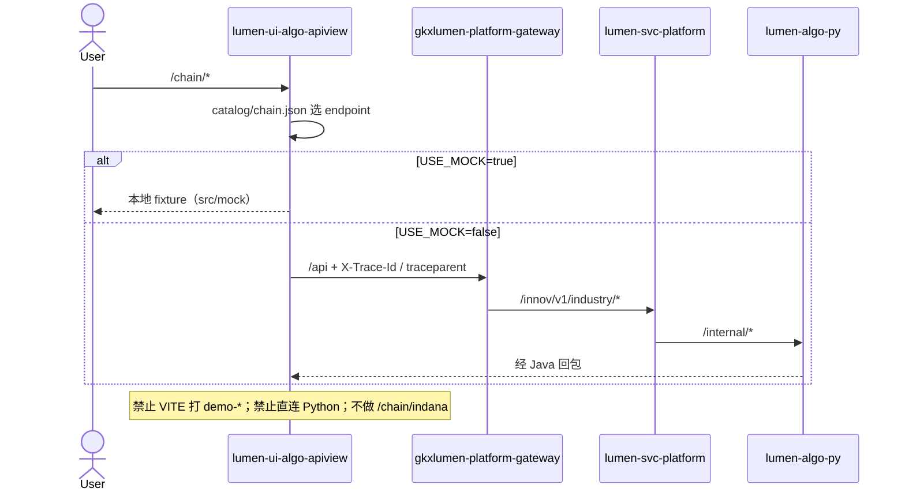

# LUMEN-UI-ALGO-APIVIEW-CHAIN-L01 · 算法库联调台 — 产业链分析算法库首期

> 日期：2026-08-22  
> Task：`LUMEN-UI-ALGO-APIVIEW-CHAIN-L01`  
> 仓：`lumen-ui-algo-apiview` · `origin/dev`  
> 对照（只读）：`demo-ui-system-test` `CHAIN_SUB_MENU` / `src/api/chain/index.ts`；未 merge demo  
> 父叶：`LUMEN-ALGO-PLATFORM-UI-L01`（企业库壳已联调）

## 任务认领（必填）

| 字段 | 值 |
|------|-----|
| claimed_by | `agent:frontend-agent` |
| supervised_by | `human:孔东` |
| claim_type | `pull` |
| 说明 | 复用企业库 `AlgoShell` + `AlgoWorkspaceView` 三区；本叶不标 `done` |

## Ponytail（coding 任务必填）

| 字段 | 值 |
|------|-----|
| ponytail | `full` |
| 说明 | catalog 驱动，未另起一套交互。未用 YAGNI 跳过 D8 token、D9 ⓘ、D10 评审自闸、可观测请求头、D12 网关、handoff。 |

## Headroom（可选）

| 字段 | 值 |
|------|-----|
| headroom | `skip` |
| 说明 | 本机会话未挂载 Headroom MCP。 |

## 图即契约

| 字段 | 值 |
|------|-----|
| diagram_id | `LUMEN-UI-ALGO-APIVIEW-CHAIN-L01-SEQ` |
| 图 diff | 新增 FE→网关 `/innov/v1/industry/*` 联调台边；无 ODS/ADS 改边。禁止事项未变。 |
| 会签态 | `draft` |

## 范围与实现

侧栏「产业链分析算法库」从灰显改为可展开。9 页由 `src/catalog/chain.json` 驱动同一套三区工作区。

### 已交付区块

1. **路由 / 侧栏**：`/chain/basic`、`panorama`、`topic-panorama`、`cycle`、`keynodes`、`bottleneck`、`region`、`shenzhen`、`hotspot`；不做 `/chain/indana`
2. **契约**：列表与基础指标、深度模型 panorama / cycle / key-nodes / bottlenecks / region-index / shenzhen / hotspot / roadmap / recommendation；demo path `/innov/v1/industry` 仅对照，正式走网关 Java REST
3. **壳**：`AlgoShell` 可展开产业链子菜单；`HomeView` 统计卡与产业链卡片网格纳入 `chainCatalog`
4. **Runner**：`src/api/chain.ts`；图谱边字段兼容；`USE_MOCK=true` 可演示
5. **D9**：`src/review/readiness.generated.ts` 镜像产业链指标；`MetricMarker` 自闸

### 非范围

- 政策 / 产业服务 catalog（另叶 POLICY-L01 / SVC-L01）
- `/chain/indana` 要素库 Mock、demo `internal` 灌数 / graph-schema-init
- Java path 与网关前缀会签（catalog 暂用 demo 对照 `/innov/v1/industry`）
- 人审截图

## 偏离说明

1. 全景 / 专题全景等图谱页未另写特例 Vue，仍套 `AlgoWorkspaceView` + catalog `viz`（G6/表/图）。
2. 产业链页 `autoRun: true`（与企业库一致，切到算法测试会打当前接口）；政策/产业服务另叶改为 `false`。
3. 地图无天地图时用表+柱回退，未引入 Leaflet。

## 复刻五维（R1–R5）

| # | 项 | 结果 |
|---|---|---|
| R1 布局 | 侧栏可展开 + 三区；总览纳入产业链卡 | ✅ |
| R2 交互 | 切菜单重建；执行有加载/失败/JSON；未执行可视化为空 | ✅ |
| R3 样式 | `--sci-bg-page` / `#D8E7FC`、主色 `#165DFF`、正文 14px；Arco Vue | ✅ |
| R4 评审 | 只从 `@/review` 挂点；关评审不渲染 metric_id / GAP / 就绪度字样 | ✅ |
| R5 Mock | 开：`src/mock`；关：不 fixture 填数 | ✅ |

检索皮肤 V2–V7：N/A。工作区 W1–W4：N/A（联调台，非专题分析工作区）。

## Design.md §14

- 主色 `#165DFF`、页底 `#D8E7FC`、正文 14px、控件走 Arco 默认 32px 高
- 图表：ECharts + AntV G6；无新 vendor token、无 `.ant-`

## 测试结果

- `node --test scripts/*.test.mjs`：49 pass / 0 fail（与 POLICY/SVC 同仓一次跑）
- `pnpm type-check`：通过
- `pnpm build-only`：通过
- Java 联调：真实 `/innov/v1/industry/*` 依赖网关已发布；`USE_MOCK=true` 可演示

## 遗留风险

- 无 `.gitlab-ci.yml`，push 后无前端门禁
- Java `/innov/v1/industry` 与正式网关 path 未会签；未发布接口在 `USE_MOCK=false` 下会失败（诚实空/错误态）
- 本叶未做人审截图

## CI/CD（必填）

- 分支：`lumen-ui-algo-apiview` `origin/dev`
- commit：`7b17be7`
- pipeline URL / ID：仓内无 `.gitlab-ci.yml`
- 部署 namespace / 镜像 tag：未交 Helm/Dockerfile
- K8s rollout：本叶未等
- 本地：`pnpm dev` → `http://127.0.0.1:3100/`（hash 路由 `#/chain/basic`）

## 可观测性

- `src/utils/request.ts`：`X-Trace-Id` + `traceparent`（沿用企业库）
- OTEL_SERVICE_NAME：N/A（纯前端）

## 架构合规自检

| 铁律 | 结果 |
|------|------|
| 1 算法只在 Python | ✅ 前端无 NLP/图谱算法，G6 只可视化回包 |
| 2 调用链 FE→Java→Python `/internal` | ✅ axios `baseURL=/api`；不直连 Python |
| 3 Nebula 非 Neo4j | ✅ 未碰图数据库 |
| 4 可观测 | ✅ 请求头 trace |
| 5 CI | ❌ 无 `.gitlab-ci.yml`（遗留） |
| 6 demo2 不 merge 进 lumen | ✅ 只读对照 demo-ui-system-test |
| 7 共享聚合 / 只调 Java | ✅ 无 Feign/VITE 打 demo-* |
| 8 数据 ADS / Mock 开关 | ✅ `USE_MOCK=false` 不 fixture |
| 9 D8 Design token | ✅ |
| 10 D9 八件套 / 不自造改绿 | ✅ 镜像 readiness；不手写改绿 |
| 11 D10 `@/review` | ✅ |
| 12 D12 不打 demo-* | ✅ 不迁 indana / internal 灌数 |

## Cost

| 字段 | 值 |
|------|-----|
| `actual_tokens` | 180000 |
| `model_used` | `claude-sonnet-4.5`（registry 合法枚举；本会话为 Cursor Grok 4.6，按 Sonnet 价表回填） |
| `actual_cost` | 0.97 |
| `cost_warn` | green |
| 口径 | frontend-agent 80/20；`180000×0.8×3/1e6 + 180000×0.2×15/1e6 = 0.97`；`source: session_estimate` |

## 涉及文件

- `lumen-ui-algo-apiview`：`src/catalog/chain.json`、`src/api/chain.ts`、`AlgoShell.vue`、`HomeView.vue`、`scripts/catalog.test.mjs`
- 本 handoff

## 产物清单

- 产业链 9 页联调台 + catalog 契约
- 本 handoff + cost 四字段
- 状态：`in_progress` → `integration`（等网关 `/innov/v1/industry/*` 联调）
