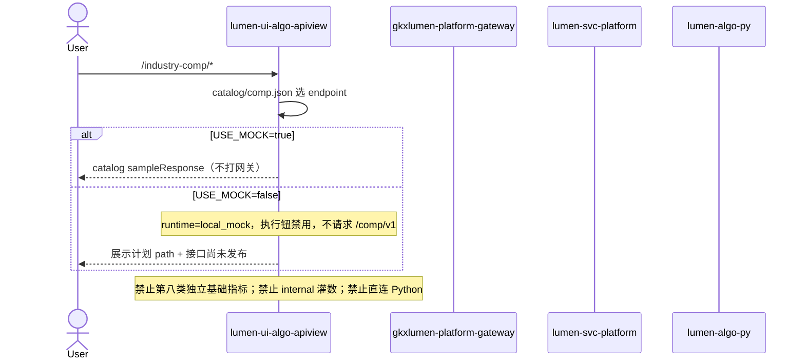

# LUMEN-UI-ALGO-APIVIEW-COMP-L01 · 算法库联调台 — 产业综合分析算法库首期

> 日期：2026-08-24  
> Task：`LUMEN-UI-ALGO-APIVIEW-COMP-L01`  
> 仓：`lumen-ui-algo-apiview` · 工作区 `dev`  
> 对照（只读）：`demo-ui-system-test` `INDUSTRY_COMP_SUB_MENU` / `compModelCatalog.ts` / `BasicIndicators.vue`；设计分册 `docs/产业综合分析算法设计说明.md`；未 merge demo  
> 父叶：`COMP-ALGO-DESIGN-L01`

## 任务认领（必填）

| 字段 | 值 |
|------|-----|
| claimed_by | `agent:frontend-agent` |
| supervised_by | `human:孔东` |
| claim_type | `coordinator_dispatch` |
| 说明 | 监管人确认认领下发并先做本叶。本叶不标 `done` |

## Ponytail（coding 任务必填）

| 字段 | 值 |
|------|-----|
| ponytail | `full` |
| 说明 | catalog 驱动，未另起一套交互。未用 YAGNI 跳过 D8/D9/D10、可观测、D12、handoff。 |

## Headroom（可选）

| 字段 | 值 |
|------|-----|
| headroom | `skip` |
| 说明 | 本机会话未挂载 Headroom MCP。 |

## 图即契约

| 字段 | 值 |
|------|-----|
| diagram_id | `LUMEN-UI-ALGO-APIVIEW-COMP-L01-SEQ` |
| 图 diff | COMP 不打网关；path 仅登记计划契约。Java `/comp/v1` 未发布。 |
| 会签态 | `draft` |

## 范围与实现

侧栏「产业综合分析算法库」可展开。11 页由 `src/catalog/comp.json` 驱动同一套 `AlgoShell` + `AlgoWorkspaceView`。

### 已交付区块

1. **路由**：`/industry-comp/basic`、`tech-outcome`、`industry-outcome`、`talent-outcome`、`policy-outcome`、`vitality`、`element-type`、`element-layer`、`element-domain`、`element-synthesis`、`synergy`
2. **契约**：11 条 `runtime: local_mock`；path 仍登记 `/comp/v1/comp/*` 作为计划对照。**不向网关发请求**（Java / 网关 / Python 均无此路由，标 `java_api` 必 404）。demo 产业综合亦为前端 Mock。
3. **可视化**（规避前库问题）：
   - 全部 `vizLayout: stack`，KPI / 表 / 图各占一行
   - 每张表显式 `columns`；测试校验列 field 落在 `sampleResponse` 行上
   - KPI/表列/图 kind 与 demo `BasicIndicators` + `COMP_MODEL_SPECS` 对齐
   - 协同页含 G6 图谱，仍套通用工作台，不用企业 `graph-composite`
4. **Mock 自洽**：城市名一致、排名与分数同序（深圳 92/第1 …）、指数 0–100；权重仍挂 Q064–Q067
5. **交互**：`autoRun: false`；`USE_MOCK=false` 不 fixture、不打 `/comp/v1`；执行钮禁用并提示「Java 尚未发布」
6. **总览**：`HomeView` 纳入产业综合卡片网格（创新监测已由 INNOV-L01 开通）

### 非范围

- 独立第八类基础指标（招标未定义）
- Java `/comp/v1/comp/*` 会签与实现
- 创新监测库（`LUMEN-UI-ALGO-APIVIEW-INNOV-L01`）

## 偏离说明

1. Demo `ModelDemoPage` 有雷达+柱并排；本叶按监管要求改为一行一块，避免拥挤。
2. 未为协同图谱另写特例 Vue。
3. 上游依赖表的联调台入口只展示 `menuLabel` 文本，不做跨库 router-link（工作台路由已存在时用户可从侧栏进入）。

## 复刻五维（R1–R5）

| # | 项 | 结果 |
|---|---|---|
| R1 布局 | 11 页三区；KPI/表/图各占一行 | ✅ |
| R2 交互 | 切测试不自动请求；执行钮触发 | ✅ |
| R3 样式 | Design token + Arco Vue | ✅ |
| R4 评审 | `@/review` 自闸 | ✅ |
| R5 Mock | `USE_MOCK=false` 禁止 fixture | ✅ |

### 检索皮肤（V1–V7）

本叶是算法工作台不是检索 Hub。V1 页底沿用 `--sci-bg-page`；V2–V7 不适用。

## Design.md 验收 6 条

- 主色 `#165DFF`、页底 `#D8E7FC`、正文 14px
- ECharts + G6；无 Element/AntD

## 测试结果

- `node --test scripts/*.test.mjs`：56 pass / 0 fail
- `pnpm type-check`：通过
- `pnpm build-only`：通过
- 本机 `pnpm dev` 已挂 `http://localhost:3100/`；`USE_MOCK=false` 时 COMP 不发网关请求（避免 `/api/comp/v1/*` 404）
- 本会话无浏览器自动化；未能登录后点页截图。看可视化请开 `VITE_APP_USE_MOCK=true` 走 `#/industry-comp/basic` 与 `#/industry-comp/synergy`

## 遗留风险

- 无前端 CI
- `/comp/v1/comp` 与正式网关 path 未会签
- Java `/comp/v1` 未实现；通真接口须另派 api-agent + algorithm-agent + 网关路由。前端本叶不能单独消 404

## CI/CD（必填）

- 分支：`lumen-ui-algo-apiview` `origin/dev`
- commit：监管人要求本交 push `origin/dev`
- pipeline：仓内已有 GitLab CI（`pnpm`）
- 部署 namespace / 镜像 tag：未交
- K8s rollout：本叶未等
- 本地：`pnpm dev` → `#/industry-comp/basic`

## 可观测性

- 请求头 `X-Trace-Id` + `traceparent`（沿用企业库）

## 架构合规自检

| 铁律 | 结果 |
|------|------|
| 1 算法只在 Python | ✅ |
| 2 调用链 FE→Java→Python `/internal` | ✅ 不直连 Python |
| 3 Nebula 非 Neo4j | ✅ |
| 4 可观测 | ✅ |
| 5 CI | ❌ 无 `.gitlab-ci.yml` |
| 6 demo2 不 merge | ✅ |
| 7 只调 Java | ✅ |
| 8 Mock 开关 | ✅ |
| 9 D8 | ✅ |
| 10 D9 不自造改绿 | ✅ |
| 11 D10 | ✅ |
| 12 D12 不打 demo-* | ✅ 不迁 CatalogModelPage 内联演示器 |

## Cost

| 字段 | 值 |
|------|-----|
| `actual_tokens` | 150000 |
| `model_used` | `claude-sonnet-4.5`（registry 合法枚举；本会话为 Cursor Grok 4.6，按 Sonnet 价表回填） |
| `actual_cost` | 0.81 |
| `cost_warn` | green |
| 口径 | frontend-agent 80/20；`150000×0.8×3/1e6 + 150000×0.2×15/1e6 = 0.81`；`source: session_estimate` |

## 涉及文件

- `src/catalog/comp.json`、`src/catalog/index.ts`、`src/api/comp.ts`
- `src/layout/AlgoShell.vue`、`src/views/HomeView.vue`、`src/views/AlgoWorkspaceView.vue`
- `src/utils/labels.js`（领先/强/达标等中文 tag 色）
- `scripts/catalog.test.mjs`、`README.md`
- 本 handoff

## 产物清单

- 产业综合 11 页联调台 + catalog 契约 + 一行一块可视化
- 本 handoff + cost 四字段
- 状态：`integration`（监管人确认联调中，代码 push `origin/dev`）
