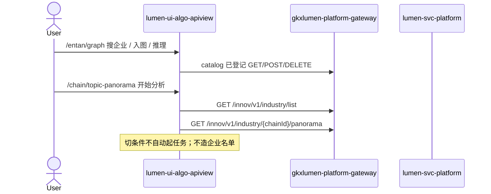

# 企业图谱 + 专题全景工作区（建议 1/2）

> 日期：2026-08-24  
> 挂到：`LUMEN-UI-ALGO-APIVIEW-CHAIN-L01`（专题全景）· `LUMEN-ALGO-PLATFORM-UI-L01`（企业图谱）  
> 仓：`lumen-ui-algo-apiview`（未要求 commit）  
> 对照（只读）：`demo-ui-system-test` `GraphView.vue` / `TopicPanoramaPage.vue`；未 merge demo

## 任务认领（必填）

| 字段 | 值 |
|------|-----|
| claimed_by | `agent:frontend-agent` |
| supervised_by | `human:孔东` |
| claim_type | `pull` |
| 说明 | 两叶均已 `integration`；用户口头授权「按建议执行 1 和 2」，未新开 ready 单 |

## Ponytail（coding 任务必填）

| 字段 | 值 |
|------|-----|
| ponytail | `full` |
| 说明 | 复用已登记 10 个图谱接口 + `chain.basic.list` / panorama；未用 YAGNI 跳过 D8/D9/D10、可观测、handoff。不迁文档详情 / mock-generate / internal 灌数。 |

## Headroom（可选）

| 字段 | 值 |
|------|-----|
| headroom | `skip` |
| 说明 | 本机会话未挂载 Headroom MCP。 |

## 图即契约

| 字段 | 值 |
|------|-----|
| diagram_id | `LUMEN-UI-ALGO-APIVIEW-GRAPH-TOPIC-WS-SEQ` |
| 图 diff | 企业图谱补交互边（enterprises / add / remove / mock / infer）；专题全景补「开始分析」+ 下钻再调 panorama。禁止事项未变。 |
| 会签态 | `draft` |

## 修改内容

1. **企业图谱**：`GraphCompositePanel` 接到已有 catalog：远程搜企业、模拟入库、候选加入、节点移除、文档推理（预览/写入）。不打开 `documents/{id}`，不填 DEMO 企业 fixture。
2. **专题全景**：`layout: topic-panorama-composite`，`TopicPanoramaPanel`：L0/L1、「开始分析」、图谱/结构列表、下钻与面包屑。侧栏编码/阶段/所属链；企业名单与技术路线空态。D9 ⓘ 挂 `M_CHAIN_NODE_COUNT`。
3. 未做建议 3：文档详情、internal 灌数、Mock CRUD。

## 测试结果

- `pnpm test`：79 pass / 0 fail
- `pnpm type-check`：通过
- 本机 Vite 已 HMR 到新面板；会话内无浏览器 MCP，未点进登录后交互

## 遗留风险

- 正式接口未发布时 `USE_MOCK=false` 会失败（诚实错误态）；列表空回退 catalog 种子只用于 L0/L1 下拉，不造图谱环节
- 未做人审截图、未 commit

## CI/CD（必填）

- 分支：`lumen-ui-algo-apiview` 工作区（未 push）
- commit：无
- pipeline URL / ID：仓内无 `.gitlab-ci.yml`
- 部署 namespace / 镜像 tag：未交
- K8s rollout：本叶未等
- 本地：`pnpm dev` → `http://127.0.0.1:3100/` `#/entan/graph` `#/chain/topic-panorama`

## 可观测性

- 沿用 `src/utils/request.ts`：`X-Trace-Id` + `traceparent`

## 架构合规自检

| 铁律 | 结果 |
|------|------|
| 1 算法只在 Python | ✅ |
| 2 调用链 FE→Java→Python `/internal` | ✅ 只调已登记 Java path |
| 3 Nebula 非 Neo4j | ✅ 未碰图库 |
| 4 可观测 | ✅ |
| 5 CI | ❌ 无 `.gitlab-ci.yml`（遗留） |
| 6 demo2 不 merge | ✅ 只读对照 |
| 7 只调 Java | ✅ |
| 8 Mock 开关 | ✅ `USE_MOCK=false` 不 fixture 填企业 |
| 9 D8 | ✅ Arco + 现有 token |
| 10 D9 | ✅ 专题全景 ⓘ；不自造改绿 |
| 11 D10 | ✅ `@/review` MetricMarker 自闸 |
| 12 D12 | ✅ 不迁 indana / internal |

## Cost

| 字段 | 值 |
|------|-----|
| `actual_tokens` | 120000 |
| `model_used` | `claude-sonnet-4.5`（registry 合法枚举；本会话为 Cursor Grok 4.6，按 Sonnet 价表回填） |
| `actual_cost` | 0.65 |
| `cost_warn` | green |
| 口径 | frontend-agent 80/20；`120000×0.8×3/1e6 + 120000×0.2×15/1e6 = 0.65`；`source: session_estimate` |

## 涉及文件

- `lumen-ui-algo-apiview`：`GraphCompositePanel.vue`、`TopicPanoramaPanel.vue`、`PageVisualization.vue`、`graphWorkspace.js`、`topicPanorama.js`、`chain.json`、`types.ts`、`main.css`、对应 test
- 本 handoff
