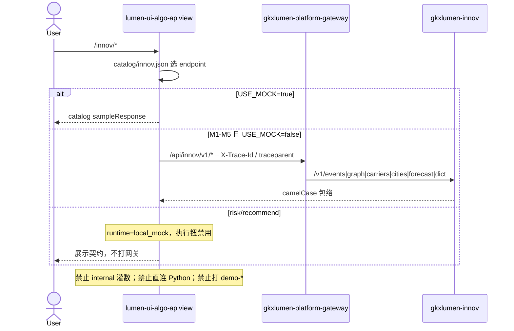

# LUMEN-UI-ALGO-APIVIEW-INNOV-L01 · 算法库联调台 — 创新监测算法库首期

> 日期：2026-08-24  
> Task：`LUMEN-UI-ALGO-APIVIEW-INNOV-L01`  
> 仓：`lumen-ui-algo-apiview` · 工作区 `dev`  
> 对照（只读）：`demo-ui-system-test` `INNOV_SUB_MENU` / `src/api/innov/index.ts` / EventMap、GraphInfluence、CarrierRank、CityIndex、ForecastView、RiskInsightView、RecommendView；Java `gkxlumen-innov` Event/Graph/Carrier/City/Forecast/Dict；未 merge demo  
> 父叶：`E-INNOV-M1-L08`

## 任务认领（必填）

| 字段 | 值 |
|------|-----|
| claimed_by | `agent:frontend-agent` |
| supervised_by | `human:孔东` |
| claim_type | `pull` |
| 说明 | 监管人确认认领开工。本叶不标 `done` |

## Ponytail（coding 任务必填）

| 字段 | 值 |
|------|-----|
| ponytail | `full` |
| 说明 | catalog 驱动，未另起一套交互。未用 YAGNI 跳过 D8/D9/D10、可观测、D12、handoff。 |

## Headroom（可选）

| 字段 | 值 |
|------|-----|
| headroom | `skip` |
| 说明 | 本机会话未挂载 Headroom MCP。 |

## 图即契约

| 字段 | 值 |
|------|-----|
| diagram_id | `LUMEN-UI-ALGO-APIVIEW-INNOV-L01-SEQ` |
| 图 diff | 新增 FE→网关 `/innov/v1/*` 边（M1–M5）；risk/recommend 无网关边。 |
| 会签态 | `draft` |

## 范围与实现

侧栏「创新监测算法库」可展开。7 页由 `src/catalog/innov.json` 驱动同一套 `AlgoShell` + `AlgoWorkspaceView`。六库全部开通，总览去掉二期灰显。

### 已交付区块

1. **路由**：`/innov/events`、`graph`、`carriers`、`cities`、`forecast`、`risk`、`recommend`（与 demo `INNOV_SUB_MENU` 同 slug）
2. **契约**：M1 `/innov/v1/events|heatmap|detail|relations|dict/event-types`；M2 `/graph/domains|subgraph|influence/rank`；M3 `/carriers/rank|{id}|index-method`；M4 `/cities/rank|compare|{code}/advice|index-method`；M5 `/forecast/domain|contributions|bursts`。path 与 `gkxlumen-innov` Controller + demo `src/api/innov/index.ts` 对齐
3. **可视化**（规避前库问题）：
   - 全部 `vizLayout: stack`，`stackViz: false`（只显示当前接口）
   - 每张表显式 `columns`；测试校验列 field 落在 `sampleResponse` 行上
   - 表列与 demo prop 字面一致：`importanceLevel/title/importanceScore/eventTime`、`rankInDomain/name/nodeType/influenceScore`、`rankTotal/name/carrierType/indexScore`、`rankGlobal|rankDomestic/nameZh/indexScore`、`topicName/domainId/burstStart/burstScore`、`title/contribution`、`rank/enterprise_name/recommendation_score`
   - 地图走通用 `UnifiedLeafletMap`（Leaflet + 天地图）：geo 打点、heatmap 热力；catalog `kind: map`
   - 图谱走通用 G6，不用企业 `graph-composite`
4. **Mock 自洽**：importanceLevel 仅 1/2/3；载体类型仅 university/research/incubator；排名与指数同序；预测年度连续；contribution 0–1
5. **异步页**：risk/recommend 为 `local_mock` + 空 path，不迁 demo 异步跑法池。未套企业专用 `eval-async-composite`（该面板写死技术力/商业力/综合竞争力，套上去字段对不上）
6. **交互**：`autoRun: false`；`USE_MOCK=false` 时 M1–M5 打网关，异步页禁用执行

### 非范围

- 企业 `eval-async-composite` 扩成通用异步壳
- Java risk/recommend REST（未发布）
- 提交 / push（监管人未要求）

## 偏离说明

1. Demo 事件页左右分栏地图+表；本叶按「一个区域一行」改为 stack，地图在表上方。
2. 异步页未复用 `eval-async-composite`，原因见上。仍套 `AlgoShell` 三区。
3. 城市建议走 `json` 而非 markdown 渲染器（现有 markdown 读取 `record.markdown`，与 Java `contentMd` 不对齐，不新写渲染器）。

## 复刻五维（R1–R5）

| # | 项 | 结果 |
|---|---|---|
| R1 布局 | 7 页三区；KPI/表/图各占一行 | ✅ |
| R2 交互 | 切测试不自动请求；执行钮触发；异步页禁用 | ✅ |
| R3 样式 | Design token + Arco Vue | ✅ |
| R4 评审 | `@/review` 自闸 | ✅ |
| R5 Mock | `USE_MOCK=false` 禁止 fixture；异步页不发请求 | ✅ |

### 检索皮肤（V1–V7）

本叶是算法工作台不是检索 Hub。V1 页底沿用 `--sci-bg-page`；V2–V7 不适用。

## Design.md 验收 6 条

- 主色 `#165DFF`、页底 `#D8E7FC`、正文 14px
- ECharts + G6；无 Element/AntD

## 测试结果

- `node --test scripts/*.test.mjs`：71 pass / 0 fail
- `pnpm type-check`：`ChainCascader` 有既有 TS 告警（本叶未改该控件类型）；`pnpm build-only` 通过
- 本机 `pnpm dev` 已挂 `http://localhost:3100/`
- 本会话无浏览器自动化；未能登录后逐页截图。请监管人走 `#/innov/events`、`#/innov/graph`、`#/innov/recommend`

## 遗留风险

- 无前端 CI
- 网关 `/innov/**` StripPrefix 已有跨叶 as-built；若本机网关未指 lumen `gkxlumen-innov`，M1–M5 会 4xx（诚实错误，不填 fixture）
- risk/recommend 通真接口须另派 api-agent
- DoD「每页对照拍照」本会话未交，待监管人补或开补单

## CI/CD（必填）

- 分支：`lumen-ui-algo-apiview` `origin/dev`
- commit：监管人要求本交 push `origin/dev`
- pipeline：仓内已有 GitLab CI（`pnpm`）
- 部署 namespace / 镜像 tag：未交
- K8s rollout：本叶未等
- 本地：`pnpm dev` → `#/innov/events`

## 可观测性

- 请求头 `X-Trace-Id` + `traceparent`（沿用企业库）

## 架构合规自检

| 铁律 | 结果 |
|------|------|
| 1 算法只在 Python | ✅ |
| 2 调用链 FE→Java→Python `/internal` | ✅ 不直连 Python |
| 3 Nebula 非 Neo4j | ✅ |
| 4 可观测 | ✅ |
| 5 CI | ❌ 无 `.gitlab-ci.yml` |
| 6 demo2 不 merge | ✅ |
| 7 只调 Java | ✅ |
| 8 Mock 开关 | ✅ |
| 9 D8 | ✅ |
| 10 D9 不自造改绿 | ✅ |
| 11 D10 | ✅ |
| 12 D12 不打 demo-* | ✅ |

## Cost

| 字段 | 值 |
|------|-----|
| `actual_tokens` | 180000 |
| `model_used` | `claude-sonnet-4.5`（registry 合法枚举；本会话为 Cursor Grok 4.6，按 Sonnet 价表回填） |
| `actual_cost` | 0.97 |
| `cost_warn` | green |
| 口径 | frontend-agent 80/20；`180000×0.8×3/1e6 + 180000×0.2×15/1e6 = 0.97`；`source: session_estimate` |

## 涉及文件

- `src/catalog/innov.json`、`src/catalog/index.ts`、`src/api/innov.ts`
- `src/layout/AlgoShell.vue`、`src/views/HomeView.vue`、`src/views/AlgoWorkspaceView.vue`
- `src/utils/labels.js`（载体类型 / 节点类型 / 重要性级）
- `src/components/map/UnifiedLeafletMap.vue`、`src/utils/mapPoints.js`、`src/config/tianditu.ts`
- `scripts/catalog.test.mjs`、`scripts/mapPoints.test.mjs`、`README.md`
- 本 handoff

## 产物清单

- 创新监测 7 页联调台 + catalog 契约 + 一行一块可视化 + 天地图
- 本 handoff + cost 四字段
- 状态：`in_progress` → `integration`（监管人要求进联调）
