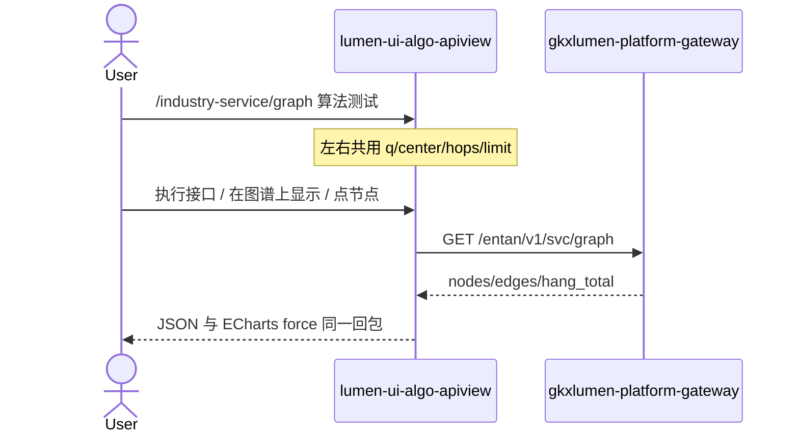

# 联调台侧栏按招标分组 + 产业服务图谱对照 demo

> 日期：2026-08-25  
> 挂到：`LUMEN-UI-ALGO-APIVIEW-SVC-L01`（交叉改动亦覆盖 CHAIN / POLICY / COMP 已 `integration` 叶）  
> 仓：`lumen-ui-algo-apiview` · `origin/dev`  
> 对照（只读）：`agent-delivery/bid-reference/科技专题服务算法库.md`；`demo-ui-system-test` `src/views/industry-service/components/GraphView.vue`；未 merge demo

## 任务认领（必填）

| 字段 | 值 |
|------|-----|
| claimed_by | `agent:frontend-agent` |
| supervised_by | `human:孔东` |
| claim_type | `pull` |
| 说明 | 无新开 ready 单；用户口头授权改菜单与产业服务图谱，并要求 handoff + commit + push `origin/dev`。不把父叶标 `done`。 |

## Ponytail（coding 任务必填）

| 字段 | 值 |
|------|-----|
| ponytail | `full` |
| 说明 | 分组只改 `pageNavGroup` / catalog，不另起导航框架。图谱复用 `EntanGraphChart`，不迁 `internal` 投影/十模型。未用 YAGNI 跳过 D8/D9/D10、可观测、handoff、D12。 |

## Headroom（可选）

| 字段 | 值 |
|------|-----|
| headroom | `skip` |
| 说明 | 本机会话未挂载 Headroom MCP。 |

## 图即契约

| 字段 | 值 |
|------|-----|
| diagram_id | `LUMEN-UI-ALGO-APIVIEW-NAV-SVC-GRAPH-SEQ` |
| 图 diff | 产业服务图谱由通用 viz 改为 `svc-graph-composite`，自调已登记 `svc.graph.main`；条件与执行结果回写可视化。禁止事项未变（不迁 `/entan/internal/svc/run-graph` / `run-models`）。 |
| 会签态 | `draft` |

## 修改内容

### 1. 侧栏按招标功能架构分组（不横切三大板块做一级）

顺序：算法库总览 → 基础指标 → 图谱 → 产业链分析 → 企业分析 → 政策分析 → 产业服务分析 → 产业综合分析 → 工程增强 → 创新监测算法库。

- 基础指标：产业链 / 企业 / 政策 / 产业服务四页。
- 工程增强：风险评分、企业评估（异步）、文本解析、**产业综合上游依赖**（`comp.basic` 从基础指标挪入）。
- 服务关系链仍留在产业服务分析（招标十模型，不是图谱浏览页）。

### 2. 企业重点资讯并入企业基础指标

- 删除独立页 `entan.news`；统计 + 明细 endpoint 并进 `entan.basic`（id 仍为 `entan.news.stats` / `entan.news.list`）。
- `#/entan/news` 重定向到 `#/entan/basic`。

### 3. 产业服务图谱对照 demo GraphView

- `svc.graph` 设 `layout: svc-graph-composite`。
- 新增 `SvcGraphPanel`：检索、中心下拉、1/2/3 跳、左图右实体/邻接；图例只服务机构 `#ec4899`。
- **算法测试三区保留**：接口选择、请求配置、运行 JSON。
- 左右条件同步；「执行接口 / 在图谱上显示 / 全局概览 / 点节点」走同一次 `GET /entan/v1/svc/graph`。
- 中心节点左右均为可搜索下拉（`optionsFrom: centerNodes`），选项来自样本 + 已执行回包。
- 不搬 demo「投影到图谱 / 跑十模型」。

### 4. 招标拆叶（同工作区一并提交）

`chain.json` / `policy.json` 按招标拆出阶段、深圳问题/机遇、路线、布局、政策机遇等叶子（此前会话已改，与本菜单/图谱同批 push）。

## 测试结果

- `npm test`：88 pass / 0 fail
- 本机 `pnpm dev` HMR 正常；会话无浏览器 MCP，未做登录后点击验收

## 遗留风险

- `USE_MOCK=false` 时 Java `/entan/v1/svc/graph` 未发布会诚实失败
- 服务关系链页仍另挂 `GET /entan/v1/svc/graph` 作模型输出小图，与图谱菜单浏览页职责不同
- 未做人审截图；chain/policy 大 diff 随同批提交，需人扫一眼拆叶标题

## CI/CD（必填）

- 分支：`lumen-ui-algo-apiview` `origin/dev`；handoff 在 `gkx-orchestration` `origin/dev`
- commit：`c819641`（`lumen-ui-algo-apiview`）
- pipeline URL / ID：随 `lumen-ui-algo-apiview` GitLab CI（`d4f41f` 起已接）
- 部署 namespace / 镜像 tag：本叶未等
- K8s rollout：本叶未等
- 本地：`pnpm dev` → `http://localhost:3100/` `#/industry-service/graph` 算法测试

## 可观测性

- 请求头沿用 `runEntanEndpoint` / `runSvcEndpoint`：`X-Trace-Id` + `traceparent`

## 架构合规自检

| 铁律 | 结果 |
|------|------|
| 1 算法只在 Python | ✅ |
| 2 调用链 FE→Java→Python `/internal` | ✅ 不直连 Python |
| 3 Nebula 非 Neo4j | ✅ 只展示 `source` |
| 4 可观测 | ✅ |
| 5 CI | ✅ 仓内已有 GitLab CI（本叶未等绿） |
| 6 demo2 不 merge | ✅ |
| 7 只调 Java | ✅ |
| 8 Mock 开关 | ✅ `USE_MOCK=false` 不填 fixture |
| 9 D8 | ✅ ECharts + Arco |
| 10 D9 不自造改绿 | ✅ 本叶未手写改绿 |
| 11 D10 | ✅ |
| 12 D12 不打 demo-* | ✅ |

## Cost

| 字段 | 值 |
|------|-----|
| `actual_tokens` | 200000 |
| `model_used` | `claude-sonnet-4.5`（registry 合法枚举；本会话为 Cursor Grok 4.6，按 Sonnet 价表回填） |
| `actual_cost` | 1.08 |
| `cost_warn` | green |
| 口径 | frontend-agent 80/20；`200000×0.8×3/1e6 + 200000×0.2×15/1e6 = 1.08`；`source: session_estimate`；含菜单重排 + 资讯合并 + 服务图谱同步 |

## 涉及文件

- `src/catalog/index.ts`、`entan.json`、`svc.json`、`comp.json`、`chain.json`、`policy.json`、`types.ts`
- `src/layout/AlgoShell.vue`、`src/views/HomeView.vue`、`src/views/AlgoWorkspaceView.vue`、`src/router/index.ts`
- `src/components/algo/SvcGraphPanel.vue`、`PageVisualization.vue`、`ApiTestPanel.vue`、`ParamForm.vue`
- `src/utils/graphFields.js`、`paramValues.js`、`src/mock/filterResponse.js`
- `scripts/catalog.test.mjs`、`entan-graph-option.test.mjs`、`graph-fields.test.mjs`、`param-values.test.mjs`、`mock-filter.test.mjs`
- 本 handoff
