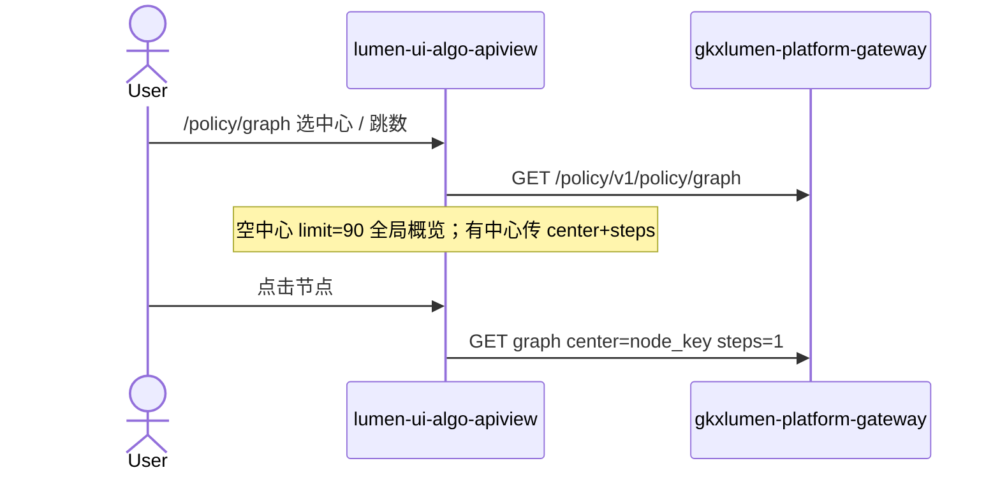

# 政策图谱工作区（对照 demo ECharts 重做）

> 日期：2026-08-24  
> 挂到：`LUMEN-UI-ALGO-APIVIEW-POLICY-L01`  
> 仓：`lumen-ui-algo-apiview`（未要求 commit）  
> 对照（只读）：`demo-ui-system-test` `src/views/policy/components/GraphView.vue`；未 merge demo

## 任务认领（必填）

| 字段 | 值 |
|------|-----|
| claimed_by | `agent:frontend-agent` |
| supervised_by | `human:孔东` |
| claim_type | `pull` |
| 说明 | 叶已 `integration`；用户口头授权对照 demo 用 ECharts 重做政策图谱，未新开 ready 单 |

## Ponytail（coding 任务必填）

| 字段 | 值 |
|------|-----|
| ponytail | `full` |
| 说明 | 复用企业页 `EntanGraphChart` + `buildEntanGraphOption`；政策用独立 `policy-graph-composite`，不套企业 `graph-composite`。未用 YAGNI 跳过 D8/D9/D10、可观测、handoff。不填 DEMO_POLICY_OPTIONS。 |

## Headroom（可选）

| 字段 | 值 |
|------|-----|
| headroom | `skip` |
| 说明 | 本机会话未挂载 Headroom MCP。 |

## 图即契约

| 字段 | 值 |
|------|-----|
| diagram_id | `LUMEN-UI-ALGO-APIVIEW-POLICY-GRAPH-SEQ` |
| 图 diff | 政策图谱从通用 G6 改为 FE 工作区自调已登记 `policy.graph.main`；禁止事项未变（不迁 `/policy/mock` / internal）。 |
| 会签态 | `draft` |

## 修改内容

1. `policy.graph` 设 `layout: policy-graph-composite`（**不是**企业 `graph-composite`）。
2. `PolicyGraphPanel`：单选中心（可搜/清空/手输 node_key）、1/2/3 跳、「在图谱上显示」、「全局概览」；图+右侧 descriptions（名称/类型/key/权重+标量 props）。
3. 图画复用企业 ECharts `graph+force`，类别走 `POLICY_CATS`（政策蓝 / 产业绿 / 技术紫 / 企业橙 / 人才红 / 机构青 / 服务粉）；中心金边。
4. 下拉选项来自同接口 `nodes`，失败保持空，不抄 demo fixture。
5. 权重旁 D9 ⓘ 挂 `M_POLICY_NODE_WEIGHT`（registry 无则红问号，不手写改绿）。
6. 产业服务图谱本次未动。

## 测试结果

- `pnpm test`：84 pass / 0 fail
- `pnpm type-check`：通过
- 本机 Vite 已 HMR；会话内无浏览器 MCP，未登录后点选交互

## 遗留风险

- `USE_MOCK=false` 时接口未发布会诚实失败
- `M_POLICY_NODE_WEIGHT` 当前 readiness 镜像可能缺失，评审态红问号属诚实
- 未做人审截图、未 commit

## CI/CD（必填）

- 分支：`lumen-ui-algo-apiview` `origin/dev`
- commit：`b8c6771`
- pipeline URL / ID：仓内无 `.gitlab-ci.yml`
- 部署 namespace / 镜像 tag：未交
- K8s rollout：本叶未等
- 本地：`pnpm dev` → `http://localhost:3100/` `#/policy/graph`

## 可观测性

- 请求头沿用 `runEntanEndpoint`：`X-Trace-Id` + `traceparent`

## 架构合规自检

| 铁律 | 结果 |
|------|------|
| 1 算法只在 Python | ✅ |
| 2 调用链 FE→Java→Python `/internal` | ✅ 不直连 Python |
| 3 Nebula 非 Neo4j | ✅ 只展示 `source` |
| 4 可观测 | ✅ |
| 5 CI | ❌ 无 `.gitlab-ci.yml` |
| 6 demo2 不 merge | ✅ |
| 7 只调 Java | ✅ |
| 8 Mock 开关 | ✅ 不填 fixture |
| 9 D8 | ✅ ECharts + Arco |
| 10 D9 不自造改绿 | ✅ |
| 11 D10 | ✅ |
| 12 D12 不打 demo-* | ✅ |

## Cost

| 字段 | 值 |
|------|-----|
| `actual_tokens` | 80000 |
| `model_used` | `claude-sonnet-4.5`（registry 合法枚举；本会话为 Cursor Grok 4.6，按 Sonnet 价表回填） |
| `actual_cost` | 0.43 |
| `cost_warn` | green |
| 口径 | frontend-agent 80/20；`80000×0.8×3/1e6 + 80000×0.2×15/1e6 = 0.43`；`source: session_estimate`；本增量 |

## 涉及文件

- `src/components/algo/PolicyGraphPanel.vue`
- `src/components/algo/PageVisualization.vue`、`src/catalog/types.ts`、`src/catalog/policy.json`
- `src/components/visualization/EntanGraphChart.vue`、`src/utils/entanGraphOption.js`、`src/utils/graphFields.js`
- `scripts/catalog.test.mjs`、`scripts/entan-graph-option.test.mjs`、`scripts/graph-fields.test.mjs`
- 本 handoff
