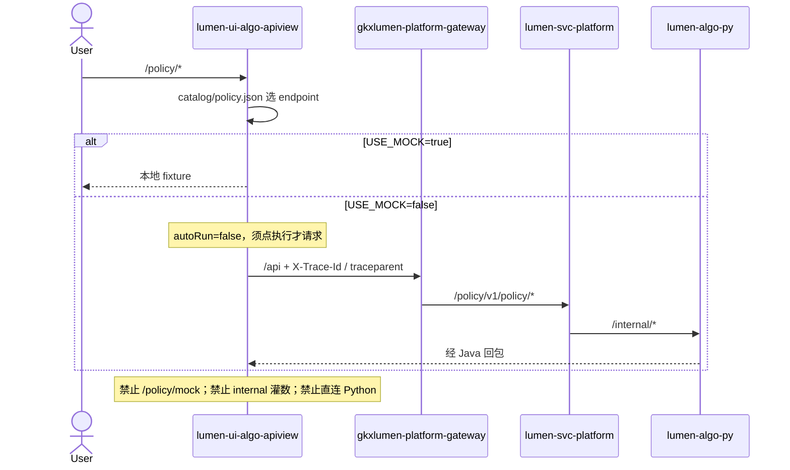

# LUMEN-UI-ALGO-APIVIEW-POLICY-L01 · 算法库联调台 — 政策分析算法库首期

> 日期：2026-08-22  
> Task：`LUMEN-UI-ALGO-APIVIEW-POLICY-L01`  
> 仓：`lumen-ui-algo-apiview` · `origin/dev`  
> 对照（只读）：`demo-ui-system-test` `POLICY_SUB_MENU` / `src/api/policy/index.ts`；未 merge demo  
> 父叶：`LUMEN-ALGO-PLATFORM-UI-L01`

## 任务认领（必填）

| 字段 | 值 |
|------|-----|
| claimed_by | `agent:frontend-agent` |
| supervised_by | `human:孔东` |
| claim_type | `pull` |
| 说明 | 复用企业库三区；监管人要求切到算法测试不自动打接口。本叶不标 `done` |

## Ponytail（coding 任务必填）

| 字段 | 值 |
|------|-----|
| ponytail | `full` |
| 说明 | catalog 驱动，未另起一套交互。未用 YAGNI 跳过 D8/D9/D10、可观测、D12、handoff。 |

## Headroom（可选）

| 字段 | 值 |
|------|-----|
| headroom | `skip` |
| 说明 | 本机会话未挂载 Headroom MCP。 |

## 图即契约

| 字段 | 值 |
|------|-----|
| diagram_id | `LUMEN-UI-ALGO-APIVIEW-POLICY-L01-SEQ` |
| 图 diff | 新增 FE→网关 `/policy/v1/policy/*` 边；无 ODS/ADS 改边。 |
| 会签态 | `draft` |

## 范围与实现

侧栏「政策分析算法库」可展开。8 页由 `src/catalog/policy.json` 驱动。

### 已交付区块

1. **路由**：`/policy/basic`、`graph`、`focus`、`intensity`、`effect`、`gap`、`layout`、`text`；不做 `/policy/mock`
2. **契约**：`/policy/v1/policy/metrics`、`indicators`、`graph`、`analysis/{focus,intensity,effect,gap,opportunity,layout}`、`text/parse`、`match`、`simulate`
3. **可视化 as-built**（监管人点修）：
   - 焦点 / 力度 / 效果 / 短板 / 布局：`vizLayout: table-then-charts`（上表下图，各占一行）
   - 短板·机遇：`stackViz: false`，只渲染当前选中接口
   - 政策名称列读 `ext.title`，不用 `policy_id` 冒充标题
   - 政策图谱不用企业库 `graph-composite`（那是 `entan.graph.*` 专用壳）
4. **交互**：政策页全部 `autoRun: false`；`ApiTestPanel` 只读缓存、不自动打兄弟接口；同页切「接口信息 / 算法测试」`v-show` 保留上次结果
5. **页级叠图**：基础 metrics+indicators、文本三件套在 `stackViz !== false` 时叠齐
6. **总览**：`HomeView` 纳入政策 catalog 卡

### 非范围

- `/policy/mock` CRUD、demo `internal` 灌数
- 天地图（无图层时表+柱回退）
- Java path 会签

## 偏离说明

1. 未为图谱页另写特例 Vue，仍套 `AlgoWorkspaceView` + catalog viz。
2. 去掉误套的 `layout: graph-composite`，改为通用 G6/表渲染。
3. `ResultVisualization` 按 `spec.viz` 顺序渲染全部块（不再每种 kind 只取第一个）——企业库仍可用 `table-chart` 左右分栏。
4. 企业 / 产业链 `autoRun: true` 未改。

## 复刻五维（R1–R5）

| # | 项 | 结果 |
|---|---|---|
| R1 布局 | 8 页三区；焦点等五页上表下图；短板不叠兄弟接口 | ✅ |
| R2 交互 | 切测试不自动请求；执行钮触发；切 Tab 保留结果 | ✅ |
| R3 样式 | Design token + Arco Vue | ✅ |
| R4 评审 | `@/review` 自闸 | ✅ |
| R5 Mock | `USE_MOCK=false` 禁止 fixture | ✅ |

检索皮肤 V2–V7：N/A。工作区 W1–W4：N/A。

## Design.md §14

- 主色 `#165DFF`、页底 `#D8E7FC`、正文 14px
- ECharts + G6；无 Element/AntD

## 测试结果

- `node --test scripts/*.test.mjs`：49 pass / 0 fail
- `pnpm type-check`：通过
- `pnpm build-only`：通过
- 本机 `pnpm dev` 可进 `#/policy/*`；真实 Java 依赖网关 `/policy/v1/policy/*`

## 遗留风险

- 无前端 CI
- `/policy/v1` 网关前缀未会签
- `enrichAnalysisRow` 只把 `intensity_score×100 → intensity_index`，不编造 `industry_coverage` / 不用 demo `DEMO_ROWS`

## CI/CD（必填）

- 分支：`lumen-ui-algo-apiview` `origin/dev`
- commit：`7b17be7`
- pipeline URL / ID：仓内无 `.gitlab-ci.yml`
- 部署 namespace / 镜像 tag：未交
- K8s rollout：本叶未等
- 本地：`pnpm dev` → `#/policy/basic`

## 可观测性

- 请求头 `X-Trace-Id` + `traceparent`（沿用企业库）

## 架构合规自检

| 铁律 | 结果 |
|------|------|
| 1 算法只在 Python | ✅ |
| 2 调用链 FE→Java→Python `/internal` | ✅ 不直连 Python |
| 3 Nebula 非 Neo4j | ✅ |
| 4 可观测 | ✅ |
| 5 CI | ❌ 无 `.gitlab-ci.yml` |
| 6 demo2 不 merge | ✅ |
| 7 只调 Java | ✅ |
| 8 Mock 开关 | ✅ |
| 9 D8 | ✅ |
| 10 D9 不自造改绿 | ✅ |
| 11 D10 | ✅ |
| 12 D12 不打 demo-* | ✅ 不迁 `/policy/mock` / internal |

## Cost

| 字段 | 值 |
|------|-----|
| `actual_tokens` | 220000 |
| `model_used` | `claude-sonnet-4.5`（registry 合法枚举；本会话为 Cursor Grok 4.6，按 Sonnet 价表回填） |
| `actual_cost` | 1.19 |
| `cost_warn` | green |
| 口径 | frontend-agent 80/20；`220000×0.8×3/1e6 + 220000×0.2×15/1e6 = 1.19`；`source: session_estimate` |

## 涉及文件

- `src/catalog/policy.json`、`src/api/policy.ts`
- 共享可视化：`ResultVisualization.vue`、`PageVisualization.vue`、`ApiTestPanel.vue`、`AlgoWorkspaceView.vue`、`vizData.js`、`tableColumns.js`、`chartOption.js`
- 本 handoff

## 产物清单

- 政策 8 页联调台 + catalog 契约 + 可视化对齐
- 本 handoff + cost 四字段
- 状态：`in_progress` → `integration`
