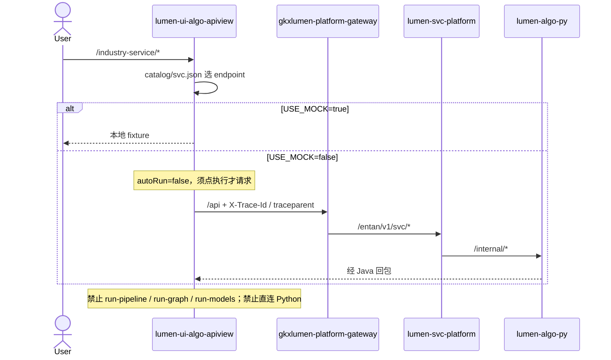

# LUMEN-UI-ALGO-APIVIEW-SVC-L01 · 算法库联调台 — 产业服务算法库首期

> 日期：2026-08-22  
> Task：`LUMEN-UI-ALGO-APIVIEW-SVC-L01`  
> 仓：`lumen-ui-algo-apiview` · `origin/dev`  
> 对照（只读）：`demo-ui-system-test` `INDUSTRY_SERVICE_SUB_MENU` / `src/api/industry-service/index.ts`；未 merge demo  
> 父叶：`LUMEN-ALGO-PLATFORM-UI-L01`

## 任务认领（必填）

| 字段 | 值 |
|------|-----|
| claimed_by | `agent:frontend-agent` |
| supervised_by | `human:孔东` |
| claim_type | `pull` |
| 说明 | 路径前缀 `/industry-service/`；不迁 run-pipeline / run-graph / run-models。本叶不标 `done` |

## Ponytail（coding 任务必填）

| 字段 | 值 |
|------|-----|
| ponytail | `full` |
| 说明 | catalog 驱动，未另起一套交互。未用 YAGNI 跳过 D8/D9/D10、可观测、D12、handoff。 |

## Headroom（可选）

| 字段 | 值 |
|------|-----|
| headroom | `skip` |
| 说明 | 本机会话未挂载 Headroom MCP。 |

## 图即契约

| 字段 | 值 |
|------|-----|
| diagram_id | `LUMEN-UI-ALGO-APIVIEW-SVC-L01-SEQ` |
| 图 diff | 新增 FE→网关 `/entan/v1/svc/*` 边；无 ODS/ADS 改边。 |
| 会签态 | `draft` |

## 范围与实现

侧栏「产业服务算法库」可展开。12 页由 `src/catalog/svc.json` 驱动。

### 已交付区块

1. **路由**：`/industry-service/basic`、`graph`、`gap`、`relation`、`tech-finance`、`tech-ip`、`tech-hr`、`tech-mkt`、`tech-consult`、`tech-innov`、`attract`、`cultivate`
2. **契约**：`GET /entan/v1/svc/indicators`、`graph`、`models?kind=`；不迁 `run-pipeline` / `run-graph` / `run-models`
3. **六类技术力**：`resultFilter.service_type` = FINANCE / IP / HR / MKT / CONSULT / INNOV，滤 live 全量 `tech[]`
4. **Top1 代理维**：环状饼图（对齐 demo `pieItems` + `dimension_scores`）；中文维名专利/研发投入/专家/案例/标准；半径 `35%/62%`
5. **图谱 / 关系链**：不用企业库 `graph-composite`；边兼容 `src_key` / `dst_key` / `relation_type`；关系链页可叠 models+graph
6. **交互**：全部 `autoRun: false`；切测试保留上次结果、不自动打接口
7. **总览**：`HomeView` 纳入 svc catalog 卡

### 非范围

- demo `internal` 灌数、run-graph / run-models / run-pipeline
- 天地图（无图层时表+柱回退）
- Java path 会签（catalog 对照 `/entan/v1/svc`）

## 偏离说明

1. 未为图谱/关系链另写特例 Vue，仍套 `AlgoWorkspaceView`。
2. Top1 代理维从雷达改为环状饼（监管人对齐 demo `svcModelSpecFromAds.ts`）。
3. 企业 / 产业链 `autoRun: true` 未改。

## 复刻五维（R1–R5）

| # | 项 | 结果 |
|---|---|---|
| R1 布局 | 12 页三区；技术力 stack；关系链可叠图 | ✅ |
| R2 交互 | 不自动请求；service_type 滤技术力；切 Tab 保留结果 | ✅ |
| R3 样式 | Design token + Arco Vue | ✅ |
| R4 评审 | `@/review` 自闸 | ✅ |
| R5 Mock | `USE_MOCK=false` 禁止 fixture | ✅ |

检索皮肤 V2–V7：N/A。工作区 W1–W4：N/A。

## Design.md §14

- 主色 `#165DFF`、页底 `#D8E7FC`、正文 14px
- ECharts + G6；无 Element/AntD

## 测试结果

- `node --test scripts/*.test.mjs`：49 pass / 0 fail
- `pnpm type-check`：通过
- `pnpm build-only`：通过
- 本机 `pnpm dev` 可进 `#/industry-service/*`；真实 Java 依赖网关 `/entan/v1/svc/*`

## 遗留风险

- 无前端 CI
- `/entan/v1/svc` 与正式网关 path 未会签
- 六类技术力依赖回包带 `service_type`；缺字段时过滤为空（诚实空态）

## CI/CD（必填）

- 分支：`lumen-ui-algo-apiview` `origin/dev`
- commit：`7b17be7`
- pipeline URL / ID：仓内无 `.gitlab-ci.yml`
- 部署 namespace / 镜像 tag：未交
- K8s rollout：本叶未等
- 本地：`pnpm dev` → `#/industry-service/basic`

## 可观测性

- 请求头 `X-Trace-Id` + `traceparent`（沿用企业库）

## 架构合规自检

| 铁律 | 结果 |
|------|------|
| 1 算法只在 Python | ✅ |
| 2 调用链 FE→Java→Python `/internal` | ✅ 不直连 Python |
| 3 Nebula 非 Neo4j | ✅ |
| 4 可观测 | ✅ |
| 5 CI | ❌ 无 `.gitlab-ci.yml` |
| 6 demo2 不 merge | ✅ |
| 7 只调 Java | ✅ |
| 8 Mock 开关 | ✅ |
| 9 D8 | ✅ |
| 10 D9 不自造改绿 | ✅ |
| 11 D10 | ✅ |
| 12 D12 不打 demo-* | ✅ 不迁 run-pipeline / run-graph / run-models |

## Cost

| 字段 | 值 |
|------|-----|
| `actual_tokens` | 200000 |
| `model_used` | `claude-sonnet-4.5`（registry 合法枚举；本会话为 Cursor Grok 4.6，按 Sonnet 价表回填） |
| `actual_cost` | 1.08 |
| `cost_warn` | green |
| 口径 | frontend-agent 80/20；`200000×0.8×3/1e6 + 200000×0.2×15/1e6 = 1.08`；`source: session_estimate` |

## 涉及文件

- `src/catalog/svc.json`、`src/api/svc.ts`
- 共享：`chartOption.js`（环状饼）、`vizData.js`（`applyResultFilter`）、`AlgoShell.vue`、`HomeView.vue`
- 本 handoff

## 产物清单

- 产业服务 12 页联调台 + catalog 契约 + 技术力环状图
- 本 handoff + cost 四字段
- 状态：`in_progress` → `integration`
