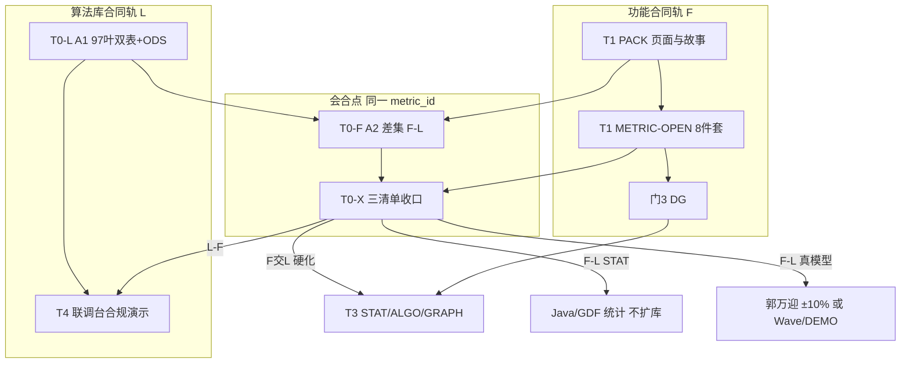
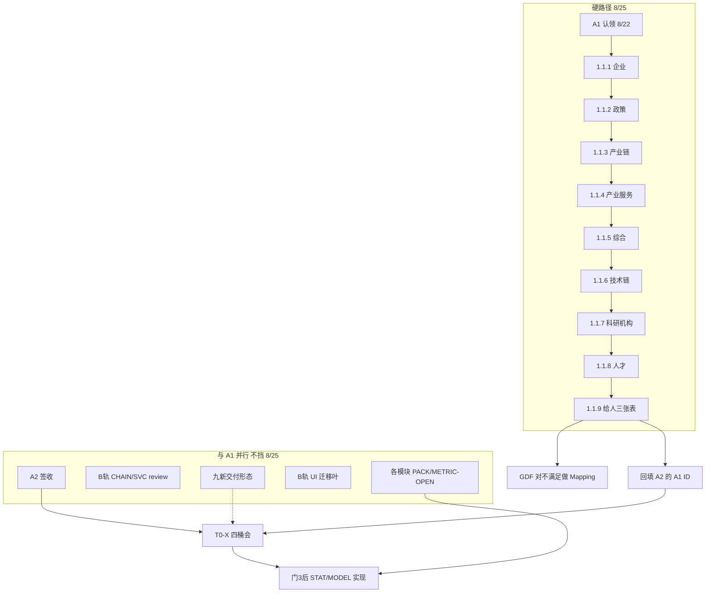

# 指标与算法 · 工作类型与流程梳理（给人）

> **日期**：2026-08-22  
> **决策人**：`human:淮政玮`（项目负责人）  
> **本文件角色**：指标 + 算法相关工作的**类型、流程、WBS、输入/输出、依赖、工作计划**真源。A/B 两轨战术排期仍看 `[给人说明-算法指标梳理两轨-2026-08-21.md](./给人说明-算法指标梳理两轨-2026-08-21.md)`。  
> **与 D9 数据血缘**：本文件管「谁做、按类型怎么派」；8 件套字段 / D1–D4 / ⓘ 以 [`data-lineage-policy.md`](../../data-lineage-policy.md) 为准。对照卡（含「四维不并进 8 件套」）：[`metrics/给人说明-指标与算法工作类型与流程梳理.md`](../../metrics/给人说明-指标与算法工作类型与流程梳理.md)。  
> **怎么读**：§2 实现归属两轴 · §5 WBS · §6 输入/输出 · §7 依赖与并行 · §8 工作计划 · **§8.4 METRIC-OPEN 登记差** · **§9 8/25 三方数据满足度表**。  
> **不新建 Epic**；不把废作四叶标 `done`。A1 8/25 **禁止改 seed 口径/公式/源表**；`algorithm_type` 自 D9 v1.5 起是 8 件套字段，唐绍祖会签后由 data-agent 回填 `metrics/registry/cfg_metric-*-seed.yaml`（不算改口径）。

**一句话**：两套合同、一个指标对象、按算法类型分流实现。算法库不是产品功能设计的前置；功能差集也不等于算法库没做完。

**本工作流口径分工（2026-08-22 定）**：


| 事项                    | 主责              | 说明                                                     |
| --------------------- | --------------- | ------------------------------------------------------ |
| **口径 / 8 件套 / 适用性**   | `**human:淮政玮`** | 指标是什么、是否适用于本页/本模块、8 件套能否过门；本工作流内以此为准                   |
| 公式 / 权重 / 算法类型 / 模型步骤 | `human:唐绍祖`     | 怎么算；STAT 只审公式，不写实现                                     |
| 范围 ±10% / 是否扩算法库      | `human:郭万迎`     | F−L 真模型才立项                                             |
| `{模块}-FDS-L01` 起草     | `human:郭万迎`     | 工程衔接 FUNC-DESIGN；`derived_only`；不挡门 1；**不顶** PACK/OPEN |
| **页面要哪些指标**           | 见责任矩阵 / 下表      | 高颖只落 WF 第 6 列，**不定**清单                                 |
| **专题功能实现归属**          | 见下表 + §2.3      | 该维落地谁推进；`STAT` Java 即此人；**不等于**谁写 Python |
| 甲方业务口径 🟡→🟢          | 甲方（经 PM 推进）     | 淮政玮拍的是**内部交付方案**，不替代甲方                                 |


**页面要哪些指标（2026-08-22 `human:淮政玮` 点名；与责任矩阵同文）**：


| 范围                           | 主责          |
| ---------------------------- | ----------- |
| 展示系统                         | `human:李伟`  |
| 专题 · 企业                      | `human:徐滕强` |
| 专题 · 综合智能分析                  | `human:徐滕强` |
| 专题 · 产业链                     | `human:李伟`  |
| 专题 · 服务机构（产业服务）              | `human:侯佳伟` |
| 专题 · 政策                      | `human:淮政玮` |
| 专题 · 技术链 / 科研机构 / 人才         | `human:郭万迎`（对北京九新；李伟辅助抽清单） |
| 展示 · 三方对接（技术/机构/人才依赖）      | `human:郭万迎`（对北京九新；李伟辅助） |
| 专题 · 查询 / 运营                 | 待指定（走 n/a_ops，不进九新清单） |


**专题系统 · 功能实现归属（同日点名；轴 B 见 §2.2）**：


| 专题维度       | 功能实现归属人     | 对应模块 / 现网线索                                         |
| ---------- | ----------- | --------------------------------------------------- |
| 企业         | `human:徐滕强` | TOPIC-ENT / 企业查询·评估等；花名册「企业维度架构设计主责」                |
| 综合智能分析     | `human:徐滕强` | E8 / SYNTH（活力·要素·协同）；与企业同 Owner                     |
| 产业链        | `human:李伟`  | TOPIC-CHAIN；B 轨 `TOPIC-CHAIN-METRIC-MIGRATE-L01`    |
| 服务机构（产业服务） | `human:侯佳伟` | TOPIC-SVC / 服务机构；B 轨 `TOPIC-SVC-METRIC-MIGRATE-L01` |
| 政策         | `human:淮政玮` | TOPIC-POLICY / E7；与口径主责同一人，功能实现也归本维                 |


本次未点名、**待指定**（功能实现 Owner）：技术链、科研机构、人才、查询 / 运营。

**页面要哪些指标 · 技术链/机构/人才** 与 **展示三方对接** 已点名 `human:郭万迎`（对北京九新；李伟辅助）。任务：`JIUXIN-TECH-ORG-TALENT-L01`。

**展示系统**：业务页「要哪些指标」主责仍 `human:李伟`；其中 **依赖九新的技术/机构/人才** 从李伟清单划出，由郭万迎对九新谈交付形态（SQL / Python / API），不改李伟对其余展示页的主责。

算法实现仍按 §2：`STAT`→**GDF 出 ADS + 各模块负责人 Java**（只读聚合）；`MODEL`/`GRAPH`→唐绍祖监管 Python。维度 Owner **不**代替唐绍祖写模型。完整交叉表见 **§2.3**。

与 `产品定义评审规程.md` §1.4.2「王惠为口径主责」的差异：**本工作流（指标/算法梳理与会合）以本说明为准**。规程未改前，METRIC-OPEN / PDR-05/06 纪要写 `owner_semantic: human:淮政玮`。王惠已交的 B 轨 CHAIN/SVC 口径稿继续作实现输入，不回溯作废。

---

## 0. 两套需求必须分开看

### 0.1 假设：标书里没有「科技专题服务算法库」

标准软件工程应是**功能驱动、指标派生**：


| 步   | 做什么                   | 本项目已有对应                                                                                               |
| --- | --------------------- | ----------------------------------------------------------------------------------------------------- |
| 1   | 功能设计                  | 产品定义轨：PACK（高颖：USM / TRACE / IA / Wireframe）→ UX → 门 1；条件必填时另出 `{模块}-FDS-L01`（**郭万迎起草**，工程衔接，不扩 scope） |
| 2   | 从功能抽出「页面要哪些数字、哪些分析结果」 | Wireframe 第 6 列 `metric_id`；TRACE `metrics[]`                                                         |
| 3   | 指标/算法需求分析（语义层）        | `{模块}-METRIC-OPEN-L01`：8 件套 + 算法定义卡 + 贴源缺口                                                            |
| 4   | 实现归属切分                | 两轴必须同时填，见 **§2**：① `algorithm.type`；② 专题维度 Owner（企业+综合→徐滕强 / 产业链→李伟 / 产业服务→侯佳伟 / 政策→淮政玮）              |
| 5   | 工程实现                  | 门 3 DG 后：GDF 贴源 → Java REST → 需要时才 Python `/internal/*` → 前端 ⓘ                                        |


第 4 步的结果必须是一张**功能指标清单**，每条至少有：

- 功能/页面引用（哪个 USM / 哪块 UI）
- `metric_id` + 口径（淮政玮）
- **实现归属**：① `algorithm.type`（STAT vs MODEL）② 专题维度功能 Owner（§2.3）
- 数据能否算（D2 结构 / D3 源 / D4 接入）

如果没有算法库合同，**不会**单独做 97 条需规对照，也不会做「联调台把每个模型都挂一遍」。没用到的模型根本不存在。

### 0.2 实际：标书有算法库，且必须合规交付

`bid-reference/srs/05-深度挖掘算法/科技专题服务算法库` = **独立验收对象**（八维 × 四层，97 叶：基础指标 / 图谱 / 深度 / 综合）。

它和「展示 + 专题页面好不好用」是**两份合同**：


| 合同      | 真源              | 验收看什么                    |
| ------- | --------------- | ------------------------ |
| 功能合同 F  | `02` 展示、`04` 专题 | 页面上的数字和分析结果              |
| 算法库合同 L | `05` 算法库 97 叶   | 库里有没有这些模型/指标，联调台能否演示计算过程 |


因此会出现三种集合，不能混成一张待办：

```text
         功能要的指标/能力（F）
        /                      \
   F ∩ L                        F − L
  两边都要                    功能要了、库没覆盖
  → 真正该硬化的主链            → A2 missing（专题 7 + 展示 70）

         L − F
  库里有、页面不一定用
  → 仍须在算法库产品上可演示（联调台 / DEMO）
  → 禁止硬塞进 USM，也禁止按生产级模型排期
```

当前 A/B 两轨只覆盖了**合同盘点与部分入库**：


| 轨                                 | 从哪边出发    | 回答                               | 截止           |
| --------------------------------- | -------- | -------------------------------- | ------------ |
| **A1** `ALGO-LIB-METRIC-DEPS-L01` | L        | 97 叶对应哪些指标/算法；三方 ODS 够不够         | 2026-08-25   |
| **A2** 专题/展示差集                    | F        | 页面要了库没有（`missing`）               | 表已交，待签收      |
| **B** CHAIN/SVC 入库                | 已认定的 F∩L | 63 `M_CHAIN_`* + 29 `M_SVC_`* 接口 | 算法单已交 review |


废作四叶（`TOPIC/DS-METRIC-INVENTORY/CLASSIFY-L01`）想先盘功能指标再分类，方向对、时机错：没有 L 的底表，分类会和算法库对不上。分类能力已并进 A1 表2 的 `algorithm.type`，**不要再派那四叶**。

A 不依赖 B、B 不依赖 A —— 仍成立。缺的是 **T0-X 会合**（三清单收口），见 §3。

---

## 1. 工作任务类型（standing，不只是本周 A/B）

按「回答什么问题」分成 6 类。派单时一类一叶，禁止把定义、差集、实现、合规演示捆在一张单上。

### T0 合同盘点（不改 seed、不写代码）


| 类型        | 代表任务               | 回答                          | Owner                   |
| --------- | ------------------ | --------------------------- | ----------------------- |
| T0-L 库内分解 | A1 双表 + ODS 缺口     | 97 叶各自对应哪些指标/算法；三方 ODS 满不满足 | 唐绍祖 + `algorithm-agent` |
| T0-F 功能差集 | A2.1 / A2.2 / 父单索引 | 页面要了库没有（`missing`）          | 淮政玮签；agent 已交           |
| T0-九新交付形态 | `JIUXIN-TECH-ORG-TALENT-L01` | 技术/机构/人才：STAT/COMPUTE/MODEL/GRAPH 各交 SQL / Python / API | **郭万迎**对北京九新；李伟辅助抽清单 |
| T0-X 集合收口 | **建议建一叶或半天会**      | F∩L / F−L / L−F 三条清单 + 实现归属 | **淮政玮主持并拍板**            |


### T1 产品定义（功能轨，按模块）


| 类型          | 代表任务                   | 回答                       | Owner                                                 |
| ----------- | ---------------------- | ------------------------ | ----------------------------------------------------- |
| T1-PACK     | `{模块}-PACK-L01`        | 谁、做什么、交互故事               | 高颖（体验）。**哪页要哪些指标**见责任矩阵，不定指标清单                        |
| T1-MO       | `{模块}-METRIC-OPEN-L01` | ④ 指标语义卡 + ⑤ 开放项（规程 §3.2） | **淮政玮：口径/适用性**；唐绍祖：公式；`data-agent` 血缘                 |
| T1-UX/V1/V2 | UX / HIFI / lumen 准生产  | 交互与视觉，不发明口径              | 高颖 / 孔东                                               |
| T1-FDS      | `{模块}-FDS-L01`         | 工程说明书（派生，不扩 scope）       | **郭万迎起草**（2026-08-22 淮政玮拍板；规程 §3.5 仍写高颖，**本工作流以此为准**） |


门禁：PACK 完成后 **必须登记** OPEN 叶。OPEN **不挡** UX/V1，**挡** 门 1。A2 差集不是这张 registry 叶。现网 `*-METRIC-OPEN-L01`：**原 15 条** + **态势 9 条 backlog**（`DS-01`…`DS-09-METRIC-OPEN-L01`；`ENT-MOD-EVAL-READINESS-UI-L01` 不算）。其余缺叶 / 错位 / 欠账见 **§8.4**。门 3 后才批量标实现 leaf `ready`。

### T2 语义与血缘真源（全项目一份指标对象）


| 类型         | 产物                              | 谁写                              | 谁签      |
| ---------- | ------------------------------- | ------------------------------- | ------- |
| T2-ID      | `metric_id` + 中文名 + 口径 + 适用性    | data-agent / algorithm-agent 起草 | **淮政玮** |
| T2-FORMULA | 公式 / 权重 / 步骤 / `algorithm.type` | algorithm-agent                 | **唐绍祖** |
| T2-SEED    | `metrics/registry/cfg_metric-*-seed.yaml`（8 件套，v1.5 共 9 项含 `algorithm_type`） | data-agent                      | 淮政玮适用性  |
| T2-READY   | `metrics/registry/metric-readiness-matrix-*.yaml` D1–D4（**不进** 8 件套） | data / GDF / lineage            | 徐滕强核 D2 |
| T2-GAP     | `data-gap-catalog.yaml` + Q0xx  | data-agent / 郭万迎                | 甲方才升 🟢 |


铁律：**功能轨和算法库轨共用同一套 `metric_id`**。A 轨禁止为缺口编造正式 `M_*` 写入 seed；B 轨才允许入库。

8 件套字段仍以 `data-lineage-policy.md` §2 为准（v1.5：**metric_id / 中文名 / 口径 / 公式 / `algorithm_type` / 源表 / 源系统 / 更新频率 / 版本**，共 9 项）。**齐备态 = `D1=aligned`**，分阶段填齐见 policy **§2.1**。OPEN / 门 1 不要求 9 项一次齐（类型可 `UNKNOWN`）。**D1–D4 与 `lifecycle_stage` 不并进 8 件套**（正交状态，见 metrics 目录对照卡）。口径定义与适用性由淮政玮拍板；公式与类型由唐绍祖拍板。

### T3 实现归属分流（门 3 之后）


| 类型         | 谁干                         | 仓                                      |
| ---------- | -------------------------- | -------------------------------------- |
| T3-STAT    | GDF 出 ADS；**各模块负责人** Java 只读聚合 | `lumen-svc-platform`                   |
| T3-ALGO    | 唐绍祖监管 Python `/internal/*` | `lumen-algo-py`                        |
| T3-GRAPH   | 同上 + Nebula，禁止 Neo4j       | `lumen-algo-py`                        |
| T3-ETL     | 辜少彬 / 胡森泉 ODS→DWD          | GDF 工作包                                |
| T3-FE      | 孔东团队：只消费 Java + D9 角标      | `lumen-ui-*`                           |
| T3-MIGRATE | 已入库指标接到 demo 页（B 轨迁移叶）     | `demo-ui-topic`；产业链→李伟 / 产业服务→侯佳伟 / **企业+综合→徐滕强** / **政策→淮政玮** |
| T3-TOPIC   | 专题功能实现（按维度，见 §2.3）         | 企业+综合→徐滕强 · 产业链→李伟 · 产业服务→侯佳伟 · 政策→淮政玮 |


维度 Owner = **该模块谁推进落地**。对 `STAT`：此人就是 **ADS 之上的 Java 只读聚合**主责（与 GDF 搭档，见 WBS-4.1）。对 `MODEL`/`GRAPH`：此人推进接线 / Java 门面 / 联调，**不**在 Java 里做模型。未点名维度不得猜 Owner。

### T4 算法库合规交付（L−F 也要有入口）


| 类型        | 代表                               | 标准                                 |
| --------- | -------------------------------- | ---------------------------------- |
| T4-DESIGN | `SVC-ALGO-DESIGN-L01` 等（多已 done） | 招标模型有设计卡即可                         |
| T4-UI     | `LUMEN-UI-ALGO-APIVIEW-*`        | 联调台能点、能看过程                         |
| T4-DEMO   | 无功能引用的库内模型                       | **DEMO / Mock**，有入口即合规；不进页面 Sprint |


「有没有」看联调台；「好不好用」看专题/展示 USM。不要用页面完善度去验收 L−F。

### T5 工程联调与硬化

门 I1 开工 → I2 前端→Java→Python → I3 关闭。指标相关硬项：`产品实现规程.md` I2-04（ⓘ / Mock / SchemaGap / Ingesting）、附录 D 防漏扫描、分析工作区附录 E。

---

## 2. `algorithm.type` 与实现归属

每条功能指标**开工前必须填两格**，缺一格禁止派实现单：


| 轴                      | 回答                      | 不回答                                    |
| ---------------------- | ----------------------- | -------------------------------------- |
| **A** `algorithm.type` | 这段计算谁写、写在哪一仓            | 不决定专题功能谁推进                             |
| **B** 专题维度 Owner       | 这个专题功能谁推进落地；**STAT 的 Java 就是此人** | 不代替唐绍祖写 MODEL；不另设「侯佳伟组 STAT 底座」包办他维 |


两轴在 `MODEL`/`GRAPH` 上正交；在 `STAT` 上 **Java 执行人 = 轴 B 模块负责人**（GDF 只出 ADS，不写 Java）。派单：STAT 监管人填该模块负责人；MODEL 计算仍归唐绍祖，`supervised_by` 仍填该维 Owner。

### 2.1 轴 A · `algorithm.type`（这段计算谁写）

A1 表2 枚举，**签完回填 seed `algorithm_type`**（D9 v1.5 起为 8 件套第 5 项）。**「谁实现」只指计算代码**；专题功能 Owner 一律按 §2.2 / §2.3 另填。


| `algorithm.type`      | 含义                 | 计算实现                                | 唐绍祖                    | 专题功能 Owner（轴 B）怎么配合                                 |
| --------------------- | ------------------ | ----------------------------------- | ---------------------- | --------------------------------------------------- |
| `STAT`                | 计数、占比、排名、简单聚合      | GDF 出 ADS + **该模块负责人** Java 只读 ADS | 否，只审公式                 | Owner **本人**（或其组）写本维 Java；禁止另派「侯佳伟底座」包办企业/链/政策/综合/展示 |
| `COMPUTE`             | 有公式但无模型（加权、标准化、阈值） | Python 可做，模式固定                      | 抽检即可，agent 可写          | 该维 Owner 对口功能页；Python 仍归算法仓                         |
| `MODEL`               | 评分、预测、聚类、适配性等      | **只在 Python**                       | 必须出定义卡，实现可派 agent      | 该维 Owner 对口页面与 Java 门面；**禁止**维度 Owner 在 Java 里做模型   |
| `GRAPH`               | 中心性、路径、子图          | Python + Nebula                     | 必须出步骤，禁止「模型计算」一句话      | 同上；禁止 Neo4j                                         |
| `API` / `third_party` | 人才/机构等外采能力         | 封装调用，不伪展开公式                         | 不编造                    | 指标清单+九新对接 **郭万迎**；功能 Owner 仍待指定；默认向九新要 **API** |
| `MIXED`               | 上列组合               | 拆成可指派的子项后再派                         | 按子项                    | 子项各自带 type + 同一维度 Owner                             |
| `LITERATURE`          | 文献指数、无现成公式         | 先登记文献任务，不进实现 Sprint                 | 不写代码                   | 该维 Owner 只标 DEMO/开放项，不开编码单                          |
| `UNKNOWN`             | 尚未判定               | 禁止开工实现                              | 先回到 T0-X / METRIC-OPEN | 禁止先填 Owner 再开工                                      |


废作 CLASSIFY 枚举（`STAT|COMPUTE|MODEL|LITERATURE|THIRD_PARTY|NO_SOURCE`）与上表对齐后作废，不再单独派分类叶。

### 2.2 轴 B · 专题维度（这个功能谁推进）


| 专题维度                    | 功能实现归属      | 派单 `supervised_by` | 现网线索                                                              |
| ----------------------- | ----------- | ------------------ | ----------------------------------------------------------------- |
| 企业                      | `human:徐滕强` | 徐滕强                | TOPIC-ENT；花名册企业维架构主责                                              |
| **综合智能分析**              | `human:徐滕强` | 徐滕强                | E8 / SYNTH 活力·要素·协同；与企业同 Owner                                    |
| 产业链                     | `human:李伟`  | 李伟                 | TOPIC-CHAIN；`TOPIC-CHAIN-METRIC-MIGRATE-L01`                      |
| 服务机构（产业服务）              | `human:侯佳伟` | 侯佳伟                | TOPIC-SVC；`TOPIC-SVC-METRIC-MIGRATE-L01`；本维 STAT Java 亦归侯佳伟 |
| 政策                      | `human:淮政玮` | 淮政玮                | E7 政策分析；口径与功能实现同人                                                 |
| 技术链 / 科研机构 / 人才 | 功能实现 **待指定**；**指标清单+九新对接** `human:郭万迎` | 禁止猜填功能 Owner | `JIUXIN-TECH-ORG-TALENT-L01`；李伟辅助抽清单 |
| 查询·运营 | **待指定** | 禁止猜填 | n/a_ops，不进九新清单 |


展示系统各 DS **不套**轴 B。L−F 联调台叶子用 T4，不填专题维度 Owner。

### 2.3 交叉派单（两轴填完才能开工）

读法：先定维度（行），再定 type（列）。`STAT` 列的 Java = **该行模块负责人**（GDF 出 ADS）。`MODEL` 列仍是唐绍祖监管 Python。


| 专题维度               | 功能 Owner | `STAT`：ADS + Java         | `COMPUTE`/`MODEL`/`GRAPH` 计算 | 前端  |
| ------------------ | -------- | ------------------------ | ---------------------------- | --- |
| 企业                 | **徐滕强**  | GDF + **徐滕强** Java          | 唐绍祖监管 Python                 | 孔东组 |
| 综合智能分析             | **徐滕强**  | GDF + **徐滕强** Java          | 同上                           | 孔东组 |
| 产业链                | **李伟**   | GDF + **李伟** Java            | 同上                           | 孔东组 |
| 服务机构（产业服务）         | **侯佳伟**  | GDF + **侯佳伟** Java          | 唐绍祖监管 Python                 | 孔东组 |
| 政策                 | **淮政玮**  | GDF + **淮政玮** Java          | 唐绍祖监管 Python                 | 孔东组 |
| 技术链 / 机构 / 人才 | 功能 Owner 待指定 | STAT Java **待指定**（郭万迎不对九新写 Java） | 同上；九新交付见 `JIUXIN-TECH-ORG-TALENT-L01` | — |
| 查询 | 待指定 | 禁止开工 | 禁止开工 | — |


展示系统不套专题轴 B，但 **STAT 同样走模块负责人**：GDF + **李伟** Java。九新依赖项走 API 封装，不把郭万迎写成 STAT Java。

**禁止**：只填 type 不填维度；把企业/综合功能单派给唐绍祖当功能 Owner；把产业链 / 企业 / 政策 / 综合 / 展示的 STAT Java 默认派给侯佳伟；把未点名维度写成上表已点名人；STAT 让唐绍祖写 Python；MODEL 让维度 Owner 在 Java 里做。

---

## 3. 标准流程 vs 现在真正该跑的流程

没有算法库时，是一条链：

```text
PACK → 抽出指标需求 → METRIC-OPEN（语义+归属）→ DG → STAT走Java / MODEL走Python → 页面
```

有算法库时，必须**两条链并行、在指标对象上会合**，而不是谁等谁：




允许的依赖：


| 下游     | 依赖                     | 不依赖           |
| ------ | ---------------------- | ------------- |
| 页面实现   | 该模块 METRIC-OPEN + DG   | 97 叶 A1 全部做完  |
| 算法库联调台 | A1 里该叶的定义              | 该模块 PACK      |
| 采购/入站  | A1 的 ODS 缺口（8/25）      | A2            |
| 新模型立项  | A2 `missing` 经 ±10% 收口 | 自动「库扩到覆盖全部页面」 |


---

## 4. 花名册约束与打法

瓶颈不在分析框架，而在人：


| 人             | 容量事实               | 本工作流职责                                                                       |
| ------------- | ------------------ | ---------------------------------------------------------------------------- |
| **淮政玮**       | 项目负责人              | **口径 / 8 件套 / 适用性**；T0-X；A2 签收；**专题政策**（指标清单 + 功能实现 + 本维 STAT Java + **B 轨迁 demo**） |
| **唐绍祖**       | 算法 Lead **只有他一个**  | A1；公式/类型/MODEL·GRAPH 定义卡；STAT 只抽检；**不是**专题功能 Owner；**不写** STAT Java |
| **郭万迎**       | 合规 / ±10%          | F−L 是否扩库；L−F DEMO；FDS 起草；**技术/机构/人才指标清单 + 展示三方对接（对北京九新）** `JIUXIN-TECH-ORG-TALENT-L01` |
| **高颖**        | 体验 Owner           | PACK / UX（故事、IA、交互）；**不要**定页面指标清单、公式、适用性；**不要起草 FDS**                        |
| **侯佳伟组**      | Java 4 人           | **仅专题产业服务** 的 STAT Java + 页面指标清单 + 功能实现；**不是**全项目 STAT 底座 |
| **辜少彬 / 胡森泉** | GDF                | ADS / A1 表3 ODS 缺口 → Mapping                                                       |
| **孔东组**       | 前端                 | 只接线；禁止页面自填就绪度                                                                |
| **徐滕强**       | 架构 / 企业·综合维        | D2 结构；调用链铁律；**专题企业 + 综合智能分析**（指标清单 + 功能实现 + 本维 STAT Java + **B 轨迁 demo**） |
| **李伟**        | 架构                 | **展示系统**（指标清单 + **展示 STAT Java**）；**专题产业链**（指标清单 + 功能实现 + **本维 STAT Java**）；**辅助**郭万迎抽九新清单 |
| **王惠**        | 既有 CHAIN/SVC 口径稿作者 | B 轨已交口径继续作实现输入；**本工作流不再作为口径/适用性主责**                                          |


### 七条原则

1. **一个指标对象，两套验收。** 淮政玮管「这数字是什么、本页用不用」；唐绍祖管「怎么算、算不算模型」。页面验收看 F；库验收看联调台。禁止用「页面没用到」否决库内叶子，也禁止用「库里有类似模型」假装页面指标已闭合。
2. **STAT 永远不进算法 Sprint。** A2 的 `missing` 里，凡是计数/占比/排行，直接给 **GDF + 该模块负责人 Java**。这是「功能要了、库没写进 05」的常态，不是算法欠债。扩算法库要过郭万迎 ±10%。
3. **L−F 用 DEMO 合规，不按生产模型排期。** 97 叶里功能用不到的，联调台能跑通 + 口径卡 + Mock 角标即验收。唐绍祖出定义卡模板，agent 填，他抽检。不要把这些塞进高颖的 USM。
4. **F−L 先分拣，再决定是否建模型。** A2 已有数：专题 **7** missing，展示 **70** missing（态势一项就 43）。开一次 **T0-X 半天会**（淮政玮 + 唐绍祖 + 郭万迎 + 徐滕强），只产出四桶，不现场设计公式：

  | 桶           | 处置                          | 谁接着               |
  | ----------- | --------------------------- | ----------------- |
  | ① 其实是 STAT  | 不扩库，GDF ADS + 该模块负责人 Java | 模块负责人 / 辜少彬     |
  | ② 已有模型可映射   | 回填 A1 ID，改 `mapped`         | 唐绍祖抽检             |
  | ③ 真要新 MODEL | 登 change_log / Wave / 或扩 05 | 郭万迎守门后才派算法        |
  | ④ 降级 DEMO   | 页面 ⚠️ + Q0xx，有入口即合规         | 高颖标开放项；适用性仍由淮政玮确认 |

   展示 70 条禁止理解成「算法还要做 70 个模型」。
5. **A2「语义欠账」≠ 缺 METRIC-OPEN 任务。** 专题 111 + 展示 247 **不进** A2 missing。三类分开处理（§8.4）：① **从未建叶** → 补登记 `{MODULE}-METRIC-OPEN-L01`；② **叶在但没罩住页** → 扩核对记录或改 TRACE，禁止再新建撞车叶；③ **叶已有、④⑤没写清** → 在原叶补条目。唐绍祖只在有公式/权重时共签。
6. **并行，不把定义轨串到 A1 后面。** 已有的 15 条 OPEN 叶继续走；**缺叶补登记不挡 8/25 A1**。B 轨 CHAIN/SVC 已在 review，不要停。
7. **派单粒度跟类型走。** 唐绍祖本机同时只挂 **A1** + **在飞的 MODEL 实现**（CHAIN/SVC 已交的不要再揽定义）。算法实现可开 `algorithm-agent`，但同仓同时一张 coding 单。A2 已 `ready_to_sign`：淮政玮签收即可，不要让唐绍祖再分析一遍差集。

### 责任矩阵（派单用）


| 工作                     | 主责          | 共签                         | 禁止                                 |
| ---------------------- | ----------- | -------------------------- | ---------------------------------- |
| **页面要哪些指标 · 展示系统**     | **李伟**      | 高颖落 WF 第 6 列               | 发明公式；高颖代定清单                        |
| **页面要哪些指标 · 专题企业**     | **徐滕强**     | 同上                         | 发明公式；高颖代定清单                        |
| **页面要哪些指标 · 专题综合智能分析** | **徐滕强**     | 同上                         | 发明公式；高颖代定清单                        |
| **页面要哪些指标 · 专题产业链**    | **李伟**      | 同上                         | 发明公式；高颖代定清单                        |
| **页面要哪些指标 · 专题产业服务**   | **侯佳伟**     | 同上                         | 发明公式；高颖代定清单                        |
| **页面要哪些指标 · 专题政策**     | **淮政玮**     | 同上                         | 发明公式；另开专题政策 OPEN 叶                 |
| **页面要哪些指标 · 专题技术链/机构/人才** | **郭万迎** | **李伟辅助**抽清单；对北京九新 | 猜填；替九新定公式；复活废作 `DS-METRIC-INVENTORY/CLASSIFY` |
| **展示三方对接 · 技术/机构/人才** | **郭万迎** | **李伟辅助**；与李伟「展示指标清单」切分 | 把全部展示指标改挂九新；前端直连九新 |
| 页面要哪些指标 · 专题查询/运营       | 待指定         | —                          | 猜填；塞进九新清单                     |
| **口径 / 8 件套 / 适用性**    | **淮政玮**     | —                          | 替甲方拍板 🟡→🟢                        |
| 公式 / 类型 / 模型步骤         | 唐绍祖         | —                          | 给 STAT 写 Python                    |
| 库 97 叶是否覆盖             | A1          | 唐绍祖                        | 改 seed                             |
| 功能 vs 库差集              | A2          | 淮政玮签                       | 把 B 轨 63/29 打成 missing             |
| 三清单优先级                 | **淮政玮**     | 郭万迎 ±10%                   | 默认「库扩到覆盖全部页面」                      |
| ODS 够不够                | A1 表3       | 辜少彬落地 Mapping              | `pending_ods` 算已确认缺口               |
| STAT 实现                | **GDF + 各模块负责人** Java | 唐绍祖审公式                     | 另设侯佳伟组 STAT 底座包办他维；前端直连 Python |
| MODEL/GRAPH 实现         | 唐绍祖监管 agent | 架构调用链                      | Java 里做 NLP/推理                     |
| **专题企业功能实现**           | **徐滕强**     | 孔东接线；唐绍祖只接 MODEL           | 默认派给唐绍祖当功能 Owner                   |
| **专题综合智能分析功能实现**       | **徐滕强**     | 与企业同 Owner；E8 三兄弟 OPEN 已在途 | 另开 Owner 或派给唐绍祖                    |
| **专题产业链功能实现**          | **李伟**      | CHAIN 迁移叶已挂李伟              | 默认派给侯佳伟                            |
| **专题产业服务功能实现**         | **侯佳伟**     | SVC 迁移叶已挂侯佳伟；本维 STAT Java 亦归侯佳伟 | 把全项目 STAT Java 都派给侯佳伟           |
| **专题政策功能实现**           | **淮政玮**     | 口径亦归淮政玮                    | 另开专题政策 OPEN 叶                      |
| 库内未使用叶子                | 联调台 DEMO    | 郭万迎验收口径                    | 进专题/展示 Sprint                      |
| 前端数字                   | 孔东          | D9 只读矩阵                    | 页面把状态改绿                            |


---

## 5. WBS（工作分解）

编号规则：`WBS-x.y` = 可派单或可验收的工作包。一类一叶；禁止把定义、差集、实现、合规演示捆在一张 registry 单上。

```text
WBS-0  治理与会合（项目负责人）
WBS-1  合同盘点轨（T0）          ← 8/25 硬路径只在 1.1
WBS-2  产品定义轨（T1，按模块）
WBS-3  语义与血缘真源（T2）
WBS-4  实现分流（T3，门 3 后）
WBS-5  算法库合规交付（T4）
WBS-6  联调硬化（T5）
```

### WBS-0 治理与会合


| ID  | 工作包                            | 主责    | registry / 形式                                                        |
| --- | ------------------------------ | ----- | -------------------------------------------------------------------- |
| 0.1 | 口径 / 8 件套 / 适用性拍板              | 淮政玮   | 随 METRIC-OPEN / 本工作流会签，不另建 Epic                                      |
| 0.2 | 范围 ±10%、是否扩算法库                 | 郭万迎   | 纪要 + change_log                                                      |
| 0.3 | T0-X 三清单收口（F∩L / F−L / L−F 四桶） | 淮政玮主持 | 半天会 + 一页纪要；可补 spike 叶                                                |
| 0.4 | A2 签收 + 父单索引                   | 淮政玮   | `TOPIC-ALGO-GAP-L01` / `DS-ALGO-GAP-L01` / `TOPIC-DS-METRIC-GAP-L01` |
| 0.5 | 北京九新：技术/机构/人才交付形态（SQL/Python/API） | **郭万迎**；李伟辅助 | `JIUXIN-TECH-ORG-TALENT-L01`；**不挡** 8/25 A1 |


### WBS-1 合同盘点


| ID        | 工作包                                       | 主责                   | registry                   |
| --------- | ----------------------------------------- | -------------------- | -------------------------- |
| **1.1**   | **A1 算法库 97 叶 → 指标/算法/ODS 满足度（8/25 硬交付）** | 唐绍祖                  | `ALGO-LIB-METRIC-DEPS-L01` |
| 1.1.1     | 企业（11 叶）                                  | 同上 · loop 内          | 不另建单                       |
| 1.1.2     | 政策（9 叶）                                   | 同上                   | 不另建单                       |
| 1.1.3     | 产业链（16 叶）                                 | 同上                   | 不另建单                       |
| 1.1.4     | 产业服务（13 叶）                                | 同上                   | 不另建单                       |
| 1.1.5     | 综合（11 叶）                                  | 同上                   | 不另建单                       |
| 1.1.6     | 技术链（14 叶）                                 | 同上；实现类 `third_party` | 不另建单                       |
| 1.1.7     | 科研机构（10 叶）                                | 同上；不伪展开公式            | 不另建单                       |
| 1.1.8     | 人才（13 叶）                                  | 同上；不伪展开公式            | 不另建单                       |
| **1.1.9** | **投影给人三张表 + 八维汇总（8/25 主交付）**              | 唐绍祖                  | 见 §9                       |
| 1.2.1     | A2.1 专题差集                                 | 已交，待签                | `TOPIC-ALGO-GAP-L01`       |
| 1.2.2     | A2.2 展示差集                                 | 已交，待签                | `DS-ALGO-GAP-L01`          |
| 1.2.3     | A2 父单索引                                   | 已交                   | `TOPIC-DS-METRIC-GAP-L01`  |
| 1.3       | A1 交卷后回填 A2 的 A1 需规 ID / 指标叶 ID           | 唐绍祖或另派               | **8/25 之后**，不挡 ODS 表       |


废作（不进 WBS、勿再派）：`TOPIC/DS-METRIC-INVENTORY-L01`、`TOPIC/DS-METRIC-CLASSIFY-L01`。

### WBS-2 产品定义（按模块重复）

规程（`产品定义评审规程.md` §3.2）：`{MODULE}-PACK-L01` 完成后 **必须登记** `{MODULE}-METRIC-OPEN-L01`（`algorithm-agent` + `data-agent`，④ 指标语义卡、⑤ 开放项）。不挡 UX/V1，挡门 1。


| ID  | 工作包                               | 主责                            | registry                                                                                         |
| --- | --------------------------------- | ----------------------------- | ------------------------------------------------------------------------------------------------ |
| 2.1 | PACK：USM / TRACE / IA / Wireframe | 高颖（体验）。**页面指标清单**见责任矩阵        | `{MODULE}-PACK-L01`；无 PACK 不得假装 OPEN 已过门 1                                                       |
| 2.2 | METRIC-OPEN：④⑤                    | 淮政玮口径/适用性；唐绍祖公式；data-agent 血缘 | 现有 15 条见 §8.4 丙；**应补登**见 §8.4 甲                                                                  |
| 2.3 | UX →（可选）V1 HIFI → 门 1             | 高颖 / 孔东                       | 门 1 完整闭合须 2.2 ✅                                                                                  |
| 2.4 | 门 2 ∥ V2 lumen                    | 高颖 / 孔东                       |                                                                                                  |
| 2.5 | 门 3 DG                            | 淮政玮                           |                                                                                                  |
| 2.6 | FDS（条件必填）                         | **郭万迎起草**                     | `{MODULE}-FDS-L01`；依赖 UX；**不挡**门 1（除非会议点名）；**可挡**点名模块实现拆单。现网 **0 条**，点名后再建，禁止用 FDS 顶 PACK / OPEN |


**禁止**：用 A2 差集代替 OPEN 叶；把 `ENT-MOD-EVAL-READINESS-UI-L01` 算作 OPEN；专题企业挂展示 `ENT-MOD-*-METRIC-OPEN`；给 SYNTH-REGION 父索引再开一叶。

### WBS-3 语义与血缘


| ID  | 工作包                        | 主责                      |
| --- | -------------------------- | ----------------------- |
| 3.1 | `metric_id` + 口径 + 适用性     | 淮政玮签；agent 起草           |
| 3.2 | 公式 / `algorithm.type` / 步骤 | 唐绍祖                     |
| 3.3 | seed / 就绪度矩阵（仅实现轨，A 轨禁止）   | data-agent；淮政玮适用性       |
| 3.4 | `data-gap-catalog` + Q0xx  | data-agent / 郭万迎；甲方升 🟢 |


### WBS-4 实现分流（门 3 后）


| ID   | 工作包                                  | 主责              |
| ---- | ------------------------------------ | --------------- |
| 4.1  | STAT：ADS + Java                      | **GDF + 各模块负责人** |
| 4.2  | COMPUTE / MODEL：Python `/internal/*` | 唐绍祖监管           |
| 4.3  | GRAPH：Python + Nebula                | 唐绍祖监管           |
| 4.4  | ETL：ODS→DWD Mapping                  | 辜少彬 / 胡森泉       |
| 4.5  | 前端只消费 Java + D9                      | 孔东              |
| 4.6  | B 轨已入库指标迁 demo 页                     | 产业链→李伟；产业服务→侯佳伟；**企业+综合→徐滕强**；**政策→淮政玮** |
| 4.7  | 专题企业功能实现                             | **徐滕强**         |
| 4.8  | 专题综合智能分析功能实现                         | **徐滕强**         |
| 4.9  | 专题产业链功能实现                            | **李伟**          |
| 4.10 | 专题产业服务（服务机构）功能实现                     | **侯佳伟**         |
| 4.11 | 专题政策功能实现                             | **淮政玮**         |


4.1 与 4.7–4.11 **不是两套人**：`STAT` 的 Java = 该模块负责人（GDF 出 ADS 后写只读聚合）。对照：企业/综合→徐滕强；产业链→李伟；产业服务→侯佳伟；政策→淮政玮；**展示→李伟**；技术链/机构/人才→功能 Owner 仍待指定。侯佳伟组 **只**做产业服务维，不是全项目 STAT 底座。

4.6 迁 demo 页监管与上表同一套模块负责人：产业链→李伟；产业服务→侯佳伟；**企业+综合→徐滕强**；**政策→淮政玮**。现网 registry 仅 CHAIN/SVC 两叶；企业/综合/政策迁页叶等对应指标入库后再建，**不挡** 8/25。


### WBS-5 算法库合规（L−F）


| ID  | 工作包                   | 主责         |
| --- | --------------------- | ---------- |
| 5.1 | 模型设计卡（多维已 done）       | 唐绍祖        |
| 5.2 | 联调台可演示                | 孔东 / 前端算法台 |
| 5.3 | 无功能引用叶子 → DEMO / Mock | 郭万迎验收口径    |


### WBS-6 联调硬化

门 I1 → I2（前端→Java→Python）→ I3。指标硬项：I2-04、附录 D/E。

---

## 6. 每项工作的输入与输出

### 6.1 合同盘点（与 8/25 直接相关）

#### WBS-1.1 A1 `ALGO-LIB-METRIC-DEPS-L01`


|                       | 内容                                                                                                                                                                                                                                                                                                                                                                                    |
| --------------------- | ------------------------------------------------------------------------------------------------------------------------------------------------------------------------------------------------------------------------------------------------------------------------------------------------------------------------------------------------------------------------------------- |
| **输入**                | ① `bid-reference/srs/05-深度挖掘算法/科技专题服务算法库/`（97 叶，八维 README 为叶子数真源）② `metrics/algo-results/ALGO-LIB-METRIC-DEPS-L01-schema.md` ③ `data-lineage-policy.md` §2.3 D3 ④ 三方入站：`data/third-party-source/`（ODS 表结构清单 + `gkx-mysql-raw` DDL 沙箱 + `SUPPLIER-WORK-CONSTRAINTS.md`）⑤ 只读样板：`calc-logic/ENT/`、`cfg_metric-ENT-seed.yaml`、`indicator-inventory/2026-08-20/` ⑥ **禁止**把 B 轨 63/29 当本叶验收 |
| **输出（机器）**            | `metrics/algo-results/`：`*-requirements.yaml`（表1）· `*-metrics.yaml`（表2）· `*-ods-gaps.yaml`（表3）· `*-summary.md` · handoff `*-L01.md`                                                                                                                                                                                                                                                   |
| **输出（给人 · 8/25 主交付）** | **三方数据满足度表**（xlsx + md），见 §9：全量满足度 / 不满足明细 / 待核验 / 八维汇总                                                                                                                                                                                                                                                                                                                               |
| **不输出**               | 不改 seed、不写业务代码、不盘页面差集、不把 `pending_ods` 写入「不满足」                                                                                                                                                                                                                                                                                                                                        |


#### WBS-1.2 A2 差集（已交）


|         | 内容                                                                                                |
| ------- | ------------------------------------------------------------------------------------------------- |
| **输入**  | `04` 专题需规 · `02` 展示需规 · 半成品 `metrics/request/展示系统页面指标释义清单.xlsx` · A1 表（无则 SRS 05 打底）· schema 15 列 |
| **输出**  | `metrics/request/专题系统/`、`展示系统/` 各四件套（xlsx/yaml/summary/handoff）；父单 `TOPIC-DS-METRIC-GAP-L01.md`   |
| **主数字** | 专题 missing **7**；展示 missing **70**（去重后）；语义欠账不进 missing                                            |
| **不输出** | 不改 seed；**不作为 8/25 三方 ODS 表的输入**                                                                  |


#### WBS-0.3 T0-X 三清单收口


|         | 内容                                                               |
| ------- | ---------------------------------------------------------------- |
| **输入**  | A2 已签差集 + A1 双表（可 8/25 后开；缺 A1 ID 先用 SRS 05）                     |
| **输出**  | 一页纪要：F∩L / F−L 四桶（STAT / 已有模型 / 新 MODEL / DEMO）/ L−F 联调台 DEMO 清单 |
| **不输出** | 现场设计公式；当场扩 70 个模型                                                |


### 6.2 定义 / 语义 / 实现（8/25 之后仍并行，不挡 ODS 表）


| WBS             | 输入                                         | 输出                                                                                     |
| --------------- | ------------------------------------------ | -------------------------------------------------------------------------------------- |
| 2.1 PACK        | bid 对应章节                                   | USM / TRACE / IA / Wireframe（第 6 列 `metric_id`）                                        |
| 2.2 METRIC-OPEN | 该模块 PACK（或书面「SRS/详细设计顶 PACK」）+ 8 件套模板 + 贴源 | `METRIC-OPEN-{模块}-核对记录.md` + metric-spec + data-gap-catalog + Q0xx；**必须先有 registry 叶** |
| 2.6 FDS         | 同叶子交互五件套 + 已批 DEC                          | `FUNC-DESIGN-{模块}.md`；**郭万迎起草**；`derived_only`；禁止倒灌扩 scope                             |
| 2.5 DG          | 门 1+2 + V2                                 | 拍板纪要 → 实现 leaf 可 `ready`                                                               |
| 3.3 seed        | T0-X 或 METRIC-OPEN 已适用                     | `cfg_metric-*-seed.yaml` + 就绪度矩阵（**A 轨禁止**）                                            |
| 4.1 STAT        | 口径卡 + DWD/ADS                              | 该模块负责人 Java 只读 ADS API；GDF 出表 |
| 4.2/4.3 算法      | 算法定义卡 + ADS/图                              | Python `/internal/*`                                                                   |
| 4.4 ETL         | A1 表3 `confirmed_unmet` + 待核验              | GDF Mapping / 派单包回写                                                                    |
| 4.6 B 轨迁移       | 已入库指标（现网 63 `M_CHAIN_*` + 29 `M_SVC_*`；企业/综合/政策待对应入库） | demo-ui-topic 接线（不碰 lumen 四仓）；CHAIN→李伟；SVC→侯佳伟；**企业+综合→徐滕强**；**政策→淮政玮** |
| 0.5 九新交付形态 | A2 技术/机构/人才行 + SRS 05 三维叶子 + 展示 third_party | 对人表：每条 `STAT/COMPUTE/MODEL/GRAPH` + 九新交 SQL / Python / API；沟通纪要 |
| 5.2 联调台         | A1 该叶定义                                    | 可点、可看计算过程                                                                              |


---

## 7. 依赖与并行




### 7.1 必须串行


| 顺序                                         | 原因                             |
| ------------------------------------------ | ------------------------------ |
| A1 八维 **同一会话内 loop 串行**（1.1.1→1.1.8→1.1.9） | 唐绍祖只有一人；一叶一会话；禁止一提示词包办 97 叶    |
| 表2 每条输入判定 **先于** 表3/给人表                    | 表3 只能从表2 `inputs[]` 投影，禁止手填平行表 |
| A2.1 先于 A2.2                               | 已执行完毕；展示不重列专题 missing          |
| T0-X 四桶会 **晚于** A2 签收；**建议晚于** A1 8/25     | 分拣 missing 要用库内对应关系            |
| 新 MODEL 实现 **晚于** 郭万迎 ±10%                 | 范围守门                           |
| 页面硬化实现 **晚于** 该模块 DG                       | 实现规程                           |


### 7.2 可以并行（且 8/25 前必须并行，避免唐绍祖被打断）


| 工作                              | 与 A1 关系             | 谁做                         |
| ------------------------------- | ------------------- | -------------------------- |
| 淮政玮签 A2                         | **无依赖**             | 淮政玮 · 8/22–8/23            |
| B 轨 CHAIN/SVC 入库 review / 迁移叶   | **禁止并进 A1**         | 李伟 / 侯佳伟；企业+综合迁页→徐滕强；政策迁页→淮政玮 |
| 各模块 PACK / UX / 已在途 METRIC-OPEN | 不依赖 A1 齐套           | 高颖 / 孔东；口径会签淮政玮            |
| 联调台已开工页面                        | 不要求 97 叶全完          | 前端                         |
| **九新技术/机构/人才交付形态** | **不挡 A1** | 郭万迎对九新；李伟辅助抽清单 `JIUXIN-TECH-ORG-TALENT-L01` |
| GDF 熟悉 ODS 清单 / 连接只读核验          | 为 8/25 后 Mapping 预热 | 辜少彬 / 胡森泉 **只读对照，不改 A1 表** |


### 7.3 明确「不依赖」——防止把 8/25 拖死


| 有人以为要等                            | 实际                                                            |
| --------------------------------- | ------------------------------------------------------------- |
| 等 A2 签完才做 A1                      | **否**。ODS 表只对照算法库 97 叶，不对照页面差集                                |
| 等全部 PACK / 门 1 / 缺的 OPEN 叶补齐才做 A1 | **否**。OPEN 缺叶见 §8.4 甲，**不挡** 8/25                             |
| 等 B 轨 63/29 对齐才做 A1               | **否**。禁止把入库报告写入 A1 DoD                                        |
| 等三方 ODS「完全稳定」才标满足度                | **否**。未核的标 `pending_ods` 进「待核验」，**不得**标 `full`，也**不得**混进「不满足」 |
| 等 T0-X 才交 ODS 表                   | **否**。8/25 只交库侧数据满足度                                          |


---

## 8. 工作计划

**今日**：2026-08-22（周六）。**8/25 硬里程碑只绑定 `ALGO-LIB-METRIC-DEPS-L01`（WBS-1.1）**。

状态以 2026-08-22 MCP 查询为准；变更以 registry 为准。

### 8.0 本计划涉及的任务 ID


| 计划角色             | Task ID                                        | 当前状态            | 监管 / 说明                      |
| ---------------- | ---------------------------------------------- | --------------- | ---------------------------- |
| **8/25 硬路径（唯一）** | `ALGO-LIB-METRIC-DEPS-L01`                     | `ready`（待认领）    | `human:唐绍祖` · 八维 loop 不另建单   |
| A2.1 签收          | `TOPIC-ALGO-GAP-L01`                           | `ready_to_sign` | `human:淮政玮`                  |
| A2.2 签收          | `DS-ALGO-GAP-L01`                              | `ready_to_sign` | `human:淮政玮`                  |
| A2 父单收口          | `TOPIC-DS-METRIC-GAP-L01`                      | `backlog`       | coordinator · 两子叶签完后 fan-in  |
| B 轨 CHAIN 入库     | `LUMEN-CHAIN-METRIC-SVC-L01`                   | `review`        | 63 `M_CHAIN_*` · **禁止并进 A1** |
| B 轨 SVC 入库       | `LUMEN-SVC-METRIC-SVC-L01`                     | `review`        | 29 `M_SVC_*` · **禁止并进 A1**   |
| B 轨迁 demo 页      | `TOPIC-CHAIN-METRIC-MIGRATE-L01`               | `backlog`       | 监管 `human:李伟`                |
| B 轨迁 demo 页      | `TOPIC-SVC-METRIC-MIGRATE-L01`                 | `backlog`       | 监管 `human:侯佳伟`               |
| B 轨迁 demo 页      | 企业+综合（待建叶）                                  | —               | 监管 `human:徐滕强`；对应指标入库后再 MCP |
| B 轨迁 demo 页      | 政策（待建叶）                                      | —               | 监管 `human:淮政玮`；对应指标入库后再 MCP |
| T0-X 四桶会         | **无 registry**（8/26–27 半天会）                    | —               | 淮政玮主持；需要再补 spike 叶           |
| A1 后回填 A2 ID     | 仍挂 `TOPIC-ALGO-GAP-L01` + `DS-ALGO-GAP-L01`    | 签收后补列           | **不新建单**；不挡 8/25             |
| 联调台（并行、不挡 8/25）  | `LUMEN-ALGO-PLATFORM-UI-L01`                   | `integration`   | 总览+企业                        |
|                  | `LUMEN-UI-ALGO-APIVIEW-CHAIN-L01`              | `integration`   | 产业链                          |
|                  | `LUMEN-UI-ALGO-APIVIEW-POLICY-L01`             | `integration`   | 政策                           |
|                  | `LUMEN-UI-ALGO-APIVIEW-SVC-L01`                | `integration`   | 产业服务                         |
|                  | `ALGO-LIB-UI-NAV-L01`                          | `claimed`       | demo-ui-system-test 导航       |
| 设计卡（已完、只对照）      | `SVC-ALGO-DESIGN-L01` / `COMP-ALGO-DESIGN-L01` | `done`          | 不进 8/25 路径                   |
| **勿再派（废作）**      | `TOPIC-METRIC-INVENTORY-L01`                   | `review`        | 废作，不标 done、不继续               |
|                  | `TOPIC-METRIC-CLASSIFY-L01`                    | `backlog`       | 废作                           |
|                  | `DS-METRIC-INVENTORY-L01`                      | `backlog`       | 废作（久新对接改走 `JIUXIN-TECH-ORG-TALENT-L01`） |
|                  | `DS-METRIC-CLASSIFY-L01`                       | `backlog`       | 废作                           |
| **九新三方（本批新建）** | `JIUXIN-TECH-ORG-TALENT-L01` | `ready` | 郭万迎主责；李伟辅助；对北京九新；派单包已写 |
| **METRIC-OPEN 欠账收口** | `METRIC-OPEN-DEBT-L01` | `claimed`（淮政玮） | 甲表清单 + 乙/丙原叶；不挡 8/25；甲表确认后才另 MCP |


并行 METRIC-OPEN：**不挡 8/25**。现网仅 15 条 `*-METRIC-OPEN-L01`（清单与缺叶见 **§8.4**）。下表只列「叶已有、继续走」的代表，**不要**把 A2 语义欠账当成这些叶没建。


| 模块             | PACK                                   | METRIC-OPEN                                           | METRIC-OPEN 状态  | §8.4 归类                           |
| -------------- | -------------------------------------- | ----------------------------------------------------- | --------------- | --------------------------------- |
| 产业链            | （E2 产品包既有）                             | `CHAIN-METRIC-OPEN-L01`                               | `done`          | 丙（补条目，禁止打 missing）                |
| 政策 E7+DS-10/12 | `POLICY-PACK-L01` · `DS10-12-PACK-L01` | `POLICY-METRIC-OPEN-L01`                              | `integration`   | 乙（专题 P-70/72/73 未消费）+ 丙（展示政策口径未定） |
| 综合三兄弟          | `SYNTH-MOD-*-PACK-L01`                 | `SYNTH-MOD-{VITALITY,ELEMENT,COLLAB}-METRIC-OPEN-L01` | `ready_to_sign` | 丙；父索引 SYNTH-REGION **不另建叶**       |
| 企业多叶           | `ENT-MOD-*-PACK-L01`                   | `ENT-MOD-*-METRIC-OPEN-L01`                           | 见 §8.4 乙/丙      | 禁止专题企业挂这些叶                        |


`ENT-MOD-EVAL-READINESS-UI-L01` = 前端刷新，**不算** OPEN 叶。

### 8.1 总表


| 窗口             | 必须完成                                  | Task ID                                            | 并行可做（Task ID）                                                                                                              | 禁止                                  |
| -------------- | ------------------------------------- | -------------------------------------------------- | -------------------------------------------------------------------------------------------------------------------------- | ----------------------------------- |
| **8/22 当天**    | 认领 A1 并开工企业维                          | `**ALGO-LIB-METRIC-DEPS-L01`**                     | 签 A2：`TOPIC-ALGO-GAP-L01`、`DS-ALGO-GAP-L01`；B 轨保持 `LUMEN-CHAIN-METRIC-SVC-L01` / `LUMEN-SVC-METRIC-SVC-L01`                | 再派废作四叶；把 A1 拆成 8 张 registry 单       |
| **8/23**       | A1 企业+政策 yaml 收口；产业链开工                | `ALGO-LIB-METRIC-DEPS-L01`                         | A2 两叶签完；父单 `TOPIC-DS-METRIC-GAP-L01` 可推进                                                                                   | 唐绍祖改页面/写代码                          |
| **8/24**       | A1 产业链+产业服务+综合收口；技术链开工                | `ALGO-LIB-METRIC-DEPS-L01`                         | PACK 照常：`POLICY-PACK-L01`、`DS10-12-PACK-L01`、`CHAIN-UX-L06` 等                                                              | 把 A2 missing 写进 ODS「不满足」            |
| **8/25 12:00** | A1 技术链+科研机构+人才；**97 叶表1/表2 齐**        | `ALGO-LIB-METRIC-DEPS-L01`                         | —                                                                                                                          | 缺维交卷                                |
| **8/25 下班前**   | §9 xlsx 四 sheet 冻结；handoff → `review` | `ALGO-LIB-METRIC-DEPS-L01`                         | —                                                                                                                          | `pending_ods` 写入不满足；只交 yaml 不交 xlsx |
| 8/26–8/27      | 回填 A2 的 A1 ID；T0-X 半天会                | 回填：`TOPIC-ALGO-GAP-L01` + `DS-ALGO-GAP-L01`；会：无 ID | GDF 读不满足表（无新 ID）；迁移叶仍 backlog：`TOPIC-CHAIN-METRIC-MIGRATE-L01` / `TOPIC-SVC-METRIC-MIGRATE-L01`                            | 未开会就派 70 个新模型                       |
| 8/28 起         | 按四桶拆实现/DEMO；METRIC-OPEN 继续            | 新 MODEL 须新建叶（未建不编造 ID）；OPEN 用上表在途 ID               | `TOPIC-CHAIN-METRIC-MIGRATE-L01` · `TOPIC-SVC-METRIC-MIGRATE-L01`；联调台四叶 `LUMEN-*-APIVIEW-*` / `LUMEN-ALGO-PLATFORM-UI-L01` | A 轨改 seed 口径/公式/源表（`algorithm_type` 会签回填除外）                           |


### 8.2 A1 日内节奏（loop，禁止一提示词包办）

**全部子步骤同属一张单：`ALGO-LIB-METRIC-DEPS-L01`。** 不按维新建 registry 任务。

按叶子数排，**先有样板/可对照的维，后第三方不展开的维**（后者公式可写「不展开」，但 `inputs[]` 与 ODS 判定仍必填）：


| 日               | 维               | 叶数    | Task ID                    | 当日退出标准                                                         |
| --------------- | --------------- | ----- | -------------------------- | -------------------------------------------------------------- |
| 8/22            | 企业              | 11    | `ALGO-LIB-METRIC-DEPS-L01` | 表1 11 行 + 表2 指标与 inputs 有 ODS 判定                               |
| 8/23 上午         | 政策              | 9     | `ALGO-LIB-METRIC-DEPS-L01` | 同上                                                             |
| 8/23 下午–8/24 上午 | 产业链             | 16    | `ALGO-LIB-METRIC-DEPS-L01` | 图谱+深度都登记；基础可对照 inventory 草稿                                    |
| 8/24            | 产业服务 + 综合       | 13+11 | `ALGO-LIB-METRIC-DEPS-L01` | **不要**把 `LUMEN-SVC-METRIC-SVC-L01` 的 29 个 `M_SVC_`* 当本叶验收，只作对照 |
| 8/24 晚–8/25 上午  | 技术链             | 14    | `ALGO-LIB-METRIC-DEPS-L01` | 实现类 `third_party`                                              |
| 8/25 上午         | 科研机构 + 人才       | 10+13 | `ALGO-LIB-METRIC-DEPS-L01` | 不伪展开公式；inputs 仍评 ODS                                           |
| 8/25 下午         | **1.1.9 投影给人表** | —     | `ALGO-LIB-METRIC-DEPS-L01` | 见 §9 DoD；xlsx + `*-ods-gaps.yaml/.md`                          |


每维结束必须把该维写入 `*-requirements.yaml` / `*-metrics.yaml`（可增量 commit），禁止攒到最后一天才落盘。

**风险闸门**：8/24 下班若完成维 < 5（企业/政策/产业链/产业服务/综合），淮政玮当晚加时或加一个只读对照会话帮核 ODS 字段，**仍由唐绍祖签公式与类型**，任务 ID 不变。8/25 不得以「没核完」交白卷：核不清的一律 `pending_ods` 进待核验表。

### 8.3 8/25 之后（不在硬路径，但要排上）


| #   | 工作                                   | Task ID                                                                                                                                                            |
| --- | ------------------------------------ | ------------------------------------------------------------------------------------------------------------------------------------------------------------------ |
| 1   | 淮政玮主持 T0-X：A2 **missing** 四桶（不是语义欠账） | 输入：`TOPIC-ALGO-GAP-L01`、`DS-ALGO-GAP-L01`、`ALGO-LIB-METRIC-DEPS-L01`；会议本身无 ID                                                                                      |
| 2   | GDF 按 §9「不满足」开 Mapping / 入站          | 输入：`ALGO-LIB-METRIC-DEPS-L01` 产物；GDF 叶 **会后按缺口再建**（现无 ID）                                                                                                          |
| 3   | **补登记缺的 OPEN 叶**（§8.4 甲）             | 见下表建议 ID；**确认后才 MCP 建单**；不挡 8/25                                                                                                                                   |
| 4   | **覆盖错位**（§8.4 乙）扩核对记录，不新建叶           | `POLICY-METRIC-OPEN-L01`、`ENT-MOD-KEYPANO-METRIC-OPEN-L01`、`ENT-MOD-SHENZHEN-METRIC-OPEN-L01`、`ENT-MOD-COMPARE-METRIC-OPEN-L01`；智库补登 `ZHIKU-METRIC-OPEN-L01`（文件已有） |
| 5   | **④⑤ 补条目**（§8.4 丙）在原叶改，不新开           | `CHAIN-METRIC-OPEN-L01`、`SYNTH-MOD-*-METRIC-OPEN-L01`、`POLICY-METRIC-OPEN-L01`、企业 SEARCH/EVAL/RISK/RECRUIT/E32/STAR/OPS                                            |
| 6   | L−F 联调台 DEMO                         | `LUMEN-ALGO-PLATFORM-UI-L01`、`LUMEN-UI-ALGO-APIVIEW-CHAIN-L01`、`LUMEN-UI-ALGO-APIVIEW-POLICY-L01`、`LUMEN-UI-ALGO-APIVIEW-SVC-L01`                                  |
| 7   | B 轨迁 UI（不并进 A1）                      | 现网：`TOPIC-CHAIN-METRIC-MIGRATE-L01`（李伟）、`TOPIC-SVC-METRIC-MIGRATE-L01`（侯佳伟）；**企业+综合→徐滕强、政策→淮政玮**（迁 demo 叶待建） |


### 8.4 METRIC-OPEN 登记差（对照规程 §3.2 · 2026-08-22）

规程：`{MODULE}-PACK-L01` 完成后必须登记 `{MODULE}-METRIC-OPEN-L01`（`algorithm-agent` + `data-agent`，④ 指标语义卡、⑤ 开放项）。不挡 UX/V1，挡门 1。

**缺的是 registry 这一叶，不是 A2 差集本身。** 2026-08-22 MCP：真正 `*-METRIC-OPEN-L01` **15 条**。`ENT-MOD-EVAL-READINESS-UI-L01` 不算。

三类分开，禁止把语义欠账当成缺任务。

#### 甲、从未建叶（应补登记）

**2026-08-22 已 MCP 建成、同日 SRS 顶 PACK 后标 `ready`（`METRIC-OPEN-DEBT-L01` 收口）**：`SVCCHAIN-METRIC-OPEN-L01` · `TOPIC-ENT-METRIC-OPEN-L01` · `TOPIC-TECH-METRIC-OPEN-L01` · `TOPIC-ORG-METRIC-OPEN-L01` · `TOPIC-TALENT-METRIC-OPEN-L01` · `TOPIC-QUERY-METRIC-OPEN-L01` · `ZHIKU-METRIC-OPEN-L01`。8/25 前不派唐绍祖开工。禁止另开 `TOPIC-POLICY-METRIC-OPEN-L01`。

**专题先。** 无 PACK 的，OPEN 可先 `backlog`，`depends_on` 待建 PACK，或书面「SRS/详细设计顶 PACK」后再标 `ready`。不能因为没 PACK 就跳过 ④⑤。


| 建议 Task ID                     | 覆盖页                                 | 前置                                             | 说明                                         |
| ------------------------------ | ----------------------------------- | ---------------------------------------------- | ------------------------------------------ |
| `SVCCHAIN-METRIC-OPEN-L01`     | 机构分析 / 生态 / 招引 / 门户（4 页，欠账 6+6+4+7） | `TOPIC-SVCCHAIN-R1` / `R2` / `R2C` 已声称五件套，可直接登 | Epic `E7-产业服务链分析` 只有前端 R1/R2，**没有 OPEN 叶** |
| `TOPIC-ENT-METRIC-OPEN-L01`    | 专题企业 TOPIC-ENT-05（欠账 12）            | 无 PACK-L01，只有 `05.3-企业.md`                     | **禁止**挂展示 `ENT-MOD-*-METRIC-OPEN`          |
| `TOPIC-TECH-METRIC-OPEN-L01`   | 专题技术链（欠账 6）                         | 无 PACK，`05.1-技术链.md`                           | registry 0 条                               |
| `TOPIC-ORG-METRIC-OPEN-L01`    | 专题科研机构（欠账 6）                        | 无 PACK，`05.4`                                  | registry 0 条                               |
| `TOPIC-TALENT-METRIC-OPEN-L01` | 专题人才（欠账 12）                         | 无 PACK，`05.5`                                  | 与展示 DS-13～16 **分叶，勿混**                     |
| `TOPIC-QUERY-METRIC-OPEN-L01`  | 专题查询（欠账 5）                          | 无 PACK                                         | 有统计数字就不能口头 N/A                             |


专题政策 **已拍板（2026-08-22 · `human:淮政玮`）**：**扩** `POLICY-METRIC-OPEN-L01`，专题分析三页 P-70 / P-72 / P-73 **必须消费** `METRIC-OPEN-E7-DS10-12-核对记录.md`。**禁止**另开 `TOPIC-POLICY-METRIC-OPEN-L01`。剩余债 = 核对记录指针 / TRACE / A2 语义层对齐，算 §8.4 乙+丙，不是缺叶。

SYNTH-REGION 是父索引，三兄弟已有 OPEN 叶，**不必**给索引单独建叶。

`TOPIC-OPS` / `TOPIC-DATAREQ`：运营/需求面，走 **N/A + 依据**，不算缺任务。

**展示后。** 态势、人才、成果、图谱、服务全景 **整段没有** 对应 `PACK-L01`。页上已有统计数字。按规程应 **先 PACK**（或书面承认 SRS/详细设计顶 PACK），再登 OPEN。

**态势已拍板（2026-08-22 · `human:淮政玮`）：按 DS-01…09 拆 9 叶**，不建 `DS01-09-SITUATION-METRIC-OPEN-L01`。


| Task ID                 | 覆盖（catalog `ds_id` / 需规四级） | catalog 页                    |
| ----------------------- | -------------------------- | ---------------------------- |
| `DS-01-METRIC-OPEN-L01` | DS-01 科技全域态势               | 4（FACTORS/LAYERS/MAP/EVENTS） |
| `DS-02-METRIC-OPEN-L01` | DS-02 科学技术全景               | 5                            |
| `DS-03-METRIC-OPEN-L01` | DS-03 技术发展跟踪               | 2                            |
| `DS-04-METRIC-OPEN-L01` | DS-04 全球创新监测               | 6                            |
| `DS-05-METRIC-OPEN-L01` | DS-05 湾区创新监测               | 4                            |
| `DS-06-METRIC-OPEN-L01` | DS-06 深圳创新监测               | 4                            |
| `DS-07-METRIC-OPEN-L01` | DS-07 科技创新评估               | 4                            |
| `DS-08-METRIC-OPEN-L01` | DS-08 科技指数                 | 3                            |
| `DS-09-METRIC-OPEN-L01` | DS-09 科技发展规划               | 3                            |


其余展示缺叶（仍待建，本批只拆态势）：


| 建议 Task ID                        | 覆盖            | 页量（catalog missing） |
| --------------------------------- | ------------- | ------------------- |
| `DS13-16-TALENT-METRIC-OPEN-L01`  | 人才态势 DS-13～16 | 4 页 / 欠账 32         |
| `DS21-24-GRAPH-METRIC-OPEN-L01`   | 知识图谱          | 4 页 / 欠账 9          |
| `DS25-29-ACHIEVE-METRIC-OPEN-L01` | 科技成果          | 5 页 / 欠账 15         |
| `DS30-SVC-METRIC-OPEN-L01`        | 服务全景          | 5 页 / 欠账 3          |


DS-17～20 数据资源：catalog 默认 `n/a_ops`。要过门 1，写一份 **N/A 核对记录** 即可，不必做算法语义卡。

9 叶 OPEN + 甲表 7 叶：**2026-08-22 `human:淮政玮` 书面 SRS/详细设计顶 PACK，已标 `ready`。** 8/25 前 **禁止**派 `human:唐绍祖` 开工这些 OPEN（只做 A1）；口径草稿 `supervised_by=human:淮政玮`。FDS 仍不顶。

**FDS 不顶 PACK、不顶 OPEN。** `{MODULE}-FDS-L01` 是门 3 / 实现拆单的工程衔接件（规程 §3.5），**郭万迎起草**。现网 0 条；态势 9 叶 OPEN **不** `depends_on` 尚不存在的 FDS。点名要说明书时再按 DS-01…09 另建 `DS-0N-FDS-L01`。

#### 乙、叶已经在——不要新建，但是页仍显示「缺 OPEN」

覆盖错位。再建一叶会和现有 PACK 撞车。


| 页              | 已有任务                                      | 问题                                                        | 处置                                                                    |
| -------------- | ----------------------------------------- | --------------------------------------------------------- | --------------------------------------------------------------------- |
| 专题 E7-POLICY   | `POLICY-METRIC-OPEN-L01`                  | 任务范围写成 E7+DS-10/12，A2 曾拒绝当专题语义层                           | **已拍板扩本叶**（§1.1）；对齐 TRACE/A2 指针，不新建                                   |
| ENT-E33 重点企业概览 | `ENT-MOD-KEYPANO-METRIC-OPEN-L01`         | PACK 标题是 E-33，产物落在 E-20/E-22；catalog 把 E-33 标 missing     | 回写核对记录/TRACE 罩住 E-33，不新建                                              |
| ENT-E35 深圳企业介绍 | `ENT-MOD-SHENZHEN-METRIC-OPEN-L01`        | 任务名是「介绍」，核对记录写的是 E-25 现状；E-35 TRACE 的 `metric_id` 仍全 null | 补 E-35 列，不新建                                                          |
| ENT-COMPARE    | `ENT-MOD-COMPARE-METRIC-OPEN-L01`（`done`） | 磁盘上没有 `METRIC-OPEN-ENT-COMPARE-核对记录.md`，A2 仍标 missing     | 补文件或把路径写进 handoff，不新建                                                 |
| E-ZHIKU        | registry **无** OPEN 叶                     | 核对记录文件已经在                                                 | **补登记** `ZHIKU-METRIC-OPEN-L01`（或 `E-ZHIKU-METRIC-OPEN-L01`），不是从零做 ④⑤ |


#### 丙、叶已有、④⑤ 没写清（语义欠账，补条目）

**已有 METRIC-OPEN-L01，不是缺任务。**


| 范围                                                   | Task ID                                             | 状态                 | 怎么补                               |
| ---------------------------------------------------- | --------------------------------------------------- | ------------------ | --------------------------------- |
| 专题产业链                                                | `CHAIN-METRIC-OPEN-L01`                             | `done`             | 含深圳对比四维——B 轨已有 ID，**禁止打 missing** |
| E8 三兄弟                                               | `SYNTH-MOD-VITALITY/ELEMENT/COLLAB-METRIC-OPEN-L01` | `ready_to_sign`    | 公式 pending，在原叶补                   |
| 展示政策 DS-10/11/12                                     | `POLICY-METRIC-OPEN-L01`                            | `integration`      | 全是口径未定 / QPOL，原叶补                 |
| 企业 SEARCH / EVAL / RISK / RECRUIT / E32 / STAR / OPS | 对应 `ENT-MOD-*-METRIC-OPEN-L01`                      | done / integration | 原叶补条目；STAR=`integration`          |


现网 15 条 OPEN 叶（MCP 2026-08-22）：

`CHAIN-METRIC-OPEN-L01` · `POLICY-METRIC-OPEN-L01` · `SYNTH-MOD-VITALITY-METRIC-OPEN-L01` · `SYNTH-MOD-ELEMENT-METRIC-OPEN-L01` · `SYNTH-MOD-COLLAB-METRIC-OPEN-L01` · `ENT-MOD-SEARCH-METRIC-OPEN-L01` · `ENT-MOD-COMPARE-METRIC-OPEN-L01` · `ENT-MOD-KEYPANO-METRIC-OPEN-L01` · `ENT-MOD-STAR-METRIC-OPEN-L01` · `ENT-MOD-SHENZHEN-METRIC-OPEN-L01` · `ENT-MOD-EVAL-METRIC-OPEN-L01` · `ENT-MOD-RISK-METRIC-OPEN-L01` · `ENT-MOD-RECRUIT-METRIC-OPEN-L01` · `ENT-MOD-OPS-METRIC-OPEN-L01` · `ENT-MOD-OVERVIEW-E32-METRIC-OPEN-L01`

#### 丁、与 8/25 / A2 的边界


| 东西                         | 是不是缺 OPEN 叶 | 挡 8/25 A1？           |
| -------------------------- | ----------- | -------------------- |
| A2 `missing`（专题 7 + 展示 70） | 否（库覆盖差）     | 否                    |
| A2 语义欠账（111+247）           | 多数是丙或乙，少数是甲 | 否                    |
| 甲表建议 ID                    | **是**，应补登记  | **否**（定义轨，可 8/26 后建） |
| 乙表                         | 否           | 否                    |
| 丙表                         | 否           | 否                    |


---

## 9. 8 月 25 日硬交付：三方数据是否满足

### 9.1 范围（必须完整，也必须边界清晰）


| 问         | 答                                                  |
| --------- | -------------------------------------------------- |
| 对照谁       | **算法库 97 叶**的计算输入 ↔ 三方 ODS（`gkx` 入站库 / 表结构清单）      |
| 不问谁       | 展示/专题页面差集（A2）；seed 是否入库；Java/Python 是否已实现          |
| 「完整」      | **每一条重要计算输入**都有满足度，八维 0 漏叶；给人能直接开表                 |
| 「满足」      | `ods_mapping_status = full`（已核三方 ODS 字段+粒度够算）      |
| 「不满足」     | **仅** `none` 或 `partial`（已确认缺字段/粒度/覆盖）             |
| 「还不能算不满足」 | `pending_ods`（未核入站）→ **待核验表**；`n/a`（纯派生/第三方不评）单独计数 |


禁止：凭项目 DWD 反推 ODS `full`；把 `pending_ods` 写进不满足；人才/机构维不列 inputs。

### 9.2 给人主文件（8/25 下班前必须能打开）

路径（相对 `agent-delivery/metrics/algo-results/`）：


| 文件                                             | 读者             | 作用                                   |
| ---------------------------------------------- | -------------- | ------------------------------------ |
| `**ALGO-LIB-METRIC-DEPS-L01-ods-status.xlsx**` | 淮政玮 / 采购 / GDF | **给人主表**（四张 sheet，见下）                |
| `ALGO-LIB-METRIC-DEPS-L01-ods-gaps.md`         | 同上（可转发）        | 与 xlsx 同行：先不满足，再待核验，文首写两档条数 + 全量五档计数 |
| `ALGO-LIB-METRIC-DEPS-L01-ods-gaps.yaml`       | 机器             | 从表2 投影，禁止手填一套对不上的                    |
| `ALGO-LIB-METRIC-DEPS-L01-metrics.yaml`        | 机器真源           | 全量 inputs 判定                         |
| `ALGO-LIB-METRIC-DEPS-L01-requirements.yaml`   | 机器             | 97 叶覆盖                               |
| `ALGO-LIB-METRIC-DEPS-L01-summary.md`          | 人              | 八维计数（schema 已规定）                     |


xlsx 与 yaml **同行同判定**。禁止只交 yaml 不交 xlsx。

### 9.3 xlsx 四张 sheet（栏目固定）

**Sheet 1 · 全量满足度**（回答「是否满足」——每一行都有结论）


| 列                      | 说明                                                  |
| ---------------------- | --------------------------------------------------- |
| 维度                     | 八维之一                                                |
| requirement_id         | 表1 ID                                               |
| 需规标题                   | 短名                                                  |
| metric_id              | 正式 `M_*` 或 `TEMP_ALGO_*`                            |
| 指标中文名                  |                                                     |
| input_name             | 重要计算输入                                              |
| required_grain         | 如 enterprise_id+year                                |
| required_field         | 业务字段名                                               |
| source_system          | 三方哪类库                                               |
| ods_table / ods_field  | 已核则填；未核留空                                           |
| **ods_mapping_status** | `full` / `partial` / `none` / `pending_ods` / `n/a` |
| evidence               | 对照路径或「未核三方入站」                                       |
| gap                    | 缺什么（full 可空）                                        |
| impact                 | 对公式/需规的影响                                           |
| 指标级 rollup             | 该 metric 的 `dependency_rollup`                      |


**Sheet 2 · 不满足**（回答「不满足的地方是哪些」）

Sheet 1 中 `none` + `partial` 的子集。增加 `gap_id`（`ODS-GAP-001` 起）。**这是采购/入站沟通主清单。**

**Sheet 3 · 待核验**

仅 `pending_ods`。文案必须写「未核验 ≠ 已确认缺口」。

**Sheet 4 · 八维汇总**


| 维度      | SRS 叶数 | 表1 已登          | 指标数 | full | partial | none | pending_ods | n/a | 不满足条数          | 待核验条数         |
| ------- | ------ | -------------- | --- | ---- | ------- | ---- | ----------- | --- | -------------- | ------------- |
| 企业 … 综合 | …      | 必须 = README 叶数 |     | 输入条数 |         |      |             |     | = none+partial | = pending_ods |
| **合计**  | **97** | **97**         |     |      |         |      |             |     |                |               |


`summary.md` 须与 Sheet 4 数字一致。

### 9.4 8/25 验收清单（唐绍祖会签 + 淮政玮可抽检）

- [ ] 表1 叶子数 = 八维 README **97**，无漏维
- [ ] 每条需规有 `coverage_status` 与 `metrics[]`
- [ ] 每个指标有 definition、`algorithm.type`、formula 或 steps（MODEL/GRAPH 必有 steps）
- [ ] 每项重要输入单独有 `ods_mapping_status` + evidence
- [ ] 未核三方入站的输入 **不得** `full`
- [ ] **xlsx Sheet 1 行数 = 表2 全部 inputs 行数**（全量，不是只出品缺口）
- [ ] Sheet 2 只含 `none`/`partial`；Sheet 3 只含 `pending_ods`
- [ ] 每条不满足写清：缺什么字段/粒度、影响哪条需规/指标、对公式的影响
- [ ] 未改 seed、未写业务代码、未把 A2 missing 混进 ODS 表
- [ ] handoff 指向上述路径；任务进入 `review`

抽检建议：企业维抽 1 条 STAT、1 条 MODEL；人才维抽 1 条 `third_party`（无伪公式、有 inputs）。

### 9.5 8/25 当天若仍有未核字段

允许交卷，但必须同时成立：

1. 97 叶表1 齐；
2. 未核输入全部在 Sheet 3，**一条都不进 Sheet 2**；
3. Sheet 4 的 `pending_ods` 计数 > 0 时，handoff 写「待核验清单将在 ODS 核验后升格/关闭，不在本次假装满足」。

这样 8/25 **完整列出**：已满足、已确认不满足、尚未核验三类，而不是一张含混的「缺口表」。

---

## 10. 相关真源


| 文件                                                                                                                         | 用途                                            |
| -------------------------------------------------------------------------------------------------------------------------- | --------------------------------------------- |
| `[给人说明-算法指标梳理两轨-2026-08-21.md](./给人说明-算法指标梳理两轨-2026-08-21.md)`                                                             | A/B 战术排期与截止                                   |
| `[给人说明-ALGO-LIB-METRIC-DEPS-L01-2026-08-21.md](./给人说明-ALGO-LIB-METRIC-DEPS-L01-2026-08-21.md)`                             | A1 派单                                         |
| `[给人说明-A2差集拆解-2026-08-21.md](./给人说明-A2差集拆解-2026-08-21.md)`                                                                 | A2 派单                                         |
| `[metrics/request/A2-GAP-schema.md](../../metrics/request/A2-GAP-schema.md)`                                               | A2 15 列                                       |
| `[metrics/algo-results/ALGO-LIB-METRIC-DEPS-L01-schema.md](../../metrics/algo-results/ALGO-LIB-METRIC-DEPS-L01-schema.md)` | A1 双表                                         |
| `产品定义评审规程.md`                                                                                                              | 门 1–3；**§3.2 METRIC-OPEN**（PACK 后必须登记 OPEN 叶） |
| `产品实现规程.md`                                                                                                                | DG 后 I1–I3                                    |
| `data-lineage-policy.md`                                                                                                   | 8 件套与四维就绪度                                    |
| `team-roster.yaml`                                                                                                         | 花名册（本工作流口径主责以本文为准）                            |


