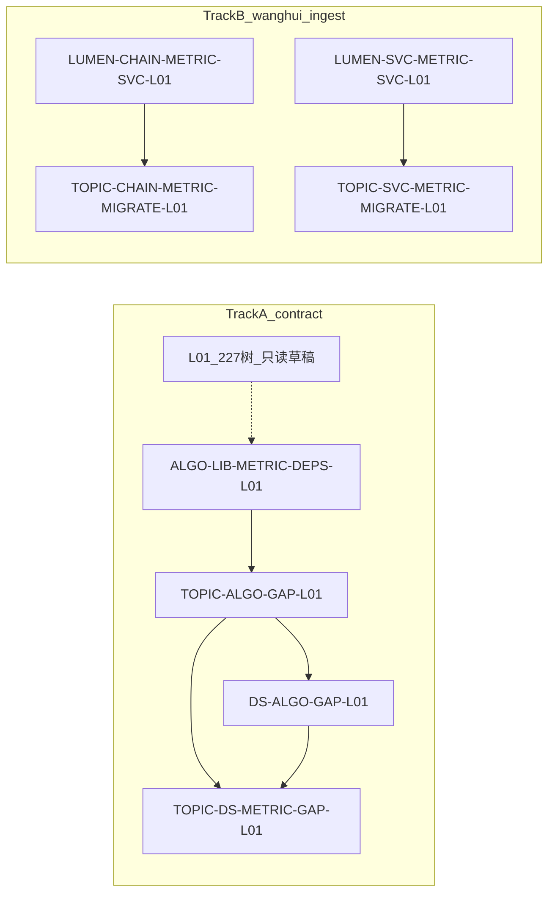

# 算法指标梳理 · 两轨总图（给人）

> **日期**：2026-08-21（A 轨改写：四叶废作 → A1；A2 拆专题差集 → 展示差集）  
> **不新建 Epic**  
> **A 轨 Epic**：`E-ALGO-LIB-DEMO`  
> **B 轨 Epic**：`E-CHAIN-PROTOTYPE` / `E7-产业服务链分析`  
> **旧四叶说明（已废作）**：[`给人说明-指标盘点-2026-08-20.md`](./给人说明-指标盘点-2026-08-20.md)

两套活并行，**A 不依赖 B，B 不依赖 A**。

**截止（给人）**：
- **A2 2026-08-24 下班前**：专题 + 展示差集表齐（`metrics/request/{专题系统,展示系统}/`）
- **A1 2026-08-25**：三方 ODS 不满足清单（`metrics/algo-results/ALGO-LIB-METRIC-DEPS-L01-ods-gaps.md`）

A2 早于 A1：差集可对照 SRS `05` 打底，不挡 8/24。

**算法结果落点**：
- **A1** → [`metrics/algo-results/`](../../metrics/algo-results/README.md)（含 8/25 三方 ODS 缺口清单）
- **A2** → [`metrics/request/专题系统/`](../../metrics/request/专题系统/) 与 [`metrics/request/展示系统/`](../../metrics/request/展示系统/)（格式见 [`A2-GAP-schema.md`](../../metrics/request/A2-GAP-schema.md)；半成品 Excel 在 `request/` 根目录只读）

A 轨不改 seed。B 轨口径 md 在 `metrics/calc-logic/{CHAIN,SVC}/`。

## 谁读哪份真源

| 轨 | 读什么 | 可以改 seed？ | 谁拆单 |
|---|---|---|---|
| A1 算法库 | `bid-reference/srs/05-深度挖掘算法/科技专题服务算法库` 八维；L01 `inventory.yaml` **只读草稿** | **否** | 一叶一会话，监管 `human:唐绍祖` |
| A2.1 专题差集 | `04-科技专题服务系统` vs A1；输出 `request/专题系统/` | **否** | 先做；监管 `human:淮政玮` |
| A2.2 展示差集 | 半成品 `request/展示系统页面指标释义清单.xlsx` + `02` 需规；输出 `request/展示系统/` | **否** | A2.1 之后 |
| B 口径入仓+接口 | [`lumen-algo-py/docs/metrics/`](../../../../repos/lumen-algo-py/docs/metrics/) 8/21 报告 + `calc-logic/{CHAIN,SVC}/` | **是** | 算法入库与 topic 迁移分开开聊 |

## A 轨 · 改写后两叶

| Task ID | 状态 | 监管 / 管理人 | 做什么 |
|---------|------|----------------|--------|
| `ALGO-LIB-METRIC-DEPS-L01` | ready | `human:唐绍祖` | 算法库八维 **双表**（需规对应 + 指标公式/ODS）。说明：[`给人说明-ALGO-LIB-METRIC-DEPS-L01-2026-08-21.md`](./给人说明-ALGO-LIB-METRIC-DEPS-L01-2026-08-21.md)；schema：`metrics/algo-results/ALGO-LIB-METRIC-DEPS-L01-schema.md` |
| `TOPIC-ALGO-GAP-L01` | backlog | `human:淮政玮` | **先做**。专题功能 vs 算法库差集 → `metrics/request/专题系统/`。说明：[`给人说明-A2差集拆解-2026-08-21.md`](./给人说明-A2差集拆解-2026-08-21.md) |
| `DS-ALGO-GAP-L01` | backlog | `human:淮政玮` | **后做**。展示 → `metrics/request/展示系统/`；半成品列模板见 `request/展示系统页面指标释义清单.xlsx` |
| `TOPIC-DS-METRIC-GAP-L01` | backlog | `human:淮政玮` | 父单收口，不自己分析 |

### 废作四叶（勿再派）

`TOPIC-METRIC-INVENTORY-L01` / `TOPIC-METRIC-CLASSIFY-L01` / `DS-METRIC-INVENTORY-L01` / `DS-METRIC-CLASSIFY-L01`  
产物 `indicator-inventory/2026-08-20/` 保留只读，不扩 DoD、不把 `*_20260821.md` 塞进去。

## B 轨 · 王惠口径入库 + 接口 + topic 迁移

| Task ID | 当前状态 | 监管（迁移叶） | 产物 |
|---------|----------|----------------|------|
| `LUMEN-CHAIN-METRIC-SVC-L01` | `review`（算法/主仓 DoD 已交） | — | 63 `M_CHAIN_*`；`/v1/chain/**` |
| `LUMEN-SVC-METRIC-SVC-L01` | `review`（算法/主仓 DoD 已交） | — | 29 `M_SVC_*`；`/internal/v1/svcan` |
| `TOPIC-CHAIN-METRIC-MIGRATE-L01` | backlog | `human:李伟` | `demo-ui-topic` industry-center |
| `TOPIC-SVC-METRIC-MIGRATE-L01` | backlog | `human:侯佳伟` | `demo-ui-topic` service-portal/center |

算法单不把「迁 UI」当本叶验收。迁移叶 `强度：ponytail full`；不碰 lumen 四仓。

## 本次不做

- 不把废作四叶标 `done`
- 不改 `inventory.yaml` 去对齐 63/29 正式 ID（对应关系写在 A2.1/A2.2）
- 不把 B 轨 CHAIN/SVC 入库并进 A1
- 不并行开工 A2.1 与 A2.2
