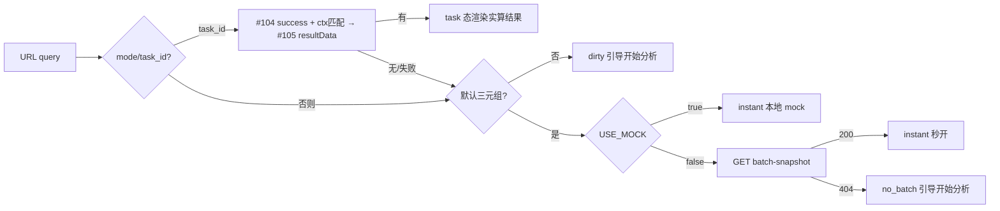

# LUMEN-INTEL-VIT-FE-L01

区域创新活力 — lumen-ui-topic 工作台接真实任务链。完工停在本地,未 commit/push。

## 任务认领

| 字段 | 值 |
|------|-----|
| claimed_by | `agent:frontend-agent` |
| supervised_by | `human:唐绍祖` |
| 状态 | 代码完成 + selfcheck/类型检查绿(2026-10-28) |

## Ponytail

| 字段 | 值 |
|------|-----|
| ponytail | `full` |
| 说明 | 未跳诚实态(404→no_batch、不 fixture 填数);selfcheck 同步升级 |

## 实现范围

仓 `repos/lumen-ui-topic`(dev,本地)。

新增:
- `src/api/topic/synthBatch.ts` — `synthVitalityBatch` defineApi;real 面 GET
  `/topic/v1/synth/vitality/batch-snapshot`,404 → `IntelBatchSnapshotNotFound`;
  mock 由 register.ts 既有 `synthVitalityBatch` 同形状提供。
- `src/api/topic/index.ts` — 出口。
- `src/views/intelligence/vitalityResultSource.ts` — 活力结果源(四态推导):
  - task:`#104` 成功 + ctx 匹配 → `#105 resultData` → `normalizeVitalityResult`
    (vitalityIndex:number + dimScores:array 最小校验);
  - instant:默认三元组;`USE_MOCK=true` 走本地确定性 mock,`USE_MOCK=false` 调快照接口,
    404/失败 → null → no_batch(禁止 fixture 填数);
  - config/dirty:引导开始分析。

修改:
- `src/views/intelligence/RegionalInnovationVitality.vue` — 接 `useVitalityResultSource`
  (语义对齐 ELEM 的 elementResultSource);删除本地 taskResult/hydrateTaskResult;
  报告父任务取 `resultState.task.taskId`;切条件由结果源重判 instant/no_batch。
- `src/views/intelligence/intelVit.selfcheck.mjs` — 断言升级(结果源模式 + 新 API 文件)。

`analysisTaskCreate(analysisType=region_innovation_vitality)` 既有桥
(`useSynthTaskBridge.startOrResumeSynthAnalysis`)不动:BE 白名单生效后同代码自动走真链。

## 四态判定(改造后)

diagram_id: LUMEN-INTEL-VIT-FE-STATES

## 偏离

- `DEFAULT_BATCH_RESULT` 直引从工作台退役(挪进结果源 mock 分支),selfcheck 断言同步升级。
- 快照服务(总纲第二步)未上线前,real 面默认三元组将显示 no_batch 诚实态 —— 符合
  「USE_MOCK=false 不 fixture 填数」红线;秒开随服务上线自然恢复。

## 验收证据

- `node src/views/intelligence/intelVit.selfcheck.mjs` → ok(覆盖四态/报告契约/禁随机数/无 a-alert content prop)
- `node src/mock/intel/intel.selfcheck.mjs` / `intelL1c` → ok
- `vue-tsc --noEmit` 改动文件 0 错误(存量 CMS/PDF 缺依赖错误与本单无关)
- `intelL1b.selfcheck.mjs` 在干净 dev 树同样失败(git stash 验证),非本单引入

## 架构合规自检

- ✅ 调用链:未新增前端直连 Python / demo-*;快照接口走 `/topic/v1`(网关)
- ✅ 算法只在 Python:前端零公式(等权/归一只在 Python 装包)
- ✅ 角标种子 D1–D4 未动;未关 Q-SYNTH-*
- ✅ D12:无 demo 引用;浏览器网络不出现 `/v1/synth-metric`、`/comp/v1`

## Cost 回填

| 字段 | 值 |
|------|-----|
| actual_tokens | ~55000 |
| model_used | cursor-glm-5.3 |
| actual_cost | ~0.28 |
| cost_warn | green |

## CI/CD

- 分支:lumen-ui-topic dev(本地未提交)
- dev 测试:selfcheck×3 + vue-tsc + eslint 改动文件全绿

## 涉及文件

- repos/lumen-ui-topic/src/api/topic/{synthBatch.ts,index.ts}(新)
- repos/lumen-ui-topic/src/views/intelligence/{vitalityResultSource.ts(新),RegionalInnovationVitality.vue,intelVit.selfcheck.mjs}
