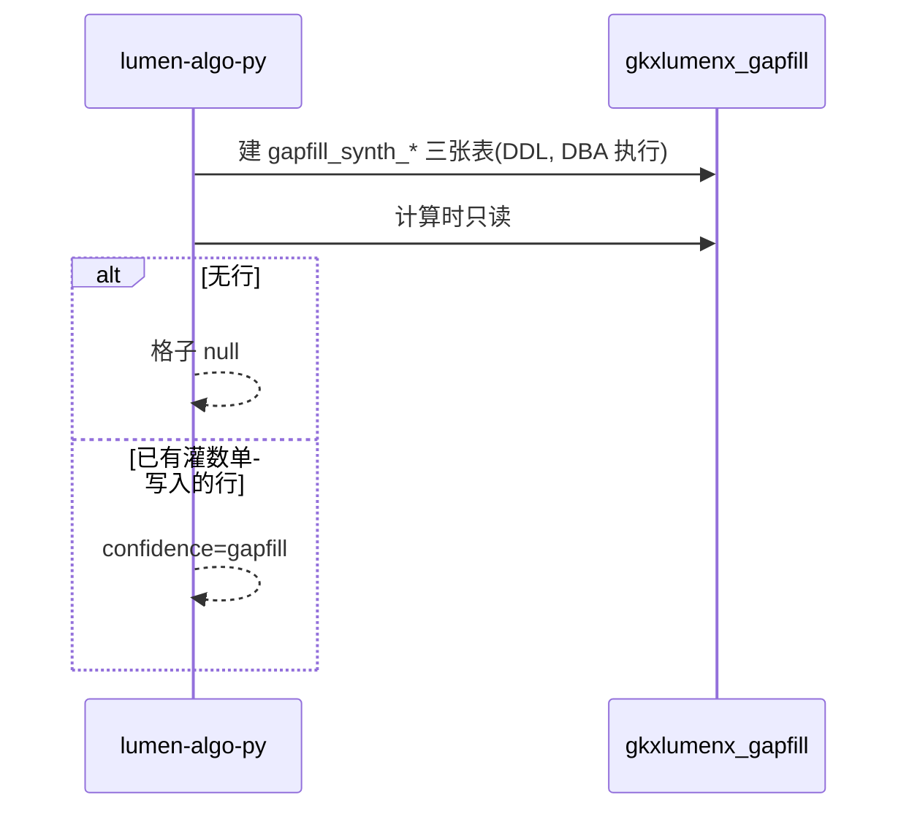

# LUMEN-INTEL-VIT-GAPFILL-L01

区域创新活力 — 功能验收缺项表(DDL + 读路径)。完工停在本地,未 commit/push。

## 任务认领

| 字段 | 值 |
|------|-----|
| claimed_by | `agent:algorithm-agent` |
| supervised_by | `human:唐绍祖` |
| 状态 | DDL + 读路径 + 单测 5/5(2026-10-28);建库建表执行待 DBA |

## Ponytail

| 字段 | 值 |
|------|-----|
| ponytail | `full` |
| 说明 | 未跳红线检查(零 INSERT/只落 gapfill 库/不为 FOUR_DIM_SCORE 建表);契约测试锁死 |

## 表名(三张,均在 gkxlumenx_gapfill,前缀 gapfill_)

| 表 | 缺项 | gap_item | 维 |
|---|---|---|---|
| `gapfill_synth_new_product_sales_ratio` | 新产品销售收入占比 | ind-newprod | 产业 |
| `gapfill_synth_rd_employee` | 研发人员数量 | ind-talent-cnt | 人才 |
| `gapfill_synth_policy_effect` | 政策实施效果指数 | ind-pol-effect | 政策 |

列(每张同构):id/metric_id(M_SYNTH_VIT_INDICATOR)/gap_item/gap_item_name/city/year/value
(NULL 允许,禁止 0 占位)/fill_method/fill_model/gapfill_batch_id/generated_at;
UNIQUE(city,year);IDX(batch)/IDX(metric)。

## 读路径(PY 单已交接,本单契约测试锁定)

- 文件:`vendor/entan-py/entan/synth_vitality/pack.py::_read_gapfill`
- 语义:`SELECT value FROM gkxlumenx_gapfill.{table} WHERE city=? AND year=? ORDER BY generated_at DESC LIMIT 1`
- 无行/读失败 → 格子 null(读失败进 WARNING 日志,不变 0);有行 → `confidence=gapfill` + 原 metric_id。
- Java/前端不建表不读此库;生产配置不读此库(装包连接走 ENTAN_MYSQL_*,目标库含
  gkxlumenx_gapfill 只读 SELECT)。

## DDL 执行入口(幂等,可重复)

`vendor/entan-py/scripts/mysql/create_gapfill_synth.sql`
- 建库+授权部分需 DBA/root(应用账号 gkxlumenx 无建库权限,已验证 SHOW GRANTS);
- 建表部分幂等(CREATE TABLE IF NOT EXISTS),零业务行。

## 调用时序

diagram_id: LUMEN-INTEL-VIT-GAPFILL-SEQ

## 偏离

- 2026-11-07 状态更新：正式 `gkxlumenx_gapfill` 与 demo `demo_gkxlumenx_ads`
  均已创建三张表。demo 使用 ADS 过渡落点，Python 已改为通过 `conn.gapfill`
  自动选择运行库。三表仍为空，灌行归 `LUMEN-INTEL-VIT-GAPFILL-DATA-L01`。

## 验收证据

- `python3 -m pytest tests/test_gapfill_synth_schema.py -q` → 5 passed
  (三表恰建/必填列齐/零 INSERT/只落 gapfill 库/装包表名列名契约)
- PY 单 9 测试含 gapfill null/gapfill 两分支(见 LUMEN-INTEL-VIT-PY-L01.md)
- `SHOW GRANTS` 证实应用账号无建库权限(执行留 DBA)

## 架构合规自检

- ✅ 只建 gkxlumenx_gapfill.gapfill_*;未写 ODS/DWD/ADS/供应方库 gkx
- ✅ 未 INSERT 业务行(灌行在 LUMEN-INTEL-VIT-GAPFILL-DATA-L01)
- ✅ 未改 D4;未把 0.30/0.30/0.20/0.20 标官方;未关 Q-SYNTH-*
- ✅ 未为 M_SYNTH_ELEM_FOUR_DIM_SCORE 建表
- ✅ 读失败进日志不变 0(装包 WARNING)

## Cost 回填

| 字段 | 值 |
|------|-----|
| actual_tokens | ~35000 |
| model_used | cursor-glm-5.3 |
| actual_cost | ~0.18 |
| cost_warn | green |

## CI/CD

- 分支:lumen-algo-py dev(本地未提交)
- dev 测试:pytest 5/5;建表执行待 DBA(见上)

## 涉及文件

- repos/lumen-algo-py/vendor/entan-py/scripts/mysql/create_gapfill_synth.sql(新)
- repos/lumen-algo-py/tests/test_gapfill_synth_schema.py(新)
- 读路径:repos/lumen-algo-py/vendor/entan-py/entan/synth_vitality/pack.py(PY 单)
