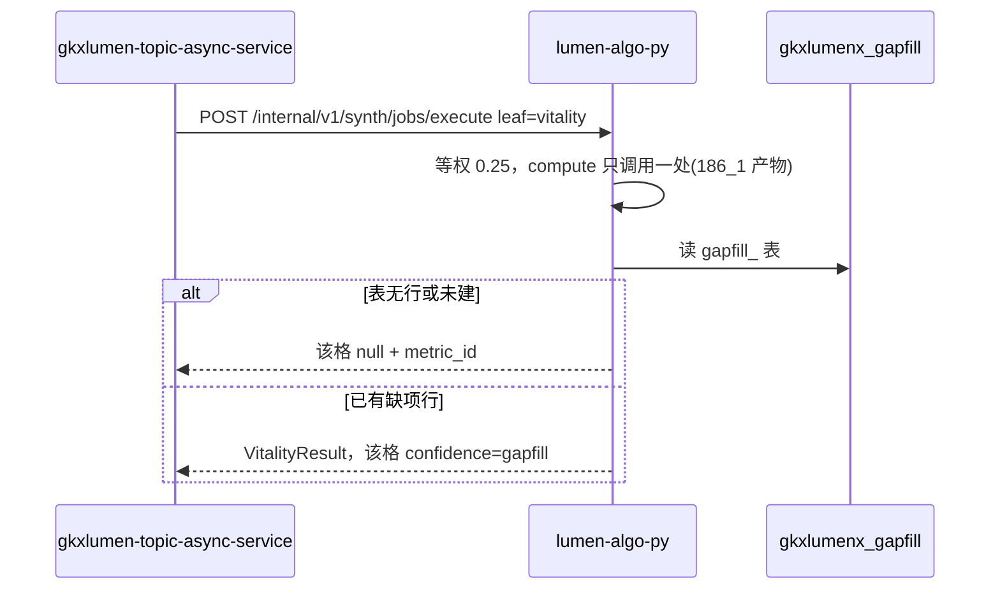

# LUMEN-INTEL-VIT-PY-L01

区域创新活力 — Python 装包与 /internal 任务执行。完工停在本地,未 commit/push。

## 任务认领

| 字段 | 值 |
|------|-----|
| claimed_by | `agent:algorithm-agent` |
| supervised_by | `human:唐绍祖` |
| 状态 | 代码完成 + 单测 9/9(2026-10-28);等唐绍祖确认联调 |

## Ponytail

| 字段 | 值 |
|------|-----|
| ponytail | `full` |
| 说明 | 未用 YAGNI 跳过调用链/可观测/架构铁律;失败路径全覆盖单测 |

## 实现范围

仓 `repos/lumen-algo-py`(dev,本地)。新增:

- `vendor/entan-py/entan/synth_vitality/{__init__,pack}.py` — 活力装包(§6.2 默认口径锁定:深圳×全国重点城市×最近3年;四维等权 0.25;极值归一盘继承;缺维分母收缩不补 0;区域映射不到 400;窗先归一中文)
- `vendor/entan-py/api/synth_jobs_routes.py` — `POST /internal/v1/synth/jobs/execute`,只接受 `leaf=vitality`(elements/collaboration 一律 400);沿用 FastAPI 已有 OTel 中间件(挂 main.py 后自动生效)
- `vendor/entan-py/api/main.py` — 挂载新路由(+8 行,样板同 synth_metric_routes)
- `tests/test_synth_vitality_job.py` — 9 单测全绿

指数位 `M_SYNTH_VIT_INDEX` 与 `M_SYNTH_186_1` 同核只调用一处:直接消费
`agent-delivery/metrics/repro/out/M_SYNTH_186_1_out.json` 的 `dim_scores` + `index_0_100`
(深圳 74.9981/广州 60.6822/东莞 12.3667/惠州 1.9012,与 calc-logic MD 正本一致)。

gapfill 读路径已接:3 张表(`gapfill_synth_new_product_sales_ratio` / `_rd_employee` /
`_policy_effect`)有行 → 格子 `confidence=gapfill`;无行/读失败 → null(失败进日志,不回 0)。
本单不建表、不灌行、不改 D4。

## 五阶段中文(与清单单逐字一致,无百分比)

1. 任务提交与分析条件冻结
2. 校验目标区域×对比范围×时间窗，装载四维专题库快照与权重合计
3. 按科技/产业/人才/政策四维计算区域创新活力指数
4. 生成单维评分、权重分布与优势短板
5. 结果可信性校验与分析报告组装

## 偏离

- 四维盘选轨:未用 `M_SYNTH_VIT_DIM_SCORE_out.json`(20261025 子模型重跑轨,科技深圳 80.29,
  等权 76.6456),改用 `M_SYNTH_186_1_out.json.dim_scores`(MD 正本同轨,深圳 73.7,等权 74.9981)。
  依据:calc-logic MD 是唯一解释口径,且「与 186_1 同核只调用一处」要求指数唯一来源。
- `yoy` / `trend` 首期 null/空数组:无历史盘,MD 明示截面合成;推导不了就空,不编数。

## 调用时序

diagram_id: LUMEN-INTEL-VIT-PY-SEQ

## 验收证据

- `python3 -m pytest tests/test_synth_vitality_job.py -q` → 9 passed
- 默认三元组 vitalityIndex=74.9981(深圳),与 `metrics/repro/out/M_SYNTH_186_1_out.json` 相等
- `yoy`/`trend` 空态;未知区域 400 REGION_UNMAPPED;leaf=elements 400

## 架构合规自检

- ✅ 调用链:只挂 `/internal/*`,未动 `/v1/synth-metric`;无 demo-* 引用
- ✅ 算法只在 Python:加权只此一处;Java/前端零公式
- ✅ 图谱:未改 Nebula
- ✅ 可观测:沿用 TraceHeaderMiddleware;gapfill 读失败进日志
- ✅ CI:业务仓未 commit;handoff 落编排仓
- ✅ D12:无 lumen→demo 调用
- ✅ 缺项只读 gkxlumenx_gapfill;未写 ODS/DWD/ADS/供应方库

## Cost 回填

| 字段 | 值 |
|------|-----|
| actual_tokens | ~60000 |
| model_used | cursor-glm-5.3 |
| actual_cost | ~0.30 |
| cost_warn | green |

## CI/CD

- 分支:lumen-algo-py dev(本地未提交,待唐绍祖确认)
- pipeline:未触发(不自行 push)
- dev 测试:pytest 9/9 绿

## 涉及文件

- repos/lumen-algo-py/vendor/entan-py/entan/synth_vitality/*(新)
- repos/lumen-algo-py/vendor/entan-py/api/synth_jobs_routes.py(新)
- repos/lumen-algo-py/vendor/entan-py/api/main.py(+8 行)
- repos/lumen-algo-py/tests/test_synth_vitality_job.py(新)
