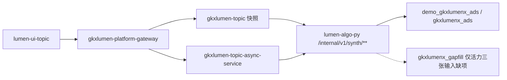

# 综合智能分析 · 调用链与边界

- 日期：2026-11-05（对齐总册 v1.0.5-draft：结果读 ADS）
- 配套：`综合智能分析-系统详细设计说明书.md`
- 状态：DRAFT

## 1. 对外链

专题综合智能分析页的浏览器只打网关后的专题路径：

- 同步：`/topic/v1/synth/**`
- 异步：`/topicAsync/topic/v1/analysis/**`

不直连 Python、不直连 MySQL、不直连 Nebula。

算法出口只有 Python `/internal/*`。Java Adapter 只做白名单、参数归一、Feign、任务态；不算指数。

## 2. 同步与异步

| 类型 | 入口 | 行为 |
|---|---|---|
| 快照秒开 | `GET .../synth/{leaf}/batch-snapshot` | Python 读 ADS `synth_*`；无行 404 |
| 开始分析 | `#102` create | Adapter → `/internal/v1/synth/jobs/execute`；五阶段 SSE |
| 报告 | 前端基于真实快照渲染并出 PDF（`renderIndustryAnalysisReportPdf`） | `*_report` 任务键 v1 不依赖；服务端不生成报告文件 |

切条件不自动起任务。异步失败不清空同页已成功的同步区块（若有）。

## 3. 边界（禁止）

- 禁止 Feign / helm / 前端指向 `demo-algo-*`、`demo-platform-*`、`demo-ui-system-test`
- 禁止接口直接返回写死 mock JSON；假数只进表行
- 禁止 `USE_MOCK=false` 时用前端 fixture 填业务结果
- 禁止 Java 写 nGQL / NLP / 加权公式
- 禁止把 `M_COMP_*` 产业综合契约当专题结果
- 禁止本说明书新开 WBS；实现挂现有 `LUMEN-INTEL-*`

## 4. 库边界

| 库 | 谁读 | 用途 |
|---|---|---|
| `demo_gkxlumenx_ads` / `gkxlumenx_ads` | Python 灌行并装包只读 | 本模块 `synth_*` 结果、图事实、`synth_collab_batch_meta` |
| `gkxlumenx_gapfill` | Python | 只有活力三张既有输入缺项。图谱结果不进这里 |
| ODS / DWD / 供应方 | 要素全景只读 DWD | 本模块不把结果写入这些库 |

表名 `synth_*`，禁止 `gapfill_` 前缀，禁止再落到 `gkxlumenx_ai`。
