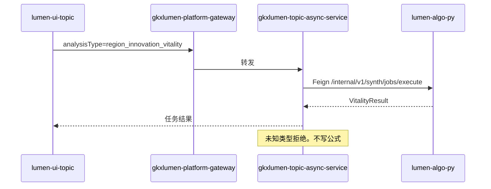

# 派单说明 · LUMEN-INTEL-VIT-BE-L01

```text
/goal api-agent
身份：你是经验丰富、遵循最佳实践的资深 Java 后端工程师。只做任务白名单和 Feign 转发。绝不在 Java 写指数公式，不直连 nGQL。
强度：ponytail full（默认）。禁止用 YAGNI 跳过调用链、可观测与架构铁律。
图：必含 LUMEN-INTEL-VIT-BE-SEQ。先写调用时序再写代码。图放在本文件「调用时序」一节，diagram_id 为 LUMEN-INTEL-VIT-BE-SEQ。不另画全局拓扑。图文冲突以图为准。必读 agent-delivery/diagram-as-contract.md。

任务：LUMEN-INTEL-VIT-BE-L01
标题：区域创新活力 — Java 任务白名单与 Adapter
监管人：human:唐绍祖。已认领，claimed_by=agent:api-agent，supervised_by=human:唐绍祖。不要改监管人，不要另开任务。
执行：agent:api-agent。协作 algorithm-agent。
状态：claimed。本单没有前置任务，可以和 PY 并行。不要并行改 LUMEN-INTEL-BE-1。
仓：lumen-svc-platform，服务 gkxlumen-topic-async-service，分支 dev。业务仓完工停在本地，不自行 commit / push，除非唐绍祖明确说提交。
开始时间：2026-10-28。功能出门日：2026-11-05（五张单一起，本单不单独立截止）。

目标：只登记活力分析键和活力报告键，经 Feign 调 Python /internal。计算口径在 Python，按实现方案 §6.2。Java 不解释权重。

调用方向（必须落在图上）：
lumen-ui-topic → gkxlumen-platform-gateway → gkxlumen-topic-async-service → http://gkxlumen-platform-entan-py:8000/internal/v1/synth/jobs/execute。
配置禁止 demo-platform-*、demo-svc-*、demo-algo-*。

必读：
- 本文件（执行范围）
- agent-delivery/agent-handoffs/综合智能分析-SYNTH/LUMEN-INTEL-实现方案.md（§6.2、§9）
- agent-delivery/architecture-baseline.md（D12、D16）
- 同目录 派单-LUMEN-INTEL-VIT-PY-L01.md（Python 边界）
任务查询只用 MCP task-get / task-query。禁止读 task-registry.yaml。

范围：
1. gkxlumen-topic-async-service 只登记 region_innovation_vitality 与 region_innovation_vitality_report。不登记要素与协同。
2. Adapter Feign 到上面的 /internal 路径。未知 analysisType 仍被拒绝。
3. 报告键第一期结果只有 {format, parent_task_id}，模板 synth-vitality-report-v1，不生成 PDF。
4. Java 仓库无活力指数公式。失败不把演示 JSON 写入正式结果。
5. 窗参数若前端传来 1y|3y|5y，透传前归一成最近1年 / 最近3年 / 最近5年。未映射区域失败，不改写成深圳。
6. 不改 D4。完成态 D4 不得停在 mock，改 live 在灌数单。

DoD：
1. 只登记活力两键。要素、协同、任意未知字符串都被拒绝。
2. Feign 目标是 gkxlumen-platform-entan-py:8000/internal/v1/synth/jobs/execute，配置里没有 demo-platform-*。
3. 报告第一期只有 {format, parent_task_id}，模板 synth-vitality-report-v1，无 PDF。
4. Java 仓库搜不到活力指数公式。失败结果不是演示 JSON。
5. handoff：agent-delivery/agent-handoffs/综合智能分析-SYNTH/LUMEN-INTEL-VIT-BE-L01.md。含架构合规与 ponytail: full。evidence 指向该 handoff 和本派单（含 LUMEN-INTEL-VIT-BE-SEQ）。不要把任务标 done。联调确认词只在唐绍祖确认后写入。

可观测：沿用 topic-async-service 已有 Java Agent 与 X-Trace-Id。不新造观测桶。

禁止：
- 登记要素、协同，或去改 LUMEN-INTEL-BE-1 的三叶白名单。
- 在 Java 里写归一、权重或指数公式。
- Feign 或配置回落到 demo-*。
- 失败时写入演示 JSON。
- 本单改 D4，或关闭 Q-SYNTH-*。
- task-create 新叶，或修改本任务以外的 depends_on、状态、DoD。
- 业务仓自行 commit / push。
```

## 调用时序

diagram_id: LUMEN-INTEL-VIT-BE-SEQ



## 和其他单的分工

Java 只透传。实算在 `LUMEN-INTEL-VIT-PY-L01`。页面在 `LUMEN-INTEL-VIT-FE-L01`。建表在 `LUMEN-INTEL-VIT-GAPFILL-L01`。灌行和 D4=live 在 `LUMEN-INTEL-VIT-GAPFILL-DATA-L01`。

五张单都交接后才可提测。监管人都是唐绍祖。

登记表 DoD 与本文件不一致时，以本文件为准。
