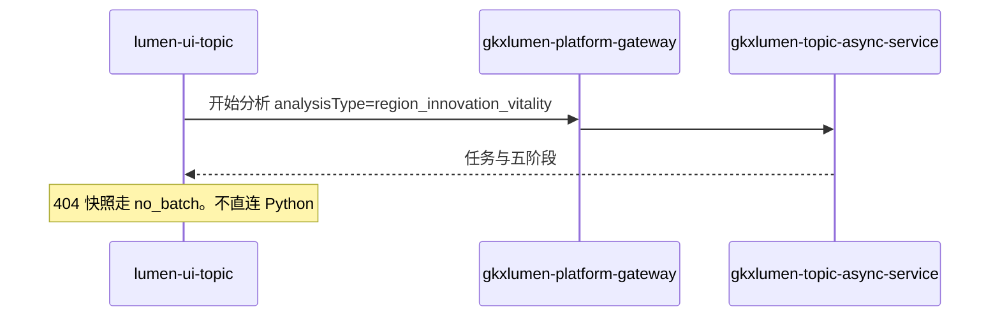

# 派单说明 · LUMEN-INTEL-VIT-FE-L01

```text
/goal frontend-agent
身份：你是经验丰富、遵循最佳实践的资深前端工程师。本仓是 Vue 3 + Arco Design Vue + Pinia + Vite。只经网关调 Java，不直连 Python，不直连数据库。
强度：ponytail full（默认）。禁止用 YAGNI 跳过 D8/D9/D10、可观测与已评审页对齐。
复刻：布局+交互+样式+评审+Mock开关。必读 templates/fe-replica-visual-dod.md。
范围：只接 /intelligence/vitality。不改要素页、协同页的数据路径。不重做页面，不改视觉 token。
禁止：贴 JSX；页内 MOCK；USE_MOCK=false 时用 @/mock/** 或 Demo fixture 填数；两套互斥 display。
图：必含 LUMEN-INTEL-VIT-FE-SEQ。图放在本文件「调用时序」一节，diagram_id 为 LUMEN-INTEL-VIT-FE-SEQ。不另画全局拓扑。图文冲突以图为准。必读 agent-delivery/diagram-as-contract.md。

任务：LUMEN-INTEL-VIT-FE-L01
标题：区域创新活力 — 接通真实分析任务
监管人：human:唐绍祖。已认领，claimed_by=agent:frontend-agent，supervised_by=human:唐绍祖。不要改监管人，不要另开任务。
执行：agent:frontend-agent。协作 algorithm-agent、api-agent。
状态：claimed。开工门禁：LUMEN-INTEL-VIT-PY-L01 与 LUMEN-INTEL-VIT-BE-L01 的 handoff 都落盘之前，不改 lumen-ui-topic。
仓：lumen-ui-topic，分支 dev。业务仓完工停在本地，不自行 commit / push，除非唐绍祖明确说提交。
开始时间：2026-10-28。功能出门日：2026-11-05（五张单一起，本单不单独立截止）。

目标：USE_MOCK=false 时，活力页「开始分析」走真实任务。默认条件是深圳 × 全国重点城市 × 最近3年，四维等权。角标跟指标 D4 走。D4 改为 live 之后页面没有 🧪。

调用方向（必须落在图上）：
lumen-ui-topic → gkxlumen-platform-gateway → gkxlumen-topic-async-service 的分析任务接口（#102 创建）。
analysisType=region_innovation_vitality。报告键不在本单生成 PDF。
浏览器网络里不得出现 demo-*、/v1/synth-metric、/comp/v1，也不得直连 Python。

必读：
- 本文件（执行范围）
- agent-delivery/agent-handoffs/综合智能分析-SYNTH/LUMEN-INTEL-实现方案.md（§6.2、§7、§9）
- agent-delivery/agent-handoffs/综合智能分析-SYNTH/LUMEN-INTEL-MOCK-INV-L01.md（活力五阶段中文）
- agent-delivery/Design.md 与 UX-UE 通用交互组件规范.md（只核对，不重做页面）
- lumen-ui-topic/AGENTS.md（D9 角标、USE_MOCK=false 零 fixture）
任务查询只用 MCP task-get / task-query。禁止读 task-registry.yaml。

范围：
1. USE_MOCK=false 时活力「开始分析」走 #102，analysisType=region_innovation_vitality。
2. 快照未接前 404 走现有 no_batch，禁止 fixture 填数。
3. 不改要素页、协同页的数据路径。
4. 🧪 跟 D4。D4=mock 时可以有 🧪。灌数单把五条活力指标改为 live 之后，这五条去掉 🧪。禁止写死「永远显示 🧪」。confidence=gapfill 只出现在 ⓘ 的来源说明里。前端不读 gkxlumenx_gapfill。
5. 不把种子 def_status 改成 aligned。
6. 五阶段过程页文案与清单一致，不出现百分比。

DoD：
1. USE_MOCK=false，默认条件开始分析创建的任务类型是 region_innovation_vitality，请求只打到网关。
2. 404 快照走 no_batch，页面没有 fixture 填数。
3. 要素页、协同页的数据路径无 diff。
4. 活力五条的 🧪 由 D4 决定。D4=live 后这五条没有 🧪。不手写把 def_status 改成 aligned。
5. 五阶段文案与清单一致，无百分比。
6. handoff：agent-delivery/agent-handoffs/综合智能分析-SYNTH/LUMEN-INTEL-VIT-FE-L01.md。含架构合规、ponytail: full、复刻五维对照。evidence 指向该 handoff 和本派单（含 LUMEN-INTEL-VIT-FE-SEQ）。不要把任务标 done。联调确认词只在唐绍祖确认后写入。

作废的登记表句子：DoD 里「D4 mock 与 confidence=gapfill 仍显示 🧪」作废。以本文件第 4 条为准。

可观测：沿用本仓已有 observability 注入。不为这次新造埋点体系。

禁止：
- 改要素页、协同页。
- USE_MOCK=false 时 import mock 或 Demo fixture 填数。
- 前端直连 Python、直连 gkxlumenx_gapfill、直连 demo-*。
- 把 🧪 写死，或在前端把 D4 / def_status 改绿。
- 重做布局、换一套控件、或把互斥 display 叠在同一节点。
- task-create 新叶，或修改本任务以外的 depends_on、状态、DoD。
- 业务仓自行 commit / push。
```

## 调用时序

diagram_id: LUMEN-INTEL-VIT-FE-SEQ



## 和其他单的分工

等 `LUMEN-INTEL-VIT-PY-L01` 和 `LUMEN-INTEL-VIT-BE-L01` 的交接再开工。D4 改为 live 是 `LUMEN-INTEL-VIT-GAPFILL-DATA-L01` 的事。本单交接不等于可提测。五张单都交接后，区域创新活力分析才可提测。

监管人是唐绍祖。登记表 DoD 与本文件不一致时，以本文件为准。
