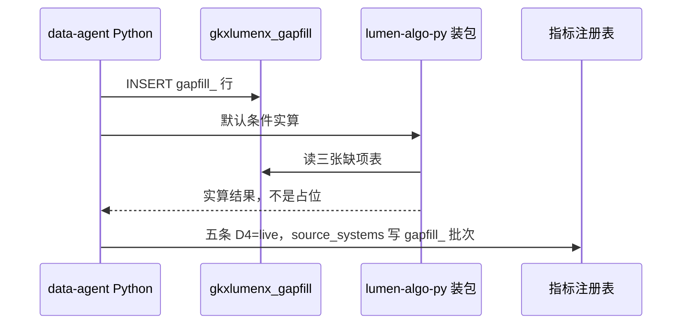

# 派单说明 · LUMEN-INTEL-VIT-GAPFILL-DATA-L01

```text
/goal data-agent
身份：你是经验丰富、遵循最佳实践的资深数据工程师。本单用 Python 往缺项表灌行，并在实算成功之后把活力五条的 D4 改为 live。Java 和前端不灌数。
强度：ponytail full。本单含灌数脚本，不用「强度：N/A」。禁止用 YAGNI 跳过血缘、D16 与实算核对。
图：必含 LUMEN-INTEL-VIT-GAPFILL-DATA-SEQ。先写调用时序再写脚本。图放在本文件「调用时序」一节，diagram_id 为 LUMEN-INTEL-VIT-GAPFILL-DATA-SEQ。不另画全局拓扑。图文冲突以图为准。必读 agent-delivery/diagram-as-contract.md。

任务：LUMEN-INTEL-VIT-GAPFILL-DATA-L01
标题：区域创新活力 — 缺项表灌数并交出可提测
监管人：human:唐绍祖。已认领，claimed_by=agent:data-agent，supervised_by=human:唐绍祖。不要改监管人，不要另开任务。
执行：agent:data-agent。协作 algorithm-agent。
状态：claimed。开工门禁：下面四张单的 handoff 都落盘之前，不灌行，不改 D4，不宣告可提测。
- LUMEN-INTEL-VIT-PY-L01
- LUMEN-INTEL-VIT-BE-L01
- LUMEN-INTEL-VIT-FE-L01
- LUMEN-INTEL-VIT-GAPFILL-L01
仓：灌数脚本在 lumen-algo-py，分支 dev。D4 变更在指标注册表，走 data-agent 正式流程，不在页面改绿。业务仓完工停在本地，不自行 commit / push，除非唐绍祖明确说提交。
开始时间：2026-10-28。功能出门日：2026-11-05。本单是五张单的最后一跳。

目标：三个已点名缺项进入 §6.2 公式。实算成功后，五条活力指标 D4=live，source_systems 写明 gapfill_ 批次。五张单都交接后，区域创新活力分析可提测。

调用方向（必须落在图上）：
Python 灌数脚本 → 只写 gkxlumenx_gapfill.gapfill_* → 活力装包按默认口径实算读到这些行 → data-agent 把 D4 改为 live。
不写 ODS/DWD/ADS/供应方库。生产配置不读 gkxlumenx_gapfill。

必读：
- 本文件（执行范围）
- agent-delivery/agent-handoffs/综合智能分析-SYNTH/LUMEN-INTEL-实现方案.md（§6.1、§6.2、§8、§9）
- agent-delivery/metrics/calc-logic/SYNTH/M_SYNTH_VIT_INDEX.md
- agent-delivery/data-lineage-policy.md §2.4
- agent-delivery/architecture-baseline.md D16
- 同目录另外四份派单说明
任务查询只用 MCP task-get / task-query。禁止读 task-registry.yaml。指标口径只用 metric-registry MCP，禁止直接改 seed 的方式绕过正式流程。

默认口径（与另外四张单同一套）：
- 深圳 × 全国重点城市 × 最近3年
- 四维等权 0.25。不把 0.30/0.30/0.20/0.20 标成官方
- 对比集合内极值归一；缺维分母收缩，不补 0
- 城市名单用装包里已经写下的「全国重点城市」映射，不另造名单

范围：
1. 只往建表单已建的 gapfill_ 表灌行。三个必灌缺项：新产品销售收入占比、研发人员数量、政策实施效果指数。细稿另写明且仍无源列的活力子项，用同前缀表灌入。细稿没写的不编。
2. 行覆盖映射中的城市和最近3年。每行有 metric_id、gap_item、fill_method（llm|rule|manual|other）、fill_model（llm 时必填）、gapfill_batch_id、generated_at。
3. 默认条件实算时，这三个缺项进入公式，不再是 null 占位。失败格仍为 null，不补 0。
4. 实算成功后，把下面五条的 D4 改为 live，source_systems 写明本次 gapfill_ 批次：
   M_SYNTH_VIT_INDEX、M_SYNTH_VIT_DIM_SCORE、M_SYNTH_VIT_WEIGHT、M_SYNTH_VIT_INDICATOR、M_SYNTH_VIT_RANK。
   灌齐并实算完成前不改 live。
5. 不关闭 Q-SYNTH-01、Q-SYNTH-V-01、Q-SYNTH-V-02。ⓘ 仍可保留「待甲方确认」。
6. 可提测核对：USE_MOCK=false，默认条件从活力页开始分析，走真实任务，结果是 §6.2 实算，五条 D4=live，页面没有 🧪。缺任何一张前置单的交接，都不写「可提测」。

DoD：
1. 三张表有覆盖默认对比集合和最近3年的行，列满足必填项。灌数脚本只在 Python。
2. 行只在 gkxlumenx_gapfill.gapfill_*。ODS/DWD/ADS/供应方库没有这批行。
3. 默认条件实算能读到三个缺项，结果不是占位 JSON，失败格不是 0。
4. 五条活力指标 D4=live，source_systems 有 gapfill_ 批次。改 live 发生在实算成功之后。
5. Q-SYNTH-01、Q-SYNTH-V-01、Q-SYNTH-V-02 仍是未关闭。等权没有被写成甲方官方权重。
6. handoff：agent-delivery/agent-handoffs/综合智能分析-SYNTH/LUMEN-INTEL-VIT-GAPFILL-DATA-L01.md。含架构合规与 ponytail: full。写明批次号、三张表行数、实算样例和「五张单均已交接，可提测」或写明还缺哪一张。evidence 指向该 handoff 和本派单（含 LUMEN-INTEL-VIT-GAPFILL-DATA-SEQ）。不要把任务标 done。联调确认词只在唐绍祖确认后写入。

可观测：灌数失败留批次和失败原因。失败批次不得被标成 live。

禁止：
- 四张前置单未交接就改 D4，或未实算就改 live。
- 写入 ODS/DWD/ADS/供应方库，或把 gapfill 行并进 DWD。
- 用随机数或补 0 填缺项。
- 在前端或 Java 灌数。
- 关闭 Q-SYNTH-*，或把等权标成官方。
- 为 M_SYNTH_ELEM_FOUR_DIM_SCORE 建表或灌数。
- 只完成灌数就写「可提测」。
- task-create 新叶，或修改本任务以外的 depends_on、状态、DoD。
- 业务仓自行 commit / push。
```

## 调用时序

diagram_id: LUMEN-INTEL-VIT-GAPFILL-DATA-SEQ



## 可提测

下面五张单的 handoff 都在，才算区域创新活力分析可提测：

| 任务 | 执行 | 监管人 |
|---|---|---|
| `LUMEN-INTEL-VIT-PY-L01` | algorithm-agent | 唐绍祖 |
| `LUMEN-INTEL-VIT-BE-L01` | api-agent | 唐绍祖 |
| `LUMEN-INTEL-VIT-FE-L01` | frontend-agent | 唐绍祖 |
| `LUMEN-INTEL-VIT-GAPFILL-L01` | algorithm-agent | 唐绍祖 |
| `LUMEN-INTEL-VIT-GAPFILL-DATA-L01` | data-agent | 唐绍祖 |

页面核对：`USE_MOCK=false`，深圳 × 全国重点城市 × 最近3年，开始分析走真实任务，结果按 §6.2 实算，五条 D4 为 live，页面没有 🧪。

登记表 DoD 与本文件不一致时，以本文件为准。
