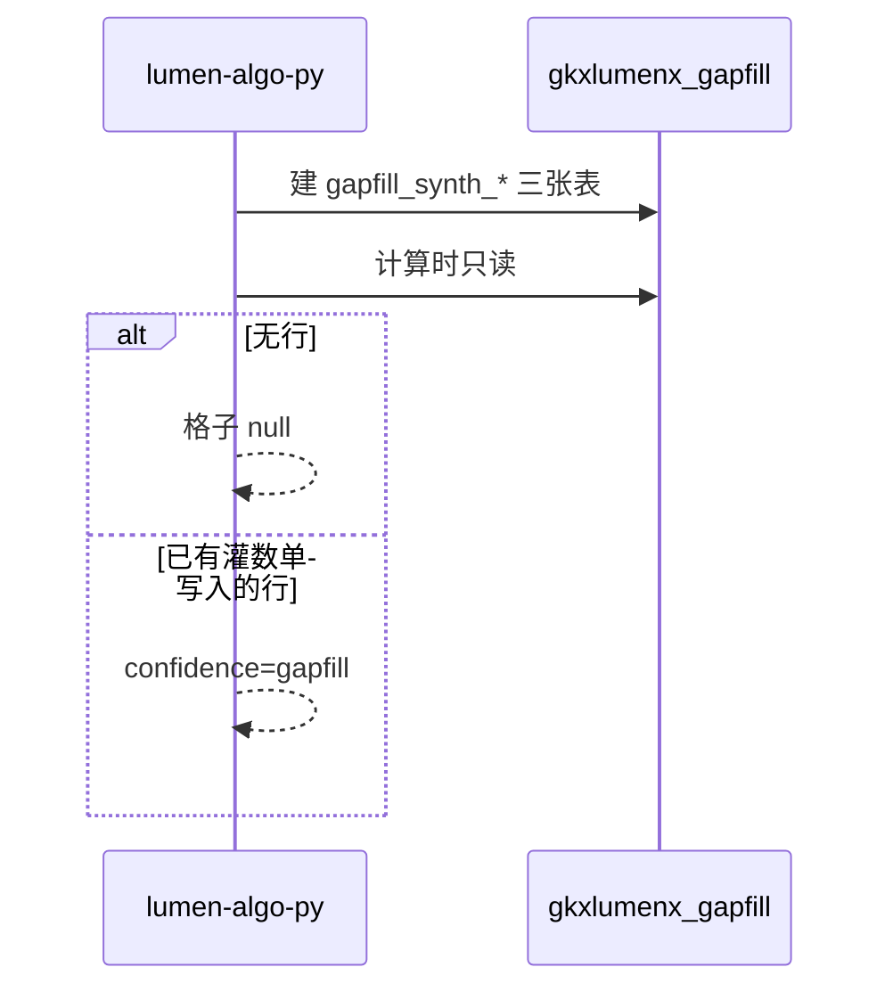

# 派单说明 · LUMEN-INTEL-VIT-GAPFILL-L01

```text
/goal algorithm-agent
身份：你是经验丰富、遵循最佳实践的资深算法工程师。本单只建缺项表，并把装包的读路径接上。不灌业务行。
强度：ponytail full（默认）。禁止用 YAGNI 跳过调用链、可观测与架构铁律。
图：必含 LUMEN-INTEL-VIT-GAPFILL-SEQ。先写调用时序再写代码。图放在本文件「调用时序」一节，diagram_id 为 LUMEN-INTEL-VIT-GAPFILL-SEQ。不另画全局拓扑。图文冲突以图为准。必读 agent-delivery/diagram-as-contract.md。

任务：LUMEN-INTEL-VIT-GAPFILL-L01
标题：区域创新活力 — 功能验收缺项表
监管人：human:唐绍祖。已认领，claimed_by=agent:algorithm-agent，supervised_by=human:唐绍祖。不要改监管人，不要另开任务。
执行：agent:algorithm-agent。
状态：claimed。开工门禁：LUMEN-INTEL-VIT-PY-L01 的装包函数交接之前，不建表、不改读路径。
仓：lumen-algo-py，分支 dev。表在库 gkxlumenx_gapfill。业务仓完工停在本地，不自行 commit / push，除非唐绍祖明确说提交。
开始时间：2026-10-28。功能出门日：2026-11-05（五张单一起，本单不单独立截止）。

目标：三张缺项表可以被装包读到。表是空的也可以。行数据由 LUMEN-INTEL-VIT-GAPFILL-DATA-L01 灌。本单不改 D4。

调用方向（必须落在图上）：
lumen-algo-py 的活力装包在计算时只读 gkxlumenx_gapfill.gapfill_*。
Java 和前端不建表、不读这个库。生产配置不读这个库。

必读：
- 本文件（执行范围）
- agent-delivery/agent-handoffs/综合智能分析-SYNTH/LUMEN-INTEL-实现方案.md（§6.1、§6.2）
- agent-delivery/metrics/calc-logic/SYNTH/M_SYNTH_VIT_INDEX.md
- agent-delivery/data-lineage-policy.md §2.4
- agent-delivery/architecture-baseline.md D16
- 同目录 派单-LUMEN-INTEL-VIT-PY-L01.md
任务查询只用 MCP task-get / task-query。禁止读 task-registry.yaml。

范围：
1. 只在 gkxlumenx_gapfill 建 gapfill_ 前缀表，覆盖三个已点名缺项：
   - 新产品销售收入占比 → gapfill_synth_new_product_sales_ratio
   - 研发人员数量 → gapfill_synth_rd_employee
   - 政策实施效果指数 → gapfill_synth_policy_effect
2. 列至少有 metric_id、gap_item、fill_method、fill_model、gapfill_batch_id、generated_at，以及该缺项的值列和区域、年份。
3. 装包读到行时，格子带原 metric_id 与 confidence=gapfill。表空时格子为 null，不补 0。
4. 细稿另写明、且仍无源列的活力子项，可以建同前缀空表，仍不灌行。
5. 不把验收用权重标成甲方官方权重。不关闭 Q-SYNTH-01、Q-SYNTH-V-01、Q-SYNTH-V-02。
6. 不为库中不存在的 M_SYNTH_ELEM_FOUR_DIM_SCORE 建表。

DoD：
1. 三张表在 gkxlumenx_gapfill，前缀是 gapfill_，列满足上面的必填项。
2. 装包只读这些表。无行时格子为 null。有行时 confidence=gapfill。
3. 本单没有灌入业务行。灌行不在本单。
4. 不写入 ODS/DWD/ADS/供应方库。生产配置不读 gkxlumenx_gapfill。
5. 本单没有把任何活力指标的 D4 改成 live，也没有把它写成「必须保持 mock」。
6. handoff：agent-delivery/agent-handoffs/综合智能分析-SYNTH/LUMEN-INTEL-VIT-GAPFILL-L01.md。含架构合规与 ponytail: full。写明表名和读路径。evidence 指向该 handoff 和本派单（含 LUMEN-INTEL-VIT-GAPFILL-SEQ）。不要把任务标 done。联调确认词只在唐绍祖确认后写入。

作废的登记表句子：DoD 里「D4 仍为 mock」作废。DoD 里「灌数只由 Python 完成」不由本单执行，灌行在灌数单，脚本仍只在 Python。

可观测：读缺项表的失败要进现有日志，不要把读失败变成 0。

禁止：
- 本单 INSERT 业务行，或用 LLM 在本单灌数。
- 写入 ODS/DWD/ADS/供应方库 gkx。
- 把缺项行并进 DWD。
- 改 D4。
- 为 M_SYNTH_ELEM_FOUR_DIM_SCORE 建表。
- 把 0.30/0.30/0.20/0.20 标成官方权重。
- task-create 新叶，或修改本任务以外的 depends_on、状态、DoD。
- 业务仓自行 commit / push。
```

## 调用时序

diagram_id: LUMEN-INTEL-VIT-GAPFILL-SEQ



## 和其他单的分工

等 `LUMEN-INTEL-VIT-PY-L01` 再开工。灌行和 D4=live 只在 `LUMEN-INTEL-VIT-GAPFILL-DATA-L01`。本单交接不等于可提测。

监管人是唐绍祖。登记表 DoD 与本文件不一致时，以本文件为准。
