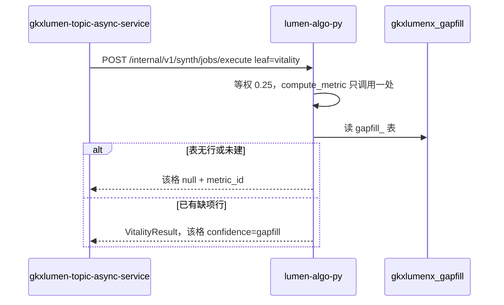

# 派单说明 · LUMEN-INTEL-VIT-PY-L01

```text
/goal algorithm-agent
身份：你是经验丰富、遵循最佳实践的资深算法工程师。算法只在 Python。本单只做区域创新活力的装包和 /internal 任务执行。
强度：ponytail full（默认）。禁止用 YAGNI 跳过调用链、可观测与架构铁律。
图：必含 LUMEN-INTEL-VIT-PY-SEQ。先写调用时序再写代码。图放在本文件「调用时序」一节，diagram_id 为 LUMEN-INTEL-VIT-PY-SEQ。不另画全局拓扑。图文冲突以图为准。必读 agent-delivery/diagram-as-contract.md。

任务：LUMEN-INTEL-VIT-PY-L01
标题：区域创新活力 — Python 装包与 /internal 任务执行
监管人：human:唐绍祖。已认领，claimed_by=agent:algorithm-agent，supervised_by=human:唐绍祖。不要改监管人，不要另开任务。
执行：agent:algorithm-agent。协作 api-agent。
状态：claimed。本单没有前置任务，可以开工。
仓：lumen-algo-py，分支 dev。业务仓完工停在本地，不自行 commit / push，除非唐绍祖明确说提交。
开始时间：2026-10-28。功能出门日：2026-11-05（五张单一起，本单不单独立截止）。

目标：前端经 Java 调到 /internal/v1/synth/jobs/execute 时，只接受活力叶，并按实现方案 §6.2 的默认口径实算。指数位用 M_SYNTH_VIT_INDEX，与 M_SYNTH_186_1 同核只调用一处。

调用方向（必须落在图上）：
lumen-ui-topic → gkxlumen-platform-gateway → gkxlumen-topic-async-service → http://gkxlumen-platform-entan-py:8000/internal/v1/synth/jobs/execute → lumen-algo-py。
本单只实现最后一跳的 Python。不读 gkxlumenx_gapfill 以外的库来填缺项。表还没有行时，对应格子为 null。

必读：
- 本文件（执行范围）
- agent-delivery/agent-handoffs/综合智能分析-SYNTH/LUMEN-INTEL-实现方案.md（§6.2、§9）
- agent-delivery/agent-handoffs/综合智能分析-SYNTH/LUMEN-INTEL-MOCK-INV-L01.md（活力结果字段与五阶段中文）
- agent-delivery/metrics/calc-logic/SYNTH/M_SYNTH_VIT_INDEX.md
- agent-delivery/architecture-baseline.md（调用链、算法只在 Python、D12、D16）
- agent-delivery/data-lineage-policy.md §2.4
任务查询只用 MCP task-get / task-query。禁止读 task-registry.yaml。

默认口径（锁定，不另造）：
- 区域 × 对比 × 时间：深圳 × 全国重点城市 × 最近3年
- 权重：四维等权，各 0.25。0.30/0.30/0.20/0.20 与熵权只作对照，不作为默认主数
- 归一：对比集合内极值归一
- 缺维：分母收缩，不补 0
- 窗参数先归一成中文（最近1年 / 最近3年 / 最近5年）再计算
- 区域映射不到则失败，不默默改成深圳

范围：
1. 新增 /internal/v1/synth/jobs/execute，只接受 leaf=vitality。elements 与 collaboration 拒绝。
2. 出参 result 为 VitalityResult，字段与清单单活力叶一致，并带 methodVersion。
3. 装包只调已有 compute_metric，不在该接口重写公式。
4. 计算失败的格子为 null，带 metric_id 与 confidence。不补 0，不用随机数。
5. 读到缺项表时，格子带原 metric_id 与 confidence=gapfill。本单不建表、不灌行。
6. 五阶段中文与清单一致，过程不出现百分比：任务提交与分析条件冻结；校验目标区域×对比范围×时间窗，装载四维专题库快照与权重合计；按科技/产业/人才/政策四维计算区域创新活力指数；生成单维评分、权重分布与优势短板；结果可信性校验与分析报告组装。
7. 本单不改 D4。D4 改 live 在 LUMEN-INTEL-VIT-GAPFILL-DATA-L01。

DoD：
1. /internal/v1/synth/jobs/execute 只接受活力叶，要素与协同被拒绝。
2. 默认条件按 §6.2 等权实算；指数与 M_SYNTH_186_1 同核只调用一处。
3. 失败格为 null，带 metric_id 与 confidence；不补 0，不用随机数。
4. 未映射区域失败；窗参数先变成中文。
5. 五阶段中文与清单一致，无百分比。
6. 不把缺项数写入 ODS/DWD/ADS/供应方库；不灌 gapfill 表。
7. handoff：agent-delivery/agent-handoffs/综合智能分析-SYNTH/LUMEN-INTEL-VIT-PY-L01.md。含架构合规与 ponytail: full。evidence 指向该 handoff 和本派单（含 LUMEN-INTEL-VIT-PY-SEQ）。不要把任务标 done。联调确认词只在唐绍祖确认后写入。

可观测：新的 /internal 路由沿用 lumen-algo-py 已有 OTel。

禁止：
- 实现要素、协同。
- 把 0.30/0.30/0.20/0.20 当成默认主数。
- 在本单改 D4，或把 D4 留成「做完仍是 mock」的验收条件。
- 用 fixture、随机数或补 0 填格子。
- 默默把未知区域改成深圳。
- 浏览器或 Feign 指向 demo-*、/v1/synth-metric、/comp/v1。
- task-create 新叶，或修改本任务以外的 depends_on、状态、DoD。
- 业务仓自行 commit / push。
```

## 调用时序

diagram_id: LUMEN-INTEL-VIT-PY-SEQ



## 和其他单的分工

| 单 | 分工 |
|---|---|
| `LUMEN-INTEL-VIT-BE-L01` | Java 只透传活力两键，不算公式 |
| `LUMEN-INTEL-VIT-FE-L01` | 只接活力页。等本单和 BE 的交接 |
| `LUMEN-INTEL-VIT-GAPFILL-L01` | 建表并把读路径接进来。等本单的装包函数 |
| `LUMEN-INTEL-VIT-GAPFILL-DATA-L01` | 灌行，实算成功后改 D4。等前四张单 |

五张单都交接后，区域创新活力分析才可提测。本单交接不等于可提测。

登记表 DoD 与本文件不一致时，以本文件为准。
