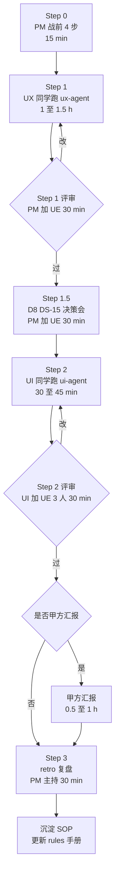

# PM 总指挥手册 · DS-25 软科学成果展示 智能体编排试点
> ⚠️ **后续编辑注解（2026-06-18，v2 重组）**：本文产出时引用的 UI 规范为 `AI可复用UI框架与设计规范.md`，**2026-06-18 已全量重组为 `agent-delivery/Design.md`**（Figma 风格稿落地版，14 节）。本文档**保留原引用以示事实历史**；下游 agent 接力时请按下表换算：
>
> | 本文中的旧引用 | 现行 `Design.md` 引用 |
> |---|---|
> | `AI可复用UI框架与设计规范.md` | `Design.md` |
> | §3 产品定位 / §4 信息架构 | §1 设计定位 + §3 页面骨架（六骨架 + 三段工作区） |
> | §5 技术框架 / §10 Arco 接入 | §0 给 AI 的执行指令（强制 Arco React + 主色 `#165DFF`）+ §13 推荐实现映射 |
> | §7 设计 Token | §4 色彩 + §5 字体 + §6 圆角描边阴影 + §13 主题 token |
> | §7.3 `.content-shell-glass` | §3.1 `.content-shell`（**取消毛玻璃强效果**） |
> | §7.3 / §7.4 图表分类色 chart-01~20 | §4.3 图表序列优先顺序（直接色值） |
> | §7.3.3 / §7.4.3 11 类业务对象 | §4.3 科技要素与图表色（**10 类，"资讯" 已取消**） |
> | §9 17 个通用组件（PageShell / GlobalWorkbenchTabs 等） | §7 通用组件 8 + §8 工作区 3（Figma 风格 class：`app-shell` / `content-shell` / `workspace-grid` / `layer-panel` / `map-stage` / `analysis-panel`） |
> | §9.3 / §9.4 Tab 分级 | §7.3 Tabs（**分级取消**） |
> | §18 验收 18 条 | §14 检查 8 + 验收 6 = 14 条（含截图取样定量验收） |
>
> 详见 `agent-delivery/architecture-baseline.md §8` v2.0 变更记录。

> **本文档读者**：项目总体负责人（你）
> **作用**：作为 PM 在本次试点中的**操作总图**，把"派单 / 评审 / 决策 / retro"全流程节奏装到一页里
> **强制要求**：每完成一个 Checkpoint 就回本文档勾一下；retro 时回填实际数据
> **创建时间**：2026-06-17
> **试点编号**：PILOT-DS-25-001（第 1 次完整试点）

---

## 0. 30 秒读懂本次试点

| 项 | 内容 |
|----|------|
| **试点目标** | 用智能体编排端到端走通一个二级功能，**发现现有手册/规约/D8 规范的不足** |
| **业务功能点** | DS-25 软科学成果展示（bid §1.1.1.1.4.6.1，7 个三级子功能） |
| **试点范围** | **只走 UX → UI demo2 沙箱**（与 DS-15 同模式），不动 lumen，不接真实 API |
| **总耗时（估算）** | 4–6 小时跨 1–2 天（UX 1.5h + 评审 0.5h + UI 1h + 评审 0.5h + 决策会 0.5h + retro 0.5h） |
| **参与人** | PM ｜ UX 同学 ｜ UE lead ｜ UI 同学；其他角色 retro 时旁听 |
| **关键文档** | 5 份（见 §1） |
| **风险点** | 第 1 次试点，话术 / 规范 / agent 行为都可能有意外，**心态：发现问题就是收益** |

---

## 1. 你手上有哪些文件（5 份）

| # | 文件 | 给谁用 | 何时用 |
|---|------|--------|--------|
| 1 | `PILOT-DS-25-PM-handbook.md`（本文） | **你（PM）** | 全程对照 |
| 2 | `PILOT-DS-25-UX-guide.md` | UX 同学 | Step 1 启动时发 |
| 3 | `UX-DS-25-trial-dispatch.md` | UX 同学（实际派单话术） | UX 同学 Step 1 复制到 Cursor |
| 4 | `PILOT-DS-25-UE-review-guide.md` | UE lead | Step 1/2 评审时发 |
| 5 | `PILOT-DS-25-UI-standby.md` | UI 同学 | 试点启动时发（待命用） |
| 6 | `D8-DS-15-retrofit-decision.md` | **你 + UE lead** | UX 完成后开决策会用 |
| 7 | `PILOT-DS-25-client-fallback-script.md` | **你（PM）** | 甲方汇报时备用 |
| 8 | **`data/DS-25-data-availability-matrix.md`** ⭐ 新增 | **你（PM）+ UX/UI 同学 + UE** | 评审字段表"来源"列时随时翻；含 7 个 PM 待确认开放项 |

> UI 同学的**正式派单话术** `UI-DS-25-trial-dispatch.md` 等 UX 试点跑完后，由 AI 协助你（PM）根据 UX 实际产出生成 —— 这是有意为之，让 UI 的话术能吸收 UX 反馈。

### 1.1 🆕 数据真源已就位（2026-06-17 PM 决策）

| 资料 | 路径 | 影响 |
|------|------|------|
| 甲方贴源数据 ODS 清单 | `agent-delivery/data/ODS源数据表结构清单(v2).md` | 186 张表 / 2253 字段 / 2026-06-02 |
| 要素库精确 DDL | `agent-delivery/data/要素库建表语句.sql` | 4229 行 SQL |
| 政策/企业字段映射示范 | `agent-delivery/data/*-ODS到DWD字段映射分析报告(v2).md` | 同类格式参考 |
| **DS-25 字段映射作弊纸** | `agent-delivery/data/DS-25-data-availability-matrix.md` | **本试点核心新增产物**：bid 字段 ↔ ODS 真实表精确映射 |

**结论**：**DS-25 不再是纯 Mock 试点**，主流程 80% 字段可基于真实 ODS 表设计，UI 阶段 mock JSON 字段名严格沿用 ODS，未来切真实数据前端代码零改动。**这是与 DS-15 试点的本质区别**，retro 时要重点记录这部分价值。

**PM 在 Step 0 战前要做的额外 2 件事**：
1. **整理"甲方确认清单"**：`DS-25-data-availability-matrix.md` §6.1 的 7 项**都是甲方口径决策**（"软科学"过滤范围、"难题攻关历程"业务语义、市/区级地图精度等），**团队定不了**。PM 的工作不是和数据 Lead 拍板，而是：
   - ✅ 列入下次甲方对接会议议程（提前 3 工作日发议程）
   - ✅ 按表中"团队临时默认值"先让 UX/UI agent 跑（**不阻塞试点**）
   - ✅ 在 UX/UI 产出的界面对应位置加 ⚠️ "待甲方确认" 标签
   - ✅ 甲方确认后才正式 bump `cfg_metric` 版本
2. 在 Step 1 评审时**抽 3 个字段**核查 UX 产出的"来源"列是否引用真实 ODS 字段（如 `dwd_zh_project.title` 而非"明细"/"接口"）—— 这是 UE 评审清单 §字段表 + 数据血缘 的 4 个"🆕"项

> **重要**：本团队遵循公约 §3.1 —— **决策不外包给 AI**，与甲方承诺也不能由 PM/UE/数据 Lead 替甲方拍板，**只能临时默认 + 标"待确认" + 等甲方书面/纪要确认**。

---

## 2. 试点总流程图



---

## 3. 时间表建议（按 1 个工作日跑完）

| 时间段 | 谁 | 做什么 | 你（PM）做什么 |
|--------|----|-------|---------------|
| Day1 09:00–09:15 | PM | Step 0：发 4 份消息（见 §4） | **现在** |
| Day1 09:15–10:45 | UX 同学 | Step 1：跑 ux-agent 写 IA/wireframe | 别打扰；10:00 瞄一眼是否有红色异常 |
| Day1 10:45–11:15 | PM + UE | Step 1 评审 + 决策会预备 | 主持 |
| Day1 11:15–11:45 | PM + UE | Step 1.5 D8/DS-15 回补决策会 | 主持，填 D8-DS-15-retrofit-decision.md |
| Day1 14:00–14:50 | UI 同学 | Step 2：跑 ui-agent 出 demo2 沙箱页 | 别打扰；14:30 瞄一眼构建是否绿 |
| Day1 14:50–15:20 | UI/UE 3 人 | Step 2 评审 | 主持；可邀 UX 同学旁听 |
| Day1 15:30–16:30 | PM + UE | （可选）试投甲方汇报 | 主导 |
| Day1 16:30–17:00 | PM 主持 | Step 3 retro | 全员旁听 |

> **如果跨 2 天**：Step 1/1.5 在 Day1 完成，Step 2/3 在 Day2；避免疲劳决策。

---

## 4. Step 0：现在立即做的 4 件事（15 分钟）

### 4.1 发消息 #1 给 UX 同学（5 min）

把 **`PILOT-DS-25-UX-guide.md`** 全文 + 试点目标一段话发给 UX 同学：

```
@UX 同学：
本周智能体编排试点 Step 1 派给你，目标是端到端走通 DS-25 软科学成果展示（bid §1.1.1.1.4.6.1）。

操作请严格按这份指南做：
- 路径：E:\gkx_src\agent-delivery\agent-handoffs\PILOT-DS-25-UX-guide.md
- 这是第 1 次试点，遇到任何看不懂的字都立即问我，别自己猜
- 预计耗时 1.5h，建议上午一口气跑完

跑完后请回我一句"UX 跑完了"+ handoff 文件链接，我们 30 min 联审。
```

### 4.2 发消息 #2 给 UE lead（3 min）

```
@UE lead：
今天 DS-25 软科学成果展示智能体编排试点启动。

请你预留 3 个时段：
1. UX 完成后 30 min：Step 1 IA/wireframe 评审（PM + UE）
2. 紧接着 30 min：D8 规范对 DS-15 历史试点是否回补的决策会
3. UI 完成后 30 min：Step 2 沙箱页评审（UI / UE / 你 3 人）

评审手册：E:\gkx_src\agent-delivery\agent-handoffs\PILOT-DS-25-UE-review-guide.md（5 min 读完）

预计你的总投入：1.5 h 跨 1 天。
```

### 4.3 发消息 #3 给 UI 同学（2 min）

```
@UI 同学：
你是本次试点 Step 2 的执行人。**先别开 Cursor agent 会话**，等 UX 完成 + PM 评审通过后我会发派单话术给你。

待命期间请按这份指南做准备工作：
- 路径：E:\gkx_src\agent-delivery\agent-handoffs\PILOT-DS-25-UI-standby.md

预计你的总投入：待命 30 min（读规范）+ 执行 45 min + 评审 30 min。
```

### 4.4 你自己做的事（5 min）

- [ ] 打开本文档（PM-handbook），固定在 Cursor 一个独立窗口便于全程对照
- [ ] 把日历预留：Day1 10:45–12:00（评审 + 决策会）、Day1 14:50–15:20（UI 评审）、Day1 16:30–17:00（retro）
- [ ] **不要**自己去预读 ux-agent 会跑出什么 —— 让试点真实暴露问题

---

## 5. Step 1：UX 跑 ux-agent（你做的事）

### 5.1 等 UX 同学开始后

| 时间 | 你做什么 |
|------|---------|
| UX 启动 +5 min | 看群里 UX 是否说"已粘贴话术开跑"。如果没动静，问一句 |
| UX 启动 +15 min | **不要打扰** UX 同学。可去做别的事 |
| UX 启动 +20 min | （可选）让 UX 远程截图 Cursor 会话最新一屏，**只看：路径是否对（demo2/docs/ia/sandbox/soft-science-2026-06-17/）、章节号是否对（§1.1.1.1.4.6.1）**。其他不评 |
| UX 启动 +60 min | 还没跑完？联系 UX 问一下进度 |
| UX 启动 +90 min | 还没跑完？让 UX **立即中断** agent 会话，把当前进度写到 handoff，作为试点反馈"超时"项 |

### 5.2 UX 完成的信号

UX 同学应该给你这些东西：

```
✅ "UX 跑完了"
✅ handoff 链接：agent-delivery/agent-handoffs/软科学成果展示-DS25/UX-DS-25-trial.md
✅ 6 项总结（话术 DoD 要求 agent 必给）：
   - 4 份产物绝对路径
   - commit hash + 改动行数
   - §18 18 条对照表摘要
   - 5 条最重要待评审开放项
   - 试点反馈中的 3 条改进建议
   - 给 ui-agent 的接力建议 ≥3 条
```

**如果有任何一项缺失** → 让 UX 让 agent 补写后再来，不要在不完整状态下评审。

### 5.3 Step 1 评审 30 min 节奏

> **位置**：可线下或飞书 / 腾讯会议
> **参与**：PM + UE lead；UX 同学远程随叫随到答疑（不用全程在线）

| 时段 | 内容 | 关键动作 |
|------|------|---------|
| 0–5 min | 看 4 份产物在不在、路径对不对 | 打开 `demo2/docs/ia/sandbox/soft-science-2026-06-17/` |
| 5–10 min | 7 个子功能全覆盖检查 | DS-25-IA.md 是否每个子功能都映射到 P-XX 页面 |
| 10–20 min | **§4.2 / §9 / §18 三大 D8 硬约束**逐项过 | 用 §6 评审清单逐项打勾 |
| 20–25 min | 开放项 ≥10 条 + 试点反馈 8 条 | 检查质量与可执行性 |
| 25–30 min | 出结论：✅ 过 / 🔧 小改 / ❌ 大改 | 见 §5.4 |

### 5.4 评审结论与下一步

| 结论 | 标准 | 你做什么 |
|------|------|---------|
| ✅ **过** | 7 子功能全覆盖；§9 组件 ≥8 用对；§4.2 每页都有；§18 自检 8 条；开放项 ≥10；试点反馈 8 条 | 立即开 Step 1.5 决策会 |
| 🔧 **小改**（< 1h 可修复） | 缺 1–2 项；命名个别地方还是口语化；§18 自检漏几条 | 让 UX **在同一 Cursor 会话**接续修，别开新会话，保留上下文 |
| ❌ **大改**（结构性问题） | 范围越界 / 主要 D8 条款全缺失 / 文档体量明显不足 | 让 UX 先停，PM 与 UE 一起在评审会上写"返工指令"，再让 UX 在原会话拿指令继续 |

---

## 6. Step 1 评审清单（30 min 打勾用）

> **使用方法**：评审会上 PM 念出每条，UE lead 看屏幕，达成共识后 PM 在本文打勾。

### 6.1 产物完整性

- [ ] `demo2/docs/ia/sandbox/soft-science-2026-06-17/` 目录存在
- [ ] 目录下 4 份 md：README / DS-25-IA / DS-25-userflow / DS-25-wireframe
- [ ] git log 看到 commit hash，commit message 含 `[sandbox]` 和 `[agent:ux-agent]`
- [ ] **已 push 到 demo2 origin/main**（`git status` 显示 `up to date with 'origin/main'`）
- [ ] GitLab 上能看到这个 commit（远端同步成功）

### 6.2 范围合规

- [ ] 7 个子功能全覆盖（§1.1.1.1.4.6.1.1–7）
- [ ] **未越界**到 §1.1.1.1.4.6.2~6（科技创新生态展示等同章节其他模块）
- [ ] 字段表使用 5 列结构（名称/类型/来源/必填/示例）
- [ ] 来源列引用 bid 章节号或"待 algorithm-agent 定义"

### 6.3 D8 规范硬约束（重点）

- [ ] **§3 产品定位**：是分析工作台风格，不是门户/营销页/大屏霓虹
- [ ] **§4.2 5 段优先级**：每个页面都有"关注什么/为什么/重点对象/趋势异常/下钻明细"5 段
- [ ] **§9 通用组件命名**：至少 8 个标准名（PageShell/SectionPanel/MetricCard/ChartPanel/MapPanel/DetailDrawer/SearchableCascadeFilter/FilterBar/DataTable/EvidenceList 等）；**未沿用 DS-15 口语命名**
- [ ] **§18 18 条对照表**：UX 自检 8 条（结论前置 / 浅色蓝灰 / 信息主次 / 复杂筛选搜索重置确认 / 通用 vs 业务组件拆分 / 文案克制 / 状态完整 / 适合截图汇报）+ ui-agent 待办 10 条（圆角 / 配色 / Arco / ECharts / 方向色 / 状态色 / 等）

### 6.4 文档质量

- [ ] mermaid 站点地图语法正确（能渲染）
- [ ] mermaid 用户流主路径 + ≥3 条异常路径
- [ ] 待评审开放项 ≥10 条，按"决策项/建议默认值/影响"3 列结构化
- [ ] 文案克制：**没有**"智能赋能 / 一站式 / 全方位 / 赋能XX"等空话

### 6.5 试点反馈（最重要）

- [ ] handoff §11【DS-15 回看清单】≥3 项具体差距
- [ ] handoff §试点反馈 1–8 条都填了
- [ ] 给 PM 的 3 条改进建议**具体可操作**（不是"再加强一下"这种空话）

### 6.6 成本回填

- [ ] handoff 中填了 4 个成本字段（estimated_tokens / actual_tokens / model_used / actual_cost / cost_warn）
- [ ] actual_cost ≤ \$5（green）；> \$10 黄牌需要复盘；> \$20 红牌 hard stop

---

## 7. Step 1.5：D8/DS-15 回补决策会（30 min）

### 7.1 触发条件

Step 1 评审通过后立即开（**与 UI 启动并行**，不阻塞）。

### 7.2 主持流程

| 时段 | 内容 |
|------|------|
| 0–5 min | UX 同学口述 §11 DS-15 回看清单 3–5 项要点（电话/微信即可，UX 不用全程在线） |
| 5–15 min | PM + UE 打开 `D8-DS-15-retrofit-decision.md`，逐项填 §1 差距清单 + §2 决策矩阵 |
| 15–20 min | 三选一总体决策：A 全回补 / B 部分回补 / C 标记历史遗留 |
| 20–25 min | 填 §4 最终决策 YAML + action_items + ETA |
| 25–30 min | 关联到 task-registry / 编排手册 / rules（§5） |

### 7.3 决策建议

| 红项数 | 建议 |
|--------|------|
| 红项 0 + 黄项 0 | C 标记历史遗留（5 min 加横幅） |
| 红项 0 + 黄项 1–4 | C 或 B（看 UE 偏好） |
| 红项 1–2 | B 部分回补（仅文档层） |
| 红项 ≥3 | A 全回补（含沙箱页局部刷新） |

> **预判**：DS-15 是 D8 同日上午产物，**最可能落 B 或 C**。如果选 A，要警惕"完美主义陷阱"。

---

## 8. Step 2：UI 跑 ui-agent

### 8.1 准备 UI 派单话术

Step 1.5 决策会完成后，PM 回到本对话告诉 AI（我）："UX 评审通过，决策选 X"，AI 会立即生成 `UI-DS-25-trial-dispatch.md`，包含：
- 基于 UX 实际产出的 7 个页面落地路径
- 沿用或修正 DS-15 沙箱页代码片段（取决于决策 A/B/C）
- §18 全 18 条硬约束
- §10 Arco 控件映射（来自 UX handoff 的接力建议）

### 8.2 发消息给 UI 同学

```
@UI 同学：UX 已完成评审通过。请打开 PILOT-DS-25-UI-standby.md 的"启动信号"一节，按那里的步骤操作。

派单话术：E:\gkx_src\agent-delivery\agent-handoffs\UI-DS-25-trial-dispatch.md
```

### 8.3 UI 跑的时候你做什么

类似 §5.1：每 15 min 远程瞄一眼，不打扰；超 60 min 介入。

### 8.4 UI 完成信号 + 评审

UI 完成时应给你：
- 沙箱入口 URL：`http://127.0.0.1:4176/sandbox/soft-science-2026-06-17`
- 7 个页面 URL
- commit hash + 改动统计
- `npm run dev` / `npm run build` 是否绿
- handoff：`agent-delivery/agent-handoffs/软科学成果展示-DS25/UI-DS-25-trial.md`

### 8.5 Step 2 评审清单（30 min）

> **参与**：UI / UE / PM 3 人

#### 8.5.1 可演示性

- [ ] `npm run dev` 在 UI 同学本地启动正常
- [ ] 沙箱入口 `/sandbox/soft-science-2026-06-17` 可访问
- [ ] 7 个页面**全部能打开**，无白屏、无 console error
- [ ] `npm run build` 构建通过

#### 8.5.2 §18 18 条对照（重点）

> UI 必须给 18 条全绿表；UE 现场抽查 5 条：

- [ ] 圆角统一 8px（卡片 / 图表容器）
- [ ] 浅色蓝灰风格，**无深色霓虹**
- [ ] 通用控件用 Arco Design（无 AntD 混搭）
- [ ] 图表用 ECharts（如有图）
- [ ] 方向性指标：上升红 / 下降绿（如有 KPI 卡）

#### 8.5.3 数据真实性

- [ ] mock 数据贴近真实软科学课题（不是 lorem ipsum）
- [ ] 至少 30 条样例数据
- [ ] 字段量级 / 枚举值符合常识（课题立项年度合理 / 单位真实存在）

#### 8.5.4 隔离铁律

- [ ] 主菜单 0 改动
- [ ] `pageRouting.js` 未改
- [ ] `package.json` 未改（没引入新 npm 依赖）
- [ ] `lumen` 任何仓未动

### 8.6 评审结论

| 结论 | 下一步 |
|------|--------|
| ✅ 过 | 决定是否甲方汇报（§9）；进 retro |
| 🔧 小改 | UI 同学在同一会话改 |
| ❌ 大改 | 写返工指令 |

---

## 9. （可选）甲方汇报（30 min–1 h）

### 9.1 触发条件

UI 评审通过 + UE lead 与 PM 一致认为"可向甲方展示"。

### 9.2 前置准备

- [ ] 确认 UI 同学已 push（应该在 Step 2 完成时已自动 push）；https://skxrules.unicomcn.tech:30999/sandbox/soft-science-2026-06-17 可访问
- [ ] PM + UE 内部预演 10 min
- [ ] 准备 2 页 PPT 或纯口头：试点目的 + 7 个子功能演示 + 开放项征询甲方意见

### 9.3 汇报中你做什么

- 主讲：PM
- 操作浏览器演示：UE 或 UI
- **重点**：让甲方看到"按你们的需求 MD 自动生成的 UX 原型"，而不是讨好甲方的最终视觉
- **关键风险**：甲方可能误以为这是最终版 → 反复强调"原型 / 待评审版"

### 9.4 汇报后

- 收集甲方意见到 `agent-handoffs/软科学成果展示-DS25/CLIENT-FEEDBACK-DS-25.md`（自建）
- 不立即改沙箱页，等 retro 一起处理

---

## 10. Step 3：retro 复盘（30 min）

### 10.1 参与

PM 主持；UX / UI / UE 全员；架构师 + 集成 + 文档同学旁听（建议视频会议方便后续看回放）。

### 10.2 流程

| 时段 | 内容 |
|------|------|
| 0–5 min | PM 回顾试点全流程数据：实际耗时 vs 估算 / token 成本 / 评审打回次数 |
| 5–15 min | 每人 2 分钟讲：你做的事 + 1 个"做得好的" + 1 个"想改的" |
| 15–25 min | 整理 **3 类不足**：①话术 / ②规范 / ③编排手册（按优先级排序） |
| 25–30 min | 每类不足分配 1 个 owner + ETA（≤1 周） |

### 10.3 retro 产出

写到 `agent-handoffs/软科学成果展示-DS25/RETRO-PILOT-DS-25.md`（自建），按以下结构：

```yaml
pilot_id: PILOT-DS-25-001
date: 2026-XX-XX
duration_actual: Xh Xm
duration_estimated: 5h
token_cost: $X
participants: [PM, UX, UI, UE]

successes:
  - ...

issues:
  - category: 话术  # 或 规范 / 手册
    description: ...
    severity: high / mid / low
    owner: ...
    eta: ...
    fix_action: ...

next_pilot:
  candidate: DS-XX（待选）
  estimated_kickoff: ...
```

### 10.4 retro 后落地

- [ ] 按 owner 把 fix_action 写成 task 到 task-registry（如有代码改动）
- [ ] 改 `.cursor/rules/{role}.mdc`（如规范类不足）
- [ ] 改 `agent-delivery/智能体编排与派单手册.md`（如手册类不足）
- [ ] 改 `agent-delivery/AI可复用UI框架与设计规范.md`（如 D8 规范类不足，需 architect-agent 评审）

---

## 11. 异常处置手册

### 11.1 agent 跑歪了

**症状**：UX/UI 同学说"agent 在改我没让它改的文件了"或"它生成的内容跟 bid 不符"

**处置**：
1. 立即让同学**在 Cursor 会话内按 Esc 中断 agent**
2. 在同一会话发一句修正指令：`暂停。请只在 demo2/docs/ia/sandbox/soft-science-2026-06-17/ 内工作，不要碰其他文件。重新读 bid §1.1.1.1.4.6.1，然后继续。`
3. 让同学盯到下一个产物落盘，确认走回正轨
4. 记入试点反馈"agent 跑偏" 条

**预防**：每 15 min 远程瞄一眼 1 次（团队公约 §7 反模式）

### 11.2 token 烧光 / 单任务超 \$10

**症状**：Cursor 显示余额告警 / handoff 中 cost_warn = orange/red

**处置**：
1. **不要继续**。让同学保存当前进度
2. 看进度：是 70% 完成还是 30% 完成？
3. 70%+ → 让 agent 用更简短的指令收尾（"用 50 字以内总结剩余 3 个页面要点，然后写 handoff"）
4. 30%- → 整个会话作废，retro 时分析 prompt 哪里写得让 agent 跑太久
5. > \$20 → hard stop + architect-agent 评审是否要拆分（团队公约 §3.7）

### 11.3 同学跑到一半卡住问你问题

**症状**：UX 在群里问 "agent 让我决定 X，我不知道怎么选"

**处置**：
1. **绝大多数情况，让 agent 自己按"建议默认值"决定 + 标"待评审"**，不打断
2. 仅在涉及"范围扩大 / 删除功能点 / 与甲方承诺"3 类问题时，你才该介入
3. 介入回答**用一句话**，别开长会

**预防**：派单话术里已写"不要反复问；遇歧义按最佳实践默认 + 标待评审"。再次提醒同学

### 11.4 commit 失败 / git 错乱

**症状**：UX/UI 说 "git commit 报错 / push 不动 / 多了奇怪文件"

**处置**：
1. 先让同学 `git status` 截图发你
2. 多了文件 → `git reset HEAD <file>` + `git checkout <file>`
3. commit 错 → **未 push** 的 commit 可以 `git commit --amend`；**已 push** 则必须新 commit fix，**禁止 amend + force push**（团队公约 §6 git 安全协议）
4. push 报错（如 reject）→ 先 `git pull --rebase` 同步远端，再 push；冲突找 DevOps
5. 实在搞不定，让同学**先停手别再 git 操作**，把目录文件备份到桌面，PM 找 DevOps 同学线下协助
6. 记入试点反馈"git 流程"条

### 11.5 评审打回，但 UX/UI 同学不服

**症状**：评审说"§4.2 缺了"，UX 同学说"我觉得这个页面不需要"

**处置**：
1. 听他/她讲 1 分钟
2. 如果是规范理解差异 → 当面打开 D8 规范 MD 对照原文
3. 如果是规范本身有歧义 → **不强逼**，记入"D8 规范模糊点"列表，retro 时一起评估是否改规范
4. 如果是 agent 跟人意见不一 → 永远以人为准，让同学手改

**心法**：试点期间**允许"规范<人的判断"**，但要把不一致显式记录下来。等 retro 整理后再决定改人还是改规范。

---

## 12. 联系矩阵（谁找谁）

| 找谁 | 什么时候 | 联系方式 |
|------|---------|---------|
| UX 同学 ↔ PM | 跑 agent 时遇到"范围 / 决策"类问题（不是技术问题） | 即时（群 / 微信） |
| UI 同学 ↔ PM | 同上 | 即时 |
| 任何同学 ↔ DevOps 同学 | git / Cursor 配置 / 网络问题 | 群内呼 DevOps |
| PM ↔ UE lead | 评审 / 决策会 | 提前 1 h 约 |
| PM ↔ architect | 涉及架构铁律 / 方案 A / 跨服务边界 | 单独约 |
| PM ↔ 全员 | retro | Day1 16:30 全员日历 |

---

## 13. 关键路径速查

```yaml
工作区根: E:\gkx_src
派单与文档: E:\gkx_src\agent-delivery
handoff 目录: E:\gkx_src\agent-delivery\agent-handoffs
demo2 仓: E:\gkx_src\demo2
demo2 沙箱目标: E:\gkx_src\demo2\docs\ia\sandbox\soft-science-2026-06-17  (UX)
demo2 沙箱页目标: E:\gkx_src\demo2\src\pages\sandbox\soft-science-2026-06-17  (UI)
范围真源 MD: E:\gkx_src\agent-delivery\bid-reference\科技信息展示系统和科技专题服务系统.md  (§1.1.1.1.4.6.1, 行 3231-3401)
D8 设计规范: E:\gkx_src\agent-delivery\AI可复用UI框架与设计规范.md
DS-15 参考: E:\gkx_src\demo2\docs\ia\sandbox\talent-2026-06-17  (D8 之前产物，仅参考形)
demo2 演示部署: https://skxrules.unicomcn.tech:30999  (允许 UX/UI 直接 push 到 main 触发自动部署)
demo2 本地 dev: http://127.0.0.1:4176
```

---

## 14. PM 心态护栏

> **试点 ≠ 完美交付**。本次试点真正的产出是"经验"，不是"DS-25 沙箱页"。

3 句话装心里：

1. **发现问题就是收益**：UX/UI 跑偏、agent 卡壳、规范模糊、评审吵架——**全部记下来**，每一项都是下次试点提速 10 倍的本金
2. **不在试点中改流程**：试点中遇到问题，**只记录、不改手册**。retro 后再批量改，避免边跑边变规则
3. **预算 10% 失败**：如果 100% 顺利，那要么试点设计太保守（没真正暴露问题），要么团队在表演给你看（更糟）

---

## 15. 本文档进度勾选区

> **PM 实时勾选**，retro 时直接当原始记录。

### Step 0 战前准备

- [ ] 已读完本手册
- [ ] 已发消息给 UX 同学
- [ ] 已发消息给 UE lead
- [ ] 已发消息给 UI 同学
- [ ] 日历已预留时段

### Step 1 UX 阶段

- [ ] UX 同学已确认开跑
- [ ] (启动 +20 min) 远程瞄目录正确
- [ ] UX 同学已回报"跑完了"
- [ ] handoff `UX-DS-25-trial.md` 已存在

### Step 1 评审

- [ ] 评审会已开（30 min）
- [ ] §6 评审清单全打勾
- [ ] 结论：✅ 过 / 🔧 小改 / ❌ 大改 → **填**: ____

### Step 1.5 决策会

- [ ] `D8-DS-15-retrofit-decision.md` §1 差距清单已填
- [ ] §2 决策矩阵已填
- [ ] §3 总体决策已选：A / B / C → **填**: ____
- [ ] §4 action_items 已分配 owner + ETA

### Step 2 UI 阶段

- [ ] AI 已生成 `UI-DS-25-trial-dispatch.md`
- [ ] UI 同学已开跑
- [ ] UI 同学已回报"跑完了"
- [ ] handoff `UI-DS-25-trial.md` 已存在

### Step 2 评审

- [ ] UI/UE/PM 3 人评审已开
- [ ] §8.5 评审清单全打勾
- [ ] 结论：✅ 过 / 🔧 小改 / ❌ 大改 → **填**: ____

### Step 3 retro

- [ ] retro 会已开（30 min）
- [ ] `RETRO-PILOT-DS-25.md` 已落盘
- [ ] 不足项 owner + ETA 已分配
- [ ] 下次试点候选已选

---

**祝跑通顺利。每个 Checkpoint 完成后回本文档勾一下，retro 会议时一目了然。**