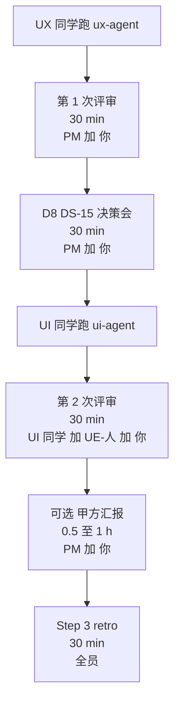

# UE lead 评审手册 · DS-25 软科学成果展示 智能体编排试点
> ⚠️ **后续编辑注解（2026-06-18，v2 重组）**：本文产出时引用的 UI 规范为 `AI可复用UI框架与设计规范.md`，**2026-06-18 已全量重组为 `agent-delivery/Design.md`**（Figma 风格稿落地版，14 节）。本文档**保留原引用以示事实历史**；下游 agent 接力时请按下表换算：
>
> | 本文中的旧引用 | 现行 `Design.md` 引用 |
> |---|---|
> | `AI可复用UI框架与设计规范.md` | `Design.md` |
> | §3 产品定位 / §4 信息架构 | §1 设计定位 + §3 页面骨架（六骨架 + 三段工作区） |
> | §5 技术框架 / §10 Arco 接入 | §0 给 AI 的执行指令（强制 Arco React + 主色 `#165DFF`）+ §13 推荐实现映射 |
> | §7 设计 Token | §4 色彩 + §5 字体 + §6 圆角描边阴影 + §13 主题 token |
> | §7.3 `.content-shell-glass` | §3.1 `.content-shell`（**取消毛玻璃强效果**） |
> | §7.3 / §7.4 图表分类色 chart-01~20 | §4.3 图表序列优先顺序（直接色值） |
> | §7.3.3 / §7.4.3 11 类业务对象 | §4.3 科技要素与图表色（**10 类，"资讯" 已取消**） |
> | §9 17 个通用组件（PageShell / GlobalWorkbenchTabs 等） | §7 通用组件 8 + §8 工作区 3（Figma 风格 class：`app-shell` / `content-shell` / `workspace-grid` / `layer-panel` / `map-stage` / `analysis-panel`） |
> | §9.3 / §9.4 Tab 分级 | §7.3 Tabs（**分级取消**） |
> | §18 验收 18 条 | §14 检查 8 + 验收 6 = 14 条（含截图取样定量验收） |
>
> 详见 `agent-delivery/architecture-baseline.md §8` v2.0 变更记录。

> **本文档读者**：UE lead（你）
> **作用**：本次试点中你需要参与的 3 个评审，每个都给出明确节奏 + 检查清单
> **预计你总投入**：1.5–2 h 跨 1 天（含 3 次评审 + 1 次决策会）
> **总指挥**：PM
> **创建**：2026-06-17

---

## 0. 你在本次试点中的位置



| 时间点 | 谁参与 | 时长 | 你的角色 |
|--------|--------|------|---------|
| 第 1 次评审（Step 1） | PM + 你 | 30 min | **UX 专业评审主理人** |
| D8/DS-15 决策会 | PM + 你 | 30 min | **决策共审人** |
| 第 2 次评审（Step 2） | UI + UE-人 + 你 | 30 min | **UI 专业评审主理人** |
| 甲方汇报（可选） | PM + 你 | 0.5–1 h | **专业兜底 + 演示支持** |
| retro | 全员 | 30 min | **沉淀反思的关键发言人** |

---

## 1. 试点背景速读（5 min）

| 项 | 内容 |
|----|------|
| 试点目标 | 端到端走通智能体编排，**发现现有手册和规范的不足** |
| 功能点 | DS-25 软科学成果展示（bid §1.1.1.1.4.6.1，7 个三级子功能） |
| 试点产物 | UX → IA + wireframe（4 份 md） + UI → demo2 沙箱页 |
| 关键规范 | `AI可复用UI框架与设计规范.md`（D8 决策，2026-06-17）+ `data-lineage-policy.md`（数据血缘新规约） |
| 历史对照 | DS-15 试点（talent-2026-06-17）是 D8 之前产物，**仅参考形不参考质** |
| 不动 lumen | 试点全部在 demo2 沙箱目录 `soft-science-2026-06-17/` 隔离 |

### 必读前置文档（评审前各 10 min）

| # | 文档 | 用途 | 关键章节 |
|---|------|------|---------|
| 1 | `agent-delivery/AI可复用UI框架与设计规范.md` | 评审 D8 合规 | §3 §4.2 §9 §18 |
| 2 | `agent-delivery/data-lineage-policy.md` | 数据血缘要求 | §2 §3 §5 §7 |
| 3 | `agent-delivery/data/DS-25-data-availability-matrix.md` | **DS-25 字段 ↔ ODS 真实表映射表**（评审字段表"来源"列是否引用真实 ODS 字段的核心依据） | 全文 / 评审字段表时对照 §2 |
| 4 | `agent-delivery/bid-reference/科技信息展示系统和科技专题服务系统.md` 行 3231–3401 | 范围真源 | §1.1.1.1.4.6.1 全部 |
| 5 | `agent-delivery/agent-handoffs/软科学成果展示-DS25/UX-DS-25-trial-dispatch.md` | 知道 UX 是带着什么约束跑的 | 必读 + DoD |
| 6 | `agent-delivery/agent-handoffs/软科学成果展示-DS25/PILOT-DS-25-PM-handbook.md` §6 §8.5 | PM 评审清单（与你联审用） | §6 + §8.5 |

---

## 2. 第 1 次评审：UX 产出（30 min）

### 2.1 触发

PM 收到 UX 同学"跑完了"的消息 + handoff 链接 → 立即拉你 30 min 会。

### 2.2 评审地点

- 优先线下，便于翻屏幕
- 远程：开飞书 / 腾讯会议，UX 同学**远程随叫随到**（不全程在线）

### 2.3 评审产物清单

打开这 4 份 md（在 `E:\gkx_src\demo2\docs\ia\sandbox\soft-science-2026-06-17\`）：

- `README.md`
- `DS-25-IA.md`
- `DS-25-userflow.md`
- `DS-25-wireframe.md`

+ handoff：`agent-delivery/agent-handoffs/软科学成果展示-DS25/UX-DS-25-trial.md`

### 2.4 30 min 评审节奏

| 时段 | 内容 | 主导 |
|------|------|------|
| 0–3 min | UX 同学口述要点（远程电话即可）：覆盖几个子功能 / 用了哪些 §9 组件 / 几个开放项 | UX 同学 |
| 3–10 min | 看 DS-25-IA.md：信息架构 + 5 段优先级 + 7 子功能覆盖 | 你（UE） |
| 10–18 min | 看 DS-25-wireframe.md：§9 组件命名 / 字段表 6 列 / metric_id 完整性 | 你（UE） |
| 18–22 min | 看 DS-25-userflow.md：主路径 + 异常路径合理性 | 你（UE） |
| 22–27 min | 看 handoff §11 数据血缘 / §12 DS-15 回看 / §13 试点反馈 | PM + 你 |
| 27–30 min | 出结论：✅过 / 🔧小改 / ❌大改 | PM 拍板 |

### 2.5 UE 评审清单（你必须打勾的项）

#### 信息架构（§4 / §4.2）

- [ ] **5 段优先级**每页都有：当前应关注什么 / 为什么 / 重点对象 / 趋势异常 / 下钻明细
- [ ] 主可视化区在视觉重心位置（不偏侧栏）
- [ ] 筛选条件清晰，与主视觉联动逻辑明确
- [ ] 右侧研判 / 关键对象 / 关键路径 有位置或明确不需要的理由
- [ ] 明细表格 / 证据列表 作为下钻终点（不浮在上层）

#### 用户旅程

- [ ] **主路径**清晰且最短（点击不超过 3 次到达详情）
- [ ] **≥3 条异常路径**：无数据 / 权限不足 / 慢加载 / 错误等
- [ ] 跨页面切换有面包屑 + 上下文保留
- [ ] 关键操作（导出 / 订阅 / 分享）有反馈状态

#### §9 通用组件使用

- [ ] **至少 8 个**标准名被引用（PageShell / TopicSidebar / ContextBar / SectionPanel / MetricCard / DataCard / SearchableCascadeFilter / FilterBar / DetailDrawer / DataTable / ChartPanel / MapPanel / GraphCanvas / EvidenceList）
- [ ] **未沿用 DS-15 口语化命名**（"左栏 240px"、"主区"等）
- [ ] 业务组件（§9.2）有标注业务口径、数据联动、权限限制

#### 字段表 + 数据血缘（D8 + data-lineage-policy 联合）

- [ ] **每页字段表 6 列**：名称 / 类型 / 来源 / 必填 / 示例 / **metric_id**
- [ ] 每个**统计字段**有 metric_id（计数 / 求和 / 平均 / 比率 / 排名）
- [ ] metric_id 命名符合规则：`M_SS_{INDICATOR}_{PERIOD?}`
- [ ] 每页末尾有 `本页 metric_id 清单` 小节
- [ ] handoff §11 数据血缘汇总 ≥ 5 个 metric_id
- [ ] **🆕 来源列引用 ODS 真实字段**（明细字段写如 `dwd_zh_project.title`，**不是凭空的"明细"或"接口"**）—— 对照 `data/DS-25-data-availability-matrix.md` §2 抽 3 个字段抽查
- [ ] **🆕 metric_id 清单含 `source_tables` 列**（引用真实 ODS 表，如 `[dwd_zh_project]`）
- [ ] **🆕 需算法字段**清单已标 `🔧 待 algorithm-agent`，handoff §11 接力清单点名
- [ ] **🆕 用户态字段**（互动/评论/收藏）标 `❌ 用户态待自建`，不混入 metric_id 清单

#### §18 验收清单（UX 阶段相关 8 条）

- [ ] 是分析工作台风格（不是门户 / 营销）
- [ ] 先给结论再给支撑数据
- [ ] 服务领导驾驶舱 + 业务分析师
- [ ] 信息主次清晰
- [ ] 复杂筛选有搜索 / 重置 / 确认 / 已选摘要
- [ ] 组件已拆分通用 vs 业务
- [ ] 文案克制（无"智能赋能 / 一站式 / 全方位"）
- [ ] 状态完整（loading / empty / error）

> **不评 UX 阶段无法决定的 10 条**（圆角 / 配色 / Arco / ECharts / 方向色 等），UI 阶段评。

#### 范围合规

- [ ] 7 子功能全覆盖（§1.1.1.1.4.6.1.1–7）
- [ ] **未越界**到 §1.1.1.1.4.6.2~6（科技创新生态等同章节其他模块）
- [ ] handoff §11 DS-15 回看清单 ≥ 3 项具体差距
- [ ] handoff §试点反馈 8 条都填了

### 2.6 评审意见怎么写

打开 handoff `UX-DS-25-trial.md` 文件末尾，append 一节：

```markdown
## 第 1 次评审意见（UE lead + PM）

评审时间：2026-XX-XX HH:MM
评审人：UE lead {name} / PM {name}
结论：✅ 过 / 🔧 小改 / ❌ 大改

### 通过项
- ...

### 待改进项（小改）
- P-03 字段表缺 metric_id 列：xxx 字段没标
- §4.2 P-05 缺"趋势异常"段
- ...

### 重要发现（送 retro）
- ...
```

### 2.7 评审结论与下一步

| 结论 | 标准 | 下一步 |
|------|------|--------|
| ✅ **过** | 全部清单打勾 | 立即进 §3 D8/DS-15 决策会 |
| 🔧 **小改** | 缺 1–2 项 / 个别命名 / metric_id 漏几个 | UX **同会话**接续修，30 min 内完成；不开新会话 |
| ❌ **大改** | §4.2 全缺 / §9 命名全是口语 / 范围越界 | PM + 你写返工指令，UX 重跑 |

### 2.8 评审中可能遇到的争议

| 争议 | 你的处理 |
|------|---------|
| UX 同学："agent 没做 §4.2，但我觉得不需要" | **看 D8 规范原文**：§4.2 是必须做的；本试点是发现规范盲区的机会，记入"D8 规范模糊点"列表，retro 时一起评估 |
| UX 同学："agent 自创了组件名 XXX" | 必须改回 §9 标准名；记入"agent 越界" |
| PM："这一项规范要求太严，我们改一下" | **试点中不改规范**（团队公约 §6 铁律之一），retro 时再评估 |
| 你与 PM 不同结论 | UE 主张 UX 专业；PM 主张范围合规。两者冲突时倾向**严格执行规范**，记录分歧到 retro |

---

## 3. D8/DS-15 回补决策会（30 min）

### 3.1 触发

第 1 次评审通过后立即开（**与 UI 跑并行**，不阻塞）。

### 3.2 必读

- `agent-delivery/agent-handoffs/科技人才态势-DS15/D8-DS-15-retrofit-decision.md`（占位决策记录）
- `agent-delivery/agent-handoffs/软科学成果展示-DS25/UX-DS-25-trial.md` §12 DS-15 回看清单
- `agent-delivery/AI可复用UI框架与设计规范.md`（与 DS-15 产物对比）

### 3.3 30 min 节奏

| 时段 | 内容 |
|------|------|
| 0–5 min | UX 同学口述 §12 DS-15 回看清单 3–5 项要点（电话即可） |
| 5–15 min | 你 + PM 打开 `D8-DS-15-retrofit-decision.md`，填 §1 差距清单 + §2 决策矩阵 |
| 15–20 min | 三选一总体决策：A 全回补 / B 部分回补 / C 标记历史遗留 |
| 20–25 min | 填 §4 最终决策 YAML + action_items + ETA |
| 25–30 min | 关联到 task-registry / 编排手册 / rules（§5） |

### 3.4 UE 决策视角

你应该重点判断这 3 个维度：

| 维度 | 高分（→ 回补） | 低分（→ 标记遗留） |
|------|--------------|-------------------|
| **DS-15 是否会被其他人当模板** | "talent-2026-06-17 看起来很完整，新人容易拿来抄" | "很少有人会主动看 DS-15" |
| **未来工程化复刻到 lumen 时是否踩坑** | "DS-15 沙箱页代码已经按口语命名，复刻时要全部重命名" | "复刻时本来就会重新设计" |
| **DS-15 是否包含错的范式** | "§4.2 完全没做，传染风险高" | "只是局部 D8 没覆盖，影响小" |

### 3.5 你与 PM 的决策共识

- 红项 0 + 黄项 0 → **C 标记历史遗留**
- 红项 0 + 黄项 1–4 → **C 或 B**（看你 UE 的偏好 — 倾向严格则 B）
- 红项 1–2 → **B 部分回补**
- 红项 ≥3 → **A 全回补**

> **你 UE 通常更偏严格**（UX 专业洁癖），PM 通常更偏务实（成本控制）。这两种视角碰撞是健康的，不要互相妥协，**用决策矩阵的数据来定**。

---

## 4. 第 2 次评审：UI 产出（30 min）

### 4.1 触发

UI 同学跑完 ui-agent，回报 PM"跑完了" + handoff 链接。

### 4.2 评审地点

- UI 同学本地 `npm run dev` 启动；屏幕共享或大家围观
- 沙箱入口：`http://127.0.0.1:4176/sandbox/soft-science-2026-06-17`

### 4.3 参与人

- UI 同学（操作）
- UE-人（你的下属 / 另一位 UE 设计师）
- 你（UE lead）

> PM 不强制参加，但建议旁听。

### 4.4 30 min 评审节奏

| 时段 | 内容 | 主导 |
|------|------|------|
| 0–5 min | UI 同学演示：沙箱入口 + 7 个页面快速过 | UI 同学 |
| 5–10 min | 你+UE-人 看视觉：圆角 / 配色 / 字号 / 间距 / 整体气质 | UE 二人 |
| 10–18 min | 看交互：复杂筛选 / 下钻 / 状态切换 / 异常态 | UE 二人 |
| 18–22 min | 看 D8 §18 **全 18 条**对照（UI 必须全绿） | 你 |
| 22–25 min | 看数据血缘 UI 实现：ⓘ + MetricSpecCard + 🧪 MockBadge | 你 + UE-人 |
| 25–30 min | 出结论 + 评审意见入 handoff | 你 |

### 4.5 UI 评审清单（你必须打勾的项）

#### §18 全 18 条（重点）

- [ ] **#1** 分析工作台风格（不是门户 / 营销）
- [ ] **#2** 先给结论再给支撑数据
- [ ] **#3** 服务领导驾驶舱 + 业务分析师
- [ ] **#4** 浅色蓝灰专业风格
- [ ] **#5** 避免深色霓虹大屏
- [ ] **#6** 信息主次清晰
- [ ] **#7** 卡片和图表容器 **8px 圆角**
- [ ] **#8** 方向性指标：上升红 / 下降绿
- [ ] **#9** 图表分类色按 chart-01–chart-20 序列或固定业务映射
- [ ] **#10** Tag 浅底深字 + 同族边框（不用高饱和图表色作底）
- [ ] **#11** 图表优先 **ECharts**
- [ ] **#12** 通用控件优先 **Arco Design**（无 AntD 混搭）
- [ ] **#13** 复杂筛选：搜索 / 重置 / 确认 / 已选摘要
- [ ] **#14** 组件已拆分通用 vs 业务
- [ ] **#15** 文案克制（无装饰性说明）
- [ ] **#16** loading / empty / error / disabled 状态完整
- [ ] **#17** 无文字溢出和元素重叠
- [ ] **#18** 适合截图、汇报和导出

#### 数据血缘 UI 实现（data-lineage-policy §5）

- [ ] **每个统计数字旁有 ⓘ 图标**
- [ ] 点击 ⓘ 弹出 **MetricSpecCard**，含 8 件套元数据
- [ ] Wave 0 阶段每个数字旁有 **🧪 MockBadge**
- [ ] tooltip 内容含 metric_id / 口径定义 / 数据源 / 更新频率
- [ ] **未硬编码"数据说明"**（应从 mock 中读，模拟 catalog API 返回）

#### 隔离铁律

- [ ] 主菜单 0 改动（`pageRouting.js` 未改）
- [ ] 主导航无新入口
- [ ] `talent-preview/` 未被改动
- [ ] `package.json` 未引入新依赖
- [ ] `vite.config.js` / `tailwind.config.js` 未改
- [ ] `lumen` 任何仓未动
- [ ] App.jsx 改动最少（推荐 hash 路由完全不改）

#### 数据真实性

- [ ] mock 数据贴近真实软科学课题领域（不是 lorem ipsum）
- [ ] 至少 30 条样例数据
- [ ] 字段值合理（立项年度合理 / 单位真实存在 / 课题类型符合软科学）

### 4.6 评审意见怎么写

打开 handoff `UI-DS-25-trial.md` 文件末尾，append 一节：

```markdown
## 第 2 次评审意见（UI/UE 3 人）

评审时间：2026-XX-XX HH:MM
评审人：UE lead {name} / UE-人 {name} / UI 同学 {name}
结论：✅ 过 / 🔧 小改 / ❌ 大改

### §18 18 条对照结果
- 通过：N / 18
- 红色不过：列出
- 黄色待补：列出

### 数据血缘 UI 实现
- MetricSpecCard 实现度：✅/🔧/❌
- MockBadge 显示完整性：✅/🔧/❌
- ⓘ 图标全覆盖：✅/🔧/❌

### 待改进项
- ...

### 给 frontend-agent 工程化复刻到 lumen 的建议
- ...

### 重要发现（送 retro）
- ...
```

### 4.7 PM 是否邀请甲方汇报

评审通过后，与 PM 共同判断：

| 准则 | 适合甲方汇报 | 不适合 |
|------|------------|--------|
| §18 18 条 | 全绿 | 有 1+ 红 |
| 数据血缘 UI | 完整 | 部分实现 |
| Mock 数据 | 贴近真实 | 明显假 |
| 整体气质 | 专业 | 草稿感 |

---

## 5. 甲方汇报（可选 30 min–1 h）

### 5.1 你的角色

- **主讲**：PM（讲 + 演示）
- **专业兜底**：你（甲方追问视觉/交互/UX 时支援）
- **数据血缘解释**：你 + 数据 lead（如在场）

### 5.2 必读

- `agent-delivery/agent-handoffs/软科学成果展示-DS25/PILOT-DS-25-client-fallback-script.md`（PM 兜底话术）
- 沉淀了"甲方追问 → 团队答复"的 10 类标准 SOP
- 评审前与 PM 对一次（10 min）：哪几个 metric 容易被追问、谁主答

### 5.3 你专属的应答场景

| 甲方问 | 你（UE）的答复要点 |
|--------|------------------|
| "这个页面看起来跟我之前看的不一样" | "我们建立了统一的设计规范（D8），所有页面遵循同一组组件库和视觉语言，这是规范的成果。设计变化是为了**所有页面看起来都属于同一个产品**" |
| "为什么不用我们看过的那种大屏风格" | "您指的霓虹/深色风格是**汇报大屏**用的。我们这个是**分析工作台**，给业务分析师每天用，浅色蓝灰**长时间使用不疲劳**" |
| "字体能不能再大一点 / 颜色再鲜艳一点" | "字号 / 颜色是设计 token，调整会影响整个产品一致性。今天评审记录一下，**24 小时内**我和数据治理委员会评估是否调整全局 token" |
| "这个图能不能 3D" | "您的视觉偏好我们了解。3D 在专业数据分析场景**会牺牲准确性**（视差错位），所以规范禁止。但我们可以在特定演示场景（如领导汇报版本）做 3D 增强版本，今天评审一下需求是否成立" |

---

## 6. retro 复盘（30 min，全员）

### 6.1 你的发言份额

每人 2 min。你要讲：
1. **做得好的 1 个**
2. **想改的 1 个**
3. **给 D8 规范的 1 条改进建议**
4. **给智能体编排手册的 1 条改进建议**

### 6.2 你 UE 视角的核心反思（重点准备）

| 维度 | 反思 |
|------|------|
| D8 §4.2 5 段优先级 | 在本次试点中是否真的有用？哪些页面套不上？ |
| D8 §9 组件清单 | 有没有发现规范没覆盖的组件？（比如本次的 MetricSpecCard） |
| D8 §18 18 条 | UX 与 UI 拆分是否合适？UX 阶段评 8 条 / UI 阶段评 10 条这个划分对吗？ |
| 数据血缘规约 | 与 D8 规范衔接处有歧义吗？metric_id 列在 wireframe 字段表中是否会让 UX 同学心智过载？ |
| DS-15 回看 | 看完 DS-15 实际产物，发现的"质量水位线"是否需要在规范中量化？ |

### 6.3 你的最大贡献

> retro 现场是你**唯一能改变项目规则**的窗口。试点中你看到的"明明应该是这样"的细节，趁热打铁说出来，进入下次试点的规范。

---

## 7. 联系与协作

| 找你的人 | 找你做什么 | 你的优先级 |
|---------|----------|-----------|
| UX 同学 | 范围 / 范式 / 美学决策（不是技术问题） | 高（5 min 内回） |
| UI 同学 | 视觉 / 交互 / 组件取舍 | 高（5 min 内回） |
| PM | 评审 / 决策 / 与甲方沟通策略 | 中（30 min 内回） |
| 数据 lead | 评审 metric_id 命名是否符合业务习惯 | 中（30 min 内回） |
| 其他 | retro 旁听 | 低 |

---

## 8. UE 心态护栏

> **第 1 次试点，你最大的角色不是"评审通过"，而是"沉淀经验"**。

3 件事记住：

1. **挑刺要尽情**：评审中发现的每一个细节都是金子。**别"差不多就过"**，过了反而失去试点价值
2. **不打压 UX/UI**：他们是第 1 次跑 agent，挑刺要针对**产物**而不是**人**
3. **D8 规范在试点中也是被验证的对象**：规范规定的某条如果不合理，记下来 → retro → 改规范，而不是逼 UX/UI 服从

---

## 9. 关键路径速查

```yaml
试点根目录: E:\gkx_src
你需要打开的产物:
  UX 产物: E:\gkx_src\demo2\docs\ia\sandbox\soft-science-2026-06-17\
  UI 产物 (Step 2): E:\gkx_src\demo2\src\pages\sandbox\soft-science-2026-06-17\
  UI 沙箱本地: http://127.0.0.1:4176/sandbox/soft-science-2026-06-17

UX handoff: E:\gkx_src\agent-delivery\agent-handoffs\UX-DS-25-trial.md
UI handoff: E:\gkx_src\agent-delivery\agent-handoffs\UI-DS-25-trial.md

你必读规范:
  D8 设计规范: E:\gkx_src\agent-delivery\AI可复用UI框架与设计规范.md
  数据血缘规约: E:\gkx_src\agent-delivery\data-lineage-policy.md
  范围真源: E:\gkx_src\agent-delivery\bid-reference\科技信息展示系统和科技专题服务系统.md (§1.1.1.1.4.6.1)

PM 手册: E:\gkx_src\agent-delivery\agent-handoffs\PILOT-DS-25-PM-handbook.md
决策会用: E:\gkx_src\agent-delivery\agent-handoffs\D8-DS-15-retrofit-decision.md
评审材料模板: E:\gkx_src\agent-delivery\templates\metric-spec-card-template.md
```

---

**评审 30 min 前打开本手册 §2.5 / §4.5 清单，对着勾。祝评审顺利。**