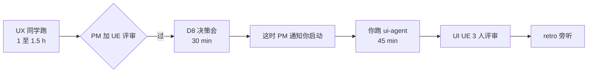

# UI 同学待命指南 · DS-25 软科学成果展示 智能体编排试点 Step 2
> ⚠️ **后续编辑注解（2026-06-18，v2 重组）**：本文产出时引用的 UI 规范为 `AI可复用UI框架与设计规范.md`，**2026-06-18 已全量重组为 `agent-delivery/Design.md`**（Figma 风格稿落地版，14 节）。本文档**保留原引用以示事实历史**；下游 agent 接力时请按下表换算：
>
> | 本文中的旧引用 | 现行 `Design.md` 引用 |
> |---|---|
> | `AI可复用UI框架与设计规范.md` | `Design.md` |
> | §3 产品定位 / §4 信息架构 | §1 设计定位 + §3 页面骨架（六骨架 + 三段工作区） |
> | §5 技术框架 / §10 Arco 接入 | §0 给 AI 的执行指令（强制 Arco React + 主色 `#165DFF`）+ §13 推荐实现映射 |
> | §7 设计 Token | §4 色彩 + §5 字体 + §6 圆角描边阴影 + §13 主题 token |
> | §7.3 `.content-shell-glass` | §3.1 `.content-shell`（**取消毛玻璃强效果**） |
> | §7.3 / §7.4 图表分类色 chart-01~20 | §4.3 图表序列优先顺序（直接色值） |
> | §7.3.3 / §7.4.3 11 类业务对象 | §4.3 科技要素与图表色（**10 类，"资讯" 已取消**） |
> | §9 17 个通用组件（PageShell / GlobalWorkbenchTabs 等） | §7 通用组件 8 + §8 工作区 3（Figma 风格 class：`app-shell` / `content-shell` / `workspace-grid` / `layer-panel` / `map-stage` / `analysis-panel`） |
> | §9.3 / §9.4 Tab 分级 | §7.3 Tabs（**分级取消**） |
> | §18 验收 18 条 | §14 检查 8 + 验收 6 = 14 条（含截图取样定量验收） |
>
> 详见 `agent-delivery/architecture-baseline.md §8` v2.0 变更记录。

> **本文档读者**：UI 同学（你）
> **当前状态**：⏸️ **待命中** — 不要先开 Cursor agent 会话！等 PM 通知
> **总投入预估**：待命 30 min（读规范）+ 执行 45 min（跑 agent）+ 评审 30 min = 1.5–2 h
> **总指挥**：PM
> **创建**：2026-06-17

---

## 0. 你在试点中的位置



| 阶段 | 你做什么 | 状态 |
|------|---------|------|
| ⏸️ 现在 | **待命** + 读规范 + 看现有代码（30 min） | 进行中 |
| 🚀 启动信号 | PM 在群里 @你 并发派单话术 | 等 |
| ⚡ 执行 | 打开 Cursor + 复制话术 + 跑 45 min | 等 |
| 🔍 评审 | UI / UE / PM 3 人评审 30 min | 等 |
| 📝 retro | 全员复盘 30 min | 等 |

---

## 1. 为什么不能现在开始

| 原因 | 说明 |
|------|------|
| 1. 你的派单话术**还没生成** | UI-DS-25-trial-dispatch.md 等 UX 跑完后由 PM 协同 AI 根据 UX 实际产出生成 |
| 2. UX 产物可能调整 | 评审可能让 UX 改 1–2 项，你拿到的会是改完后的版本 |
| 3. D8/DS-15 回补决策影响你 | 决策结果决定你是"完全按 D8 新做"还是"局部参考 DS-15 沙箱页代码" |
| 4. 关键依赖：metric_id 清单 | UX handoff §11 的 metric_id 清单是你 UI 实现 MetricSpecCard 的输入 |

**强行先跑的代价**：浪费一次完整 agent 会话（约 \$5 token + 你 45 min）。

---

## 2. 待命期间做什么（30 min）

### 2.1 读规范（必须，20 min）

#### 2.1.1 D8 设计规范（10 min）

打开 `agent-delivery/AI可复用UI框架与设计规范.md`，**精读以下 5 节**：

| 节 | 你需要记住的 | 时间 |
|----|------------|------|
| §3 产品定位 | "分析工作台 + 汇报级驾驶舱"，**不做门户 / 营销 / 深色霓虹大屏** | 1 min |
| §4 信息架构 | 4.2 节 5 段优先级（结论摘要 → KPI → 筛选 → 主可视化 → 右侧研判 → 明细） | 2 min |
| §5 技术框架 | React + Vite + Arco + ECharts + AntV G6 + Leaflet + dayjs；新页面**禁止 AntD** | 1 min |
| §7 设计 Token | **完整通读 §7.1 §7.2**；§7.3 **最大内容容器 `.content-shell-glass`（一页面只一个）**；§7.4 图表分类色 chart-01–chart-20；§7.4.3 11 类业务对象固定色；§7.5 Tag 配色 | 4 min |
| §9 组件清单 | 17 个通用组件名背下来（§9.1 基础 15 + §9.3 GlobalWorkbenchTabs + §9.4 AnalysisPanelTabs；Tab 分级不可混用） | 2 min |
| §10 Arco 接入 | 哪些用 Arco / 哪些可定制 / 哪些不可定制 | 1 min |
| §18 验收清单 18 条 | **每条背下来 + 想清楚如何对照** | 1 min |

#### 2.1.2 数据血缘规约（10 min）

打开 `agent-delivery/data-lineage-policy.md`，**精读以下 4 节**：

| 节 | 你需要记住的 |
|----|------------|
| §2 8 件套元数据 | UI 上每个统计数字 hover 必须能展示这 8 项 |
| §5 UI 表现规范 | MetricSpecCard / DataLineageDrawer / MockBadge 三个新组件 |
| §5.1.1 MetricSpecCard | 触发 / 内容 / 样式 / 降级 |
| §5.1.3 MockBadge | Wave 0 强制；🧪 图标 + tooltip |
| §7.5 ui-agent 责任 | 你的硬约束清单 |

#### 2.1.3 DS-25 数据可用性映射表（10 min）⭐ 新增

打开 `agent-delivery/data/DS-25-data-availability-matrix.md`，**精读以下 3 节**：

| 节 | 你需要记住的 |
|----|------------|
| §1 ODS 主要可用表 | 10 张 ODS 表（dwd_zh_project / dwd_zh_project_output / dwd_org_reg_info / …）；mock JSON 的字段名要严格沿用 |
| §2 7 子功能字段映射 | 知道每个页面哪些字段是真实可用、哪些需算法、哪些用户态待自建 |
| §5 UI 阶段做 mock 数据时怎么用 | **mock JSON 字段名要严格沿用 ODS**；mock 数据要"贴近真实"（单位真实存在 / 金额合理范围） |

**这份资料是你"mock 数据贴近真实"的核心依据**。未来 Wave 1 切真实数据时，**只要 mock 字段名与 ODS 一致，前端代码零改动**。

### 2.2 看现有代码（推荐，10 min）

```bash
# 在 PowerShell 切到 demo2
cd E:\gkx_src\demo2

# 看现有 sandbox 目录（DS-15 是 pre-D8 产物，仅参考）
dir src\pages\sandbox\

# 看现有共用组件
dir src\components\

# 看 package.json 确认依赖（不要 install 新依赖）
type package.json
```

**重点看以下文件**：

| 文件 | 看什么 |
|------|--------|
| `demo2/src/App.jsx` | 主路由结构（你将追加 sandbox 路由，不删改既有逻辑） |
| `demo2/src/components/InsightDetailDrawer.jsx` | 详情抽屉模式可复用 |
| `demo2/src/components/SearchableCascadeFilter.jsx` | 复杂级联筛选可复用 |
| `demo2/src/SharedRegionMap.jsx` | 地图组件，本试点 P-02 分布地图可复用 |
| `demo2/src/pages/sandbox/talent-2026-06-17/` | DS-15 沙箱页结构（参考形不参考质，**用了 AntD/Tailwind**，但 D8 之后必须用 Arco） |

### 2.3 检查 Cursor 环境（5 min）

- [ ] Cursor 已更新到最新版（v0.45+）
- [ ] 登录账号 + token 余额 ≥ \$8
- [ ] 工作区 `E:\gkx_src` 已打开
- [ ] `.cursor/rules/ui.mdc` 命中（按 Ctrl+Shift+P 输入 Cursor Rules 查看）
- [ ] 终端能执行 `npm run dev`（dev 端口 4176）

测试：

```bash
cd E:\gkx_src\demo2
npm install  # 如果 node_modules 缺
npm run dev
# 浏览器打开 http://127.0.0.1:4176 应该能看到 demo2 首页
```

如果 `npm run dev` 失败，**立即联系 DevOps 同学**，不要硬跑 agent。

---

## 3. 启动信号（PM 通知你之后做什么）

### 3.1 PM 会发什么给你

预计你会在群里收到类似消息：

```
@UI 同学：UX 已评审通过。
派单话术：agent-delivery/agent-handoffs/软科学成果展示-DS25/UI-DS-25-trial-dispatch.md
请按 PILOT-DS-25-UI-standby.md §4 开始执行。

UX handoff 关键摘要：
- 4 份 md 在 demo2/docs/ia/sandbox/soft-science-2026-06-17/
- 7 个页面 + 30 个 metric_id 清单
- D8/DS-15 回补决策：B 部分回补（仅文档层）
- 关键复用建议：SharedRegionMap (P-02), InsightDetailDrawer (P-04)
```

### 3.2 检查启动条件

收到通知后**先停 5 min** 做以下检查：

- [ ] UX 4 份 md 都在 demo2 目录里
- [ ] UI 派单话术 `UI-DS-25-trial-dispatch.md` 文件已存在
- [ ] 你打开了 D8 设计规范 + 数据血缘规约（已读完）
- [ ] Cursor 工作区 = `E:\gkx_src`
- [ ] `npm run dev` 能跑

任意一项不满足，**立即问 PM**，别硬跑。

---

## 4. 执行：跑 ui-agent（45 min）

### 4.1 打开新 Cursor 会话

类似 UX 同学：

1. Cursor 右上角点 **+** 开新 Agent 会话
2. 模式：**Agent**
3. 模型：**Opus 4.7 或 Sonnet 4.5 或 GPT-5**（不能用 haiku/mini，UI 代码生成需要长上下文）

### 4.2 复制派单话术

1. 打开 `agent-delivery/agent-handoffs/软科学成果展示-DS25/UI-DS-25-trial-dispatch.md`
2. 找 "**派单话术开始**" / "**派单话术结束**" 之间内容
3. 全选复制到新会话首条消息，发送

### 4.3 间歇性瞄一眼（每 10 min 1 次）

UI 阶段比 UX 出错率高（写代码、写 mock JSON、装路由），监督要更勤：

| 时间点 | 看什么 | 红色异常 |
|--------|--------|---------|
| +5 min | agent 是否读了规范 + UX 产物 | 没读 / 直接动手写 |
| +10 min | 是否创建了 `src/pages/sandbox/soft-science-2026-06-17/` | 写到错目录 / 改主菜单 |
| +20 min | 是否引入了新 npm 依赖 | `package.json` diff |
| +25 min | 第 1 个页面是否能跑（`npm run dev` 编译通过） | 编译错误 |
| +35 min | MetricSpecCard / MockBadge 组件是否实现 | 缺组件 |
| +40 min | 7 个页面是否都打通 | 缺页面 |
| +45 min | handoff 是否写了 | 缺 handoff |

### 4.4 严格禁止 agent 做的事

| 禁止 | 应对 |
|------|-----|
| 修改 `package.json` 引入新依赖 | Esc 中断 → 还原 → "不要装新依赖，用 demo2 已有的" |
| 修改 `vite.config.js` / `tailwind.config.js` / `postcss.config.js` | Esc 中断 → 还原 → "配置文件零改动" |
| 修改 `pageRouting.js` 或主导航 | Esc 中断 → 还原 → "主菜单零改动，只在 SandboxRouter 注册路由" |
| 修改 `src/pages/talent-preview/` | Esc 中断 → 还原 → "DS-15 沙箱页只读" |
| 改 lumen 任何仓 | Esc 中断 → 还原 → "lumen 仓不能动" |
| `git push --force` / `-f` | Esc 中断 → "禁止 force push 到 main（团队公约 §6 git 安全协议）" |

### 4.5 mock 数据要求

- 至少 **30 条软科学课题** mock
- 字段要贴近真实：
  - `topic_name`: "深圳市数字经济产业发展战略研究" (真实风格)
  - `lead_unit`: "深圳大学经济学院" (真实存在的单位)
  - `approval_year`: 2020–2026 之间合理分布
  - `topic_type`: "重点课题 / 一般课题 / 自筹经费课题" (符合软科学行业)
  - `funding_amount`: 5–50 万 (合理金额)
  - `region`: 福田 / 南山 / 罗湖 等真实区划
- 固定种子可重复（seed=42）
- mock 文件含 `calc_batch_id: "mock_20260617_seed42"` 前缀（data-lineage-policy.md §4.2）

### 4.6 MetricSpecCard 实现核心要求

每个统计数字（如 KPI 卡的"本季度课题新增数 12"）旁必须：

1. **ⓘ 图标**（Arco `Tooltip` 或 `Popover`），hover/点击触发
2. 弹出 **MetricSpecCard 组件**：

```jsx
// 示例伪代码（生产代码看 agent 实际产出）
<MetricSpecCard
  metricId="M_SS_TOPIC_NEW_COUNT_Q"
  metricNameZh="本季度软科学课题新增数"
  definition="立项日期在本季度内 + 课题类型=软科学 + 去重课题号"
  formula="COUNT(DISTINCT topic_id) WHERE quarter=current AND topic_type='soft_science'"
  sourceTables={['ads_ss_topic_quarterly', 'dws_ss_topic_monthly', 'dwd_ss_topic', 'ods_ss_topic_raw']}
  sourceSystems={['Mock @ batch=mock_20260617_seed42']}
  updateFreq="daily"
  version="1.0.0"
  isMock={true}
  mockUntil="2026-10-01"
/>
```

3. 数字旁还要 **🧪 MockBadge**（Wave 0 阶段强制）：

```jsx
<span>
  12 <MockBadge tooltip="Mock 数据，预计 2026-10-01 切换为真实数据源" />
</span>
```

4. **数据来源**：mock JSON 里写一份 `metrics_catalog.json`，模拟未来 /metrics/v1/catalog API 返回；MetricSpecCard 从这个 mock JSON 读，不硬编码

### 4.7 完工标志

agent 完工应该给你：

- [ ] `npm run dev` 启动成功
- [ ] 沙箱入口：`http://127.0.0.1:4176/sandbox/soft-science-2026-06-17`
- [ ] 7 个页面 URL 全部能打开
- [ ] `npm run build` 构建通过（无错误，警告可接受）
- [ ] handoff：`agent-delivery/agent-handoffs/软科学成果展示-DS25/UI-DS-25-trial.md`
- [ ] **§18 18 条对照表**全绿（或明确标注待评审）
- [ ] **数据血缘 UI 三件套**实现完整（ⓘ / MetricSpecCard / 🧪 MockBadge）
- [ ] git commit（含 `[agent:ui-agent]` 标记）
- [ ] **已 push 到 demo2 origin/main**（`git status` 显示 `up to date with 'origin/main'`）
- [ ] **触发自动部署**：约 2–3 min 后 https://skxrules.unicomcn.tech:30999/sandbox/soft-science-2026-06-17 可访问（远端验证）

---

## 5. 完工检查（10 min）

在浏览器打开 `http://127.0.0.1:4176/sandbox/soft-science-2026-06-17`，过一遍：

### 5.1 视觉与气质

- [ ] 整体浅色蓝灰，**没有深色霓虹**
- [ ] 卡片 / 图表容器圆角统一 8px（用浏览器 DevTools 量）
- [ ] 字号 / 间距 / 颜色符合 D8 规范 §7 token
- [ ] 没有"门户感"（无大幅 banner、无营销文案）

### 5.2 §18 18 条自检（你打勾）

打开 D8 规范 §18 对照实际页面：

- [ ] 全部 18 条都过 / 或明确标待评审
- [ ] 红色不过的项**别藏着**，写到 handoff 让评审知道

### 5.3 数据血缘三件套

- [ ] 找 **3 个统计数字**测试：ⓘ 能点开 MetricSpecCard
- [ ] MetricSpecCard 内容含 8 件套元数据
- [ ] 🧪 MockBadge 在每个统计数字旁出现
- [ ] tooltip 文本清晰

### 5.4 隔离铁律

```bash
cd E:\gkx_src\demo2
git status  # 查看改了哪些文件
git diff package.json  # 应该是空（未改）
git diff src/pageRouting.js  # 应该是空（未改）
git diff src/App.jsx  # 应该是 1–3 行追加（推荐 hash 路由零改动）
```

如果 `package.json` 或 `pageRouting.js` 有改动 → **立即还原**，回会话让 agent 重做。

### 5.5 跨页面流畅性

- [ ] 7 个页面切换无卡顿
- [ ] 浏览器 DevTools Console **无 error**（warning 可接受）
- [ ] 浏览器 DevTools Network 无 404
- [ ] 复杂筛选有搜索 / 重置 / 确认 / 已选摘要

---

## 6. 回报 PM（5 min）

```
@PM UI 跑完了。

handoff: agent-delivery/agent-handoffs/软科学成果展示-DS25/UI-DS-25-trial.md
沙箱入口（本地）: http://127.0.0.1:4176/sandbox/soft-science-2026-06-17
沙箱入口（远端，已部署）: https://skxrules.unicomcn.tech:30999/sandbox/soft-science-2026-06-17
7 个页面 URL: [列出]

commit hash: <git log 复制>
GitLab 链接: https://gitlab.htmisoft.net/gkx1/demo2/-/commit/<hash>  (已 push, 自动部署完成)
实际耗时: <X 分钟>
token 成本: $<X.XX>

§18 18 条对照: <N> 绿 / <M> 黄 / <K> 红
数据血缘三件套: ✅/🔧/❌

3 个发现（给评审参考）：
1. ...
2. ...
3. ...

我接下来 30 min 在线，可以开评审会了。
```

---

## 7. 异常处置

### Q1: agent 引入了 AntD 或 Tailwind

**A**: 
1. 立即 Esc 中断
2. `git checkout` 还原相关文件
3. 回会话："**新页面禁止 AntD**（D8 决策）。请用 Arco Design 的 Card / Tabs / Descriptions / Drawer 等组件重做。Tailwind 工具类可以用，但必须沉淀到 token。"

### Q2: agent 创建了一个我没要的"演示组件"或"showcase 页"

**A**: 
1. 让 agent 删掉
2. "你的范围是 wireframe 定的 7 个页面，不要自创演示组件。"

### Q3: agent 用了 chart.js / d3 / react-vis 等第三方图表库

**A**: 
1. Esc 中断 + 还原
2. "图表必须用 ECharts（echarts-for-react），G6 用于图谱。其他不允许。"

### Q4: 沙箱页路由进不去 / 404

**A**: 
1. 看 `App.jsx` 是否追加了 sandbox 路由
2. 看 `src/pages/sandbox/SandboxRouter.jsx` 是否存在
3. 重启 `npm run dev`（Ctrl+C 然后 `npm run dev` 重跑）
4. 还不行 → 截图给 PM + DevOps 协助

### Q5: 我感觉数据血缘 UI 实现太重了，agent 写不完

**A**: 
1. **不要简化数据血缘**（这是甲方硬需求）
2. 可以让 agent 把其他页面"简单实现"，但 ⓘ + MetricSpecCard + 🧪 必须 100% 实现
3. 实在跑不完，跟 PM 反馈"超时"，记入试点反馈

### Q6: agent 想 mock 真实的源系统名（如"深圳科技厅项目库"）

**A**: 
1. **允许**，因为这是合理的 source_systems 示例
2. 但必须配 `is_mock: true` + 🧪 MockBadge，避免甲方误以为真接入了

---

## 8. UI 心态护栏

> 第 1 次试点，你最大产出是**经验**，不是"完美沙箱页"。

3 件事：

1. **遇到 agent 走偏立即停**：宁可花 5 min 纠正，不要让它跑歪 30 min
2. **数据血缘是甲方红线**：别想着"先简化，回头再补"，**第 1 次就做对**
3. **handoff §18 对照表别造假**：18 条该红就红，让评审看见真问题，不要为了过审打勾

---

## 9. 关键路径速查

```yaml
工作区根: E:\gkx_src
派单话术（等 PM 发后再用）: agent-delivery/agent-handoffs/软科学成果展示-DS25/UI-DS-25-trial-dispatch.md
你的产物目标:
  代码: E:\gkx_src\demo2\src\pages\sandbox\soft-science-2026-06-17\
  mock: E:\gkx_src\demo2\src\pages\sandbox\soft-science-2026-06-17\mocks\
  metrics catalog mock: E:\gkx_src\demo2\src\pages\sandbox\soft-science-2026-06-17\mocks\metrics_catalog.json
你的 handoff 目标: agent-delivery/agent-handoffs/软科学成果展示-DS25/UI-DS-25-trial.md

UX 产物依赖（输入）:
  E:\gkx_src\demo2\docs\ia\sandbox\soft-science-2026-06-17\

D8 规范: agent-delivery/AI可复用UI框架与设计规范.md
数据血缘规约: agent-delivery/data-lineage-policy.md
你的角色规约: .cursor/rules/ui.mdc
团队公约: .cursor/rules/00-team-constitution.mdc

dev 启动: cd E:\gkx_src\demo2 && npm run dev
本地 URL: http://127.0.0.1:4176
沙箱入口: http://127.0.0.1:4176/sandbox/soft-science-2026-06-17
```

---

## 10. 一句话总结

> **现在待命读规范 → 等 PM 通知 → 开新会话粘话术 → 让 agent 跑 → 监督 + 完工检查 → 回报 PM → 评审**

加油 🚀