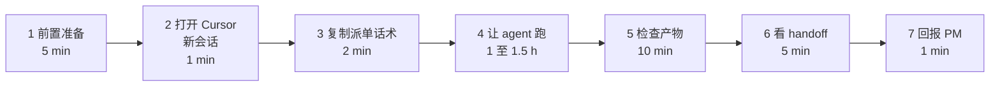

# UX 同学操作指南 · DS-25 软科学成果展示 智能体编排试点 Step 1
> ⚠️ **后续编辑注解（2026-06-18，v2 重组）**：本文产出时引用的 UI 规范为 `AI可复用UI框架与设计规范.md`，**2026-06-18 已全量重组为 `agent-delivery/Design.md`**（Figma 风格稿落地版，14 节）。本文档**保留原引用以示事实历史**；下游 agent 接力时请按下表换算：
>
> | 本文中的旧引用 | 现行 `Design.md` 引用 |
> |---|---|
> | `AI可复用UI框架与设计规范.md` | `Design.md` |
> | §3 产品定位 / §4 信息架构 | §1 设计定位 + §3 页面骨架（六骨架 + 三段工作区） |
> | §5 技术框架 / §10 Arco 接入 | §0 给 AI 的执行指令（强制 Arco React + 主色 `#165DFF`）+ §13 推荐实现映射 |
> | §7 设计 Token | §4 色彩 + §5 字体 + §6 圆角描边阴影 + §13 主题 token |
> | §7.3 `.content-shell-glass` | §3.1 `.content-shell`（**取消毛玻璃强效果**） |
> | §7.3 / §7.4 图表分类色 chart-01~20 | §4.3 图表序列优先顺序（直接色值） |
> | §7.3.3 / §7.4.3 11 类业务对象 | §4.3 科技要素与图表色（**10 类，"资讯" 已取消**） |
> | §9 17 个通用组件（PageShell / GlobalWorkbenchTabs 等） | §7 通用组件 8 + §8 工作区 3（Figma 风格 class：`app-shell` / `content-shell` / `workspace-grid` / `layer-panel` / `map-stage` / `analysis-panel`） |
> | §9.3 / §9.4 Tab 分级 | §7.3 Tabs（**分级取消**） |
> | §18 验收 18 条 | §14 检查 8 + 验收 6 = 14 条（含截图取样定量验收） |
>
> 详见 `agent-delivery/architecture-baseline.md §8` v2.0 变更记录。

> **本文档读者**：UX 同学（你）
> **背景**：团队第 1 次走完整智能体编排试点，**目的是发现现有手册和规范的不足**，所以你跑过程中遇到的任何"卡顿、困惑、不确定"都是金子 —— 务必记下来
> **预计耗时**：1.5 h（含读文档 + 跑 agent + 检查产物 + 写交付）
> **总指挥**：PM；联系方式见公司群

---

## 0. 30 秒读懂你要做的事

| 项 | 内容 |
|----|------|
| **你扮演什么角色** | UX 同学（人），监督 `ux-agent`（AI）干活 |
| **干什么** | 把"软科学成果展示"功能（bid §1.1.1.1.4.6.1）翻译成 IA + 用户旅程 + 低保真线框 3 类文档 |
| **不干什么** | **不写代码** / **不画视觉**（颜色、字号都不指定） / **不动 lumen 仓** |
| **产出在哪** | `E:\gkx_src\demo2\docs\ia\sandbox\soft-science-2026-06-17\` 下 4 份 md |
| **关键时间** | 启动 → 跑 agent 1–1.5 h → handoff → 等 PM 评审 |

---

## 1. 你只需要做 7 步（按顺序）



**重点**：你的工作主要在 **1、2、3、5、6、7**。步骤 4（agent 跑）你只需要"间歇性瞄一眼"，不要全程盯着。

---

## 1.5 重要：本试点的两个关键资料（你要让 ux-agent 都读到）

试点过程中，**PM 又准备好了两份核心资料**，是 D8 决策和"甲方数据血缘要求"的产物：

| 资料 | 路径 | 作用 |
|------|------|------|
| 数据血缘规约 | `agent-delivery/data-lineage-policy.md` | 甲方要求每个统计指标说清数据来源/加工/口径 |
| DS-25 数据可用性映射表 | `agent-delivery/data/DS-25-data-availability-matrix.md` | **DS-25 专用作弊纸** —— bid 字段 ↔ ODS 真实表字段精确映射；ux-agent 写字段表时不需要"凭空想字段名"，直接抄 ODS 真实字段 |

**这两份资料已经写进 UX 派单话术（§必读 5 / 5.5），你不用额外做什么**，只是要 **知道它们存在**，并：
- 如果 ux-agent 跑完产物里**字段表的"来源"列还在写`明细`/`接口`等口语化词、或者编了不存在的字段名（如`项目编号`而非真实的 `project_number`）**，说明 agent 没认真读这份映射表 —— 你应该让 PM 决定是否要重跑或追加指令
- agent 写的 wireframe **必须有 `metric_id` 列**（统计字段必填），否则不合格

---

## 2. Step 1：前置准备（5 min）

### 2.1 检查 Cursor

打开 Cursor，确认：
- [ ] **版本**：最新版（菜单 "Help → About"，建议 v0.45+）
- [ ] **登录状态**：右下角能看到你的账号头像
- [ ] **token 余额**：右下角设置 → 看 Usage（确保至少有 \$10 余量，本任务估算消耗 \$3–8）

### 2.2 打开工作区

在 Cursor 菜单点 "File → Open Folder"，选择：

```
E:\gkx_src
```

⚠️ **不是** `E:\gkx_src\demo2`，**也不是** `E:\gkx_src\agent-delivery`。一定是 `E:\gkx_src` 根目录，这样 agent 才能读到全部 `.cursor/rules/` 和 `agent-delivery/`。

打开后，你应该在 Cursor 左侧文件树看到：
- `agent-delivery/`
- `demo2/`
- `gkx_lumen_backend/`
- `gkx_lumen_fronted_pc/`
- `innov-algo-demo/`
- ……等十几个子目录

### 2.3 验证规约生效

按 `Ctrl+Shift+P` 打开命令面板，输入 `Cursor Rules`，查看是否能列出 13 条 rules 文件（含 `ux.mdc`）。

如果看不到，说明 `.cursor/rules/` 没生效，**先停下来联系 PM**，不要硬跑。

### 2.4 选模型档位

打开任意 Agent 会话设置，**模型选择建议**：

| 模型 | 适用 | 本任务推荐 |
|------|------|----------|
| claude-opus-4.7 | 复杂思考 + 大产出 | ⭐ 强烈推荐（最稳） |
| claude-sonnet-4.5 | 平衡 | ✅ 备选 |
| claude-haiku-4 | 快但浅 | ❌ 本任务不行 |
| gpt-5 | 替代 Claude | ✅ 备选 |
| gpt-5-mini | 快但浅 | ❌ 本任务不行 |

> **不要用 haiku/mini**。UX 工作需要长上下文 + 结构化思考，弱模型会输出散乱产物。

---

## 3. Step 2：打开 Cursor 新 Agent 会话（1 min）

### 3.1 怎么开新会话

Cursor 右上角点 **"+"** 按钮（不是 Chat 窗口里的 +，是窗口标题栏的 + ）开一个全新会话。

⚠️ **重要**：不要在已有会话里继续。已有会话有上下文污染，会让 agent 走捷径或被你之前的对话带偏。

### 3.2 确认会话模式

- 模式：**Agent**（不是 Ask / Chat）
- 模型：上一步选好的（Opus 4.7 或 Sonnet 4.5 或 GPT-5）

界面应该是空白的对话框，等你输入。

---

## 4. Step 3：复制派单话术（2 min）

### 4.1 打开派单话术文件

在 Cursor 文件树点开：

```
agent-delivery/agent-handoffs/软科学成果展示-DS25/UX-DS-25-trial-dispatch.md
```

或直接按 `Ctrl+P` 输入 `UX-DS-25-trial-dispatch` 打开。

### 4.2 找到"派单话术开始"

文件中段大约第 30 行会看到：

```
## ====== 派单话术开始（复制下方全部内容到新 Cursor 会话）======
```

### 4.3 复制到"派单话术结束"

往下滑，会看到：

```
## ====== 派单话术结束 ======
```

**全选这两条横线之间的所有内容**（不包括横线本身），按 `Ctrl+C` 复制。

> 💡 **小技巧**：从 "`/goal ux-agent`" 这一行开始选，到 "中文产出。开始执行。" 这一行结束，是最干净的选取范围。

### 4.4 粘贴并发送

回到 Step 2 开的新 Agent 会话，粘贴 `Ctrl+V`，然后按 `Ctrl+Enter` 或点发送按钮。

### 4.5 你应该看到

agent 几秒内开始回复，第一句话大概是：

> "我是 ux-agent，开始执行 DS-25 软科学成果展示试点任务。先读必读文件……"

如果 agent 直接问你问题或拒绝执行 → **截图发 PM**，记入试点反馈。

---

## 5. Step 4：让 agent 跑（1–1.5 h，期间你做这些）

### 5.1 你应该看到的现象

agent 会依次：
1. 读 7 项必读文件（bid §1.1.1.1.4.6.1、scope-baseline、设计规范、DS-15 参考等）—— 约 5–10 min
2. 列计划（"我会创建 4 份 md：README/IA/userflow/wireframe"）—— 1 min
3. 一份份写 md，每份大概 10–15 min
4. 写完后做自检 + 写 handoff —— 10–15 min
5. git add + commit —— 1 min
6. 最后回复 6 项总结 —— 1 min

总计大约 60–90 分钟。

### 5.2 你做什么

**绝大多数时间不要打扰 agent**。可以去喝咖啡、回邮件、做别的事。

### 5.3 间歇性瞄一眼（每 15 min 1 次，10 秒）

| 时间点 | 看什么 | 红色异常 |
|--------|--------|---------|
| +5 min | agent 是否在读文件、是否在 Cursor 右侧打开 bid MD | 没读 / 读错文件 |
| +20 min | 文件树是否新出现 `demo2/docs/ia/sandbox/soft-science-2026-06-17/` 目录 | 写到错目录 / 写到 lumen / 没有新目录 |
| +20 min | 新目录下第一份 md（应该是 README 或 IA）是否提到 §1.1.1.1.4.6.1 | 章节号错 / 越界 |
| +40 min | 看 2–3 份 md 已落盘 | 1 份还没写完 → 可能 agent 卡了 |
| +60 min | handoff 文件 `UX-DS-25-trial.md` 出现 | 接近完工 |

### 5.4 红色异常应对

| 异常 | 你做什么 |
|------|---------|
| 写到 demo2 之外（如 lumen 仓） | **立即 Esc 中断**，发指令："停。你的工作目录必须严格限制在 `demo2/docs/ia/sandbox/soft-science-2026-06-17/`，不要碰其他任何目录。已经写错的文件请删除。然后重新开始。" |
| 越界到 §1.1.1.1.4.6.2~6 | 发指令："停。范围只限 §1.1.1.1.4.6.1（软科学成果展示），不要写 §1.1.1.1.4.6.2 科技创新生态等。" |
| 用 AntD 而不是 Arco / 给 wireframe 加视觉样式 | 发指令："停。你不该决定视觉。wireframe 只画结构区块（用 §9 通用组件名）。颜色 / 字号 / 圆角 / AntD vs Arco 都不由你定。" |
| agent 反复问你问题 | 发一句："按 UX 最佳实践给默认值即可，标'待评审'，不要打断我。继续。" |
| agent 一直在等（5+ min 无新输出） | 发一句："请继续上一步。" |

### 5.5 agent 主动问你的问题：怎么回？

**铁律：除非涉及"范围扩大 / 删除功能点 / 改架构"3 类问题，否则一律答 "按最佳实践默认 + 标待评审"**。

举例：

| agent 问 | 你的回复 |
|---------|---------|
| "P-04 详情页的字段优先级如何排？" | "按 UX 最佳实践默认排序，列在 wireframe 字段表 + 加'待评审'标记。" |
| "评论功能（§5）是否需要敏感词过滤？" | "默认假设是。具体规则标'待评审 / 安全合规'。" |
| "可以引用 DS-15 沙箱页代码风格吗？" | "可以参考 IA / wireframe 结构，但 §9 组件命名以 D8 规范为准，不照搬 DS-15。" |
| "默认 30 条 mock 数据够吗？" | "你不负责 mock 数据，那是 ui-agent 的事。" |
| "可以扩大到 §1.1.1.1.4.6.2 吗？" | "**不可以**。范围严格限 §1.1.1.1.4.6.1。" |

---

## 6. Step 5：检查产物（10 min）

agent 说"任务完成"或"6 项总结"后，你做以下检查。

### 6.1 文件齐全

在文件树查看 `demo2/docs/ia/sandbox/soft-science-2026-06-17/` 下应有 **4 份 md**：

- [ ] `README.md`
- [ ] `DS-25-IA.md`
- [ ] `DS-25-userflow.md`
- [ ] `DS-25-wireframe.md`

**缺一份都不行**。如果缺，回会话发：`缺 XXX.md，请补写。`

### 6.2 体量合理（防偷工减料）

打开每份 md 看行数（Cursor 底部状态栏会显示）：

| 文件 | 期望行数 | 异常 |
|------|---------|------|
| README.md | 50–100 | < 30 太少 |
| DS-25-IA.md | 150–300 | < 80 太少 |
| DS-25-userflow.md | 100–200 | < 50 太少 |
| DS-25-wireframe.md | 500–1000 | < 200 太少（7 子功能 × 字段表 = 至少 500 行） |

⚠️ 如果任意一份明显过短，发回会话："XXX.md 体量明显不足（行数太少），请按 7 个子功能逐一补全。"

### 6.3 范围对（不越界）

打开 `DS-25-IA.md` 用 `Ctrl+F` 搜索：
- ✅ 应该搜到：`§1.1.1.1.4.6.1` 多处
- ❌ **不应该搜到**：`§1.1.1.1.4.6.2` / `§1.1.1.1.4.6.3` / `§1.1.1.1.4.6.4` / `§1.1.1.1.4.6.5` / `§1.1.1.1.4.6.6`（这些是同章其他模块，越界了）

### 6.4 §9 组件名用对

打开 `DS-25-wireframe.md` 用 `Ctrl+F` 搜索，**至少 8 个**应能搜到：

```
PageShell / TopicSidebar / ContextBar / SectionPanel / ModuleHeader /
MetricCard / DataCard / SearchableCascadeFilter / FilterBar / StatusTag /
DetailDrawer / DataTable / ChartPanel / MapPanel / GraphCanvas / EvidenceList
```

⚠️ **不应该搜到**：`左栏 240px` / `主区` / `左侧导航` 等 DS-15 当时的口语化命名。如果搜到，发回："请把口语化区块名替换为 §9 通用组件名（PageShell、SectionPanel 等）。"

### 6.5 §4.2 5 段优先级

打开 `DS-25-IA.md` 用 `Ctrl+F` 搜索 `关注什么` 或 `当前应关注`，应该**每个页面**都出现一次。

如果只出现 1–2 次，发回："§4.2 5 段优先级（关注什么/为什么/重点对象/趋势异常/下钻明细）必须每个页面都有，请补全。"

### 6.6 7 个子功能全覆盖

打开 `DS-25-IA.md` 看页面清单，应该至少有：

- [ ] 分布地图与趋势分析（§1.1.1.1.4.6.1.1）
- [ ] 智能成果筛选与专题检索（§1.1.1.1.4.6.1.2）
- [ ] 成果详情与案例展示（§1.1.1.1.4.6.1.3）
- [ ] 多维统计与趋势分析（§1.1.1.1.4.6.1.4）
- [ ] 成果互动与传播中心（§1.1.1.1.4.6.1.5）
- [ ] 数据导出与报告管理（§1.1.1.1.4.6.1.6）
- [ ] 成果进展与跟踪监控中心（§1.1.1.1.4.6.1.7）

漏掉任意一个，发回："漏了 §X.X 子功能，请补。"

### 6.7 文案克制（10 秒抽查）

打开任意一份 md，用 `Ctrl+F` 搜：
- ❌ "智能赋能" / "一站式" / "全方位" / "全面提升"

如果搜到 → 发回："文案过于空泛，请改为名词短语描述具体功能。"

---

## 7. Step 6：检查 handoff（5 min）

打开 `E:\gkx_src\agent-delivery\agent-handoffs\UX-DS-25-trial.md` 这份文件应该存在。

### 7.1 必备 12 节都在

按目录滑过去检查：

- [ ] 执行时间 + 任务范围
- [ ] 完成清单对照 DoD
- [ ] 4 份产物绝对路径
- [ ] 体量统计
- [ ] commit hash
- [ ] 范围与实现
- [ ] §18 18 条对照表
- [ ] §4.2 5 段优先级覆盖表
- [ ] 待人评审开放项 ≥10 条
- [ ] 给 ui-agent 的 next-step 建议
- [ ] **【DS-15 回看清单】** ≥3 项
- [ ] **【试点反馈】** 1–8 条

### 7.2 试点反馈 8 条都填了

特别检查这 8 条（不能是空话）：

1. 耗时实测 vs 估算
2. 必读文件评价
3. 派单话术评价
4. 范围铁律 / 原文模糊
5. 角色边界
6. 与 DS-15 对比 + DS-15 是否回补建议
7. D8 规范实战评价（最有用 3 条 + 最难落地 3 条）
8. 给 PM 的 3 条改进建议

如果任何一条只写了一句话，发回："第 X 条试点反馈过于简略，请展开（至少 3 句话 + 具体例子）。"

### 7.3 成本回填

handoff 末尾应该有：

```yaml
estimated_tokens: ...
actual_tokens: ...
model_used: claude-opus-4.7
actual_cost: $X.XX
cost_warn: green
```

如果缺，发回："请回填 5 个成本字段（按 budget-estimate.md §2）。"

### 7.4 git 状态

在 Cursor 终端（Ctrl+`）输入：

```bash
cd E:\gkx_src\demo2
git log -1 --format="%H %s"
git status
```

应该看到：
- 最近一次 commit 信息含 `[sandbox] ux-agent 试点：DS-25 软科学成果展示 IA/wireframe` 和 `[agent:ux-agent]`
- `git status` 显示 `Your branch is up to date with 'origin/main'`（**已 push 同步**，不是 ahead of）
- `git log -1 --pretty=format:'%H %s'` 应在 GitLab demo2 仓的 main 分支上能查到（已推送到远端）
- 没有 uncommitted 文件

如果有问题，参考 §9 异常处置。

---

## 8. Step 7：回报 PM（1 min）

打开微信 / 公司群，发给 PM：

```
@PM UX 跑完了。

handoff: agent-delivery/agent-handoffs/软科学成果展示-DS25/UX-DS-25-trial.md
4 份产物在: demo2/docs/ia/sandbox/soft-science-2026-06-17/
commit hash: <从 git log 复制>
GitLab 链接: https://gitlab.htmisoft.net/gkx1/demo2/-/commit/<hash>  (已 push, 远端同步)
实际耗时: <X 分钟>
token 成本: $<X.XX>

3 个发现（给评审参考）：
1. <你自己观察到的 1 个问题点>
2. <例如：DS-15 §9 命名确实缺失，建议回补>
3. <例如：派单话术里 X 段比较绕，可以简化>

可以评审了，我接下来 30 min 在线。
```

PM 会在 30 min 内回你评审结果。

---

## 9. 异常处置 FAQ

### Q1: Cursor 卡住，agent 不动了

**A**: 
1. 检查右下角网络状态
2. 在会话里发"请继续"
3. 还不动 → 截图发 PM，说"agent 卡住"
4. **不要**自己关 Cursor，否则上下文丢

### Q2: agent 说要 install npm 包

**A**: 
1. 立即回复："不要 install 任何 npm 包。本任务只写 .md 文档，没有 .jsx/.tsx/.css 代码。如果你想引入新依赖，停。"
2. 记入试点反馈

### Q3: agent 改了 .gitignore / package.json / .cursor/rules/

**A**: 
1. 立即 Esc 中断
2. 在 Cursor 终端：`cd E:\gkx_src\demo2 && git diff` 看改了什么
3. `git checkout .gitignore package.json` 还原
4. 回会话："你不该改 .gitignore / package.json。已还原。请只在 demo2/docs/ia/sandbox/soft-science-2026-06-17/ 下工作。"
5. 记入试点反馈"agent 越界"

### Q4: token 烧到 \$10 / 黄牌

**A**: 
1. 看进度，70% 完成 → 让 agent "用最简短指令收尾，写完 handoff 就停"
2. < 30% → 停掉，找 PM 商量是否换会话重跑（话术可能写得不好让 agent 跑太久）
3. 单任务 > \$20 → **立即 hard stop**，找 PM 和 architect-agent 评审

### Q5: git commit 报错 "nothing to commit"

**A**: 
1. demo2 仓的 `docs/` 目录在 `.gitignore` 里，需要用 `git add -f`
2. agent 应该自动这么做（话术里已写）；如果没有，让它："请用 `git add -f docs/ia/sandbox/soft-science-2026-06-17/` 强制添加这 4 个文件，不要碰 .gitignore"

### Q6: agent 完成 commit 后 push 卡住 / 报错

**A**: 
1. 看 push 错误信息：
   - `non-fast-forward` / `reject` → 别人推了新 commit。先 `git pull --rebase`，解决冲突后再 push
   - 网络 / 认证错 → 检查 VPN + GitLab token 是否过期
   - 权限错 → demo2 仓你应该有 push 权限；找 DevOps 确认
2. 让 agent 在会话内重试一次，不行就让你手工 `git push origin main` 在终端跑
3. 还不行 → 截图发 PM + DevOps
4. **千万别用** `git push --force` / `git push -f`（团队公约 §6 git 安全协议禁止 force push 到 main）

### Q7: 我中途要去吃饭怎么办

**A**: 
1. agent 会自己跑，不需要你盯着
2. 走前在会话最后一条消息说："我离开 30 min，期间继续按计划执行；如果遇到非范围 / 删功能 / 改架构 3 类问题再停下来等我。"
3. 回来检查文件树看进度

### Q8: 评审说改 1 条，我跟 agent 怎么说

**A**: 
1. 不要开新会话，**在原 Cursor 会话**接续
2. 把 PM 评审意见原文粘进去：
   ```
   PM 评审意见：
   1. §4.2 5 段优先级 P-04 缺"趋势异常"段，请补
   2. ...
   
   请按以上意见修改。修改完毕后更新 handoff。
   ```
3. agent 改完后重做 §6/§7 检查

### Q9: 我感觉 agent 自由发挥太多了

**A**: 
1. 这是试点要发现的事，**别太管**
2. 把自由发挥的内容**记到你的笔记**：哪段、为什么算超界、你建议规约怎么改
3. retro 时用这份笔记发言（这就是试点真正的产出）

---

## 10. 试点心态护栏

> 这是团队第 1 次试点。你**最重要的产出不是 4 份 md，而是经验**。

3 件事记住：

1. **遇到不顺别忍**：任何"卡住、不确定、不爽"立即记到 `RETRO-MY-NOTES.txt`（自己建一份本地文件），retro 时讲出来
2. **不要替 agent 想完美**：agent 给的开放项就让它列，PM 评审会处理；你不用替它做决策
3. **完工不是终点**：handoff 写完只是 50%，retro 讲清楚遇到的不足才是 100%

---

## 11. 关键文件速查

```yaml
工作区根: E:\gkx_src
派单话术: E:\gkx_src\agent-delivery\agent-handoffs\UX-DS-25-trial-dispatch.md
你的产物目标: E:\gkx_src\demo2\docs\ia\sandbox\soft-science-2026-06-17\
你的 handoff 目标: E:\gkx_src\agent-delivery\agent-handoffs\UX-DS-25-trial.md

范围真源: E:\gkx_src\agent-delivery\bid-reference\科技信息展示系统和科技专题服务系统.md
  关键章节: §1.1.1.1.4.6.1（行 3231–3401）

D8 设计规范: E:\gkx_src\agent-delivery\AI可复用UI框架与设计规范.md
  必读子节: §3 §4 §9 §18

DS-15 参考（D8 之前，仅参考形）: E:\gkx_src\demo2\docs\ia\sandbox\talent-2026-06-17\

ux 角色规约: E:\gkx_src\.cursor\rules\ux.mdc
团队公约: E:\gkx_src\.cursor\rules\00-team-constitution.mdc
```

---

## 12. 一句话总结

> **打开工作区 → 开新 Agent 会话 → 复制派单话术 → 让它跑 → 间歇瞄一眼 → 完工检查 → 回报 PM**

每步遇到不顺都不是你的错，是流程要改进的地方。**记下来**就是你对试点最大的贡献。

加油，**第 1 次试点完成后我们整体复盘** 🚀