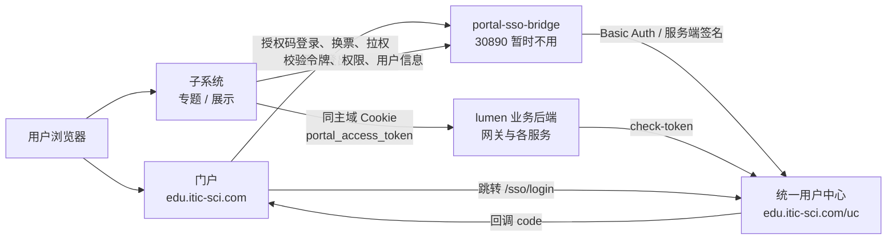
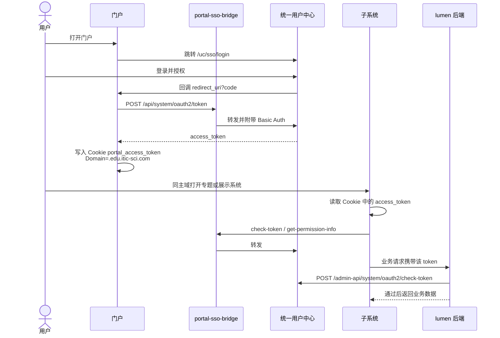

# 统一用户链路图

> 2026-10-21。上游用户中心 `https://edu.itic-sci.com/uc`。`client_secret` 只在后端，不进浏览器。
>
> **备注（2026-10-21）**：独立 jar `portal-sso-bridge` 已迁移到统一门户的部署上。`http://10.50.69.111:30890` 暂时不用。下面图中的 bridge 节点保留作对照，不是当前入口。

## 组件关系

## 登录与登录态共享

## 两条后端路径

| 路径 | 做什么 | 不做什么 |
| --- | --- | --- |
| `portal-sso-bridge`（独立 jar，2026-10-21 已迁入统一门户部署，`http://10.50.69.111:30890` 暂时不用） | 保管各系统 `client_secret`，换票、刷新、登出、拉权限，并对开放接口做服务端签名 | 不访问 Redis、MySQL、对象存储 |
| lumen 业务后端 | 用门户写入 Cookie 的同一个 `access_token`，向用户中心做 `check-token` | 不再换一套子系统 token |

## 现网落点

| 项 | 值 |
| --- | --- |
| 用户中心 | `https://edu.itic-sci.com/uc` |
| 登录页 | `https://edu.itic-sci.com/uc/sso/login` |
| 独立 jar | 2026-10-21 已迁移到统一门户部署。`http://10.50.69.111:30890` 暂时不用 |
| 探针 | `GET /api/apps` |
| Cookie | `portal_access_token`，`Domain=.edu.itic-sci.com` |
