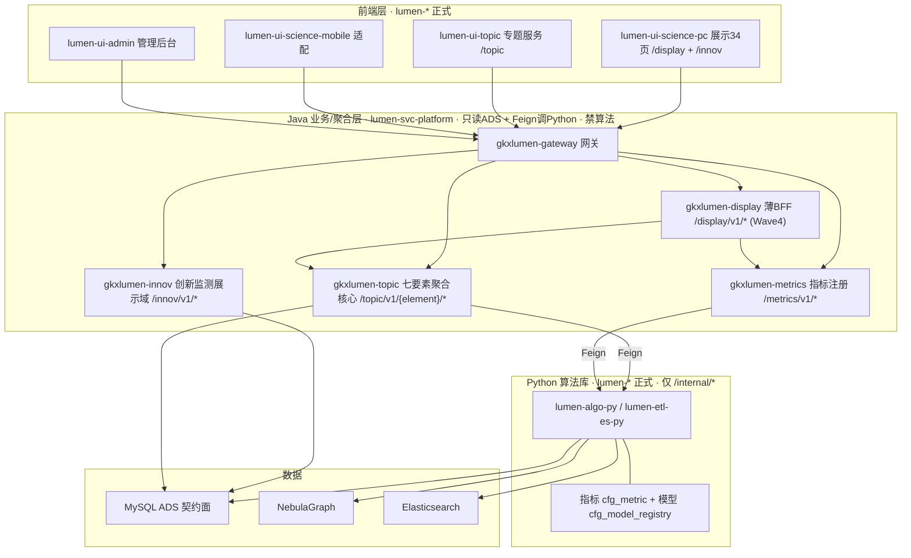

# 架构基线（编排 P0 输入 · 方案 A 共享聚合核心）

> **读者**：architect-agent、coordinator、全部开发/qa Agent  
> **作用**：多智能体编排的**架构真源**，与 `scope-baseline.yaml`（范围）并列为 P0 输入。所有 Epic/leaf 的服务边界、契约方向、依赖规则以本文为准；与本文冲突的实现一律按本文纠正。  
> **关联**：`graph-engine.md`（NebulaGraph）· `observability.md`（OTel）· `数据库设计.md`（ADS 契约面）· `scope-baseline.yaml`（范围 ±10%）  
> **维护**：architect-agent；变更走本文 §8 变更记录 + PM 知情。

---

## 1. 目标拓扑（方案 A）

算法库（Python）**同时服务**科技信息展示系统与科技专题服务系统；两系统共享同一 Java 聚合核心（`gkxlumen-topic` + `gkxlumen-metrics`），**不重复直连 Python、不各造一套算法调用**。



**调用链铁律**：`前端 → 网关 → Java 聚合（只读 ADS + Feign /internal/*）→ Python 算法库`。前端不直连 Python/DB/Nebula；Java 不写算法、不直连 nGQL。

**D12 仓隔离**：上图全部是 `lumen-*` 仓与 `gkxlumen-*` 服务。`demo-*` 只做原型，不进入本图。lumen 前端调用链（含 Java 下游 Feign）禁止打到任何 `demo-*` 项目服务，详见 §2 D12 / §3.1。

---

## 2. 锁定决策（12 项）

| # | 决策 | 内容 |
|---|------|------|
| D1 | **Java 聚合拓扑 = 方案 A** | 统一 `gkxlumen-topic` 提供 `/topic/v1/{element}/*`，两个前端共享；展示页面级拼装走薄 BFF `gkxlumen-display`（Wave4 建），**M1 阶段 innov 仍由 `gkxlumen-innov` 直接服务展示**。禁止展示与专题各造一套独立算法调用。 |
| D2 | **算法库统一出口** | Python 能力经 **指标注册（`cfg_metric` / `gkxlumen-metrics` catalog）+ 模型注册（`cfg_model_registry`）** 出口；新算法必须注册，Java 经注册中心/`/internal/*` 调用，不绕过。 |
| D3 | **契约面 = ADS** | Java 业务 API **仅**读 `*_ads`（+ `app_user` 读写）；禁止扫 ODS/DWD、禁止 Java 写 ADS。算法写、API 读。 |
| D4 | **双前端职责切分** | `lumen-ui-science-pc`=展示 34 页（`/display/**` + `/innov`）；`lumen-ui-topic`=专题服务（`/topic/**`）；`lumen-ui-science-mobile`=移动/大屏适配。共用 `observability.ts`、request 拦截器、网关。 |
| D5 | **网关路由划分** | `/display/**`（展示 BFF）· `/topic/**`（专题聚合）· `/innov/**`（创新监测）· `/metrics/**`（指标注册）；均经 `gkxlumen-gateway`，StripPrefix + 回传 trace 头。 |
| D6 | **横切统一** | OTel 全栈（见 `observability.md`）；图谱统一 NebulaGraph（见 `graph-engine.md`）；缓存键含 `element`+参数 hash（见 `数据库设计.md §7`）；鉴权/SSO/权限经网关统一,业务服务不各自实现。 |
| D7 | **数据契约先行 + Mock 先行** | 三方原始数据源表结构未定期间：先冻结应用层**标准表（ADS 契约面）**，由 **Python 写 Mock 至 ADS**（禁 Java/前端造假数据）；三方源就绪后经**数据工厂**（`ODS 贴源 → DWD 清洗 → ADS`）转换接入，**不传导到契约面**、上层零改动。详见 `数据库设计.md §12`。 |
| **D8** | **前端规范唯一来源** | `agent-delivery/Design.md` 是前端权威 UI 规范（Figma 风格稿落地版，14 节，含设计定位 / 视觉气质 / 页面骨架 / 色彩 / 字体 / 圆角描边阴影 / 通用组件 / 地图分析工作区 / 图表 / 交互状态 / 响应式 / AI 生成规则 / 推荐实现映射 / 验收清单）。**新页面权威栈 = React + Vite + `@arco-design/web-react` + `@arco-design/web-react/icon` + ECharts + AntV G6 + Leaflet + dayjs**；主色固定 `#165DFF`、页面底色 `#D8E7FC`、Header 64px、Sidebar 200px、控件 32px；demo2 已有 Ant Design v5 代码兼容保留，**禁止同页面混搭**，**禁引 `antd` / `antd/dist/reset.css`**。token / 配色 / 组件清单严格按规范；UI/Frontend handoff 必带 `Design.md §14` 14 条（8 检查 + 6 验收）对照表。详见 §5.2 评审清单与 `repo-registry.yaml#frontend_design_authority`。 |
| **D9** | **数据血缘唯一来源** | 界面每个统计指标必须有"8 件套"元数据（metric_id / 中文名 / 口径定义 / 公式 / 源表 / 源系统 / 更新频率 / 版本）；UX wireframe 字段表第 6 列必有 `metric_id`；UI 每个统计数字旁必有 ⓘ 触发 MetricSpecCard；Wave 0 阶段 Mock 数据必有 🧪 MockBadge。详见 `data-lineage-policy.md`（决策 2026-06-17）。 |
| **D10** | **交互规范唯一来源** | `agent-delivery/agent-handoffs/产品整体定义/UX-UE 通用交互组件规范.md` 是交互行为权威规范（20 节，含组件分类 / Arco 映射 / 实现约定 / 验收用例 / 全局交互语言 / 导航 / 筛选 / 卡片 / Tab按钮组 / 图表 / 地图 / 图谱 / 表格 / 抽屉 / 导出 / 权限态 / 状态矩阵 / 键盘 / 无障碍 / 走查清单）。**与 D8 分层互补**：交互行为 / 状态覆盖 / 键盘可达 / 无障碍 / Arco 组件选型边界以本规范为准；视觉 token / 配色 / 字号 / 圆角 / 阴影以 `Design.md` + Arco 主题为准，二者不互相覆盖语义。导航 / 页签按 Figma 定制但须保留 Arco 同类组件状态、键盘与无障碍语义；ux/ui/frontend handoff 必带 **§19 设计走查清单 + §3.4 验收用例** 对照。**注：D10 决策 2026-06-23，demo 阶段经用户放行免 PM+架构师双签，上线前需补签确认**；归属仓与正式基线区位置待 ui-agent 接力产出后再定。 |
| **D11** | **demo-ui-system-test Arco 一致性豁免** | demo-ui-system-test（算法效果展示/内测台，Vue + Element Plus）**不纳入 Arco 一致性收敛范围**。理由：(1) 定位为内部算法工程师自测与演示工具，不面向甲方展示；(2) 当前 Element Plus 栈（el-tabs/el-button/ElMessage/ElMessageBox）稳定可用；(3) 迁移至 Arco（无论 Vue 版还是 React 重写）对内部用户零收益、高成本。若未来甲方明确要求该仓纳入展示前端，再启动迁移评估。决策来源：QA 交互规范回归走查报告 G-09（§4 栈级偏离待裁决），由算法负责人唐绍祖与架构基线 §2 对照后裁定。登记日期：2026-07-31。关联 task：DECIDE-SYSTEMTEST-STACK。 |
| **D12** | **demo 原型 / lumen 正式隔离** | **`demo-*` 仓只做原型**（POC / UX 沙箱 / 算法内测 / Demo 库闭环）。**正式开发与交付只在 `lumen-*`。** **lumen 前端调用链禁止调用任何 `demo-*` 项目服务**：`lumen-ui-*` 只经 `gkxlumen-platform-gateway`（`lumen-svc-platform`）调 `gkxlumen-*` Java；Java 下游只调 `lumen-algo-py` / `lumen-etl-es-py` 等 lumen 算法（`/internal/*`）。禁止直连、nginx 反代、`VITE_*` 或 Feign/helm **回落**到 `demo-svc-platform` / `demo-platform-*` / `demo-algo-*` / `demo-svc-topic-py`。对照 demo 实现允许读代码后在 lumen 重写；**禁止 git merge demo→lumen**（延续铁律 6）。demo 前端可以打 demo 服务，与 lumen 隔离并存。决策来源：项目负责人 2026-08-14 确认。关联 task：`DECIDE-D12-LUMEN-CALLCHAIN`。历史债见 §3.1。 |

---

## 3. 服务清单与边界

| 服务 | 语言 | 路由/接口 | 职责 | 禁止 |
|------|------|-----------|------|------|
| `gkxlumen-gateway` | Java | 全部对外路由 | 路由、StripPrefix、trace 头回传、鉴权 | 业务逻辑 |
| `gkxlumen-topic` | Java | `/topic/v1/{element}/metrics\|graph\|analysis` | 七要素专题聚合核心（两前端共享） | 算法、直连 nGQL、写 ADS |
| `gkxlumen-metrics` | Java | `/metrics/v1/catalog` 等 | 指标注册中心（口径/版本） | 算法 |
| `gkxlumen-innov` | Java | `/innov/v1/*` | 创新监测展示域聚合（M1） | 算法（NLP/图谱/模型） |
| `gkxlumen-display` | Java | `/display/v1/*` | 展示 34 页薄 BFF，复用 `/topic`+`/metrics`（**Wave4**） | 重复直连 Python、写 ADS |
| 算法库 | Python | 仅 `/internal/*` | ETL/NLP/图谱/模型/指标计算，写 ADS/Nebula/ES | 对前端暴露、写业务 REST |

> **innov 与 topic 的关系**：`gkxlumen-innov` 是展示域的早期专用聚合（创新监测），与 `gkxlumen-topic` 同属"只读 ADS + Feign 调 Python"模式；长期可并入展示 BFF/专题聚合体系，M1 阶段保持独立以走快路径。

### 3.1 仓边界（D12）与历史债

| 前缀 | 定位 | 仓（工作区） |
|------|------|----------------|
| **demo-*** | 原型 only | `demo-ui-science` · `demo-ui-topic` · `demo-ui-system-test` · `demo-admin-ui` · `demo-svc-platform` · `demo-svc-topic-py` · `demo-algo-science` · `demo-algo-ent-analysis` |
| **lumen-*** | 正式开发 | `lumen-ui-science-pc` · `lumen-ui-topic` · `lumen-ui-science-mobile` · `lumen-ui-admin` · `lumen-svc-platform` · `lumen-algo-py` · `lumen-etl-es-py` · **`lumen-topic-py`（检索/AI 门面）** |

合法：`lumen-ui-*` → `gkxlumen-platform-gateway` → `gkxlumen-*` → `lumen-algo-py` / `lumen-etl-es-py` / **`lumen-topic-py`** `/internal/*`。  
禁止：lumen 前端或其后半段 Feign/helm 回落打到 `demo-svc-platform` / `demo-platform-*` / `demo-algo-*` / `demo-svc-topic-py`。

**D12 整改债（决策仓只登记；实现见对应 leaf）：**

| ID | 缺口 | 现状 | 目标 | 实现任务 |
|----|------|------|------|----------|
| D12-DEBT-TOPIC-PY | 企业检索/AI Python 仍是 demo 运行时 | **已闭合**（2026-08-14）：`python-base-url=http://gkxlumen-platform-search-py:8080`；async `python-ai-base-url=http://gkxlumen-platform-ai-py:8081`；仓 `lumen-topic-py` pipeline 5026 + Java `1ceb8e3` pipeline 5027；网关 filters **200** | Java 不再打 `demo-platform-search-py` | `DEVOPS-LUMEN-TOPIC-PY-L01` / `PY-LUMEN-TOPIC-PY-PORT-L01` / `API-LUMEN-TOPIC-PY-CUTOVER-L01` |
| D12-DEBT-INNOV-PY | 创新监测算法仍是 demo 制品 | helm `innovPy` 镜像 `gkx-innov-py`，由 **`demo-algo-science` CI** 热更新；`gkxlumen-innov` Feign `gkxlumen-platform-innov-py`；values 仍写「可回落 `demo-platform-innov-py`」 | 算法进程迁入 `lumen-algo-py`（或独立 `lumen-innov-py`）；删除 demo 回落；新 Feign 禁止再指向 demo | 待拆 |
| D12-DEBT-ENTAN-PY | 企业图谱 worker 仍是 demo 制品 | helm `entanPy` 由 **`demo-algo-ent-analysis` CI** 热更新 | 迁入 `lumen-algo-py`；lumen 调用链不再依赖 demo-algo-ent-analysis 运行时 | 待拆 |
| D12-DEBT-REGISTRY | 登记表落后 | **已闭合**：`lumen-algo-py` / `lumen-topic-py` 已登记且 topic-py 已切流 | 正式 Python：`lumen-algo-py` + `lumen-etl-es-py` + `lumen-topic-py` | 随 TOPIC-PY 三叶闭合 |

产业链门面（`gkxlumen-topic-chain` / async job）已钉 `lumen-algo-py`，可作为迁出样板。

---

## 4. 机器可读依赖规则（agent 校验用）

```yaml
dependency_rules:
  frontend:
    may_call: [java_rest_via_gateway]
    must_not_call: [python_internal, mysql, nebula, elasticsearch]
  lumen_frontend_call_chain:   # D12：整条链都不得打到 demo-* 服务
    frontend_repos: [lumen-ui-science-pc, lumen-ui-topic, lumen-ui-science-mobile, lumen-ui-admin]
    may_call: [gkxlumen-platform-gateway]
    java_downstream_may_call: [lumen-algo-py, lumen-etl-es-py, lumen-topic-py]
    must_not_call: [demo-svc-platform, demo-platform-*, demo-algo-science, demo-algo-ent-analysis, demo-svc-topic-py]
  java_aggregation:        # gkxlumen-topic / metrics / innov / display
    may_read: [mysql_ads, app_user]
    may_call: [python_internal_via_feign, registry]
    must_not: [nlp, graph_compute, model_inference, write_ads, direct_ngql, scan_ods_dwd, demo_algo_runtime, demo_platform_fallback]
  python_algo:
    may_write: [mysql_ads, mysql_dwd, mysql_dwm, nebula, elasticsearch]
    exposes_only: [/internal/*]
    must_not: [business_rest_to_frontend]
    lumen_formal_repos: [lumen-algo-py, lumen-etl-es-py, lumen-topic-py]
    demo_prototype_repos: [demo-algo-science, demo-algo-ent-analysis, demo-svc-topic-py]
  display_aggregation:     # 展示页面级拼装
    prefer_reuse: [/topic/v1, /metrics/v1]
    must_not: [new_direct_python_call_bypassing_topic_metrics]
  algorithm_capability:
    must_register: [cfg_metric, cfg_model_registry]   # 新算法必须注册，不绕过
  data_contract:                          # D7 数据契约先行 + Mock 先行
    standard_tables: [mysql_ads, gkx_dim, gkx_cfg]    # 冻结，Java 只读依赖
    mock_writer: python_to_ads            # 仅 Python 写 Mock 到 ADS
    must_not: [java_or_frontend_fake_data, third_party_schema_leak_into_ads]
    third_party_source: deferred          # 表结构待定；经数据工厂 ODS->DWD->ADS 接入
    switch_path: [freeze_ads, python_mock_ads, parallel_dev, data_factory_when_source_ready, mock_to_real]
shared_core:
  topology: A
  shared_by: [lumen-ui-science-pc, lumen-ui-topic]
  core_services: [gkxlumen-topic, gkxlumen-metrics]
```

---

## 5. 架构合规检查清单（architect 评审 / qa 验收用）

### 5.1 后端 / 数据 / 横切（D1–D7）

- [ ] 前端无直连 Python/DB/Nebula 的调用（仅经网关调 Java）
- [ ] Java 模块无 NLP/图谱/模型计算代码，无写 ADS，无直连 nGQL
- [ ] 展示页面聚合复用 `/topic`+`/metrics`，未新增绕过的 Python 直连
- [ ] 新增算法能力已注册到 `cfg_metric` / `cfg_model_registry`
- [ ] 网关路由归属正确（`/display` `/topic` `/innov` `/metrics`），trace 头回传
- [ ] OTel / NebulaGraph / 缓存键 / 鉴权 符合横切规范
- [ ] 数据契约：Java 只读冻结的 ADS 标准表；Mock 由 Python 写 ADS（无 Java/前端造假数据）；三方源字段未泄漏进 ADS（见 `数据库设计.md §12`）

### 5.3 仓隔离合规（D12）

- [ ] lumen 前端（含 nginx `/api`、`VITE_APP_API_URL` / `VITE_API_URL`）只指向 `gkxlumen-platform-gateway`，无 demo 网关 / demo NodePort
- [ ] lumen Java 新增或改动的 `algo-base-url` / Feign 不指向 `demo-algo-*` / `demo-platform-*` / `demo-svc-*`
- [ ] 无 `git merge` demo → lumen；对照实现是读代码后重写
- [ ] 已知历史债（§3.1 `D12-DEBT-*`）未作为新能力的默认下游；新 PR 不得再扩大回落

### 5.2 前端规范合规（D8）

- [ ] 新页面使用 `@arco-design/web-react`（不是 AntD v5；除非是 demo2 历史代码维护）
- [ ] 同页面无 Arco / AntD 混搭；项目入口**不引** `antd` / `antd/dist/reset.css` / `vendor-antd`
- [ ] token 从 `Design.md §4 色彩 / §5 字体 / §6 圆角描边阴影 / §13 推荐实现映射` 导入（无硬编码颜色 / 圆角 / 字号 / 间距 / 阴影）
- [ ] 主色固定 `#165DFF`，页面底色 `#D8E7FC`；截图取样验证（`Design.md §14 验收 #5`）
- [ ] 方向性指标符合"上升红 / 下降绿 / 持平灰；连续量蓝系梯度"硬铁律
- [ ] **业务要素配色**：10 类业务对象（专家 / 企业 / 机构 / 会议 / 论文 / 专利 / 服务机构 / 项目 / 课题 / 期刊）按 `Design.md §4.3` 固定映射；"资讯" 在 v2 已取消
- [ ] Tag 使用浅底深字（`Design.md §7.4`，不直接用高饱和图表色作底）
- [ ] **页面骨架强制六容器（`Design.md §3.1`）**：`app-shell` / `app-frame` / `app-header(64px)` / `app-sidebar(展开 200px)` / `content-shell(margin 16px)` / `workspace-grid(184px + 1fr + 520px)`
- [ ] **三段工作区强制（`Design.md §3.2`）**：左侧图层 + 中央地图/主视图 + 右侧分析面板；**右侧分析面板默认不可删除**
- [ ] Tabs 用 `Design.md §7.3` 轻量样式（蓝字 + 浅蓝底激活态，不要把主导航塞进 tabs）
- [ ] 卡片 / 图表容器圆角按 `Design.md §6.1`（页面外壳 `12~16px`、一级面板 `8~12px`、按钮/输入 `2~4px`、标签胶囊 `999px`）；浅色蓝灰风格；无深色霓虹大屏
- [ ] handoff 附 `Design.md §14` 14 条对照表（§14 检查 8 条 + 验收 6 条；已过 / N/A 已说明 / 未过 0）

---

## 6. 与范围/数据/图谱基线的关系

| 维度 | 真源 | 关系 |
|------|------|------|
| 范围（功能点 ±10%） | `scope-baseline.yaml` | 架构服务实现范围内功能点 |
| 数据（ADS/Nebula/ES） | `数据库设计.md` | D3 契约面、D6 图谱主存 |
| 图谱引擎 | `graph-engine.md` | D6 NebulaGraph |
| 可观测性 | `observability.md` | D6 全栈 OTel |

---

## 7. 架构师角色（轻量）

| 时机 | architect-agent 动作 |
|------|----------------------|
| 编排启动前 | 维护本基线（一次性产出 + 增量更新） |
| Epic 首任务开工前 | 设计评审：确认该 Epic 契约/依赖方向不破 §2 决策 |
| 里程碑签收（L10 / P0-L08 / E7-L07） | 合规评审：按 §5 清单核对 handoff 与 dev 实现 |

详见 `项目工程化交付模式.md` 子 Agent 规划 与 `智能体编排与派单手册.md §5/§9`。

---

## 8. 变更记录

| 版本 | 日期 | 说明 |
|------|------|------|
| v1.0 | 2026-06-17 | 初版：方案 A 共享聚合核心；6 项锁定决策；依赖规则；新增 `lumen-ui-topic` 专题前端、`gkxlumen-display` 薄 BFF；architect-agent 轻量角色 |
| v1.1 | 2026-06-17 | 新增 D7 数据契约先行 + Mock 先行（Python 写 Mock 至 ADS、数据工厂解耦三方源）；依赖规则增 `data_contract`；§5 清单增数据契约项 |
| v1.2 | 2026-06-17 | 新增 **D8 前端规范唯一来源**（`AI可复用UI框架与设计规范.md` 为权威；新页面 Arco；demo2 已有 AntD 兼容保留，禁混搭）；§5 增 5.2 前端规范合规清单（10 条）；architect 评审清单与 `repo-registry.yaml#frontend_design_authority` 同步更新 |
| v1.3 | 2026-06-17 | UI 规范 v1.1 同步：章节号偏移（§7.3 图表色 → §7.4，§7.3.3 业务对象固定映射 → §7.4.3，§7.4 Tag 配色 → §7.5）；新增 §7.3 **最大内容容器 token（`.content-shell-glass`）**；新增 §9.3 **GlobalWorkbenchTabs**（一级工作台 Tab）与 §9.4 **AnalysisPanelTabs**（右侧分析二级 Tab）；§5.2 前端规范合规清单从 10 条扩到 12 条（加最大内容容器一层 + Tab 分级两项）；ux/ui/dispatch 同步通用组件清单 15 → 17 |
| v2.0 | 2026-06-18 | **UI 规范全量重组**：废弃 `AI可复用UI框架与设计规范.md`，启用 `Design.md`（Figma 风格稿落地版，14 节）。重大变更：(1) **抽象组件命名体系废止**——废 17 个 PascalCase 组件（PageShell/TopicSidebar/GlobalWorkbenchTabs/AnalysisPanelTabs 等），改为 Figma 风格 class（`app-shell` / `app-frame` / `content-shell` / `workspace-grid` / `layer-panel` / `map-stage` / `analysis-panel`）；(2) **业务对象配色 11 类 → 10 类**，"资讯"取消；(3) **最大内容容器毛玻璃 token `.content-shell-glass` → `.content-shell`**（白色半透明，无毛玻璃）；(4) **Tab 分级取消**（一级/二级合并为 `§7.3 Tabs` 一节）；(5) **验收清单 §18 18 条 → §14 14 条**（8 检查 + 6 验收，含截图取样定量验收）；(6) **强制主色 `#165DFF`、页面底色 `#D8E7FC`、Header 64px、Sidebar 200px、控件 32px**；(7) **禁引 antd**（硬铁律，CI 应扫描）。所有 mdc / handbook / repo-registry / 角色对比手册同步重写引用 |
| v2.1 | 2026-06-23 | **决策表补登 D9 + 新增 D10 交互规范唯一来源**：§2 标题 8 → 10 项；补 D9（数据血缘，原仅在公约/data-lineage-policy 记录）；新增 **D10**（`UX-UE 通用交互组件规范.md` 为交互行为权威，与 D8 视觉规范分层互补：交互/状态/键盘/无障碍/Arco 选型边界归 D10，视觉 token 归 D8）。同步：`00-team-constitution §1` 增 P0 必读行、`§2` 增第 11 条铁律。task-registry 新增 `E-PROD-UXUE-ALIGN`（已上线页面回归走查），E-E7-POLICY-M1-L05 / E-PERM-L01/L02/L03 追加交互规范走查 DoD。**注：D10 demo 阶段经用户放行免双签，上线前需 PM+架构师补签** |
| v2.2 | 2026-08-14 | **新增 D12 demo 原型 / lumen 正式隔离**：`demo-*` 仅原型；正式开发只在 `lumen-*`；**lumen 前端调用链禁止打到任何 demo 服务**（含 Java Feign / helm 回落）。拓扑图与 §4 `lumen_frontend_call_chain`、§5.3 清单、§3.1 仓表与 `D12-DEBT-INNOV-PY` / `D12-DEBT-ENTAN-PY` 整改债同步。关联 `DECIDE-D12-LUMEN-CALLCHAIN`。公约铁律 12、repo-registry / paths.yaml / 工程化交付模式 / frontend·api·algorithm·architect mdc 同步 |
| v2.2.1 | 2026-08-14 | 补 **D12-DEBT-TOPIC-PY**：现网 `gkxlumen-topic-enterprise` 直连 `demo-platform-search-py`。正式仓名 **`lumen-topic-py`**（禁止 `lumen-svc-topic-py`、禁止只改名、禁止并进 `lumen-algo-py`）。实现三叶：`DEVOPS-LUMEN-TOPIC-PY-L01` / `PY-LUMEN-TOPIC-PY-PORT-L01` / `API-LUMEN-TOPIC-PY-CUTOVER-L01` |
| v2.2.2 | 2026-08-14 | `lumen-topic-py` 已建仓并切流：GitLab `gkx-lumen/lumen-topic-py`；Java `python-base-url` → `gkxlumen-platform-search-py`。**D12-DEBT-TOPIC-PY 闭合**。INNOV-PY / ENTAN-PY 仍开 |
