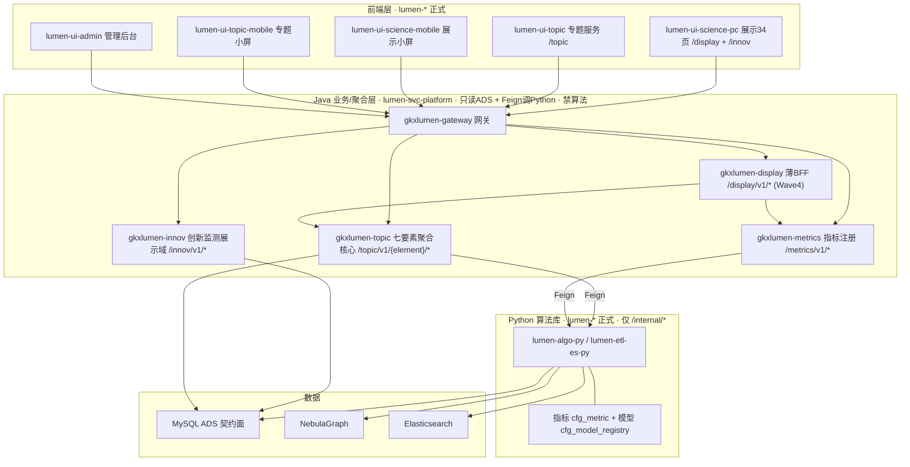
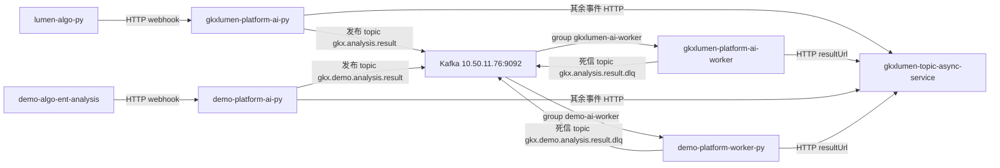

# 架构基线（编排 P0 输入 · 方案 A 共享聚合核心）

> **读者**：architect-agent、coordinator、全部开发/qa Agent  
> **作用**：多智能体编排的**架构真源**，与 `scope-baseline.yaml`（范围）并列为 P0 输入。所有 Epic/leaf 的服务边界、契约方向、依赖规则以本文为准；与本文冲突的实现一律按本文纠正。  
> **关联**：[graph-engine.md](graph-engine.md)（NebulaGraph）· [observability.md](observability.md)（OTel）· [storage/README.md](data/data-design/storage/README.md)（ADS/域库）· [scope-baseline.md](scope-baseline.md) / [scope-baseline.yaml](scope-baseline.yaml)（范围 ±10%）· [diagram-as-contract.md](diagram-as-contract.md)（图即契约）· [repo-registry.yaml](repo-registry.yaml)（仓与环境）· [cicd-pipeline.md](cicd-pipeline.md)（CI/CD）· [paths.yaml](paths.yaml)（路径展开；运行时根仍只认 `.env`）  
> **维护**：architect-agent；变更走本文 §8 变更记录 + PM 知情。

---

## 1. 目标拓扑（方案 A）

> **diagram_id：`ARCH-TOPO-LUMEN`**（L0 · 图即契约）。改服务边界 / 调用链 / D12 只改本图，禁止模块文档另画冲突全局拓扑。

算法库（Python）**同时服务**科技信息展示系统与科技专题服务系统；两系统共享同一 Java 聚合核心（`gkxlumen-topic` + `gkxlumen-metrics`），**不重复直连 Python、不各造一套算法调用**。



**调用链铁律**：`前端 → 网关 → Java 聚合（只读 ADS + Feign /internal/*）→ Python 算法库`。前端不直连 Python/DB/Nebula；Java 不写算法、不直连 nGQL。

**D12 仓隔离**：上图全部是 `lumen-*` 仓与 `gkxlumen-*` 服务。`demo-*` 只做原型，不进入本图。lumen 前端调用链（含 Java 下游 Feign）禁止打到任何 `demo-*` 项目服务，详见 §2 D12 / §3.1。

消息总线不进上图。`task_completed` 走 §1.1 `ARCH-MSG-KAFKA`。运行时不用 RabbitMQ。

### 1.1 消息总线（Kafka）

> **diagram_id：`ARCH-MSG-KAFKA`**（本叶契约图）。`signoff_status: draft`。改发布者、消费者、topic 或 bootstrap 只改本图。L0 `ARCH-TOPO-LUMEN` 不加这条边。

```yaml
diagram_id: ARCH-MSG-KAFKA
signoff_status: draft
bootstrap: 10.50.11.76:9092
```



| 生产者 | 消费者 | 触发 | 失败语义 | 禁止事项 |
|---|---|---|---|---|
| `gkxlumen-platform-ai-py`（仓 `lumen-topic-py`，`callback.py` 与 `result_delivery.py`） | `gkxlumen-platform-ai-worker`，组 `gkxlumen-ai-worker` | 在线：`task_completed` 且 result 非空 | 发布失败返回 HTTP 503，不向 Java 转发无指针结果；消费失败重试 3 次后由 Worker 发布到死信 topic | 禁止 RabbitMQ / AMQP；禁止算法仓和 Java 连接总线；禁止 demo 消费正式 topic |
| `demo-platform-ai-py`（仓 `demo-svc-topic-py`，同一对调用点） | `demo-platform-worker-py`，组 `demo-ai-worker` | 同上 | 同上 | 禁止与正式共用 topic 或消费组；客户端未切到 Kafka 之前不部署该 Worker |

| 职责 | 不做 |
|---|---|
| Kafka `10.50.11.76:9092` 只运送 `task_completed` 的现有 JSON 正文 | 不运送 `step_started` / `step_completed` / `task_failed` / `task_cancelled`（仍由 AI 进程同步 HTTP 到 Java） |
| 正式 topic `gkx.analysis.result`，死信 `gkx.analysis.result.dlq`，1 分区 | 不建交换机；死信由 Worker 在重试耗尽后自行发布 |
| 原型 topic `gkx.demo.analysis.result`，死信 `gkx.demo.analysis.result.dlq` | 不与正式 topic 混用 |
| 单条上限 64MiB（`max.message.bytes` 与客户端 `max_request_size` 同值） | 不把大 JSON 改成对象存储指针；超限走现有 503，不截断 |
| 地址写入配置；无认证按 PLAINTEXT | 口令、SASL 密钥不进 git。集群若要求 SASL，只走 Secret。不改 MySQL root |

**D13 整改债（决策已锁定；业务仓仍是旧客户端，实现见后续叶）：**

| ID | 缺口 | 现状 | 目标 | 实现任务 |
|----|------|------|------|----------|
| D13-DEBT-RMQ | 运行时配置和 `aio-pika` 仍连旧 AMQP | `lumen-topic-py`、`demo-svc-topic-py`、`demo-svc-platform` helm / k8s 仍有 RabbitMQ | 只连 `10.50.11.76:9092`，仓库与运行时都不再出现 AMQP 客户端 | `E-PLATFORM-P0-KAFKA-DEVOPS-L01` / `E-PLATFORM-P0-KAFKA-ALGO-L01` / `E-PLATFORM-P0-KAFKA-API-L01` |

---

## 2. 锁定决策（15 项）

| # | 决策 | 内容 |
|---|------|------|
| D1 | **Java 聚合拓扑 = 方案 A** | 统一 `gkxlumen-topic` 提供 `/topic/v1/{element}/*`，两个前端共享；展示页面级拼装走薄 BFF `gkxlumen-display`（Wave4 建），**M1 阶段 innov 仍由 `gkxlumen-innov` 直接服务展示**。禁止展示与专题各造一套独立算法调用。 |
| D2 | **算法库统一出口** | Python 能力经 **指标注册（`cfg_metric` / `gkxlumen-metrics` catalog）+ 模型注册（`cfg_model_registry`）** 出口；新算法必须注册，Java 经注册中心/`/internal/*` 调用，不绕过。 |
| D3 | **契约面 = ADS** | Java 业务 API **仅**读 `*_ads`（+ `app_user` 读写）；禁止扫 ODS/DWD、禁止 Java 写 ADS。算法写、API 读。 |
| D4 | **双前端职责切分** | `lumen-ui-science-pc`=展示 34 页（`/display/**` + `/innov`）；`lumen-ui-topic`=专题 PC（`/topic/**`）；`lumen-ui-science-mobile`=展示小屏；`lumen-ui-topic-mobile`=专题小屏（从 science-mobile **人工全量复制后按仓删减**，禁止写进 `lumen-ui-topic`）。共用 `observability.ts`、request 拦截器、网关。小屏规范：`Design-mobile.md` v1.1.2。 |
| D5 | **网关路由划分** | `/display/**`（展示 BFF）· `/topic/**`（专题聚合）· `/innov/**`（创新监测）· `/metrics/**`（指标注册）；均经 `gkxlumen-gateway`，StripPrefix + 回传 trace 头。 |
| D6 | **横切统一** | OTel 全栈（见 [observability.md](observability.md)）；图谱统一 NebulaGraph 协议（见 [graph-engine.md](graph-engine.md)）；缓存键含 `element`+参数 hash；鉴权/SSO/权限经网关统一，业务服务不各自实现。存储细表见 [storage/README.md](data/data-design/storage/README.md)。**2026-10-15 决议**（计划确认即签字）：TRSGraph 只作为下一 graphd 落点，不改产品名、不改 `source=nebula`、不引入亿集查图 API。storage 闸门已过。同日补充：所有图客户端配置指向 `10.50.75.136:9669`，地址写入各仓配置文件；口令不进 git。数据仍只重灌 `demo_gkx_chain`。 |
| D7 | **数据契约先行 + Mock 先行** | 三方原始数据源表结构未定期间：先冻结应用层**标准表（ADS 契约面）**，由 **Python 写 Mock 至 ADS**（禁 Java/前端造假数据）；三方源就绪后经**数据工厂**（`ODS 贴源 → DWD 清洗 → ADS`）转换接入，**不传导到契约面**、上层零改动。详见 [storage/README.md](data/data-design/storage/README.md) 决策 #5/#6（工厂主路径；Python 直写 ADS 仅为旁路）。 |
| **D8** | **前端规范唯一来源** | `agent-delivery/Design.md` 是前端权威 UI 规范（Figma 风格稿落地版，14 节，含设计定位 / 视觉气质 / 页面骨架 / 色彩 / 字体 / 圆角描边阴影 / 通用组件 / 地图分析工作区 / 图表 / 交互状态 / 响应式 / AI 生成规则 / 推荐实现映射 / 验收清单）。**新页面权威栈 = React + Vite + `@arco-design/web-react` + `@arco-design/web-react/icon` + ECharts + AntV G6 + Leaflet + dayjs**；主色固定 `#165DFF`、页面底色 `#D8E7FC`、Header 64px、Sidebar 200px、控件 32px；demo2 已有 Ant Design v5 代码兼容保留，**禁止同页面混搭**，**禁引 `antd` / `antd/dist/reset.css`**。token / 配色 / 组件清单严格按规范；UI/Frontend handoff 必带 `Design.md §14` 14 条（8 检查 + 6 验收）对照表。详见 §5.2 评审清单与 `repo-registry.yaml#frontend_design_authority`。 |
| **D9** | **数据血缘唯一来源** | 界面每个统计指标必须有"8 件套"元数据（metric_id / 中文名 / 口径定义 / 公式 / **algorithm_type** / 源表 / 源系统 / 更新频率 / 版本；v1.5 共 9 项）；UX wireframe 字段表第 6 列必有 `metric_id`；UI 每个统计数字旁必有 ⓘ 触发 MetricSpecCard；Wave 0 阶段 Mock 数据必有 🧪 MockBadge。详见 `data-lineage-policy.md` §2.1（决策 2026-06-17；v1.5 2026-08-22）。 |
| **D10** | **交互规范唯一来源** | `agent-delivery/agent-handoffs/产品整体定义/UX-UE 通用交互组件规范.md` 是交互行为权威规范（20 节，含组件分类 / Arco 映射 / 实现约定 / 验收用例 / 全局交互语言 / 导航 / 筛选 / 卡片 / Tab按钮组 / 图表 / 地图 / 图谱 / 表格 / 抽屉 / 导出 / 权限态 / 状态矩阵 / 键盘 / 无障碍 / 走查清单）。**与 D8 分层互补**：交互行为 / 状态覆盖 / 键盘可达 / 无障碍 / Arco 组件选型边界以本规范为准；视觉 token / 配色 / 字号 / 圆角 / 阴影以 `Design.md` + Arco 主题为准，二者不互相覆盖语义。导航 / 页签按 Figma 定制但须保留 Arco 同类组件状态、键盘与无障碍语义；ux/ui/frontend handoff 必带 **§19 设计走查清单 + §3.4 验收用例** 对照。**注：D10 决策 2026-06-23，demo 阶段经用户放行免 PM+架构师双签，上线前需补签确认**；归属仓与正式基线区位置待 ui-agent 接力产出后再定。 |
| **D11** | **demo-ui-system-test Arco 一致性豁免** | demo-ui-system-test（算法效果展示/内测台，Vue + Element Plus）**不纳入 Arco 一致性收敛范围**。理由：(1) 定位为内部算法工程师自测与演示工具，不面向甲方展示；(2) 当前 Element Plus 栈（el-tabs/el-button/ElMessage/ElMessageBox）稳定可用；(3) 迁移至 Arco（无论 Vue 版还是 React 重写）对内部用户零收益、高成本。若未来甲方明确要求该仓纳入展示前端，再启动迁移评估。决策来源：QA 交互规范回归走查报告 G-09（§4 栈级偏离待裁决），由算法负责人唐绍祖与架构基线 §2 对照后裁定。登记日期：2026-07-31。关联 task：DECIDE-SYSTEMTEST-STACK。 |
| **D12** | **demo 原型 / lumen 正式隔离** | **`demo-*` 仓只做原型**（POC / UX 沙箱 / 算法内测 / Demo 库闭环）。**正式开发与交付只在 `lumen-*`。** **lumen 前端调用链禁止调用任何 `demo-*` 项目服务**：`lumen-ui-*` 只经 `gkxlumen-platform-gateway`（`lumen-svc-platform`）调 `gkxlumen-*` Java；Java 下游只调 `lumen-algo-py` / `lumen-etl-es-py` 等 lumen 算法（`/internal/*`）。禁止直连、nginx 反代、`VITE_*` 或 Feign/helm **回落**到 `demo-svc-platform` / `demo-platform-*` / `demo-algo-*` / `demo-svc-topic-py`。对照 demo 实现允许读代码后在 lumen 重写；**禁止 git merge demo→lumen**（延续铁律 6）。demo 前端可以打 demo 服务，与 lumen 隔离并存。决策来源：项目负责人 2026-08-14 确认。关联 task：`DECIDE-D12-LUMEN-CALLCHAIN`。历史债见 §3.1。 |
| **D13** | **消息总线 = Kafka，运行时不用 RabbitMQ** | bootstrap **`10.50.11.76:9092`**。只承载 `task_completed` 大 JSON。正式 topic `gkx.analysis.result`、死信 `gkx.analysis.result.dlq`、组 `gkxlumen-ai-worker`；原型 topic `gkx.demo.analysis.result`、死信 `gkx.demo.analysis.result.dlq`、组 `demo-ai-worker`。两边禁止共用 topic 或组。发布者 `gkxlumen-platform-ai-py` / `demo-platform-ai-py`；消费者 `gkxlumen-platform-ai-worker` / `demo-platform-worker-py`。算法与 Java 不连总线。正文契约不变，单条上限 64MiB。口令不进 git，不改 MySQL root。图 `ARCH-MSG-KAFKA`（§1.1）。关联 task：`E-PLATFORM-P0-KAFKA-RMQ-L01`。 |
| **D14** | **对象存储按 §2.1：业务一个桶、用途是目录** | 正式业务只写 RustFS `http://10.50.69.111:19000` 上的桶 `gkx-lumen`（路径风格，控制台 `:19001`）。六个用途是这个桶里的目录，不是各自独立的桶。可观测仍用旧实例 `:30900` 上的 `tempo-blocks`、`loki-chunks`。存储设计说明见 [minio.md](data/data-design/storage/platform/minio.md)，与本节冲突时以本节为准。禁止自造桶或顶层目录，禁止前端直连对象存储，禁止业务读写 `milvus` 桶。凭证放 K8s Secret `gkxlumen-platform-rustfs` 或主机 `/data/middleware/.env`，不进 git。决策 2026-10-20，同日收敛为目录。 |
| **D15** | **展示系统 Python 门面独立于专题系统** | 在 `lumen-topic-py` 仓内新增 `gkx_show_service` 子项目作为**科技信息展示系统专属 Python 门面**，与专题侧 `gkx_search_service` / `gkx_svc_service` **进程级 + 镜像级 + 路由级三重隔离**：镜像 `gkxlumen-show-service`（端口 8082），路由前缀 `/internal/gkx-show/**`，K8s Deployment `gkxlumen-platform-show-py`。展示门面只读正式 ADS、不写 ADS、不承接算法职责（D2 算法库统一出口不变，数据加工/写 ADS 仍归 `lumen-algo-py/vendor/entan-py` / `innov-py`）。共享仅限 `gkx_common` 工具链（observability/response/config）。协作边界用 `CODEOWNERS` 划定。**调用链层级（三层）**：终端 → `gkxlumen-gateway` → `gkxlumen-display`（展示聚合 BFF，`/display/v1/**` 单入口）→ **Feign 并行** → 领域服务层（`gkxlumen-innov` / `gkxlumen-topic` / `gkxlumen-metrics`）→ **Feign /internal** → 算法层（`gkx_show_service` 读 ADS / 久新 API / 燕大 KG / 智谱 / 深势）。展示 BFF 职责：页面级聚合、Redis 缓存、分区降级、D9 就绪度注入；**不直连 Python / DB**。领域服务 Feign 调 Python 算法层（含 show-service）是合规路径。要素归属速查见 §2.2。决策来源：项目负责人 2026-10-22 确认，`徐腾强 @qike366.com` 落地骨架（commit `4b867f8`）。关联任务 `DEVOPS-LUMEN-TOPIC-PY-SHOW-L01`。 |

### 2.1 对象存储桶（D14）

正式业务只有桶 `gkx-lumen`。MySQL 只存指针（桶名、对象键、谁能下载）。桶里只放字节。

### 2.2 要素归属速查（D15 调用路由依据）

> **完整调用链**：终端 → 网关 → `gkxlumen-display`（展示聚合 BFF `/display/v1/**`）→ Feign 并行 → 领域服务（innov/topic/metrics）→ Feign `/internal` → Python 算法层。
> **本表仅标注领域服务下游 Python 路由方向**。真源：`工程过程/02-策划与监控/01-总集大项目整体计划/外部接口依赖/07-展示系统-页面级供方能力清单（久新+燕大）.md`

| 要素 | 编码 | 供方 | 领域服务 → 算法层路由 |
|---|---|---|---|
| 企业 | enterprise | **智树自建** | Feign → `gkx_show_service` `/internal/gkx-show/v1/enterprise/*` 读 ADS |
| 政策 | policy | **智树自建** | Feign → `gkx_show_service` 读 ADS |
| 产业链 | chain | **智树自建** | Feign → `gkx_show_service` 读 ADS |
| 服务机构 | service | **智树自建** | Feign → `gkx_show_service` 读 ADS |
| 园区（创新载体） | park | **智树自建** | Feign → `gkx_show_service` 读 ADS |
| 资金 | fund | **智树自建** | Feign → `gkx_show_service` 读 ADS |
| 专家学者 | scholar | 久新 | 领域服务**直接调久新 API**，不走 show-service |
| 科研机构 | institution | 久新 | 领域服务直接调久新 API |
| 高校实验室 | lab | 久新 | 领域服务直接调久新 API |
| 论文 | paper | 久新 | 领域服务直接调久新 API |
| 期刊 | journal | 久新 | 领域服务直接调久新 API |
| 专利 | patent | 久新 | 领域服务直接调久新 API |
| 项目 | project | 久新 | 领域服务直接调久新 API |
| 课题 | topic | 久新 | 领域服务直接调久新 API |
| 成果 | result | 久新 | 领域服务直接调久新 API |
| 会议 | meeting | 久新 | 领域服务直接调久新 API |
| 知识图谱 | kg | 燕大 | 领域服务直接调燕大 API（KG-01~KG-09） |
| NLP / 大模型 | — | 智谱 | 领域服务直接调智谱 API |
| 量子 / 物理模拟 | — | 深势 | 领域服务直接调深势 API |

| 位置 | 所在实例 | 用途 | 对象键 |
|---|---|---|---|
| `gkx-lumen` / `gkx-analysis-results` | 新 RustFS `10.50.69.111:19000` | 展示系统、专题系统分析中间结果 JSON | `gkx-analysis-results/analysis/{类型}/{父任务}/{任务}/{文件}` |
| `gkx-lumen` / `gkx-user-reports` | 同上 | 展示系统、专题系统用户生成的 HTML 和 PDF | `gkx-user-reports/science/html/`、`science/pdf/`、`topic/html/`、`topic/pdf/`，后接 `{用户}/{日期}/{文件}` |
| `gkx-lumen` / `gkx-source-reports` | 同上 | 政策原始文件，以及采购的三方报告 PDF | 政策 `gkx-source-reports/policy/{文件}`；采购原文 `gkx-source-reports/zh/…pdf`、`gkx-source-reports/en/AD/2018/….pdf` |
| `gkx-lumen` / `gkx-cms-images` | 同上 | CMS 写进 HTML 的图片 | `gkx-cms-images/{内容ID}/{文件}` |
| `gkx-lumen` / `gkx-user-assets` | 同上 | 用户头像和其他零碎上传 | `gkx-user-assets/avatar/{用户}/{文件}`、`gkx-user-assets/misc/{日期}/{文件}` |
| `gkx-lumen` / `gkx-others` | 同上 | 放不进上面五个目录的其他杂项 | `gkx-others/{用途}/{日期}/{文件}` |
| `tempo-blocks` | 旧 RustFS `10.50.69.111:30900` | 可观测：Tempo 链路 | — |
| `loki-chunks` | 同上 | 可观测：Loki 日志 | — |

开发时遵守：

1. 正式业务只写桶 `gkx-lumen`，并且对象键必须落在上表六个目录之一。要新目录或新桶，先改本节，再写代码。
2. 分析中间结果 JSON 进 `gkx-analysis-results`；用户生成的 HTML/PDF 进 `gkx-user-reports`。两处不混。
3. `gkx-others` 只收临时对不上号的对象。一项用途会长期存在时，先在本节加目录，再从这里迁出去。
4. 前端不连 RustFS。上传和下载经 Java。
5. `milvus` 桶只给 Milvus 进程，不是业务目录。业务不要读写或清理里面的对象。
6. Demo 不写 `gkx-lumen`，仍用 `demo-gkx-analysis-results`。
7. `tempo-blocks`、`loki-chunks` 留在旧实例。业务代码不要用，也不要改它们的连接。旧实例上的 `gpustack`、`plane` 本项目不使用。

---

## 3. 服务清单与边界

| 服务 | 语言 | 路由/接口 | 职责 | 禁止 |
|------|------|-----------|------|------|
| `gkxlumen-gateway` | Java | 全部对外路由 | 路由、StripPrefix、trace 头回传、鉴权 | 业务逻辑 |
| `gkxlumen-topic` | Java | `/topic/v1/{element}/metrics\|graph\|analysis` | 七要素专题聚合核心（两前端共享） | 算法、直连 nGQL、写 ADS |
| `gkxlumen-metrics` | Java | `/metrics/v1/catalog` 等 | 指标注册中心（口径/版本） | 算法 |
| `gkxlumen-innov` | Java | `/innov/v1/*` | 创新监测展示域聚合（M1） | 算法（NLP/图谱/模型） |
| `gkxlumen-display` | Java | `/display/v1/*` | 展示 34 页薄 BFF，复用 `/topic`+`/metrics`（**Wave4**） | 重复直连 Python、写 ADS |
| 算法库 | Python | 仅 `/internal/*` | ETL/NLP/图谱/模型/指标计算，写 ADS/Nebula/ES | 对前端暴露、写业务 REST |

> **innov 与 topic 的关系**：`gkxlumen-innov` 是展示域的早期专用聚合（创新监测），与 `gkxlumen-topic` 同属"只读 ADS + Feign 调 Python"模式；长期可并入展示 BFF/专题聚合体系，M1 阶段保持独立以走快路径。

### 3.1 仓边界（D12）与历史债

| 前缀 | 定位 | 仓（工作区） |
|------|------|----------------|
| **demo-*** | 原型 only | `demo-ui-science` · `demo-ui-topic` · `demo-ui-system-test` · `demo-admin-ui` · `demo-svc-platform` · `demo-svc-topic-py` · `demo-algo-science` · `demo-algo-ent-analysis` |
| **lumen-*** | 正式开发 | `lumen-ui-science-pc` · `lumen-ui-topic` · `lumen-ui-science-mobile` · `lumen-ui-topic-mobile` · `lumen-ui-admin` · `lumen-svc-platform` · `lumen-algo-py` · `lumen-etl-es-py` · **`lumen-topic-py`（检索/AI 门面）** |

合法：`lumen-ui-*` → `gkxlumen-platform-gateway` → `gkxlumen-*` → `lumen-algo-py` / `lumen-etl-es-py` / **`lumen-topic-py`** `/internal/*`。  
禁止：lumen 前端或其后半段 Feign/helm 回落打到 `demo-svc-platform` / `demo-platform-*` / `demo-algo-*` / `demo-svc-topic-py`。

**D12 整改债（决策仓只登记；实现见对应 leaf）：**

| ID | 缺口 | 现状 | 目标 | 实现任务 |
|----|------|------|------|----------|
| D12-DEBT-TOPIC-PY | 企业检索/AI Python 仍是 demo 运行时 | **已闭合**（2026-08-14）：`python-base-url=http://gkxlumen-platform-search-py:8080`；async `python-ai-base-url=http://gkxlumen-platform-ai-py:8081`；仓 `lumen-topic-py` pipeline 5026 + Java `1ceb8e3` pipeline 5027；网关 filters **200** | Java 不再打 `demo-platform-search-py` | `DEVOPS-LUMEN-TOPIC-PY-L01` / `PY-LUMEN-TOPIC-PY-PORT-L01` / `API-LUMEN-TOPIC-PY-CUTOVER-L01` |
| D12-DEBT-INNOV-PY | 创新监测算法仍是 demo 制品 | **已闭合**（2026-08-14）：`lumen-algo-py` `vendor/innov-py` 出镜像 `gkxlumen-innov-py`；helm repository 已切；demo-algo-science CI 只更新 `demo-platform`；科技新闻仍 `gkxlumen-platform-innov-py`；`INNOV_CHAIN` → `lumen-platform-algo-py` | 算法进程在 `lumen-algo-py`；禁止 demo 回落 | `PY-LUMEN-INNOV-PORT-L01` / `API-LUMEN-INNOV-ENTAN-CUTOVER-L01` |
| D12-DEBT-ENTAN-PY | 企业图谱 worker 仍是 demo 制品 | **已闭合**（2026-08-14）：`vendor/entan-py` 出 `gkxlumen-entan-py-api` / `gkxlumen-entan-py-worker`；demo-algo-ent-analysis CI 只更新 `demo-platform` | 迁入 `lumen-algo-py`；lumen 不再依赖 demo-algo-ent-analysis 运行时 | `PY-LUMEN-ENTAN-PORT-L01` / `API-LUMEN-INNOV-ENTAN-CUTOVER-L01` |
| D12-DEBT-REGISTRY | 登记表落后 | **已闭合**：`lumen-algo-py` / `lumen-topic-py` 已登记且 topic-py 已切流 | 正式 Python：`lumen-algo-py` + `lumen-etl-es-py` + `lumen-topic-py` | 随 TOPIC-PY 三叶闭合 |
| D12-DEBT-ETL-ES-PY | 正式 DWD→ES ETL 仍挂在 demo helm | **已闭合**（2026-08-14）：正式 `gkxlumen-platform-etl-es-py`；demo `etlEsPy.enabled=false`，`demo-platform-etl-es-py` 已卸。demo 只改 chart 走 `helm:chart` | lumen 作业只打 `gkxlumen-platform-etl-es-py`；demo chart 不再托管正式 ETL | `DEVOPS-LUMEN-ETL-ES-L01` / `DEVOPS-LUMEN-ETL-ES-CUTOVER-L01` / `DEVOPS-DEMO-HELM-CHART-ONLY-L01` |

**D12 数据面 as-built（2026-08-14）**

| catalog / 库 | 谁用 | 表名 |
|---|---|---|
| `gkxlumenx_{ods,dwd,ads,dim}` + `gkxlumenx_cfg` | lumen Java `gkxlumen-innov`（`InnovSql` 改写）+ lumen `innov-py`（`INNOV_LEGACY_CATALOG=0`） | 1B+2B 去前缀（`innovation_event` 等） |
| `demo_gkxlumenx_{ods,dwd,ads,dim}` | demo innov-py / demo entan-py / demo Java `gkx-innov`（DataPlane 改写） | 1B+2B 去前缀 |
| `gkxlumenx_{dwd,ads,cfg}` | lumen entan-py + 厨房 `lumen-algo-py` | 正式 ADS（企业/产业链表家族，与创新事件并存） |
| `innov` | **历史 M1 快照**，lumen 运行时不再指向 | `ads_*` / `dwm_*` |

vendor FastAPI 仍含 `/v1` 源码（demo 网关 `/entan/**` 合法直连）。lumen helm `ENTAN_EXPOSE_PUBLIC_API=0` / `INNOV_EXPOSE_PUBLIC_API=0`，运行时只留 `/healthz` `/internal/*`。lumen git 网关无 `/entan`。

产业链门面（`gkxlumen-topic-chain` / async job）已钉 `lumen-algo-py`，可作为迁出样板。

---

## 4. 机器可读依赖规则（agent 校验用）

```yaml
dependency_rules:
  frontend:
    may_call: [java_rest_via_gateway]
    must_not_call: [python_internal, mysql, nebula, elasticsearch]
  lumen_frontend_call_chain:   # D12：整条链都不得打到 demo-* 服务
    frontend_repos: [lumen-ui-science-pc, lumen-ui-topic, lumen-ui-science-mobile, lumen-ui-topic-mobile, lumen-ui-admin]
    may_call: [gkxlumen-platform-gateway]
    java_downstream_may_call: [lumen-algo-py, lumen-etl-es-py, lumen-topic-py]
    must_not_call: [demo-svc-platform, demo-platform-*, demo-algo-science, demo-algo-ent-analysis, demo-svc-topic-py]
  java_aggregation:        # gkxlumen-topic / metrics / innov / display
    may_read: [mysql_ads, app_user]
    may_call: [python_internal_via_feign, registry]
    must_not: [nlp, graph_compute, model_inference, write_ads, direct_ngql, scan_ods_dwd, demo_algo_runtime, demo_platform_fallback]
  python_algo:
    may_write: [mysql_ads, mysql_dwd, mysql_dwm, nebula, elasticsearch]
    exposes_only: [/internal/*]
    as_built_lumen_runtime: "vendor 仍含 /v1 源码；lumen helm *_EXPOSE_PUBLIC_API=0 关闭；demo 可开"
    must_not: [business_rest_to_frontend]
    lumen_formal_repos: [lumen-algo-py, lumen-etl-es-py, lumen-topic-py]
    demo_prototype_repos: [demo-algo-science, demo-algo-ent-analysis, demo-svc-topic-py]
  python_show_facade:                    # D15：展示系统 Python 门面独立
    repo: lumen-topic-py                 # 不新建仓，仓内子项目 gkx_show_service
    subproject: gkx_show_service
    image: gkxlumen-show-service          # 独立镜像 + 独立 K8s Deployment
    port: 8082
    route_prefix: /internal/gkx-show/**
    deploys_as: gkxlumen-platform-show-py
    may_read: [mysql_ads]                 # 只读正式 ADS 消费面
    may_call: [lumen_algo_py_internal_via_feign]  # 按需调算法库
    must_not: [write_ads, nlp, graph_compute, model_inference]  # D2：算法职责归 algo-py
    isolated_from: [gkx_search_service, gkx_svc_service]  # 专题侧路由 8080 / 8081 完全隔离
  display_aggregation:     # 展示页面级拼装
    prefer_reuse: [/topic/v1, /metrics/v1]
    must_not: [new_direct_python_call_bypassing_topic_metrics]
  algorithm_capability:
    must_register: [cfg_metric, cfg_model_registry]   # 新算法必须注册，不绕过
  message_bus:                            # D13
    broker: kafka
    bootstrap: "10.50.11.76:9092"
    must_not: [rabbitmq, amqp, aio_pika]
    lumen:
      publisher: gkxlumen-platform-ai-py
      consumer: gkxlumen-platform-ai-worker
      topic: gkx.analysis.result
      dlq_topic: gkx.analysis.result.dlq
      group: gkxlumen-ai-worker
    demo:
      publisher: demo-platform-ai-py
      consumer: demo-platform-worker-py
      topic: gkx.demo.analysis.result
      dlq_topic: gkx.demo.analysis.result.dlq
      group: demo-ai-worker
    max_message_bytes: 67108864
    secrets_in_git: false
  object_storage:                         # D14
    business_bucket: gkx-lumen
    endpoint: "http://10.50.69.111:19000"
    directories: [gkx-analysis-results, gkx-user-reports, gkx-source-reports, gkx-cms-images, gkx-user-assets, gkx-others]
    observability_buckets: [tempo-blocks, loki-chunks]
    observability_endpoint: "10.50.69.111:30900"
    demo_bucket: demo-gkx-analysis-results
    must_not: [frontend_direct_rustfs, business_write_milvus, demo_write_gkx_lumen, invent_bucket_or_top_directory]
    secrets_in_git: false
  data_contract:                          # D7 数据契约先行 + Mock 先行
    standard_tables: [mysql_ads, gkx_dim, gkx_cfg]    # 冻结，Java 只读依赖
    mock_writer: python_to_ads            # 仅 Python 写 Mock 到 ADS
    must_not: [java_or_frontend_fake_data, third_party_schema_leak_into_ads]
    third_party_source: deferred          # 表结构待定；经数据工厂 ODS->DWD->ADS 接入
    switch_path: [freeze_ads, python_mock_ads, parallel_dev, data_factory_when_source_ready, mock_to_real]
shared_core:
  topology: A
  shared_by: [lumen-ui-science-pc, lumen-ui-topic]
  core_services: [gkxlumen-topic, gkxlumen-metrics]
```

---

## 5. 架构合规检查清单（architect 评审 / qa 验收用）

### 5.1 后端 / 数据 / 横切（D1–D7、D13、D14）

- [ ] 前端无直连 Python/DB/Nebula 的调用（仅经网关调 Java）
- [ ] Java 模块无 NLP/图谱/模型计算代码，无写 ADS，无直连 nGQL
- [ ] 展示页面聚合复用 `/topic`+`/metrics`，未新增绕过的 Python 直连
- [ ] 新增算法能力已注册到 `cfg_metric` / `cfg_model_registry`
- [ ] 网关路由归属正确（`/display` `/topic` `/innov` `/metrics`），trace 头回传
- [ ] OTel / NebulaGraph / 缓存键 / 鉴权 符合横切规范
- [ ] 数据契约：Java 只读冻结的 ADS 标准表；Mock 由 Python 写 ADS（无 Java/前端造假数据）；三方源字段未泄漏进 ADS（见 [storage/README.md](data/data-design/storage/README.md)）
- [ ] **图即契约**：本 Epic 该有的 L0–L4 图已落点且节点名=仓/服务名；图文冲突以图为准（见 [diagram-as-contract.md](diagram-as-contract.md)）
- [ ] **消息总线（D13）**：运行时只连 Kafka `10.50.11.76:9092`；无 RabbitMQ / AMQP / `aio-pika`；正式与原型 topic、消费组分开；口令不进 git
- [ ] **对象存储桶（D14）**：正式业务只写 `gkx-lumen` 下 §2.1 的六个目录；可观测只用 `tempo-blocks`、`loki-chunks`；无自造桶或顶层目录；前端不直连 RustFS；业务不读写 `milvus`；Demo 不写 `gkx-lumen`；凭证不进 git

### 5.3 仓隔离合规（D12）

- [ ] lumen 前端（含 nginx `/api`、`VITE_APP_API_URL` / `VITE_API_URL`）只指向 `gkxlumen-platform-gateway`，无 demo 网关 / demo NodePort
- [ ] lumen Java 新增或改动的 `algo-base-url` / Feign 不指向 `demo-algo-*` / `demo-platform-*` / `demo-svc-*`
- [ ] 无 `git merge` demo → lumen；对照实现是读代码后重写
- [ ] 已知历史债（§3.1 `D12-DEBT-*`）未作为新能力的默认下游；新 PR 不得再扩大回落

### 5.2 前端规范合规（D8）

- [ ] 新页面使用 `@arco-design/web-react`（不是 AntD v5；除非是 demo2 历史代码维护）
- [ ] 同页面无 Arco / AntD 混搭；项目入口**不引** `antd` / `antd/dist/reset.css` / `vendor-antd`
- [ ] token 从 `Design.md §4 色彩 / §5 字体 / §6 圆角描边阴影 / §13 推荐实现映射` 导入（无硬编码颜色 / 圆角 / 字号 / 间距 / 阴影）
- [ ] 主色固定 `#165DFF`，页面底色 `#D8E7FC`；截图取样验证（`Design.md §14 验收 #5`）
- [ ] 方向性指标符合"上升红 / 下降绿 / 持平灰；连续量蓝系梯度"硬铁律
- [ ] **业务要素配色**：10 类业务对象（专家 / 企业 / 机构 / 会议 / 论文 / 专利 / 服务机构 / 项目 / 课题 / 期刊）按 `Design.md §4.3` 固定映射；"资讯" 在 v2 已取消
- [ ] Tag 使用浅底深字（`Design.md §7.4`，不直接用高饱和图表色作底）
- [ ] **页面骨架强制六容器（`Design.md §3.1`）**：`app-shell` / `app-frame` / `app-header(64px)` / `app-sidebar(展开 200px)` / `content-shell(margin 16px)` / `workspace-grid(184px + 1fr + 520px)`
- [ ] **三段工作区强制（`Design.md §3.2`）**：左侧图层 + 中央地图/主视图 + 右侧分析面板；**右侧分析面板默认不可删除**
- [ ] Tabs 用 `Design.md §7.3` 轻量样式（蓝字 + 浅蓝底激活态，不要把主导航塞进 tabs）
- [ ] 卡片 / 图表容器圆角按 `Design.md §6.1`（页面外壳 `12~16px`、一级面板 `8~12px`、按钮/输入 `2~4px`、标签胶囊 `999px`）；浅色蓝灰风格；无深色霓虹大屏
- [ ] handoff 附 `Design.md §14` 14 条对照表（§14 检查 8 条 + 验收 6 条；已过 / N/A 已说明 / 未过 0）

---

## 6. 与范围/数据/图谱/集成基线的关系

本表只索引现网真源，不搬家。[数据库设计.md](数据库设计.md) **已作废**，ADS/域库以 [storage](data/data-design/storage/README.md) 为准。

| 维度 | 真源 | 关系 |
|------|------|------|
| 范围（功能点 ±10%） | [scope-baseline.md](scope-baseline.md) · [scope-baseline.yaml](scope-baseline.yaml) · [范围明细](科技信息展示系统+专题战略4要素以及综合分析+数据处理中台-智树-范围明细.md) · [职责边界](scope-and-responsibility.md) | 架构只承载报价内实现项；只分析项不进交付拓扑。yaml 为招标叶子机器计数 |
| 数据（ADS / 工厂 / 三方） | [storage/README.md](data/data-design/storage/README.md)（[ENT](data/data-design/storage/ENT/README.md) · [CHAIN](data/data-design/storage/CHAIN/README.md) · [SVC](data/data-design/storage/SVC/README.md) · [POLICY](data/data-design/storage/POLICY/README.md)）· [data/README.md](data/README.md) · [data-lineage-policy.md](data-lineage-policy.md) | D3 契约面在 storage（ADS 必进本树）；D7 Mock/工厂见 storage 决策 #5/#6；三方 ODS 在 `data/third-party-source/`；D9 8 件套走血缘规约 + metric-registry MCP |
| 图即契约 | [diagram-as-contract.md](diagram-as-contract.md) | 五层 Mermaid 落点 + 会签只投图；L2 金牌样板 = [SVC/01-data-flow.md](data/data-design/storage/SVC/01-data-flow.md) |
| 图谱引擎 | [graph-engine.md](graph-engine.md) | D6 NebulaGraph 协议；一张 `G_科创`（storage 决策 #7）。下一 graphd 为 TRSGraph，运行时地址待 `E-PLATFORM-P0-TRSGRAPH-L01` 闸门 |
| 调用链铁律 | [本文 §1](#1-目标拓扑方案-a) · [§4](#4-机器可读依赖规则agent-校验用) | `前端 → Java → Python /internal/*`；D12 见 [§2](#2-锁定决策14-项) / [§3.1](#31-仓边界d12-与历史债)。工程过程索引：[04-产品集成.md](工程过程/04-产品集成.md) |
| 对象存储桶（D14） | [本文 §2.1](#21-对象存储桶d14) | 正式业务桶 `gkx-lumen`（`10.50.69.111:19000`），六个用途是目录。可观测桶 `tempo-blocks`、`loki-chunks` 在 `:30900`。设计说明 [minio.md](data/data-design/storage/platform/minio.md) 与本节冲突时以本节为准 |
| 消息总线（D13） | [本文 §1.1](#11-消息总线kafka) | Kafka `10.50.11.76:9092`；运行时不用 RabbitMQ。图 `ARCH-MSG-KAFKA` |
| 仓与环境映射 | [repo-registry.yaml](repo-registry.yaml) | demo↔lumen 仓、服务名、环境、`branch_policy` |
| CI/CD | [cicd-pipeline.md](cicd-pipeline.md) | push → Pipeline 绿 → K8s dev；设计类 `cicd: skip` |
| 可观测性 | [observability.md](observability.md) | D6 全栈 OTel |
| 路径 | [paths.yaml](paths.yaml) | `${GKX_ROOT}` 展开表；**运行时根只认** `gkx-orchestration/.env` |
| 前端视觉（D8） | [Design.md](Design.md) | token / 组件 / §14 验收 |
| 交互（D10） | [UX-UE 通用交互组件规范.md](agent-handoffs/产品整体定义/UX-UE%20通用交互组件规范.md) | 行为 / 键盘 / 无障碍；与 D8 分层互补 |

---

## 7. 架构师角色（轻量）

| 时机 | architect-agent 动作 |
|------|----------------------|
| 编排启动前 | 维护本基线（一次性产出 + 增量更新） |
| Epic 首任务开工前 | 设计评审：确认该 Epic 契约/依赖方向不破 §2 决策 |
| 里程碑签收（L10 / P0-L08 / E7-L07） | 合规评审：按 §5 清单核对 handoff 与 dev 实现 |

详见 [项目工程化交付模式.md](项目工程化交付模式.md) 子 Agent 规划 与 [智能体编排与派单手册.md](智能体编排与派单手册.md) §5/§9。

---

## 8. 变更记录

| 版本 | 日期 | 说明 |
|------|------|------|
| v1.0 | 2026-06-17 | 初版：方案 A 共享聚合核心；6 项锁定决策；依赖规则；新增 `lumen-ui-topic` 专题前端、`gkxlumen-display` 薄 BFF；architect-agent 轻量角色 |
| v1.1 | 2026-06-17 | 新增 D7 数据契约先行 + Mock 先行（Python 写 Mock 至 ADS、数据工厂解耦三方源）；依赖规则增 `data_contract`；§5 清单增数据契约项 |
| v1.2 | 2026-06-17 | 新增 **D8 前端规范唯一来源**（`AI可复用UI框架与设计规范.md` 为权威；新页面 Arco；demo2 已有 AntD 兼容保留，禁混搭）；§5 增 5.2 前端规范合规清单（10 条）；architect 评审清单与 `repo-registry.yaml#frontend_design_authority` 同步更新 |
| v1.3 | 2026-06-17 | UI 规范 v1.1 同步：章节号偏移（§7.3 图表色 → §7.4，§7.3.3 业务对象固定映射 → §7.4.3，§7.4 Tag 配色 → §7.5）；新增 §7.3 **最大内容容器 token（`.content-shell-glass`）**；新增 §9.3 **GlobalWorkbenchTabs**（一级工作台 Tab）与 §9.4 **AnalysisPanelTabs**（右侧分析二级 Tab）；§5.2 前端规范合规清单从 10 条扩到 12 条（加最大内容容器一层 + Tab 分级两项）；ux/ui/dispatch 同步通用组件清单 15 → 17 |
| v2.0 | 2026-06-18 | **UI 规范全量重组**：废弃 `AI可复用UI框架与设计规范.md`，启用 `Design.md`（Figma 风格稿落地版，14 节）。重大变更：(1) **抽象组件命名体系废止**——废 17 个 PascalCase 组件（PageShell/TopicSidebar/GlobalWorkbenchTabs/AnalysisPanelTabs 等），改为 Figma 风格 class（`app-shell` / `app-frame` / `content-shell` / `workspace-grid` / `layer-panel` / `map-stage` / `analysis-panel`）；(2) **业务对象配色 11 类 → 10 类**，"资讯"取消；(3) **最大内容容器毛玻璃 token `.content-shell-glass` → `.content-shell`**（白色半透明，无毛玻璃）；(4) **Tab 分级取消**（一级/二级合并为 `§7.3 Tabs` 一节）；(5) **验收清单 §18 18 条 → §14 14 条**（8 检查 + 6 验收，含截图取样定量验收）；(6) **强制主色 `#165DFF`、页面底色 `#D8E7FC`、Header 64px、Sidebar 200px、控件 32px**；(7) **禁引 antd**（硬铁律，CI 应扫描）。所有 mdc / handbook / repo-registry / 角色对比手册同步重写引用 |
| v2.1 | 2026-06-23 | **决策表补登 D9 + 新增 D10 交互规范唯一来源**：§2 标题 8 → 10 项；补 D9（数据血缘，原仅在公约/data-lineage-policy 记录）；新增 **D10**（`UX-UE 通用交互组件规范.md` 为交互行为权威，与 D8 视觉规范分层互补：交互/状态/键盘/无障碍/Arco 选型边界归 D10，视觉 token 归 D8）。同步：`00-team-constitution §1` 增 P0 必读行、`§2` 增第 11 条铁律。task-registry 新增 `E-PROD-UXUE-ALIGN`（已上线页面回归走查），E-E7-POLICY-M1-L05 / E-PERM-L01/L02/L03 追加交互规范走查 DoD。**注：D10 demo 阶段经用户放行免双签，上线前需 PM+架构师补签** |
| v2.2 | 2026-08-14 | **新增 D12 demo 原型 / lumen 正式隔离**：`demo-*` 仅原型；正式开发只在 `lumen-*`；**lumen 前端调用链禁止打到任何 demo 服务**（含 Java Feign / helm 回落）。拓扑图与 §4 `lumen_frontend_call_chain`、§5.3 清单、§3.1 仓表与 `D12-DEBT-INNOV-PY` / `D12-DEBT-ENTAN-PY` 整改债同步。关联 `DECIDE-D12-LUMEN-CALLCHAIN`。公约铁律 12、repo-registry / paths.yaml / 工程化交付模式 / frontend·api·algorithm·architect mdc 同步 |
| v2.2.1 | 2026-08-14 | 补 **D12-DEBT-TOPIC-PY**：现网 `gkxlumen-topic-enterprise` 直连 `demo-platform-search-py`。正式仓名 **`lumen-topic-py`**（禁止 `lumen-svc-topic-py`、禁止只改名、禁止并进 `lumen-algo-py`）。实现三叶：`DEVOPS-LUMEN-TOPIC-PY-L01` / `PY-LUMEN-TOPIC-PY-PORT-L01` / `API-LUMEN-TOPIC-PY-CUTOVER-L01` |
| v2.2.2 | 2026-08-14 | `lumen-topic-py` 已建仓并切流：GitLab `gkx-lumen/lumen-topic-py`；Java `python-base-url` → `gkxlumen-platform-search-py`。**D12-DEBT-TOPIC-PY 闭合**。INNOV-PY / ENTAN-PY 仍开 |
| v2.2.3 | 2026-08-14 | **D12-DEBT-INNOV-PY / ENTAN-PY 闭合**：innov/entan 对照迁入 `lumen-algo-py` `vendor/`，镜像 `gkxlumen-innov-py` / `gkxlumen-entan-py-*`；helm 切制品名；demo 仓 CI `PLATFORM_K8S_PREFIXES` 仅 `demo-platform` |
| v2.2.4 | 2026-08-14 | **D12 数据面 + /v1 运行时收口**：lumen innov Java/Python 同 catalog `innov`（M1 表名，`INNOV_LEGACY_CATALOG`）；demo 继续 `demo_gkxlumenx_*`；lumen `*_EXPOSE_PUBLIC_API=0`；vendor 保留 `/v1` 源码。任务 `API-LUMEN-INNOV-DB-ALIGN-L01` / `API-LUMEN-ENTAN-V1-CLOSE-L01` |
| v2.2.5 | 2026-08-14 | **demo Java 离开正式 ADS**：`gkx-innov` DataPlane 把 `gkxlumenx_{ads,dwd,dim,ods}` 改写到 `demo_*`；JDBC `demo_gkxlumenx_ads`。任务 `API-DEMO-INNOV-ADS-ISOLATE-L01` |
| v2.2.6 | 2026-08-14 | **lumen innov 对齐正式 2B**：Java `InnovSql` 把 M1 未限定名改写到 `gkxlumenx_{ads,dwd,dim,cfg}`；helm 关 `INNOV_LEGACY_CATALOG`；JDBC catalog=`gkxlumenx_ads`。任务 `API-LUMEN-INNOV-2B-SQL-L01` |
| v2.2.7 | 2026-08-14 | 补 **D12-DEBT-ETL-ES-PY**：正式 `lumen-etl-es-py` 现网仍是 `demo-platform-etl-es-py`。本叶 helm+CI 迁入 `gkxlumen-platform`（ClusterIP）。任务 `DEVOPS-LUMEN-ETL-ES-L01` |
| v2.2.8 | 2026-08-14 | **关掉 demo ETL 副本**：`etlEsPy.enabled=false`。正式只留 `gkxlumen-platform-etl-es-py`。任务 `DEVOPS-LUMEN-ETL-ES-CUTOVER-L01` |
| v2.2.9 | 2026-08-14 | demo 只改 chart 走 **`helm:chart`**（不改 Java TAG）；upgrade 默认不重发 Nacos。**D12-DEBT-ETL-ES-PY 闭合**。任务 `DEVOPS-DEMO-HELM-CHART-ONLY-L01` |
| v2.2.10 | 2026-08-19 | **图即契约**（非新 D 决策）：增 `diagram-as-contract.md`；§1 拓扑图登记为 `ARCH-TOPO-LUMEN`；§5.1 / §6 挂接。存储流图仍以 `storage/*/01-data-flow.md` 会签为准 |
| v2.2.11 | 2026-08-23 | §6 补集成真源：调用链（本文）· `repo-registry.yaml` · `cicd-pipeline.md` · `observability.md` · `paths.yaml`；文首关联同步。与 [04-产品集成.md](工程过程/04-产品集成.md) 总入口对齐 |
| v2.2.12 | 2026-08-23 | §6 刷新：数据真源改 [storage](data/data-design/storage/README.md)，[数据库设计.md](数据库设计.md) 标作废；表内文件改为可点链接；D6/D7/§5.1 同步改指 storage |
| v2.2.13 | 2026-08-26 | **D4 小屏分仓**：`lumen-ui-science-mobile`=展示小屏；`lumen-ui-topic-mobile`=专题小屏（全量复制后删减）。拓扑增 TOPICMOB。规范 `Design-mobile.md` v1.0（LT-6-NORM / 孔东 C1–C7）。 |
| v2.2.14 | 2026-08-27 | D4 小屏规范指针改为 `Design-mobile.md` **v1.1.2**（C5 上限按页选用，禁止套版）。不改拓扑。 |
| v2.2.15 | 2026-10-15 | **D6 落点决议**（计划确认即签字，不改产品名）：TRSGraph `10.50.75.136:9669` 为下一 graphd；协议仍是 nGQL / Nebula，`source` 仍为 `nebula`。只迁 `demo_gkx_chain`（重灌、不拷文件、不双写）；不迁 `entan` / `demo_entan`；不建正式名 `gkx_chain`；不并入亿集 API；客户端保持 `nebula3-python>=3.4,<3.9`；口令只进环境变量或 Secret。运行时地址保持 `192.168.88.43:9669`，直到 `E-PLATFORM-P0-TRSGRAPH-L01` 闸门（storage ONLINE + nGQL 探针）通过。 |
| v2.2.16 | 2026-10-15 | **补充 `E-PLATFORM-P0-TRSGRAPH-L01` 目标**：storage 已 ONLINE。所有使用图库的配置与代码默认 host 指向 `10.50.75.136:9669`，地址、账号、space 写入各仓已有配置文件；口令不进 git。数据重灌范围仍只 `demo_gkx_chain`。 |
| v2.2.17 | 2026-10-15 | **配置已切**：各仓图客户端 settings / k8s / CI / 代码默认 host 改为 `10.50.75.136:9669`。口令仍只走环境变量。`demo_gkx_chain` 重灌与旧库停写验收尚未完成。 |
| v2.2.18 | 2026-10-17 | **新增 D13 消息总线 = Kafka**：bootstrap `10.50.11.76:9092`；运行时禁止 RabbitMQ。正式 / 原型 topic 与消费组隔离。图 `ARCH-MSG-KAFKA`（draft）。业务仓仍有 AMQP 客户端，记 `D13-DEBT-RMQ`。不改 MySQL root，口令不进 git。任务 `E-PLATFORM-P0-KAFKA-RMQ-L01`。 |
| v2.2.19 | 2026-10-20 | **新增 D14 对象存储桶**：§2.1 为各项目用桶的唯一规约。正式业务桶在 RustFS `10.50.69.111:19000`。禁止自造桶名，禁止前端直连，禁止业务读写 `milvus` 桶。凭证不进 git。 |
| v2.2.20 | 2026-10-20 | **D14 收敛为目录**：正式业务只保留桶 `gkx-lumen`。`gkx-analysis-results`、`gkx-user-reports`、`gkx-source-reports`（含政策原始文件）、`gkx-cms-images`、`gkx-user-assets`、`gkx-others` 改为该桶内目录。可观测仍是独立桶 `tempo-blocks`、`loki-chunks`。 |
| v2.2.21 | 2026-10-22 | **新增 D15 展示系统 Python 门面独立**：在 `lumen-topic-py` 仓内新增 `gkx_show_service` 子项目，与专题侧 `gkx_search_service` / `gkx_svc_service` 进程级 + 镜像级 + 路由级三重隔离（镜像 `gkxlumen-show-service` :8082，前缀 `/internal/gkx-show/**`，Deployment `gkxlumen-platform-show-py`）。展示门面只读正式 ADS + 按需调 algo-py `/internal/*`，不写 ADS、不承接算法职责（D2 不变）。骨架由徐腾强 `4b867f8` 落地；§4 依赖规则补 `python_show_facade` 块；协作边界用 `CODEOWNERS` 划定。关联任务 `DEVOPS-LUMEN-TOPIC-PY-SHOW-L01`。 |
