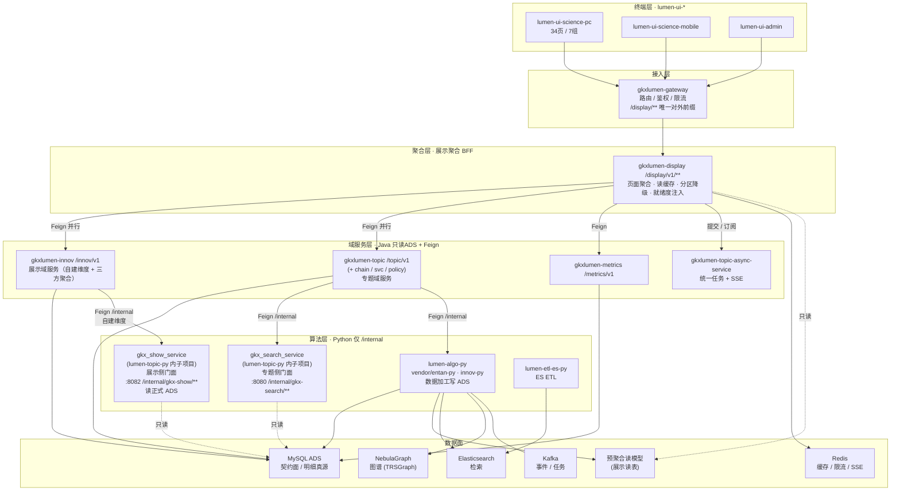

# 科技信息展示系统 · 技术架构设计（优化方案）

> **状态**：DRAFT · 提案 · 2026-10-20
> **作者**：coordinator-agent ｜ **待评审会签**：架构 `human:李伟` / 徐滕强 · 算法 唐绍祖 · 数据 Lead · PM 郭万迎
> **定位**：与 [`architecture-baseline.md`](./architecture-baseline.md) **并列**的**展示系统专项架构设计**。上位铁律 D1–D13 不变；本方案**不改动任何现有仓/服务边界**，仅重组展示系统的「接入 → 聚合 → 数据消费」方式。
> **关联**：`产品整体定义/科技信息展示系统-完整详细设计`（03 共享底座 / 11 存储接口 / 12 NFR / 13 部署）· `展示系统三要素集成-SCI-INT`（Z02 会签）· 外部接口 `06 / 06b / 06c / 06d`

---

## 0. 结论速览（TL;DR）

**前端只认 `/display/v1` 一个后端面；`gkxlumen-display` 由「薄 BFF」升级为「展示聚合 BFF」**，统一承担四件事：

1. **页面级聚合**：一页/一区块一个接口，服务端并行编排 + 裁剪，替代「前端多接口拼装」。
2. **读缓存**：Redis 页面级缓存，键 = `路由 + 筛选 + 权限 + 数据版本`。
3. **分区降级**：主 KPI 必达；图谱/预测/洞察可失败，返回诚实空态，**图失败不挡 KPI**。
4. **就绪度注入**：D9 四维角标 + 指标 8 件套由 `/metrics/v1/catalog` 单点供给，display 转发，**前端禁自填**。

重统计读走**预聚合读模型**（Python ETL 产出，display 只读）；图谱/算法走 Python `/internal/*`；重分析/报告/导出统一复用 `gkxlumen-topic-async-service`（SSE + Redis 锁 + XXL-Job + MinIO 结果外置）。

> **不新增仓、不新增服务**——`gkxlumen-display` 已在架构基线服务清单内（标注 Wave4 / 薄 BFF），本方案仅将其**实装并明确职责**。备选「保守方案」（不落 BFF，仅补路由与契约）见 [§11](#11-备选方案对比)。

---

## 1. 设计目标与约束

| 维度 | 要求 | 来源 |
|---|---|---|
| 上位约束 | 遵守 `architecture-baseline.md` D1–D13；沿用 `lumen-*` 仓与 `gkxlumen-*` 服务边界 | 架构基线 |
| 调用链 | 终端 → 网关 → Java 聚合（只读 ADS + Feign `/internal`）→ Python 算法库 | D12 / 调用链铁律 |
| 性能 | 驾驶舱首屏 P95 ≤ 3s；GIS 按视野加载；图失败不挡 KPI | 详设 12 卷 NFR |
| 一致性 | 指标口径唯一真源 = ADS 契约面；**禁止前端/Java 造数** | D3 / 项目硬约束 |
| 契约 | 前端类型由后端 OpenAPI 生成；外部真源 = 06/06b/06c/06d | 契约治理 |
| 诚实性 | 空态 `null + empty_reason`；**禁造 0**；**禁进度百分比** | D9 / 契约铁律 |
| 可观测 | 全链路 OTel（前端已注入 `traceparent`） | observability.md |
| 隔离 | `demo-*` 不得进入 lumen 调用链 | D12 |

---

## 2. 现状诊断

### 2.1 事实核对（可复现证据）

| # | 事实 | 证据 |
|---|---|---|
| F1 | **`gkxlumen-display`（薄 BFF）未实装**——`lumen-svc-platform` 无该模块 | `gkxlumen-*/pom.xml` 清单仅含 cms / topic-policy / topic-svc / topic-chain / innov / topic-enterprise / topic-async-service / gateway / visual / upms / topic / register / metrics / flow / common / boot / auth / app-server |
| F2 | **`/situation/**` 网关路由缺失**，但前端已按 `/situation/v1` 出契约 | 路由表 `db/9x_gkxlumenx_sys_route_conf_lumen_core.sql`：仅 `/innov/**`、`/metrics/**`、`/policy/**`、`/topic/**`、`/chain/**`、`/svc/**`；前端 `src/api/situation/index.ts:27` `BASE='/situation/v1'` |
| F3 | 前端 **7 组 34 页仅「科技发展态势」1 组实装**，其余回落占位 | `src/router/menu.ts:133-156` `resolveNavComponent`：仅 situation 系 9 页有组件，其余 `developingComponent` |
| F4 | **一页多接口、前端拼装** | `api/situation/index.ts` 7 个 POST 端点（map/timeline/overview/events/influence/cluster/compare）；`api/innov/index.ts` 20+ 端点 |
| F5 | **无展示读缓存** | `redis` 仅用于网关限流 / SSE 分发 / 幂等（Redisson）；无页面级响应缓存 |
| F6 | **契约真源三处漂移** | 外部（06/06b/06c/06d）· 前端 `@/types/*`（手写）· 各 Controller 自定义；缺「真源 → 生成」链路 |
| F7 | 三库访问路径展示侧**无承载层固化** | `11-存储设计与接口设计.md` 已约定 ADS/Nebula/ES 角色，但 display 缺位承接 |
| F8 | **就绪度四维角标（D9）注入点未定** | 规约要求前端禁自填就绪度，但无统一注入层 |

### 2.2 核心问题（归因）

1. **接入面碎片化**：展示系统无统一后端面，前端按模块直连 4+ 个服务前缀，扇出高、编排逻辑上移浏览器。
2. **聚合缺位**：统计类页面把「多接口聚合」留给前端，放大首屏耗时与跨接口一致性风险。
3. **契约与路由脱节**：`/situation/**` 有契约无路由 → 一旦关闭 `USE_MOCK` 即 404。
4. **读路径未分层**：三库直读 + 无缓存，重统计页无性能与稳定性兜底。
5. **降级无策略**：图谱/算法失败会导致整页失败，违背「图失败不挡 KPI」。
6. **治理缺位**：D9 就绪度、指标 8 件套、空态口径无统一注入与校验层。

---

## 3. 设计原则

- **P1 单一接入面**：展示前端只调用一个后端面（`/display/v1`），其余前缀降为内部/兼容通道。
- **P2 聚合下沉**：页面级组合在服务端完成（并行编排 + 裁剪 + 一致性）。
- **P3 读路径分层**：检索 → ES；图谱 → Nebula（经 Python 适配）；统计 → ADS / 预聚合读模型；热读 → Redis。
- **P4 分区降级**：页面按「必达区 / 可降级区」组织，弱依赖失败不拖垮整页。
- **P5 契约单向流**：真源 → OpenAPI → 生成类型 → 前端；禁止手写漂移。
- **P6 不造数、不伪造**：空态显式；就绪度只读消费。

---

## 4. 目标架构

### 4.1 分层拓扑



### 4.2 调用链铁律（沿用 D12，收敛为单入口）

```
终端 → gkxlumen-gateway → gkxlumen-display（展示聚合 BFF /display/v1/**）
     → Feign 并行 → { innov | topic | metrics }（域服务层，只读 ADS）
         ├─ gkxlumen-innov（展示域服务）
         │   ├─ 自建维度 → Feign /internal → gkx_show_service（展示侧 Python 门面 :8082，读 ADS）
         │   └─ 三方维度（久新 9 类 / 燕大 KG / 智谱 / 深势）→ Java 直接调三方 API
         └─ gkxlumen-topic（专题域服务）
             └─ Feign /internal → gkx_search_service（专题侧 Python 门面 :8080）
             └─ Feign /internal → lumen-algo-py（数据加工写 ADS / ES / Nebula）
```

- 前端**禁**直连 Python / DB / Nebula；Java **禁**写算法、禁 nGQL。
- `demo-*` 不得进入本链（D12）。
- 残留的 `/innov`、`/topic`、`/metrics` 前端直连标记 `@deprecated`，W4 退役。
- Python 算法层内部隔离：`gkx_show_service`（展示侧门面，`lumen-topic-py` 内子项目，`:8082`，路由 `/internal/gkx-show/**`）与 `gkx_search_service`（专题侧门面，`:8080`，路由 `/internal/gkx-search/**`）**进程级 + 镜像级 + 路由级三重隔离**。协作边界用 `CODEOWNERS` 划定。决策见架构基线 D15。

### 4.3 现状 → 目标 映射

| 现状 | 目标 | 动作 |
|---|---|---|
| 前端直连 `/situation/v1`（无路由） | `/display/v1/trend/*` | 补网关路由 + display 聚合端点（F2） |
| 前端直连 `/innov/v1`（20+ 端点） | `/display/v1/{trend,results,graph}/*` 聚合 | display 编排 innov，前端收敛调用 |
| 前端直连 `/topic/**`、`/metrics/**` | display 转发（就绪度 / 要素） | 内部通道保留 |
| 无缓存 | Redis 页面级缓存 | display 落地（F5） |
| 无降级 | 分区降级 | display 落地（§7.2） |
| 就绪度无注入点 | display 统一注入 | §8（F8） |

---

## 5. 展示聚合 BFF（`gkxlumen-display`）

### 5.1 职责边界（在既有服务边界内）

| 职责 | 说明 | **不做** |
|---|---|---|
| 页面聚合 | 一页 / 一区块一端点，服务端并行 | 不写算法 |
| 编排 | 并行调域服务（CompletableFuture / 响应式），带超时 + 熔断 | 不直连 nGQL / Python DB |
| 读缓存 | Redis 键 `disp:{route}:{filters}:{perm}:{dataVersion}` | 不做写模型 |
| 分区降级 | 必达区 / 可降级区分离 + 诚实空态 | 不伪造数、不造 0 |
| 就绪度注入 | 从 metrics catalog 取 8 件套 + 四维，注入响应 | 不自填状态、不改绿 |
| 契约 | 出 OpenAPI（前端唯一契约真源） | 不复制 graph controller / 不平行建图 |

### 5.2 聚合端点规范

- 路径：`/display/v1/{group}/{page}/{action}`
- `group ∈ { trend, policy, talent, data, graph, results, service }`
- 示例：`POST /display/v1/trend/overview` → 一次返回 `{ kpi[], map, timeline, events[], influence, cluster, readiness{} }`，替代现状 7 次调用（F4）
- 响应分区：
  - `data`（必达，来自 ADS / 读模型）
  - `optional`（可降级，来自 Python 图谱 / 预测 / 洞察）
  - `readiness`（D9 四维 + 8 件套）
  - `meta`（`traceId` / `dataVersion` / `cacheHit` / `degraded[]`）

### 5.3 不变量

- display **不持有指标口径**（口径在 ADS / metrics）；**不写库**；不缓存敏感明文。
- 每个统计数字必带 ⓘ（或 D1 `missing` 红问号）；不得为「界面干净」删追溯入口。

---

## 6. 数据面分层与读模型

| 用途 | 存储 | 访问路径 | 一致性 |
|---|---|---|---|
| 指标口径 / 明细真源 | MySQL ADS | Java 只读；前端经 display | 强一致（契约面） |
| 重统计（驾驶舱 / 指数 / 排行） | **预聚合读模型**（ADS 内展示读表） | Python ETL 产出；display 只读 | 最终一致（带 `dataVersion`） |
| 关键词 / 全文检索 | Elasticsearch | 经 Python 适配，display 转发 | 最终一致 |
| 图谱（实体 / 关系 / 中心性 / 社群） | NebulaGraph（**只作 TRSGraph 视图**） | 仅 Python `/internal` 适配 | 最终一致 |
| 热读 / 限流 / SSE | Redis | display + 网关 + async | — |
| 事件 / 异步任务 | Kafka `10.50.11.76:9092` | 生产者 / 消费者分离 | 最终一致 |

> **要点**：重统计页**不实时聚合 ADS**，一律读预聚合读模型，由 `dataVersion` 标识批次，display 缓存键含该版本——数据刷新即自然失效，避免「脏缓存」。

---

## 7. 横切机制

### 7.1 缓存
- 层级：浏览器（页面级 SW 缓存，可选）→ display Redis（页面级，TTL 1–10 min，按页热度分档）→ 无（域服务不叠缓存）。
- 键设计：`disp:{group}/{page}:{filtersHash}:{permScope}:{dataVersion}`；权限变化 / 数据版本变化自动失效。
- 命中率与耗时入 OTel 指标（§7.4）。

### 7.2 分区降级
- 页面响应按 `data`（必达）/ `optional`（可降级）分区；远端超时 / 熔断按区独立处理。
- 弱依赖失败 → 该区返回 `null + empty_reason`，页面显式「暂不可用」，**不阻断 KPI**（对应 NFR「图失败不挡 KPI」）。
- 降级事件写入 `meta.degraded[]`，前端可提示。

### 7.3 异步任务（统一入口）
- 重分析 / 报告 / 导出：display 仅做「提交任务 + 订阅 SSE + 取结果」的薄适配，**不自造任务体系**。
- 复用 `gkxlumen-topic-async-service` 既有能力：统一任务表 + SSE（Redis 分发）+ Redis 并发锁 + XXL-Job 状态修正 + MinIO 大结果外置。
- 遵守 I2-12 / 附录 E：切条件**不**自动起任务；条件栏「开始分析」；同用户同条件仅一条在跑；当天已成功直接打开结果。

### 7.4 可观测
- 全链路 OTel：前端 `traceparent` → 网关 → display → 域服务 → Python，单一 trace 贯穿。
- display 补指标：聚合耗时、各分区耗时、缓存命中率、降级次数、`dataVersion` 分布。

### 7.5 权限与脱敏
- 网关统一鉴权（`gkxlumen-upms` / `gkxlumen-auth`）；display 做**数据权限下推**（region / dept 级）。
- 敏感字段（人才联系方式等）在 display 层脱敏，最小权限 + 审计。

---

## 8. 契约与数据血缘治理

**三层契约，单向流：**

```
外部真源（06 / 06b / 06c / 06d）
   │  对接久新 / 燕大
   ▼
后端 OpenAPI（gkxlumen-display 对外唯一契约）
   │  生成
   ▼
前端类型（@/types/* 由生成产物替换，废止手写漂移）
```

- 指标 8 件套 + 四维就绪度：仅由 `/metrics/v1/catalog` 供给 → display 转发注入；前端**只读消费**（D9）。
- 缺口长文案真源 = `{模块}/data-gap-catalog.yaml`，禁止前端硬编码。
- 评审模式门控集中单目录（参照 `@/review`），关闭后 DOM 零泄漏。

---

## 9. 多端与前端规范

- **多端一致**：PC（34 页 / 7 组）/ 移动 / 管理后台共用 display 契约；前端 `request.ts` 已具备 `traceparent` + Bearer + 统一解包 `{code,data,msg}`，作为契约客户端基座。
- **地图 / GIS 统一封装**：`UnifiedLeafletMap` + 天地图封装，按视野加载（NFR）。
- **禁用项**：前端禁直连 Python/DB/Nebula；禁自填就绪度；禁硬 mock（`USE_MOCK=false` 时不得走 `@/mock/**`）。

---

## 10. 与 `architecture-baseline` 的兼容性对照

| 决策 | 本方案影响 | 说明 |
|---|---|---|
| D1 共享聚合核心 | ✅ 不变 | 展示与专题仍共用 topic / metrics |
| D3 契约面 = ADS | ✅ 强化 | 读模型落在 ADS 内，不另立真源 |
| D4 前端职责切分 | ✅ 收敛 | 前端不再拼装多接口 |
| D7 契约先行 + Python 写 Mock | ✅ 沿用 | 读模型由 Python 产出 |
| D9 指标 8 件套血缘 | ✅ 补注入层 | display 统一注入四维角标 |
| D12 仓隔离 | ✅ 保持 | display 属 lumen，demo 不入链 |
| D13 Kafka | ✅ 沿用 | 异步事件走 Kafka / async-service |
| 服务边界 | ✅ **不改** | 仅实装既有 `gkxlumen-display` |
| 「薄 BFF」表述 | ⚠️ **需会签** | 由「薄」升为「聚合」，属角色强化而非边界变更（Q-DISP-01） |

---

## 11. 备选方案对比

| | 方案 A（本方案） | 方案 B（保守） | 方案 C（折中） |
|---|---|---|---|
| 做法 | 实装 display 聚合 BFF，前端单入口 | 不落 BFF；补 `/situation` 路由 + 契约生成，前端继续拼装 | 前端保留多接口，但补路由 + 契约 + 缓存（网关层） |
| 首屏性能 | 高（服务端并行 + 缓存） | 低（浏览器串行/并行拼装） | 中 |
| 一致性 | 高（单端点一致） | 低（多接口时序不一） | 中 |
| 降级能力 | 强（分区降级） | 弱 | 中 |
| 改动面 | 中（新增端点 + 路由 + 缓存） | 小 | 中 |
| 结论 | **推荐** | 备选（时间紧时） | — |

---

## 12. 分波实施路径

| 波次 | 内容 | 出口 |
|---|---|---|
| **W1** | display 骨架 + `/display/**` 路由 + 契约（OpenAPI）+ `trend` 组聚合端点（回填已实装的 M1–M9） | trend 组前端切 display，关 `USE_MOCK` 可跑通 |
| **W2** | `talent` / `results` / `graph` 组聚合端点（占位 → 实装） | 三组页面从占位转实装 |
| **W3** | `policy` / `data` / `service` 组 + 读模型接入 | 全 34 页走 display |
| **W4** | 缓存 / 分区降级 / 异步统一收口；退役前端直连 `/innov`、`/topic`、`/metrics` | 单入口达成，指标入 OTel |

---

## 13. 风险与开放项

| 编号 | 开放项 | 责任方 |
|---|---|---|
| Q-DISP-01 | `gkxlumen-display` 由「薄 BFF」升为「聚合 BFF」的角色强化会签 | 架构（李伟 / 徐滕强） |
| Q-DISP-02 | 预聚合读模型的表清单与刷新频率（须与 Python ETL 对齐） | 数据 Lead + 算法 |
| Q-DISP-03 | 缓存 TTL 与失效策略分档（按页面热度） | 架构 + 运维 |
| Q-DISP-04 | `/situation/**` 是补路由还是直接并入 `/display/**`（迁移顺序） | 架构 |
| Q-DISP-05 | 契约生成工具链选型（OpenAPI → TS 类型） | 前端 + 架构 |

---

## 附：变更记录

| 日期 | 说明 |
|---|---|
| 2026-10-20 | 首版提案：现状诊断 8 项（F1–F8）+ 目标架构（单入口聚合 BFF）+ 备选对比 + 分波路径 + 开放项 Q-DISP-01~05。**不改现有仓/服务边界**；`gkxlumen-display` 实装与角色强化待会签。 |
