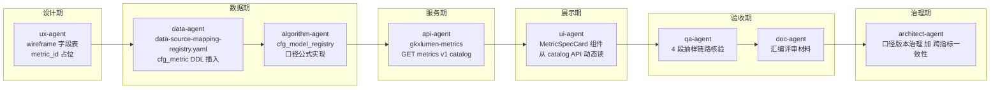

# 数据血缘规约（Data Lineage Policy）

> **作用**：界面上每个统计指标都能向甲方/审计/团队**说清楚** ① 数据来源 ② 加工过程 ③ 业务口径 ④ 更新频率 ⑤ 口径版本
> **强制等级**：**P0 铁律**（与 D8 设计规范并列，由甲方评审场景反推确立）
> **读者**：全体 agent + 全体人员
> **创建**：2026-06-17（DS-25 软科学成果展示试点过程中，PM 据甲方评审要求建立）
> **维护**：架构师 lead + 数据 lead + PM
> **关联**：
> - `数据库设计.md`（标准表 DDL 与 ADS 契约）
> - `architecture-baseline.md` 方案 A（共享聚合核心 + Java 不写算法 / 不直连 nGQL）
> - `Design.md` §7 通用组件 + §13 推荐实现映射（MetricSpecCard / DataLineageDrawer / MockBadge / **PendingBadge** 四组件作为业务扩展层组件，工程实现层引用 Arco `Card` / `Drawer` / `Tag` / `Popover`）
> - `scope-baseline.yaml`（功能点 ±10%）
> - `acceptance-compliance-policy.md`（验收政策）
> - `agent-handoffs/算法库联调-ALGO-LIB/给人说明-指标与算法工作类型与流程梳理.md`（类型 / 派单 / WBS；**不替代**本规约的 8 件套与 D1–D4。对照：`metrics/给人说明-指标与算法工作类型与流程梳理.md`）
> - `metric-mcp-usage-guide.md`（按 `metric_id` 查 8 件套 + D1–D4：MCP `metric-registry`；禁止整文件读 `metrics/registry/` seed/矩阵）
>
> **🆕 数据真源位置（2026-06-17 起，甲方提供的三方采购数据「要素库」）**：
>
> | 文件 | 作用 | 谁必读 |
> |------|------|--------|
> | `agent-delivery/data/third-party-source/ODS源数据表结构清单(v2).md` | 186 张 ODS 表 / 2253 字段总览（按数据域分组） | data-agent / ux-agent / algorithm-agent / api-agent |
> | `agent-delivery/data/third-party-source/gkx-mysql-raw/gkx_schema_ddl.sql（旧要素库SQL已删；现用三方DDL沙箱）` | 精确 DDL（utf8mb4 + 字段注释 + 值域） | data-agent / api-agent |
> | `agent-delivery/data/GDF/派单包/企业/GDF-ENT-WORKPACK-v2/09-企业域-ETL-Mapping明细-源表到DWD.md` | 企业要素 ODS→DWD 字段映射施工真源 | data-agent / 数据 lead / GDF |
> | 各域派单包 `09-*Mapping*` | 政策 / 产业链 / 服务机构等随该域工作包；**不再使用** `GDF/Mapping/` 平行目录 | data-agent / 数据 lead |
> | `agent-delivery/data/DS-25-data-availability-matrix.md` | DS-25 软科学 7 子功能 ↔ ODS 真实字段精确映射（试点专用） | **ux-agent / ui-agent / data-agent / algorithm-agent**（DS-25 试点必读） |
>
> **核心结论**：DS-25 等多数 DS 子功能**不再是纯 Mock**，可基于真实 ODS 表设计字段、metric_id 的 source_tables 必须引用真实表名（如 `dwd_zh_project.title`），未来切真实数据时前端代码零改动。

---

## 1. 为什么要做（why）

科技数据可视化项目**评审与审计场景**反复出现的问题：

| 反模式 | 后果 |
|--------|------|
| 数字光秃秃显示，甲方问"哪来的" → 团队凭记忆答 | 信任崩塌 + 反复返工 |
| 不同界面同名指标口径不一致 | 数据打架 + 责任甩锅 |
| Mock 与真实数据混用，UI 上无标识 | 决策失误 + 合规风险 |
| 算法/口径迭代后界面没同步 | 业务方误用旧数据 |

**业界最佳实践（金融大屏 / 政务大屏 / 商业 BI）**：

> 每个统计指标都是有"身份证"的实体，UI 字段是它的展示形态。任何人在任何时候点开 ⓘ 都能看到它**完整的来世今生**。

---

## 2. 8 件套元数据（齐备态身份证）

> **v1.5（2026-08-22，项目负责人淮政玮）**：8 件套是指标身份证的**齐备态**（对应 §2.3 `D1=aligned`），**不是** PACK / METRIC-OPEN / 门 1 就能一次写完的登记表。v1.5 起身份证含 `algorithm_type`（规约/梳理仍写作 `algorithm.type`），**共 9 项**；口头仍称「8 件套」时必须含此项。评审现场 ⓘ：前 8 项上台（含算法类型），`version` 进副栏。产品定义阶段只强制「对象成立」（有 ID、有名称、本页用不用说清），公式、类型与源表链按 §2.1 后补。
>
> **YAML 落点**：`metrics/registry/cfg_metric-{域}-seed.yaml`（v1.5 起；旧根路径同名文件已迁走）。

| # | 字段 | 内容 | 类型 | 谁负责拍板 | 谁负责录入 |
|---|------|------|------|----------|----------|
| 1 | `metric_id` | 全局唯一 ID，遵循 §3 命名规则 | string | architect-agent | data-agent |
| 2 | `metric_name_zh` | 中文名（口径正式称谓，与 bid 文本一致） | string | 口径主责（见下） | data-agent |
| 3 | `definition` | 业务口径定义（≥50 字，含**统计窗口**、**对象范围**、**去重逻辑**、**特殊情况**） | text | **口径主责拍板**（不可外包给 AI；甲方 🟡 不升 🟢） | data-agent 起草 |
| 4 | `formula` | 可执行计算公式（SQL 片段或算法伪代码 + 关键参数） | text | 算法 lead 评审 | algorithm-agent 起草 |
| 5 | `algorithm_type` | 这段计算怎么实现（决定派 Java 还是 Python） | enum | **算法 lead 会签**（`human:唐绍祖`） | algorithm-agent 起草；data-agent 写入 seed |
| 6 | `source_tables[]` | 源表清单（ADS↔DWS↔DWD↔ODS 完整血缘链） | list | 数据 lead 评审 | data-agent / GDF |
| 7 | `source_systems[]` | 数据来源系统（如`深圳市科技厅项目库`/`Mock @ batch=mock_20260617`/`三方爬虫`） | list | PM + 数据 lead | data-agent |
| 8 | `update_freq` | 更新频率：`realtime / hourly / daily / weekly / monthly / quarterly / yearly / static` | enum | 数据 lead | data-agent |
| 9 | `version` | 口径版本：`major.minor.patch`（口径变更要 bump） | semver | architect-agent | data-agent |

`algorithm_type` 枚举（与梳理 §2.1 同表；YAML 键一律 `algorithm_type`）：`STAT` / `COMPUTE` / `MODEL` / `GRAPH` / `third_party`（`API` 同义）/ `MIXED` / `LITERATURE` / `UNKNOWN`。`UNKNOWN` **禁止**派实现单，也**禁止**标 `D1=aligned`。`MODEL`/`GRAPH` 另须步骤（定义卡 / A1 表2），步骤本身不是 8 件套字段。

口径拍板角色以**当期工作流**为准。指标/算法梳理会合期内：口径 / 8 件套适用性 = `human:淮政玮`；公式 / `algorithm_type` = `human:唐绍祖`（见 `agent-handoffs/算法库联调-ALGO-LIB/给人说明-指标与算法工作类型与流程梳理.md`）。`产品定义评审规程.md` §1.4.2 方案 B（王惠日常口径）未改文前，本工作流 OPEN 纪要按梳理填写。

### 2.1 填齐时序（v1.4）

| 阶段 | 必须有 | 允许 TBD / `pending` | 禁止 |
|------|--------|----------------------|------|
| PACK / wireframe | `metric_id`（可 `TMP_*` 占位）、中文名、本页用不用（WF 第 6 列） | `formula`、`algorithm_type`、源表链、`version` | 假装 `D1=aligned`；把未批口径写成甲方已确认 |
| METRIC-OPEN / 门 1 | + 口径草稿或 `N/A`+依据；缺口进 `客户决策清单跟踪表.md`；`D1` 允许 `draft`；`algorithm_type` 可 `UNKNOWN`；有算法产出时定义卡步骤可待签 | 可执行 SQL、完整 ODS→DWD 链、`update_freq` 终值 | 无 `N/A` 依据过门 1；用终态 8 件套拒收 OPEN 叶 |
| A1 / 公式会签 | + `formula`、`algorithm_type`（不得再 `UNKNOWN`；`MODEL`/`GRAPH` 必填步骤） | `source_tables` 可 `pending_ods` | `UNKNOWN` 仍派实现单 |
| GDF / D3 | 源表 / 源系统实链（或已登记 gap） | — | 把 `pending_ods` 写成 `full` / `aligned` |
| **`D1=aligned`** | **8 件套齐**（9 项均有合格值；`definition`≥50 字；`algorithm_type`≠`UNKNOWN`） | — | 缺项标绿 |

`algorithm_type` **是** 8 件套第 5 项，写入 `metrics/registry/cfg_metric-{域}-seed.yaml`。A1 表2 / OPEN 算法定义卡仍是会签工作底稿；唐绍祖签完后由 data-agent 回填 seed。枚举与派单见梳理 §2。存量 seed 未填视为 `UNKNOWN`，**不**批量倒推 `STAT`。

#### 2.1.1 `lifecycle_stage`（v1.4 可选登记）

> **干什么**：标明这条指标在 §2.1 **填齐流水线**上走到哪一关。  
> **不干什么**：不替代 D1–D4，不上甲方 ⓘ 主卡当第五维角标（评审模式可在就绪度区块多一行）。  
> **落点**：`metrics/registry/metric-readiness-matrix-{域}.yaml` 每条 `lifecycle_stage`（**不进** 8 件套 / 不进 seed 身份字段）。

| 值 | 中文 | 进入条件（须同时满足） | 仍允许缺 |
|----|------|------------------------|----------|
| `pre_register` | 盘点未注册 | 仅 `inventory/` 或 WF `TMP_*`，尚未入 seed | 正式 `M_*`、口径、公式、源 |
| `identified` | 已点名 | seed 或 WF 第 6 列有稳定 `metric_id` + 中文名 | 口径终稿、公式、源 |
| `open` | 定义中 | 过 METRIC-OPEN / 门 1：口径草稿或 `N/A`+依据；`D1` 多为 `draft` | 可执行公式、ODS 实链 |
| `formula_signed` | 公式已签 | 唐绍祖已签 `formula` + `algorithm_type`（`UNKNOWN` 不算） | 源表实链 |
| `source_mapped` | 源已对 | D3=`full`，或 D3=`none` 且 gap 已登记（诚实缺口） | 8 件套其它项未齐时仍不可标 `kit_complete` |
| `kit_complete` | 8 件套齐 | **= `D1=aligned`**：9 项均有合格值（含 `algorithm_type`≠`UNKNOWN`） | D2/D4 仍可 `pending`/`mock`（结构与接入是另一轴） |
| `retired` | 废止 | 不再上页；保留 ID 防冲突 | — |
| `unspecified` | 未标 | **存量默认**；禁止把未评估写成 `kit_complete` | — |

**与四维的关系（正交，禁止用一维冒充另一维）**：

```
lifecycle_stage     这条指标定义/公式/源 填到哪一关（过程）
D1 def_status       口径对象在库里齐不齐（kit_complete ↔ aligned）
D2 schema_status    项目内结构算不算得出
D3 source_mapping   三方源喂不喂得饱
D4 ingestion        线上跑的是 Mock 还是真数
```

例：`lifecycle_stage=kit_complete` 且 `D4=mock` 合法（8 件套写清了、数还是假的）。`D1=aligned` 但 `formula` 仍 `pending_algorithm`，或 `algorithm_type` 仍 `UNKNOWN` → **不得** `kit_complete`，应降回 `open` 或尚未达成 `formula_signed`。

**谁改**：data-agent 随 OPEN / A1 回填 / GDF 映射更新；算法 lead 会签公式时升 `formula_signed`。coordinator 不把本字段当 OPEN DoD（OPEN 目标态 = `open`，不是 `kit_complete`）。

**存量**：未填则视为 `unspecified`，**不**批量倒推装齐。新登记从 `identified` 或 `pre_register` 起跳。

### 2.1.2 其它推荐字段（不纳入 8 件套）

| 字段 | 内容 | 用途 |
|------|------|------|
| `owner_human` | 业务/数据负责人（人名） | 评审时甲方对接 |
| `owner_agent` | 负责注册维护的 agent | retro / 自动化 |
| `is_mock` | 是否 Mock 数据 | UI 显示 🧪 标签 |
| `mock_until` | Mock 切真实数据预计时间 | 给甲方时间表 |
| `quality_rules[]` | 数据质量规则（非空率、值域、唯一性） | qa-agent / 数据契约 |
| `governance_tags[]` | 治理标签（敏感 / 脱敏 / 公开） | 安全合规 |
| `bid_ref` | 招标实施方案章节号（合订本 `§…`） | 范围合规追溯；与 `srs_refs` 互补，**不是**需规序号 |
| `srs_refs[]` | 需规功能清单叶子：`book` / `seq` / `name` / `brief`（一条指标可挂多叶） | **需求来源**。不进 8 件套、不上 ⓘ 主卡必填。落点 `metrics/registry/metric-srs-map.yaml`；MCP `extras.srs_refs`。`book`=srs 分册（`02` 展示 / `04` 专题 / `05` 算法库），`seq` **只在分册内唯一**（02 的 97 ≠ 05 的 97）。未回填允许空列表，**禁止编造**。生成：`node scripts/build-metric-srs-map.mjs`（A1 表1 反演 05 + A2 mapped 页 02/04） |
| `acceptance_unit_id` | acceptance-catalog 的 DS-XX / 页面 ID | 验收 / 页面追溯（不是 SRS seq） |
| `mapping_status` | 贴源状态（v1.2 新增 `⏳`，详见 §2.2 状态机）：`✅` 有源 / `🟡` 部分有源或临时默认 / `❌` 无源 / `⏳` ODS 待供应（8/20 前专用）。**v1.3 起为过渡只读字段**，新状态以 §2.3 四维就绪度为准 | METRIC-OPEN / cfg_metric / UI 角标 |
| 四维就绪度（`def_status` / `schema_status` / `source_mapping_status` / `ingestion_status`） | v1.3 新增，登记在 `metrics/registry/metric-readiness-matrix-{模块}.yaml`（非 cfg_metric 内嵌），详见 §2.3 | 就绪度区块 / SchemaGapBadge / IngestingBadge |
| `pending_ref` | 未闭合开放项编号（`Q0xx` 或 `GAP-*`），关联 `客户决策清单跟踪表.md` | ⚠️ PendingBadge |
| `pending_hint` | **数据缺口说明**长文案（建议 **≥80 字**，含 ODS/DWD 表名、缺失字段、Mock 说明）；供 Popover 展示 | ⚠️ PendingBadge Popover |
| `wave0_behavior` | Wave 0 降级行为：`mock` / `empty` / `exclude_from_score` | 算法 / FE 对齐 |
| `lifecycle_stage` | 填齐流水线位置（§2.1.1）；矩阵字段，非 8 件套 | 派单/会合看阶段；默认不上 ⓘ 主卡 |

> **`data-gap-catalog.yaml`**（路径：`agent-handoffs/产品整体定义/{模块}/data-gap-catalog.yaml`）为 METRIC-OPEN 阶段 **贴源缺口 UI 文案真源**；由 data-agent 维护，FE 只读消费。详见 §5.1.4、`产品定义评审规程.md` §3.2。

### 2.2 `mapping_status` 状态机与 ODS 供应阶段（v1.2 新增）

> **背景决策（2026-07-28，项目负责人）**：甲方供应的三方数据源（MySQL `gkx` 库；连接元数据见 `data/third-party-source/gkx-mysql-raw/CONNECTION.md`，密码仅存本地 `.env.local`、禁止写入规约）中 `dwd_*` 开头的表实质是本项目的 **ODS 层**。该 ODS 层结构目前**部分确定、仍在变动**，预计 **2026-08-20 左右**才能完全稳定。
>
> **解耦策略**：项目自建 DWD 表结构由架构师依据业务需求**自行设计**，不与甲方 ODS 一一对应。待 8/20 ODS 稳定后，由 **GDF（通用数据工厂）** 统一做 ODS→项目 DWD 的字段映射。因此血缘工作分两阶段：
>
> - **Phase 1（现在 ~ 8/20，ODS 未稳定）**：治理项目自研 DWD 设计，不做 ODS→DWD 映射。`source_tables[]` 指向**项目自研 DWD 表**，`mapping_status` 标 `⏳ pending_ods`。
> - **Phase 2（8/20 后，ODS 稳定）**：GDF 产出映射 → lineage-subcoord 验证完整性 → 升级 `mapping_status`。

#### 状态机

```
⏳ pending_ods          # Phase 1（8/20 前）：ODS 未稳定，source_tables 指向项目自研 DWD
  │
  │  8/20 ODS 稳定 + GDF 完成 mapping + lineage-subcoord 验证
  ├────────────────────→ ✅ mapped        # 映射成功，完整可追溯
  └────────────────────→ ❌ gap            # 发现 ODS 字段缺口 → 登记 data-gap-catalog + 客户决策清单（🟡）

🟡 pending_confirm       # 业务口径待甲方确认（与 ODS 供应无关的口径歧义），独立于 ⏳
```

#### 各状态下 `source_tables[]` / `source_systems[]` 的填写规则

| 状态 | `source_tables[]` | `source_systems[]` | UI 角标 |
|------|-------------------|---------------------|---------|
| `⏳ pending_ods` | 项目自研 DWD 表名（如 `dwd_zh_project`） | `"待 2026-08-20 甲方 ODS 稳定"` | ⏳ OdsPendingBadge |
| `✅ mapped` | 项目 DWD 表名（已验证可追溯到 ODS） | 真实源系统名 | 无（或 ⓘ 查看血缘） |
| `❌ gap` | 项目 DWD 表名 + `field_check` 注明缺失字段 | 源系统名 + `pending_ref` | ⚠️ PendingBadge |
| `🟡 pending_confirm` | 项目 DWD 表名 | `pending_data_lead_review` | ⚠️ PendingBadge |

#### Phase 1 期间的 DWD 设计契约预留点

每张项目自研 DWD 表的 schema 文档中须包含 `ods_mapping_expectation` 块，供 Phase 2 GDF 映射时对照：

```yaml
# data/data-design/dwd_zh_project.md 字段定义示例
fields:
  - name: title
    type: varchar(500)
    business_def: 项目名称
    ods_mapping_expectation:
      expected_from: "甲方 dwd_* 中项目主表的标题类字段"
      confidence: high    # high=语义明确 / medium=可能有命名差异 / low=可能缺失
      note: ""
```

> **此预留点由 lineage-subcoord（Phase 1 职责）维护**，data-agent 建表时须遵循，architect-agent 审设计时须校验。

### 2.3 指标四维就绪度模型（v1.3 新增）

> **背景决策（2026-08-01，项目负责人）**：单一 `mapping_status` 把「有没有定义」「结构算不算得出」「三方源喂不喂得饱」「当前接的什么数据」四件事混在一个字段，评审现场说不清责任方。拆为四个正交维度。
> **定稿方式**：项目负责人（淮政玮）放行**免会签直接定稿**，相关人（王惠 / 唐绍祖 / 架构师）由淮政玮线下通知；异议走 v1.3.x 修订。决策记录：`designs/data-lineage-v1.3-readiness-draft.md`。

#### 2.3.1 四维定义

```
D1 定义对齐   →  指标库里有没有这条（missing 则 D2~D4 = n/a）
D2 结构支撑   →  项目自研存储（MySQL DWD / ES / 图）结构上算不算得出（责任方=项目内，与三方源无关）
D3 源映射     →  三方源→ETL→DWD→ES/图 全链字段级喂不喂得饱（责任方=甲方/供应方）
D4 接入状态   →  当前线上跑的是什么数据（运行时事实）
```

| 维度 | 字段 | 枚举 | 判定 owner |
|------|------|------|-----------|
| D1 | `def_status` | `aligned`（8 件套齐，§2.1 终态，含 `algorithm_type`≠`UNKNOWN`）/ `draft`（挂 `pending_ref`；**OPEN / 门 1 合法态**）/ `missing`（未登记，UI 引用 GAP-*） | data-agent（口径拍板：当期口径主责 / 甲方） |
| D2 | `schema_status` | `ready` / `partial` / `missing` / `pending`（**v1.3.1 增补**：未评估初始态，批量登记时用，禁止伪标 ready）；按存储分述 `schema_detail: {mysql_dwd, es, graph}`（可 `n/a`）；缺陷必写 `gap` | architect + data-agent 初判（`assessed: provisional`）；lineage-subcoord 核验后 `verified`。**未核验不得标 ready 充数** |
| D3 | `source_mapping_status` | `full` / `partial` / `none` / `pending_ods`（吸收原 `⏳` 语义） | GDF / lineage-subcoord；长文案真源仍为 `{模块}/data-gap-catalog.yaml` |
| D4 | `ingestion_status` | `mock` / `ingesting` / `live`；`ingesting` 必带**阶段清单**（不用百分比）：`ods_synced / dwd_loaded / es_indexed / graph_loaded / verified`，每项 `done / in_progress / todo / n/a` | 数据工厂执行方；`verified` 由 QA 4 段链路核验（§7.6） |

#### 2.3.2 机器真源与消费

- 真源：`agent-delivery/metrics/registry/metric-readiness-matrix-{要素域}.yaml`，**每个要素域一个文件**（首例：`metric-readiness-matrix-ENT.yaml`，企业维度全域 53 条，v1.3.1 起取代按模块拆分的 ENT-EVAL 版）
- FE **只读消费**（demo 阶段镜像 `readinessSeed.ts`；Wave 1 起 `/metrics/v1/catalog` 动态返回），**禁止页面自填状态**
- 过渡：`mapping_status` 字段保留只读对照（矩阵 `legacy_mapping_status` 列），一个迭代周期后废弃。迁移映射：`✅→D3=full`；`🔧→拆开`（挂 Q 的归 D1=draft；缺源字段的归 D3=partial；仅公式待实现记 `formula_status`，不占四维）；`⚠️/🟡→D1=draft`；`❌→D3=none`；`⏳→D3=pending_ods`
- **口径侧提交与正式化（v1.3.1，2026-08-01 项目负责人要求）**：口径主责（王惠）的派单产出**允许用 Excel 做工作底稿，但 Excel 不是真源、不进仓**；每次提交必须由 data-agent **正式化为对应要素域的唯一 YAML 真源**（如 `metrics/registry/metric-readiness-matrix-ENT.yaml` + `metrics/registry/cfg_metric-{域}-seed.yaml` 增量），并在矩阵头部登记 `updated` 与来源任务 ID。**禁止**同一要素域出现第二份矩阵文件或以 Excel/文档形式的平行状态表。派单话术与验收模板见 `metrics/README.md`

#### 2.3.3 UI 图标字典（Arco Icon，禁 emoji；全部 ReviewOnly）

**入口层**（统计数字旁，顺序：数字 → [ⓘ/？] → [结构] → [⚠️/⏰] → [🧪/⟳]，最多 3 枚）：

| 状态 | 图标 | 颜色 | 说明 |
|------|------|------|------|
| D1 aligned/draft | `IconInfoCircle`（draft 加右上橙点） | 灰 `#86909C`，hover 主蓝 | 必有 ⓘ |
| D1 missing | `IconQuestionCircle` | 红 `#F53F3F` | 替代 ⓘ，点开只显治理引用 |
| D2 partial/missing | `IconStorage` | 橙 `#FF7D00` / 红 | **SchemaGapBadge**（责任方=项目内） |
| D3 partial/none | `IconExclamationCircle` | 橙 / 红 | 沿用 ⚠️ PendingBadge，文案读 gap catalog |
| D3 pending_ods | `IconClockCircle` | 蓝 `#165DFF` | 并入 PendingBadge 语义；**独立 ⏳ OdsPendingBadge 不再单独实现**（见 §5.1.5） |
| D4 mock | `IconExperiment` | 橙 | 沿用 🧪 MockBadge |
| D4 ingesting | `IconSync` | 蓝 | **IngestingBadge**，Tooltip 为阶段清单 |
| D4 live | 无 | — | 干净态 |

**卡内层**（ⓘ 弹卡「就绪度」四行状态点）：满足 `IconCheckCircleFill` 绿 / 部分 `IconExclamationCircleFill` 橙 / 缺失 `IconCloseCircleFill` 红 / 待定 `IconClockCircle` 蓝 / 不适用 `IconMinusCircle` 灰。

**不改变的既有规则**：评审模式 §5 位置字典与显隐边界；⚠️ 文案唯一真源 = gap catalog；D3=none 不伪造数值（业务态置灰不计分）；模块复核状态另轨表达；业务口径决策只能甲方拍板。

---

## 3. metric_id 命名规则

### 3.1 总体格式

```
M_{ELEMENT}_{INDICATOR}_{PERIOD?}_{VARIANT?}
```

### 3.2 各段含义

| 段 | 含义 | 取值 |
|----|------|------|
| `M_` | 固定前缀，标识 metric | `M_` |
| `ELEMENT` | 业务要素（用**字母助记码**，见下表） | `ENT`/`CHAIN`/`ORG`/`TECH`/`TALENT`/`SVC`/`POLICY`/`SS`/`IC`/`INNOV`/`COMMON` |

#### 3.2.1 七要素助记代号表（v1.1.0 起，Q009 决策 2026-06-18 人类架构师/PM 会签）

| 要素 | 助记码（现行） | 废弃别名 | 含义 |
|------|---------------|---------|------|
| 企业 | `ENT` | `E1` | enterprise |
| 产业链 | `CHAIN` | `E2` | industry chain |
| 机构（科研机构） | `ORG` | `E3` | research org |
| 技术 | `TECH` | `E4` | technology |
| 人才 | `TALENT` | `E5` | talent |
| 服务（服务机构） | `SVC` | `E6` | service |
| 政策 | `POLICY` | `E7` | policy |
| 软科学 | `SS` | — | soft science |
| 创新生态 | `IC` | — | innovation ecology |
| 创新监测 | `INNOV` | — | innovation monitor |
| 通用 | `COMMON` | — | common |

> **决策背景**：原 §3.2 企业用数字制 `E1`，但软科学/创新生态/创新监测/通用已是字母助记码。为统一风格、提升可读性与评审追溯性，将 7 要素统一改为字母助记码，`E1~E7` 保留为**废弃别名**（旧引用不报错，但新指标一律用助记码）。企业域 49 条 `M_ENT_*` 种子无需改名。详见 `agent-handoffs/企业战略分析-ENT/ARCH-ENT-milestone-review.md`。
| `INDICATOR` | 指标主体（大写蛇形） | `TOPIC_NEW_COUNT` / `UNIT_CONTRIBUTION_RATE` / `REGIONAL_DENSITY` |
| `PERIOD` | 时间窗口（可选） | `D`/`W`/`M`/`Q`/`Y`/`YTD`/`TOTAL` |
| `VARIANT` | 变体（可选，仅用于同名不同口径） | `V1` / `STRICT` / `LOOSE` |

### 3.3 示例

| 业务场景 | metric_id |
|---------|-----------|
| 本季度软科学课题新增数 | `M_SS_TOPIC_NEW_COUNT_Q` |
| 软科学课题单位贡献率 | `M_SS_UNIT_CONTRIBUTION_RATE` |
| 政策颗粒度焦点指数 | `M_E7_POLICY_FOCUS_INDEX` |
| 全球创新事件日新增 | `M_INNOV_EVENT_NEW_COUNT_D` |
| 人才综合评分（严口径 v1） | `M_E5_TALENT_OVERALL_SCORE_V1_STRICT` |

### 3.4 禁止

- ❌ 中文 ID
- ❌ 小写、下划线开头、纯数字
- ❌ 业务名直接拼音（如 `M_KETIXIN`）
- ❌ 太短（< 4 段）或太长（> 6 段）
- ❌ 不同页面对同一指标用不同 metric_id（永远以"业务口径"而非"展示位置"命名）

---

## 4. 在哪里登记 / 维护



| 制品 | 路径 | Owner |
|------|------|-------|
| **设计期** wireframe 字段表 metric_id 列 | `demo2/docs/ia/sandbox/{topic}/{DS-id}-wireframe.md` | ux-agent |
| **数据期** 应用层标准表 + 字段血缘 README | `agent-delivery/数据库设计.md` + ODS/DWD/DWS/ADS 字段映射注释 | data-agent |
| **数据期** 数据源映射登记表 | `agent-delivery/data-source-mapping-registry.yaml` | data-agent |
| **数据期** cfg_metric 表 / 配置 | `gkx_dim/gkx_cfg` schema（DB） + `demo-algo-science` 初始化脚本 | data-agent + algorithm-agent |
| **服务期** /metrics/v1/catalog API | `lumen-svc-platform/gkxlumen-metrics` 模块（task P0-L02） | api-agent |
| **展示期** MetricSpecCard / DataLineageDrawer 组件 | `gkx_lumen_fronted_*/src/components/` + demo2 沙箱 | ui-agent / frontend-agent |
| **验收期** 链路核验 case | `验收文档/数据血缘-链路核验-{epic}.md` | qa-agent |
| **评审期** 数据血缘评审材料 | `验收文档/数据血缘-评审材料-{epic}.docx`（officecli） | doc-agent |
| **治理期** 口径版本 changelog | `agent-delivery/data-lineage-changelog.md` | architect-agent |

---

## 5. UI 表现规范（接入 D8 §9 通用组件清单）

### 5.1 必备新组件（建议补入 D8 §9）

#### 5.1.1 `MetricSpecCard`（数据说明卡）

- **触发**：UI 上每个统计数字旁的 ⓘ 图标 hover/点击
- **内容**：8 件套元数据中前 8 项（含 `algorithm_type`；`version` 隐藏到副信息）
- **样式**：浅色蓝灰 + 8px 圆角；不深色霓虹
- **降级**：catalog API 失败时显示"数据说明加载中"，不阻塞主界面

#### 5.1.2 `DataLineageDrawer`（数据血缘抽屉）

- **触发**：MetricSpecCard 底部"查看完整加工链路"按钮
- **内容**：ODS → DWD → DWS → ADS 4 段血缘可视化 + 算法节点
- **可视化**：使用 G6 / mermaid 渲染
- **数据来源**：`/metrics/v1/lineage/{metric_id}`（gkxlumen-metrics 模块扩展）

#### 5.1.3 `MockBadge`（Mock 数据标识）

- **触发**：`is_mock=true` 时数字旁自动显示 🧪
- **tooltip**："当前为 Mock 数据，预计 {mock_until} 切换为真实数据源 {source_systems}"
- **强制**：所有 Wave 0 阶段沙箱页都必须显示

#### 5.1.4 `PendingBadge`（贴源缺口 / 待确认口径）

- **触发**：`mapping_status` 为 `🟡` 或 `❌`，或存在 `pending_ref` 时显示 ⚠️
- **短文案**（`pending_hint` ≤80 字）：`Tooltip` 展示摘要
- **长文案**（`pending_hint` >80 字）：`Popover` 标题 **「数据缺口说明」**，正文为 `pending_hint` 全文
- **必须关联**：`pending_ref`（`Q0xx` 或 `GAP-*`），与 `客户决策清单跟踪表.md` 一致
- **文案真源**：`{模块}/data-gap-catalog.yaml`（METRIC-OPEN 产出）；**禁止** FE 硬编码缺口说明
- **与 MockBadge 关系**：Mock 因无真源但口径已定 → 🧪；贴源不足或口径待甲方确认 → ⚠️；二者可同时存在

**`data-gap-catalog.yaml` 最低字段（每条 metric）**：

```yaml
metrics:
  - metric_id: M_ENT_XXX
    metric_name_zh: 示例指标
    mapping_status: "⏳"          # ⏳ pending_ods | ✅ mapped | 🟡 pending_confirm | ❌ gap
    pending_ref: Q019             # 或 GAP-METRIC-BID-*
    pending_hint: |               # ≥80 字时 Popover「数据缺口说明」
      该需求已在需求清单中登记（开放项 Q019），但当前三方源……
    wave0_behavior: mock          # mock | empty | exclude_from_score
    source_tables: []             # 已核查的 ODS→DWD→ADS 链
    field_check: ""               # 缺失字段说明（可选，可并入 pending_hint）
```


#### 5.1.5 `OdsPendingBadge`（ODS 待供应）——【v1.3 起不再单独实现】

> **v1.3 变更**：⏳ 语义并入四维模型 `D3 source_mapping_status = pending_ods`（§2.3），入口层用 `IconClockCircle` 蓝色角标表达（PendingBadge 家族）；独立 OdsPendingBadge 组件**不再单独实现**。原「互斥优先级」规则废止，改为**并存排列顺序**（§2.3.3 入口层顺序），各角标语义正交、可同时出现。以下 v1.2 原文仅作历史对照：

- ~~**触发**：`mapping_status` 为 `⏳` / `pending_ods`（8/20 前，ODS 未稳定）~~
- **语义**（仍有效）：项目自研 DWD 已设计、指标可按项目 DWD 落地，但**尚未接到稳定甲方 ODS**；与 Mock（数据是假的）、口径待确认（业务定义未拍板）不同
- ~~**互斥优先级**：⏳ OdsPendingBadge > ⚠️ PendingBadge > 🧪 MockBadge > ⓘ MetricSpecCard~~（v1.3 废止，改并存排列）
- **升级路径**（仍有效）：Phase 2 映射验证完成后 `pending_ods → full`（回归干净态）或 `pending_ods → partial/none`（显 ⚠️）

### 5.2 字段表 6 列模板（wireframe / 详设标准）

| 名称 | 类型 | 来源 | 必填 | 示例 | metric_id |
|------|------|------|------|------|----------|
| 课题数量 | int | 聚合 | ✅ | 12 | `M_SS_TOPIC_NEW_COUNT_Q` |
| 单位贡献率 | float% | 聚合 | ✅ | 23.5% | `M_SS_UNIT_CONTRIBUTION_RATE` |
| 课题名称 | string | 明细 | ✅ | "区块链在政务中的应用研究" | —（明细字段不需要） |

> 末尾必须有 `## 本页 metric_id 清单` 小节，列出本页用到的所有 metric_id。

---

## 6. 评审现场答复 SOP

### 6.1 标准 3 步答

甲方质疑某个数字时，**永远按 3 步答**：

1. **点 ⓘ 给看数据说明卡**（口径 + 数据源 + 更新频率）
2. **点"完整加工链路"给看血缘图**（ODS→DWD→DWS→ADS + 算法节点）
3. **如还有疑问，对照 cfg_metric 中的 `definition` 原文逐字读**

### 6.2 Wave 0（Mock 阶段）特殊话术

> "本期界面数据为 Mock，目的是验证 ① 字段层 ② 信息架构 ③ 用户交互 是否符合您的需求。每个统计指标已分配 metric_id 并预登记到 `cfg_metric` 表，待 Wave 1 数据工厂接入真实三方源后，**前端代码零改动**即可切换。届时您在每个数字旁点 ⓘ 都能看到：业务口径 / 计算公式 / 数据源系统 / 完整 ETL 链路 / 更新频率 / 口径版本。"

### 6.3 不允许的答复

| 不允许 | 原因 |
|--------|------|
| "这个是后端给的数" | 责任甩锅 + 不专业 |
| "应该是从XX系统来的吧" | 不精确 + 没追溯依据 |
| "我们回去查一下再答复" | 表明评审准备不足 |
| "口径我们再讨论" | 评审现场出现 = 团队内部没对齐 |

### 6.4 兜底话术库

PM 评审现场带在手上的话术，见 `agent-delivery/agent-handoffs/软科学成果展示-DS25/PILOT-DS-25-client-fallback-script.md`。

---

## 7. 各 agent 的责任与硬约束

### 7.1 ux-agent

- ✅ wireframe 字段表必须 6 列（含 metric_id）
- ✅ 统计字段必填 metric_id（即使是 `TMP_*` 占位）
- ✅ 每页末尾必给 `本页 metric_id 清单`
- ❌ 不擅自决定指标口径（口径决策永远是人）
- ❌ 不擅自决定数据源（数据源决策由 PM + 数据 lead）
- ❌ 不要求 PACK / WF 阶段填齐 formula / 源表 / 8 件套

### 7.2 data-agent

- ✅ 维护 `cfg_metric` 表 / 初始化脚本
- ✅ 维护 `data-source-mapping-registry.yaml`
- ✅ 按 §2.1 **分阶段**登记 seed：OPEN 允许 `D1=draft` + `algorithm_type=UNKNOWN`；**仅** `D1=aligned` 时 9 项必须齐
- ✅ ODS→DWD→DWS→ADS 各层都有字段血缘 README
- ❌ Mock 与真实数据混用（必须用 `calc_batch_id` 前缀 `mock_` 区分）
- ❌ 同名指标允许两套口径（必须用 VARIANT 区分）
- ❌ 用终态 8 件套拒收 METRIC-OPEN / PACK handoff

### 7.3 algorithm-agent

- ✅ 维护 `cfg_model_registry`
- ✅ OPEN 阶段可先交算法定义卡（`algorithm_type` 允许 `UNKNOWN`）；实现前须算法 lead 会签公式与类型，并由 data-agent 回填 seed
- ✅ 实现 `formula` 字段中描述的算法
- ✅ 算法版本号与 metric 版本号联动
- ❌ 在 Java 仓写算法（铁律 1）
- ❌ 引入 metric 但不注册到 cfg_metric
- ❌ `UNKNOWN` 仍派 Python/Java 实现单

### 7.4 api-agent

- ✅ `gkxlumen-metrics` 模块暴露 `/metrics/v1/catalog?ids=...`
- ✅ 扩展 `/metrics/v1/lineage/{metric_id}` 返回血缘图
- ✅ 字段命名与 metric_id 一致（驼峰转换或保留蛇形）
- ❌ 在 Java 写指标计算逻辑（铁律 1）
- ❌ 直连 ADS 之外的库（铁律 7）

### 7.5 ui-agent / frontend-agent

- ✅ 实现 `MetricSpecCard` / `DataLineageDrawer` / `MockBadge` 三个新组件
- ✅ 每个统计数字旁必有 ⓘ
- ✅ Wave 0 阶段所有数字必有 🧪 标识
- ✅ 从 `/metrics/v1/catalog` 动态读元数据（不硬编码）
- ❌ 硬编码"数据说明"到组件代码中
- ❌ 删除 / 隐藏 ⓘ 让界面"更干净"

### 7.6 qa-agent

- ✅ 每个 epic 末尾对**至少 5 个 metric_id 抽样**做 4 段链路核验：UI 显示值 → API 返回值 → ADS 表查询值 → DWD 加工值 → ODS 源系统值
- ✅ 抽样结果写入 `验收文档/数据血缘-链路核验-{epic}.md`
- ❌ 跳过链路核验（即使时间紧）

### 7.7 doc-agent

- ✅ 评审前从 cfg_metric + handoffs 汇编"数据血缘评审材料 docx"
- ✅ 用 officecli MCP 生成（不手编 XML）
- ✅ 每个指标一个章节（含 8 件套 + UI 截图 + 链路图）

### 7.8 architect-agent

- ✅ Epic 开工评审：metric_id 命名、口径冲突、版本管理
- ✅ 里程碑评审：cfg_metric 完整性、ODS→DWD→DWS→ADS 血缘链是否断裂
- ✅ 维护 `data-lineage-changelog.md`（口径变更全量历史）

### 7.9 coordinator-agent

- ✅ 派单时检查任务输入是否含 metric_id 清单
- ✅ Handoff 按 **§2.1 阶段**验收：PACK/OPEN 看 ID + 口径草稿或 `N/A`；**不要**用终态 8 件套卡定义叶；实现叶 / `D1=aligned` 才查 9 项是否齐
- ❌ 派单到下游时丢失上游 metric_id 清单

### 7.10 integration-agent

- ✅ 网关路由 `/metrics/v1/**` 配置正确
- ✅ 与 SSO 联动：敏感指标按角色脱敏（governance_tags）

---

## 8. 与现有制品的关系

| 现有制品 | 关系 | 是否需要扩展 |
|---------|------|-----------|
| `cfg_metric`（指标注册中心） | **核心载体**，本规约的物理实现 | ✅ 字段对齐 8 件套 |
| `cfg_model_registry`（模型注册中心） | 与 cfg_metric 关联（一个 metric 可引用多个 model） | ✅ 增加 metric_id 外键 |
| `data-source-mapping-registry.yaml` | 数据源映射的人类可读载体 | ✅ 增加 metric_id 列 |
| `gkxlumen-metrics` Java 模块（task P0-L02） | 暴露 metric 元数据 API | ✅ 扩展 /catalog + /lineage |
| `数据库设计.md §2~§12` | ADS / 标准表 DDL | ✅ 每张 ADS 表的字段注释关联 metric_id |
| `D8 设计规范 §9 组件清单` | 通用组件 | ✅ 增加 MetricSpecCard / DataLineageDrawer / MockBadge |
| `D8 §18 验收清单 18 条` | 验收 | ✅ 增加第 19 条"每个统计数字可追溯" |
| `acceptance-catalog/` | 验收功能点目录 | ✅ 每个 DS-XX 引用 metric_id 清单 |
| `scope-baseline.yaml ±10%` | 范围铁律 | 中性（增减 metric 不计入功能点±10%，但需 PM 批准） |

---

## 9. 实施路线图（与 wave 对齐）

> **v1.2 起按 ODS 供应阶段分 Phase 执行**（详见 §2.2 状态机）。8/20 前为 Phase 1（ODS 未稳定），8/20 后为 Phase 2（ODS 稳定 + GDF 映射）。

### Phase 1（现在 ~ 2026-08-20，ODS 未稳定）

- [ ] **本规约 v1.2 落盘**（now）
- [x] **DWD 设计契约模板落盘**：data/data-design/_templates/dwd-table-contract-template.md（含 ods_mapping_expectation）
- [ ] **lineage-subcoord 启动**：按模板治理项目自研 DWD 设计，逐表填写契约
- [ ] data-agent 按 DWD 设计契约建项目 DWD/DWS/ADS（**不碰 ODS**），`source_tables` 指向项目 DWD
- [ ] metric-subcoord 定指标口径，`mapping_status` 统一标 `⏳ pending_ods`
- [ ] ui-agent 实现 ⏳ OdsPendingBadge（区别于 🧪 Mock / ⚠️ 口径待确认）
- [ ] D8 §9 / §18 / §20 升级，增加 ⏳ OdsPendingBadge 组件定义
- [ ] DS-25 wireframe 试点应用
- [ ] api-agent 把 /metrics/v1/catalog 扩展到含 8 件套 + `mapping_status: ⏳`

### Phase 2（2026-08-20 后，ODS 稳定）

- [ ] **触发条件**：架构师 + 数据 lead 确认甲方 ODS 表结构稳定
- [ ] GDF 产出 ODS→项目 DWD 字段级 mapping
- [ ] lineage-subcoord 验证映射完整性 → 升级 `mapping_status`（⏳→✅ 或 ⏳→❌）
- [ ] 发现 ODS 缺口 → 登记 `data-gap-catalog.yaml` + `客户决策清单跟踪表.md`（🟡）
- [ ] data-agent 补 ETL（ODS→项目 DWD）
- [ ] ui-agent 移除 ⏳ 角标（或转 ❌ 缺失角标）
- [ ] /metrics/v1/lineage/{metric_id} 上线，DataLineageDrawer 上线
- [ ] qa-agent 4 段链路核验首次跑通

### Wave 1（E7 政策，与 Phase 并行推进指标定义）

- [ ] 全部 E7 政策指标登记进 seed（OPEN 允许 `D1=draft`；`D1=aligned` 才要求 8 件套齐；`mapping_status: ⏳`，Phase 2 后升级）
- [ ] doc-agent 评审 docx 首次生成

### Wave 2+

- [ ] data-agent 接入真实三方源后，Mock → 真实数据切换（cfg_degrade_switch）
- [ ] MockBadge 自动消失
- [ ] 7 要素全部 metric_id 注册完毕

---

## 10. retro 与版本

- v1.0.0 (2026-06-17) — 初版（PM 据 DS-25 试点甲方评审反馈建立）
- v1.1.0 (2026-06-18) — §3.2 七要素代号统一为字母助记码（`ENT/CHAIN/ORG/TECH/TALENT/SVC/POLICY` + SS/IC/INNOV/COMMON），`E1~E7` 降为废弃别名。来源：Q009 企业域命名冲突，architect-agent 建议方案 B，人类架构师/PM 2026-06-18 会签。影响：企业域 49 条 `M_ENT_*` 种子无需改名。
- v1.3.0 (2026-08-01) — §2.3 四维就绪度模型定稿（项目负责人放行免会签；王惠/唐绍祖/架构师由淮政玮线下通知，异议走 v1.3.x 修订）
- v1.3.1 (2026-08-01) — D2 增 `pending`（未评估）态；矩阵改**每要素域一个文件**（首例 ENT 全域 53 条）；口径侧 Excel→YAML 正式化提交规约（§2.3.2）
- v1.4.0 (2026-08-22) — §2.1 填齐时序：8 件套 = `D1=aligned` 齐备态，禁止用终态卡 PACK/OPEN。项目负责人拍板。
- v1.4.1 (2026-08-22) — §2.1.1 `lifecycle_stage` 矩阵可选字段。
- v1.5.0 (2026-08-22) — `algorithm_type` 纳入 8 件套（第 5 项，共 9 项）；YAML 迁到 `metrics/registry/`。项目负责人拍板。
- v1.5.1 (2026-08-25) — §2.1.2 增 `srs_refs[]`（需规序号+简要描述，sidecar `metric-srs-map.yaml`）；`bid_ref` 仍只表示实施方案章节。决策：项目负责人淮政玮。
- 后续重大变更：架构师 + 数据 lead + PM 三签，bump major
- 仅文案调整：bump patch，doc-agent 自动同步评审材料模板

---

## 11. FAQ

### Q1: Mock 阶段 metric_id 也要登记吗？

✅ **要**。Mock 是占位，规约要求"前端代码零改动切真实"，所以 metric_id 必须**从 wireframe 阶段就开始登记**（§2.1 PACK 行）。**不要**把「要登记 ID」理解成「8 件套此刻必须齐」。

### Q1b: 产品定义 / METRIC-OPEN 就要交齐 8 件套吗？

❌ **不要**。OPEN / 门 1 合法态是 `D1=draft`（口径草稿 + `pending_ref` 或 `N/A` 依据；`algorithm_type` 可 `UNKNOWN`）。8 件套齐 = `D1=aligned` 终态（9 项，类型不得再 `UNKNOWN`）。公式与类型归算法 lead 会签后回填 seed；源表实链归 GDF。coordinator **禁止**用终态 9 项拒收定义叶。详见 §2.1。

### Q2: 一个指标多个页面用到，要登记几次？

❌ **只登记 1 次**（cfg_metric 中唯一）。各页面 wireframe 引用同一个 metric_id 即可。

### Q2b: 指标的需求来源（SRS 哪一条）写在 8 件套里吗？

❌ **不要**。那是追溯字段 `srs_refs[]`（§2.1.2），不是身份/口径。查 MCP `metric-get` → `extras.srs_refs`（`book`+`seq`+`name`+`brief`）。空 = 尚未从 A1/A2 回填，不是「无需求」。

### Q3: 我（人）不知道某个数据来源怎么办？

✅ wireframe 中 `source_systems` 字段写 `pending_data_lead_review`，handoff 中标记为"待 PM + 数据 lead 决策"。**不要乱填**。

### Q4: 评审时甲方提出新指标怎么办？

1. 评审现场**不答应**
2. 在 `data-source-mapping-registry.yaml` 加 `pending_client` 标记
3. retro 时 PM + 数据 lead 评审是否纳入（涉及 ±10% 范围铁律）
4. 通过后 → data-agent 注册 metric_id → 顺序进入设计期

### Q5: 显然 Mock 的"假数据"也要写 source_systems？

✅ **要**。写 `Mock @ batch=mock_20260617_seed42`，便于甲方理解"这是设计期的占位"，而非"我们没想清楚"。

---

**本规约直接影响项目专业可信度，必须从 DS-25 试点开始 100% 执行。**

---

## 12. 版本记录

| 版本 | 日期 | 变更 | 作者 |
|------|------|------|------|
| v1.0 | 2026-06-17 | 初版：8 件套 + MetricSpecCard / MockBadge | PM |
| **v1.1** | 2026-07-20 | **PendingBadge + data-gap-catalog**：`mapping_status` / `pending_hint` 字段；METRIC-OPEN 文案真源；Popover「数据缺口说明」（对齐 `产品定义评审规程.md` v2.5） | human:淮政玮 |
| **v1.2** | 2026-07-28 | **ODS 供应解耦 + Phase 1/2 分阶段**：新增 `⏳ pending_ods` 状态；§2.2 状态机；项目 DWD 由架构师自研设计、不照抄甲方 ODS；GDF 后置映射（8/20 后）；`ods_mapping_expectation` 预留点；§9 路线图重构为 Phase 1/2。来源：项目负责人决策（三方源 8/20 才稳定） | human:项目负责人 |
| **v1.3** | 2026-08-01 | **§2.3 指标四维就绪度模型**：`def_status` / `schema_status` / `source_mapping_status` / `ingestion_status` 四维正交；`mapping_status` 转过渡只读；⏳ OdsPendingBadge 并入 D3=pending_ods 不再单独实现；「互斥优先级」改为「并存排列顺序」；机器真源 `metrics/registry/metric-readiness-matrix-{模块}.yaml`（首例 ENT-EVAL）；图标字典（§2.3.3）。定稿：**项目负责人放行免会签**（相关人淮政玮线下通知）。任务：D9-READINESS-MODEL-L01 | human:淮政玮 |
| **v1.3.1** | 2026-08-01 | D2 增 `pending`（未评估）态；矩阵改**每要素域一个文件**（`metric-readiness-matrix-ENT.yaml` 企业全域 53 条，吸收并删除 ENT-EVAL 版）；§2.3.2 增**口径侧 Excel→YAML 正式化**提交规约（王惠工作底稿不进仓，data-agent 正式化入唯一 YAML 真源）。任务：ENT-READINESS-MATRIX-ENT-L01 | human:淮政玮 |
| **v1.4** | 2026-08-22 | **8 件套填齐时序**：§2 改为齐备态身份证；新增 §2.1（PACK→OPEN→公式会签→GDF→`D1=aligned`）；§7.2/§7.9 禁止用终态 8 项卡定义叶。决策：项目负责人淮政玮（与指标/算法梳理会合一致） | human:淮政玮 |
| **v1.4.1** | 2026-08-22 | **§2.1.1 `lifecycle_stage`**：矩阵可选字段，标明填齐流水线位置；与 D1–D4 正交；存量 `unspecified` 不倒推。决策：同日淮政玮 | human:淮政玮 |
| **v1.5** | 2026-08-22 | **`algorithm_type` 纳入 8 件套**（第 5 项，共 9 项；`UNKNOWN` 禁 aligned / 禁派实现单）；机器真源迁到 `metrics/registry/`。决策：项目负责人淮政玮 | human:淮政玮 |
| **v1.5.1** | 2026-08-25 | **`srs_refs[]` 需求来源**（需规分册+序号+简要描述）；sidecar `metric-srs-map.yaml`；不进 8 件套。决策：项目负责人淮政玮 | human:淮政玮 |
