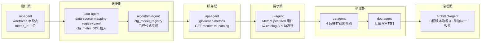

# 数据血缘规约（Data Lineage Policy）

> **作用**：界面上每个统计指标都能向甲方/审计/团队**说清楚** ① 数据来源 ② 加工过程 ③ 业务口径 ④ 更新频率 ⑤ 口径版本
> **强制等级**：**P0 铁律**（与 D8 设计规范并列，由甲方评审场景反推确立）
> **读者**：全体 agent + 全体人员
> **创建**：2026-06-17（DS-25 软科学成果展示试点过程中，PM 据甲方评审要求建立）
> **维护**：架构师 lead + 数据 lead + PM
> **关联**：
> - `数据库设计.md`（标准表 DDL 与 ADS 契约）
> - `architecture-baseline.md` 方案 A（共享聚合核心 + Java 不写算法 / 不直连 nGQL）
> - `Design.md` §7 通用组件 + §13 推荐实现映射（MetricSpecCard / DataLineageDrawer / MockBadge / **PendingBadge** 四组件作为业务扩展层组件，工程实现层引用 Arco `Card` / `Drawer` / `Tag` / `Popover`）
> - `scope-baseline.yaml`（功能点 ±10%）
> - `acceptance-compliance-policy.md`（验收政策）
>
> **🆕 数据真源位置（2026-06-17 起，甲方提供的三方采购数据「要素库」）**：
>
> | 文件 | 作用 | 谁必读 |
> |------|------|--------|
> | `agent-delivery/data/third-party-source/ODS源数据表结构清单(v2).md` | 186 张 ODS 表 / 2253 字段总览（按数据域分组） | data-agent / ux-agent / algorithm-agent / api-agent |
> | `agent-delivery/data/third-party-source/gkx-mysql-raw/gkx_schema_ddl.sql（旧要素库SQL已删；现用三方DDL沙箱）` | 精确 DDL（utf8mb4 + 字段注释 + 值域） | data-agent / api-agent |
> | `agent-delivery/data/GDF/Mapping/企业/企业相关-ODS到DWD字段映射分析报告(v2).md` | 企业要素 ODS→DWD 字段映射示范 | data-agent / 数据 lead |
> | `agent-delivery/data/GDF/Mapping/政策/政策相关-ODS到DWD字段映射分析报告(v2).md` | 政策要素 ODS→DWD 字段映射示范（含"映射状态图例"） | data-agent / 数据 lead |
> | `agent-delivery/data/DS-25-data-availability-matrix.md` | DS-25 软科学 7 子功能 ↔ ODS 真实字段精确映射（试点专用） | **ux-agent / ui-agent / data-agent / algorithm-agent**（DS-25 试点必读） |
>
> **核心结论**：DS-25 等多数 DS 子功能**不再是纯 Mock**，可基于真实 ODS 表设计字段、metric_id 的 source_tables 必须引用真实表名（如 `dwd_zh_project.title`），未来切真实数据时前端代码零改动。

---

## 1. 为什么要做（why）

科技数据可视化项目**评审与审计场景**反复出现的问题：

| 反模式 | 后果 |
|--------|------|
| 数字光秃秃显示，甲方问"哪来的" → 团队凭记忆答 | 信任崩塌 + 反复返工 |
| 不同界面同名指标口径不一致 | 数据打架 + 责任甩锅 |
| Mock 与真实数据混用，UI 上无标识 | 决策失误 + 合规风险 |
| 算法/口径迭代后界面没同步 | 业务方误用旧数据 |

**业界最佳实践（金融大屏 / 政务大屏 / 商业 BI）**：

> 每个统计指标都是有"身份证"的实体，UI 字段是它的展示形态。任何人在任何时候点开 ⓘ 都能看到它**完整的来世今生**。

---

## 2. 8 件套元数据（每个指标必须有）

| # | 字段 | 内容 | 类型 | 谁负责拍板 | 谁负责录入 |
|---|------|------|------|----------|----------|
| 1 | `metric_id` | 全局唯一 ID，遵循 §3 命名规则 | string | architect-agent | data-agent |
| 2 | `metric_name_zh` | 中文名（口径正式称谓，与 bid 文本一致） | string | 数据 lead | data-agent |
| 3 | `definition` | 业务口径定义（≥50 字，含**统计窗口**、**对象范围**、**去重逻辑**、**特殊情况**） | text | **数据 lead 拍板**（不可外包给 AI） | data-agent 起草 |
| 4 | `formula` | 可执行计算公式（SQL 片段或算法伪代码 + 关键参数） | text | 算法 lead 评审 | algorithm-agent 起草 |
| 5 | `source_tables[]` | 源表清单（ADS↔DWS↔DWD↔ODS 完整血缘链） | list | 数据 lead 评审 | data-agent |
| 6 | `source_systems[]` | 数据来源系统（如`深圳市科技厅项目库`/`Mock @ batch=mock_20260617`/`三方爬虫`） | list | PM + 数据 lead | data-agent |
| 7 | `update_freq` | 更新频率：`realtime / hourly / daily / weekly / monthly / quarterly / yearly / static` | enum | 数据 lead | data-agent |
| 8 | `version` | 口径版本：`major.minor.patch`（口径变更要 bump） | semver | architect-agent | data-agent |

**额外推荐字段（不强制但建议有）**：

| 字段 | 内容 | 用途 |
|------|------|------|
| `owner_human` | 业务/数据负责人（人名） | 评审时甲方对接 |
| `owner_agent` | 负责注册维护的 agent | retro / 自动化 |
| `is_mock` | 是否 Mock 数据 | UI 显示 🧪 标签 |
| `mock_until` | Mock 切真实数据预计时间 | 给甲方时间表 |
| `quality_rules[]` | 数据质量规则（非空率、值域、唯一性） | qa-agent / 数据契约 |
| `governance_tags[]` | 治理标签（敏感 / 脱敏 / 公开） | 安全合规 |
| `bid_ref` | bid-reference MD 章节号 | 范围合规追溯 |
| `acceptance_unit_id` | acceptance-catalog 的 DS-XX | 验收追溯 |
| `mapping_status` | 贴源状态：`✅` 有源 / `🟡` 部分有源或临时默认 / `❌` 无源 | METRIC-OPEN / cfg_metric / UI 角标 |
| `pending_ref` | 未闭合开放项编号（`Q0xx` 或 `GAP-*`），关联 `客户决策清单跟踪表.md` | ⚠️ PendingBadge |
| `pending_hint` | **数据缺口说明**长文案（建议 **≥80 字**，含 ODS/DWD 表名、缺失字段、Mock 说明）；供 Popover 展示 | ⚠️ PendingBadge Popover |
| `wave0_behavior` | Wave 0 降级行为：`mock` / `empty` / `exclude_from_score` | 算法 / FE 对齐 |

> **`data-gap-catalog.yaml`**（路径：`agent-handoffs/产品整体定义/{模块}/data-gap-catalog.yaml`）为 METRIC-OPEN 阶段 **贴源缺口 UI 文案真源**；由 data-agent 维护，FE 只读消费。详见 §5.1.4、`产品定义评审规程.md` §3.2。

---

## 3. metric_id 命名规则

### 3.1 总体格式

```
M_{ELEMENT}_{INDICATOR}_{PERIOD?}_{VARIANT?}
```

### 3.2 各段含义

| 段 | 含义 | 取值 |
|----|------|------|
| `M_` | 固定前缀，标识 metric | `M_` |
| `ELEMENT` | 业务要素（用**字母助记码**，见下表） | `ENT`/`CHAIN`/`ORG`/`TECH`/`TALENT`/`SVC`/`POLICY`/`SS`/`IC`/`INNOV`/`COMMON` |

#### 3.2.1 七要素助记代号表（v1.1.0 起，Q009 决策 2026-06-18 人类架构师/PM 会签）

| 要素 | 助记码（现行） | 废弃别名 | 含义 |
|------|---------------|---------|------|
| 企业 | `ENT` | `E1` | enterprise |
| 产业链 | `CHAIN` | `E2` | industry chain |
| 机构（科研机构） | `ORG` | `E3` | research org |
| 技术 | `TECH` | `E4` | technology |
| 人才 | `TALENT` | `E5` | talent |
| 服务（服务机构） | `SVC` | `E6` | service |
| 政策 | `POLICY` | `E7` | policy |
| 软科学 | `SS` | — | soft science |
| 创新生态 | `IC` | — | innovation ecology |
| 创新监测 | `INNOV` | — | innovation monitor |
| 通用 | `COMMON` | — | common |

> **决策背景**：原 §3.2 企业用数字制 `E1`，但软科学/创新生态/创新监测/通用已是字母助记码。为统一风格、提升可读性与评审追溯性，将 7 要素统一改为字母助记码，`E1~E7` 保留为**废弃别名**（旧引用不报错，但新指标一律用助记码）。企业域 49 条 `M_ENT_*` 种子无需改名。详见 `agent-handoffs/企业战略分析-ENT/ARCH-ENT-milestone-review.md`。
| `INDICATOR` | 指标主体（大写蛇形） | `TOPIC_NEW_COUNT` / `UNIT_CONTRIBUTION_RATE` / `REGIONAL_DENSITY` |
| `PERIOD` | 时间窗口（可选） | `D`/`W`/`M`/`Q`/`Y`/`YTD`/`TOTAL` |
| `VARIANT` | 变体（可选，仅用于同名不同口径） | `V1` / `STRICT` / `LOOSE` |

### 3.3 示例

| 业务场景 | metric_id |
|---------|-----------|
| 本季度软科学课题新增数 | `M_SS_TOPIC_NEW_COUNT_Q` |
| 软科学课题单位贡献率 | `M_SS_UNIT_CONTRIBUTION_RATE` |
| 政策颗粒度焦点指数 | `M_E7_POLICY_FOCUS_INDEX` |
| 全球创新事件日新增 | `M_INNOV_EVENT_NEW_COUNT_D` |
| 人才综合评分（严口径 v1） | `M_E5_TALENT_OVERALL_SCORE_V1_STRICT` |

### 3.4 禁止

- ❌ 中文 ID
- ❌ 小写、下划线开头、纯数字
- ❌ 业务名直接拼音（如 `M_KETIXIN`）
- ❌ 太短（< 4 段）或太长（> 6 段）
- ❌ 不同页面对同一指标用不同 metric_id（永远以"业务口径"而非"展示位置"命名）

---

## 4. 在哪里登记 / 维护



| 制品 | 路径 | Owner |
|------|------|-------|
| **设计期** wireframe 字段表 metric_id 列 | `demo2/docs/ia/sandbox/{topic}/{DS-id}-wireframe.md` | ux-agent |
| **数据期** 应用层标准表 + 字段血缘 README | `agent-delivery/数据库设计.md` + ODS/DWD/DWS/ADS 字段映射注释 | data-agent |
| **数据期** 数据源映射登记表 | `agent-delivery/data-source-mapping-registry.yaml` | data-agent |
| **数据期** cfg_metric 表 / 配置 | `gkx_dim/gkx_cfg` schema（DB） + `demo-algo-science` 初始化脚本 | data-agent + algorithm-agent |
| **服务期** /metrics/v1/catalog API | `lumen-svc-platform/gkxlumen-metrics` 模块（task P0-L02） | api-agent |
| **展示期** MetricSpecCard / DataLineageDrawer 组件 | `gkx_lumen_fronted_*/src/components/` + demo2 沙箱 | ui-agent / frontend-agent |
| **验收期** 链路核验 case | `验收文档/数据血缘-链路核验-{epic}.md` | qa-agent |
| **评审期** 数据血缘评审材料 | `验收文档/数据血缘-评审材料-{epic}.docx`（officecli） | doc-agent |
| **治理期** 口径版本 changelog | `agent-delivery/data-lineage-changelog.md` | architect-agent |

---

## 5. UI 表现规范（接入 D8 §9 通用组件清单）

### 5.1 必备新组件（建议补入 D8 §9）

#### 5.1.1 `MetricSpecCard`（数据说明卡）

- **触发**：UI 上每个统计数字旁的 ⓘ 图标 hover/点击
- **内容**：8 件套元数据中前 7 项（version 隐藏到副信息）
- **样式**：浅色蓝灰 + 8px 圆角；不深色霓虹
- **降级**：catalog API 失败时显示"数据说明加载中"，不阻塞主界面

#### 5.1.2 `DataLineageDrawer`（数据血缘抽屉）

- **触发**：MetricSpecCard 底部"查看完整加工链路"按钮
- **内容**：ODS → DWD → DWS → ADS 4 段血缘可视化 + 算法节点
- **可视化**：使用 G6 / mermaid 渲染
- **数据来源**：`/metrics/v1/lineage/{metric_id}`（gkxlumen-metrics 模块扩展）

#### 5.1.3 `MockBadge`（Mock 数据标识）

- **触发**：`is_mock=true` 时数字旁自动显示 🧪
- **tooltip**："当前为 Mock 数据，预计 {mock_until} 切换为真实数据源 {source_systems}"
- **强制**：所有 Wave 0 阶段沙箱页都必须显示

#### 5.1.4 `PendingBadge`（贴源缺口 / 待确认口径）

- **触发**：`mapping_status` 为 `🟡` 或 `❌`，或存在 `pending_ref` 时显示 ⚠️
- **短文案**（`pending_hint` ≤80 字）：`Tooltip` 展示摘要
- **长文案**（`pending_hint` >80 字）：`Popover` 标题 **「数据缺口说明」**，正文为 `pending_hint` 全文
- **必须关联**：`pending_ref`（`Q0xx` 或 `GAP-*`），与 `客户决策清单跟踪表.md` 一致
- **文案真源**：`{模块}/data-gap-catalog.yaml`（METRIC-OPEN 产出）；**禁止** FE 硬编码缺口说明
- **与 MockBadge 关系**：Mock 因无真源但口径已定 → 🧪；贴源不足或口径待甲方确认 → ⚠️；二者可同时存在

**`data-gap-catalog.yaml` 最低字段（每条 metric）**：

```yaml
metrics:
  - metric_id: M_ENT_XXX
    metric_name_zh: 示例指标
    mapping_status: "🟡"          # ✅ | 🟡 | ❌
    pending_ref: Q019             # 或 GAP-METRIC-BID-*
    pending_hint: |               # ≥80 字时 Popover「数据缺口说明」
      该需求已在需求清单中登记（开放项 Q019），但当前三方源……
    wave0_behavior: mock          # mock | empty | exclude_from_score
    source_tables: []             # 已核查的 ODS→DWD→ADS 链
    field_check: ""               # 缺失字段说明（可选，可并入 pending_hint）
```

### 5.2 字段表 6 列模板（wireframe / 详设标准）

| 名称 | 类型 | 来源 | 必填 | 示例 | metric_id |
|------|------|------|------|------|----------|
| 课题数量 | int | 聚合 | ✅ | 12 | `M_SS_TOPIC_NEW_COUNT_Q` |
| 单位贡献率 | float% | 聚合 | ✅ | 23.5% | `M_SS_UNIT_CONTRIBUTION_RATE` |
| 课题名称 | string | 明细 | ✅ | "区块链在政务中的应用研究" | —（明细字段不需要） |

> 末尾必须有 `## 本页 metric_id 清单` 小节，列出本页用到的所有 metric_id。

---

## 6. 评审现场答复 SOP

### 6.1 标准 3 步答

甲方质疑某个数字时，**永远按 3 步答**：

1. **点 ⓘ 给看数据说明卡**（口径 + 数据源 + 更新频率）
2. **点"完整加工链路"给看血缘图**（ODS→DWD→DWS→ADS + 算法节点）
3. **如还有疑问，对照 cfg_metric 中的 `definition` 原文逐字读**

### 6.2 Wave 0（Mock 阶段）特殊话术

> "本期界面数据为 Mock，目的是验证 ① 字段层 ② 信息架构 ③ 用户交互 是否符合您的需求。每个统计指标已分配 metric_id 并预登记到 `cfg_metric` 表，待 Wave 1 数据工厂接入真实三方源后，**前端代码零改动**即可切换。届时您在每个数字旁点 ⓘ 都能看到：业务口径 / 计算公式 / 数据源系统 / 完整 ETL 链路 / 更新频率 / 口径版本。"

### 6.3 不允许的答复

| 不允许 | 原因 |
|--------|------|
| "这个是后端给的数" | 责任甩锅 + 不专业 |
| "应该是从XX系统来的吧" | 不精确 + 没追溯依据 |
| "我们回去查一下再答复" | 表明评审准备不足 |
| "口径我们再讨论" | 评审现场出现 = 团队内部没对齐 |

### 6.4 兜底话术库

PM 评审现场带在手上的话术，见 `agent-delivery/agent-handoffs/软科学成果展示-DS25/PILOT-DS-25-client-fallback-script.md`。

---

## 7. 各 agent 的责任与硬约束

### 7.1 ux-agent

- ✅ wireframe 字段表必须 6 列（含 metric_id）
- ✅ 统计字段必填 metric_id（即使是占位）
- ✅ 每页末尾必给 `本页 metric_id 清单`
- ❌ 不擅自决定指标口径（口径决策永远是人）
- ❌ 不擅自决定数据源（数据源决策由 PM + 数据 lead）

### 7.2 data-agent

- ✅ 维护 `cfg_metric` 表 / 初始化脚本
- ✅ 维护 `data-source-mapping-registry.yaml`
- ✅ 每个 metric_id 8 件套完整
- ✅ ODS→DWD→DWS→ADS 各层都有字段血缘 README
- ❌ Mock 与真实数据混用（必须用 `calc_batch_id` 前缀 `mock_` 区分）
- ❌ 同名指标允许两套口径（必须用 VARIANT 区分）

### 7.3 algorithm-agent

- ✅ 维护 `cfg_model_registry`
- ✅ 实现 `formula` 字段中描述的算法
- ✅ 算法版本号与 metric 版本号联动
- ❌ 在 Java 仓写算法（铁律 1）
- ❌ 引入 metric 但不注册到 cfg_metric

### 7.4 api-agent

- ✅ `gkxlumen-metrics` 模块暴露 `/metrics/v1/catalog?ids=...`
- ✅ 扩展 `/metrics/v1/lineage/{metric_id}` 返回血缘图
- ✅ 字段命名与 metric_id 一致（驼峰转换或保留蛇形）
- ❌ 在 Java 写指标计算逻辑（铁律 1）
- ❌ 直连 ADS 之外的库（铁律 7）

### 7.5 ui-agent / frontend-agent

- ✅ 实现 `MetricSpecCard` / `DataLineageDrawer` / `MockBadge` 三个新组件
- ✅ 每个统计数字旁必有 ⓘ
- ✅ Wave 0 阶段所有数字必有 🧪 标识
- ✅ 从 `/metrics/v1/catalog` 动态读元数据（不硬编码）
- ❌ 硬编码"数据说明"到组件代码中
- ❌ 删除 / 隐藏 ⓘ 让界面"更干净"

### 7.6 qa-agent

- ✅ 每个 epic 末尾对**至少 5 个 metric_id 抽样**做 4 段链路核验：UI 显示值 → API 返回值 → ADS 表查询值 → DWD 加工值 → ODS 源系统值
- ✅ 抽样结果写入 `验收文档/数据血缘-链路核验-{epic}.md`
- ❌ 跳过链路核验（即使时间紧）

### 7.7 doc-agent

- ✅ 评审前从 cfg_metric + handoffs 汇编"数据血缘评审材料 docx"
- ✅ 用 officecli MCP 生成（不手编 XML）
- ✅ 每个指标一个章节（含 8 件套 + UI 截图 + 链路图）

### 7.8 architect-agent

- ✅ Epic 开工评审：metric_id 命名、口径冲突、版本管理
- ✅ 里程碑评审：cfg_metric 完整性、ODS→DWD→DWS→ADS 血缘链是否断裂
- ✅ 维护 `data-lineage-changelog.md`（口径变更全量历史）

### 7.9 coordinator-agent

- ✅ 派单时检查任务输入是否含 metric_id 清单
- ✅ Handoff 验收时检查 8 件套是否齐全
- ❌ 派单到下游时丢失上游 metric_id 清单

### 7.10 integration-agent

- ✅ 网关路由 `/metrics/v1/**` 配置正确
- ✅ 与 SSO 联动：敏感指标按角色脱敏（governance_tags）

---

## 8. 与现有制品的关系

| 现有制品 | 关系 | 是否需要扩展 |
|---------|------|-----------|
| `cfg_metric`（指标注册中心） | **核心载体**，本规约的物理实现 | ✅ 字段对齐 8 件套 |
| `cfg_model_registry`（模型注册中心） | 与 cfg_metric 关联（一个 metric 可引用多个 model） | ✅ 增加 metric_id 外键 |
| `data-source-mapping-registry.yaml` | 数据源映射的人类可读载体 | ✅ 增加 metric_id 列 |
| `gkxlumen-metrics` Java 模块（task P0-L02） | 暴露 metric 元数据 API | ✅ 扩展 /catalog + /lineage |
| `数据库设计.md §2~§12` | ADS / 标准表 DDL | ✅ 每张 ADS 表的字段注释关联 metric_id |
| `D8 设计规范 §9 组件清单` | 通用组件 | ✅ 增加 MetricSpecCard / DataLineageDrawer / MockBadge |
| `D8 §18 验收清单 18 条` | 验收 | ✅ 增加第 19 条"每个统计数字可追溯" |
| `acceptance-catalog/` | 验收功能点目录 | ✅ 每个 DS-XX 引用 metric_id 清单 |
| `scope-baseline.yaml ±10%` | 范围铁律 | 中性（增减 metric 不计入功能点±10%，但需 PM 批准） |

---

## 9. 实施路线图（与 wave 对齐）

### Wave 0（当前）

- [ ] **本规约（data-lineage-policy.md）落盘**（now）
- [ ] **DS-25 wireframe 试点应用**（即将由 ux-agent 跑）
- [ ] data-agent 把 cfg_metric 加入 P0-L01 DDL（**追加 task**）
- [ ] api-agent 把 /metrics/v1/catalog 扩展到含 8 件套（**P0-L02 DoD 升级**）
- [ ] ui-agent 在 DS-25 沙箱页实现 MetricSpecCard / MockBadge（**Step 2 派单话术追加**）
- [ ] D8 §9 / §18 / §20 升级（**architect-agent 评审后入库**）

### Wave 1（E7 政策）

- [ ] 全部 E7 政策指标 8 件套完整登记
- [ ] /metrics/v1/lineage/{metric_id} 上线
- [ ] DataLineageDrawer 上线
- [ ] qa-agent 4 段链路核验首次跑通
- [ ] doc-agent 评审 docx 首次生成

### Wave 2+

- [ ] data-agent 接入真实三方源后，Mock → 真实数据切换（cfg_degrade_switch）
- [ ] MockBadge 自动消失
- [ ] 7 要素全部 metric_id 注册完毕

---

## 10. retro 与版本

- v1.0.0 (2026-06-17) — 初版（PM 据 DS-25 试点甲方评审反馈建立）
- v1.1.0 (2026-06-18) — §3.2 七要素代号统一为字母助记码（`ENT/CHAIN/ORG/TECH/TALENT/SVC/POLICY` + SS/IC/INNOV/COMMON），`E1~E7` 降为废弃别名。来源：Q009 企业域命名冲突，architect-agent 建议方案 B，人类架构师/PM 2026-06-18 会签。影响：企业域 49 条 `M_ENT_*` 种子无需改名。
- 后续重大变更：架构师 + 数据 lead + PM 三签，bump major
- 仅文案调整：bump patch，doc-agent 自动同步评审材料模板

---

## 11. FAQ

### Q1: Mock 阶段 metric_id 也要登记吗？

✅ **要**。Mock 是占位，规约要求"前端代码零改动切真实"，所以 metric_id 必须**从 wireframe 阶段就开始登记**。

### Q2: 一个指标多个页面用到，要登记几次？

❌ **只登记 1 次**（cfg_metric 中唯一）。各页面 wireframe 引用同一个 metric_id 即可。

### Q3: 我（人）不知道某个数据来源怎么办？

✅ wireframe 中 `source_systems` 字段写 `pending_data_lead_review`，handoff 中标记为"待 PM + 数据 lead 决策"。**不要乱填**。

### Q4: 评审时甲方提出新指标怎么办？

1. 评审现场**不答应**
2. 在 `data-source-mapping-registry.yaml` 加 `pending_client` 标记
3. retro 时 PM + 数据 lead 评审是否纳入（涉及 ±10% 范围铁律）
4. 通过后 → data-agent 注册 metric_id → 顺序进入设计期

### Q5: 显然 Mock 的"假数据"也要写 source_systems？

✅ **要**。写 `Mock @ batch=mock_20260617_seed42`，便于甲方理解"这是设计期的占位"，而非"我们没想清楚"。

---

**本规约直接影响项目专业可信度，必须从 DS-25 试点开始 100% 执行。**

---

## 12. 版本记录

| 版本 | 日期 | 变更 | 作者 |
|------|------|------|------|
| v1.0 | 2026-06-17 | 初版：8 件套 + MetricSpecCard / MockBadge | PM |
| **v1.1** | 2026-07-20 | **PendingBadge + data-gap-catalog**：`mapping_status` / `pending_hint` 字段；METRIC-OPEN 文案真源；Popover「数据缺口说明」（对齐 `产品定义评审规程.md` v2.5） | human:淮政玮 |
