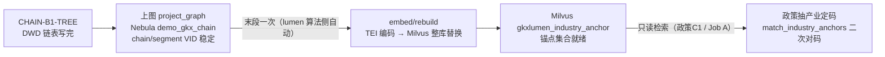

# 12 — DWD 后加工：产业链入向量库（CHAIN-B4-VEC-REBUILD）

> **读者**：GDF 数据中台产线。本文件描述"产业链入向量库"这一环节在 GDF 侧的**触发条件、执行方式、验收口径与禁止事项**。  
> **版本**：v2.2 修订（2026-11-02，round2 问 8~13 答复）：图空间名与接口契约标注**待架构师确认（round2 补）**；`demo_gkx_chain` 为占位名，禁止按此建空间。环境红线见 `23-核对签收与答复.md` §1（GDF 禁读 demo 库）。  
> **为什么要有这一步**：产业链洗数（Wave B）只是把链树写进 DWD。下游"政策抽取产业"（政策派单包 `12` 的 POLICY-C1）检索的锚点集合，要等**本环节执行后才有内容**。锚点为空时政策 C1 对不上链码、只记 `no_match`——这是**设计内行为**，不是故障。

---

## 0. 一句话

**链表洗完 → 上图 VID 稳定 → 整库一次 rebuild。映射过程逐行 embed、政策重灌调 rebuild，都是禁止的。**

### 与算法中台按钮的关系（背景）

你在 demo 算法中台看到的**「产业链入向量库 → 写入向量库」按钮**（`demo-ui-system-test` `/chain/vector`），底层就是这个动作的手动触发版：`demo-svc-platform /v1/industry/internal/embed-load` → entan-py `/internal/industry/embed/load` → 读 DWD 链/环节名 → TEI 编码 → 整库替换 `gkxlumen_industry_anchor`。

正式管线（本派单包对应的）把"手动点按钮"变成"**上图成功后自动跟一次**"（`lumen-algo-py` `project_graph` 末段 `_hook_industry_index`，全库唯一 rebuild 调用点）。两条路径动作相同、目标集合相同，**不会互相覆盖出问题**——rebuild 本身就是整库替换语义，谁最后执行谁生效，且都要求点稳定才执行。

---

## 1. GDF 侧定位：触发与等待，不是实现

**rebuild 的实现不在 GDF。** 写向量由我方算法服务完成（`lumen-algo-py` 灌链末段 `_hook_industry_index` 自动触发；运维也可手动打 `POST /internal/industry/embed/rebuild`，是同一条整库重建）。GDF 侧要做的是：

> ⚠️ **round2 问 8~13 待办（2026-11-02）**：上图接口（方法/路径/请求/响应含写入点数）、rebuild 请求/响应体、`index_version` 字段名、「点数稳定」判定规则、正式图空间名——**五项已提交架构师确认，round2 随本文件修订补齐**。确认前 GDF 不需要也不得按占位名施工。

| GDF 职责 | 说明 |
|---|---|
| **顺序保证** | 每日批内：Wave B（B1 链树）`success` → 上图完成且点数稳定 → 才轮到向量 rebuild。rebuild 失败**不回滚**已成功的 B1/上图 |
| **不抢跑** | 链表未写完、或上图未完成时，**不请求** rebuild（未就绪返回 501/degraded，不给假索引） |
| **不旁路** | **建库写入（rebuild）GDF 不执行**：调用面只有我方算法侧（lumen 灌链末段自动 + 运维手动 `/internal/industry/embed/rebuild`）。GDF 节点上**没有写向量库的脚本与凭据**。政策 C1 脚本按政策包 `12` 在 GDF 节点配置 `MILVUS_URI` / `EMBED_BASE_URL` 属**只读检索**消费切面，与本环节（建库）不冲突 |
| **回执带索引版本** | 当日回执注明 `industry_index_version`（rebuild 成功后的版本号；**跳过时诚实写 `skip`，不写数字**——此条已定） |

> 与**政策派单包** `GDF-POLICY-WORKPACK-v2/15-GDF触发调度与回执.md` 的关系：本环节**排在 Wave B 之后**、与其他后加工并列；失败语义同政策包 C 系——只记本环节，不回滚 B，不连带其他作业失败。

---

## 2. 触发条件（全部满足才发生）

| # | 条件 | 检查方式 |
|---|---|---|
| 1 | Wave B `CHAIN-B1-TREE` 当日 `success`（`industry_chain` / `industry_chain_node` 有当日批次数据） | ETL 调度状态 |
| 2 | 上图（`project_graph` → Nebula `demo_gkx_chain`）完成且 chain/segment 点数**稳定** | 上图回执；点数不稳定时 rebuild **跳过**，保留上一版索引（`index_version` 不变，诚实记 skip） |
| 3 | 由我方算法侧在灌链末段自动执行；GDF 无需（也不得）自行发起 | — |

**每日节奏**：凌晨灌链批：Wave B → 上图 → rebuild（串行）。下游 Job A（= 政策包 `12` POLICY-C1 语义抽槽在 CROSS-VEC 语境的称呼）排在 rebuild **之后**且串行——rebuild 的 drop+create 窗口内 search 返 `degraded=true`，不给假 VID，所以**禁止并排**。

---

## 3. 物理口径（引用，不在 GDF 配置）

| 项 | 口径 |
|---|---|
| 向量库 | 现网 Milvus 2.4 standalone `10.50.69.111:19530`（**没进 K8s**）。不采购第二套向量云 |
| collection | `gkxlumen_industry_anchor`（前缀必须下划线 `gkxlumen_industry_`；连字符名 Milvus 硬校验拒绝 `code 1100`）。**禁止**读写/drop `amcpdp-*` 等他人集合 |
| embedding | `bge-base-zh-v1.5`，dim 768，COSINE。集群内 `http://gkxlumen-embed-tei:8080/v1/embeddings`。GDF 代理机 `EMBED_BASE_URL=http://10.50.69.111:30903`（Service `gkxlumen-embed-tei-nodeport`，脚本自行补 `/v1/embeddings`） |
| 词表 | DWD `industry_chain`（链名）+ `industry_chain_node`（环节名），当前约 1,516 点（102 chain + 1414 segment）。**词表真源 = DWD 链表 + 图**，禁止另建第二份产业 embedding |
| VID | 只用图上链码（`chain:INB*` / `segment:INB*`），与上图 VID 同码。ODS 短码 / 中文名不得当 VID |
| 锚点别名 | 链名/环节名按"与/和/、//"拆词生成别名（≥3 字），环节额外挂父链名——检索命中靠这些文本，定码仍走 VID |

---

## 4. 禁止事项（硬闸，违反=返工）

| # | 禁止 | 原因 |
|---|---|---|
| 1 | **映射/Wave B 过程中逐行 embed** | 锚点词表 = 图上稳定点。边洗边嵌会产生半成品索引；正确做法是整库一次 rebuild |
| 2 | **政策/企业重灌同步调 rebuild** | 消费切面 ≠ 建库切面。政策重灌只读 L0+L1，不碰 Milvus/LLM |
| 3 | **把向量分数写成 `industry_link_code` / `chain:INB*`** | 向量分只表示"像不像"；政策 C1 拿 top-k 候选后还要过 `match_industry_anchors` 二次对码（名称须在政策文本中命中，环节优先于链），禁止采 top1 直写。分 ≥0.55 写入、≥0.45 且名称出现在切块里也写入，其余 `no_match` 不插空链码行 |
| 4 | **GDF 执行向量库写入（rebuild / drop / create / insert）** | 建库调用面只有我方 Python `/internal/*`（lumen 灌链末段自动 + 运维手动）。GDF 节点按政策包 `12` 配置的 `MILVUS_URI` 仅用于政策 C1 **只读检索**，不得调 rebuild、不得 drop/create 集合 |
| 5 | **rebuild 失败后伪造 `index_version` 或拿旧索引冒充新索引** | 失败跳过时保留上一版并诚实记录；引擎不可用 `degraded=true` 时不给半可信候选（Python 侧 HTTP 503 / Java 门面未就绪 501） |
| 6 | **Job A 与灌链 rebuild 并排跑** | drop+create 秒级窗口内 search 返 `code≠0`；两步必须串行（先 rebuild 后 Job A） |

---

## 5. 验收与回执口径

| 检查项 | 期望 |
|---|---|
| rebuild 触发次数 | 每日批**至多一次**；由灌链末段自动触发，多余的手动 rebuild 属异常（运维手动重建除外，需登记） |
| 回执字段 | `industry_index_version`（成功=版本号字符串；跳过=字面 `skip`，禁止空着或编造） |
| 失败语义 | rebuild 失败/跳过：**不回滚** B1/上图，当日政策 C1 若因锚点缺失大量 `no_match` 属预期（设计内空态），次日锚点就绪后政策重跑补上 |
| 抽样验证 | rebuild 成功后，以一条已知链名（如"集成电路"）做检索自检，top 候选应含该链/其节点（我方算法侧自检，GDF 不执行但回执需注明本环节状态） |

---

## 6. 与其他文件的关系

| 文件 | 关系 |
|---|---|
| `09-产业链域-ETL-Mapping明细` | 09 只管 DWD 洗数；本环节是 B 之后**独立**的后加工，不进 09 字段矩阵 |
| 政策派单包 `12-DWD后加工-抽取产业与条款结构化` | 其 C1 检索的锚点集合 = 本环节产物。本环节未执行 → 政策 C1 `no_match`（设计内空态）。政策 C1 **不依赖**本环节"当天必须成功"，只依赖"集合最终有内容" |
| `15-GDF触发调度与回执`（政策包 `GDF-POLICY-WORKPACK-v2/15`） | 本环节纳入每日批调度顺序：Wave B → 上图 → **rebuild** → Job A（串行） |
| CROSS-VEC 总控 §0 | #2 建库切面 / #3 消费切面 / #16 前缀守卫 / #17 禁 top1 定码 / #19 Job A 互斥——本文件第 4 节即其派单包投影 |

---

## 7. 版本

| 版本 | 日期 | 变更 |
|---|---|---|
| v2.1 | 2026-10-31 | 新增本文件（架构师要求：产业入向量库入派单包；政策的抽产业依赖产业入库）。口径全部引用 §9 / CROSS-VEC，无新决策 |
